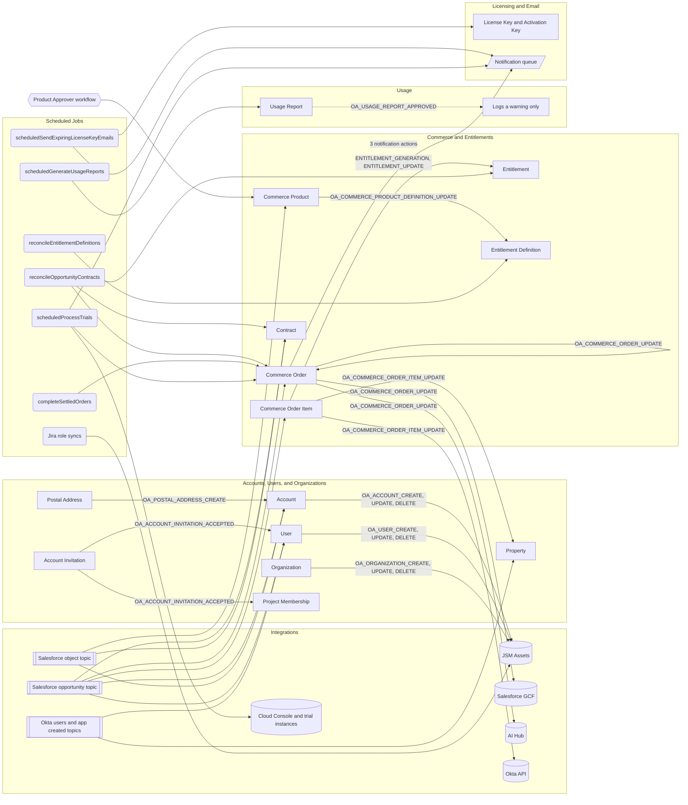

# Event and Job Inventory

This file lists everything that changes data in Liferay One without a user click: object actions, scheduled jobs, startup listeners, Pub/Sub subscribers, notification templates, and the Liferay workflow. It also records an audit of that inventory on 2026-10-16.

The code is the source of truth. The object actions come from `client-extensions/liferay-one-batch/batch/02-system-object-field.batch-engine-data.json`, `client-extensions/liferay-one-batch/batch/03-object-definition.batch-engine-data.json`, `client-extensions/liferay-one-site-initializer/site-initializer/object-actions/`, and the `notification-template.object-actions.json` files under `client-extensions/liferay-one-site-initializer/site-initializer/notification-templates/`. The handlers come from `client-extensions/liferay-one-etc-spring-boot/client-extension.yaml` and the Java source of that client extension.

A script generated the tables on 2026-10-16. The script reads the trees above and extracts every trigger, condition, executor, CET, resource path, controller, cron expression, property default, guard, subscription key, template reference, and line number. The Reads, Writes, and Idempotent columns come from a map in the same script that a person wrote from the handler code. The script stops when an extracted item has no entry in that map, or when the map names an item that is gone. When this file and the code disagree, the code is correct.

In the tables, `…/one/` stands for `client-extensions/liferay-one-etc-spring-boot/src/main/java/com/liferay/one/`.

[`object-model.md`](./object-model.md) describes the objects that these handlers read and write. [`integrations/`](./integrations/) describes the external systems.

## Summary

| Count | Item |
| --- | --- |
| 26 | Object actions in the trees |
| 17 | Object actions that call a function CET |
| 9 | Object actions that send a notification |
| 0 | Object actions whose CET or controller does not exist in this workspace |
| 17 | `objectAction` CETs in `client-extensions/liferay-one-etc-spring-boot/client-extension.yaml` |
| 17 | `/object/action/*` controllers |
| 15 | `@Scheduled` jobs in 13 files |
| 7 | Startup listeners (`ApplicationReadyEvent`) |
| 6 | Pub/Sub subscribers |
| 31 | Notification templates, of which 11 have no sender in the code |
| 1 | Liferay workflow definition (`Product Approver`) |
| 0 | Distributed locks (no ShedLock or database lock) |

## How the Events Run

Liferay fires an object action after the transaction that changed the entry commits. A `function#<cet>` executor sends the entry to the `resourcePath` of that CET on `liferay-one-etc-spring-boot`. A `notification` executor queues an email from a notification template. The trees set no retry for an object action. "Idempotent on Retry" below means: is a second delivery or a second trigger for the same entry safe?

The Spring Boot client extension also runs work on its own:

1. 15 `@Scheduled` jobs run on a pool of 10 threads (`spring.task.scheduling.pool.size=10` in `client-extensions/liferay-one-etc-spring-boot/src/main/resources/application-default.properties:156`). Spring does not start a cron job again while the previous run of that job continues, but different jobs run at the same time.

1. 7 listeners run when the application is ready. 5 of them start the same work as a cron job, so a restart runs that work at once.

1. 6 Pub/Sub subscribers read Salesforce and Okta messages. Each subscriber starts only when its `enabled` property is `true`.

No code takes a distributed lock. Every guard is an in memory `AtomicBoolean`, an in memory set of order IDs, or an in memory `KeyedLock`. `client-extensions/liferay-one-etc-spring-boot/LCP.json:30` sets `"scale": 1`, so one pod usually runs. During a rolling deploy, two pods run at the same time and neither guard sees the other.

## Diagram

The diagram shows what starts each handler and what the handler writes, grouped by domain. A solid line is a write. A labeled line is an object action. The dotted line is an action whose handler writes nothing.

## Object Actions

| Object | Action (ERC) | Trigger | Condition | Executor | Handler Chain | Handler Method | Reads | Writes | Idempotent on Retry | Defined In |
| --- | --- | --- | --- | --- | --- | --- | --- | --- | --- | --- |
| `C_ACCOUNT_INVITATION` | AccountInvitationAccepted (`OA_ACCOUNT_INVITATION_ACCEPTED`) | `onAfterUpdate` | `oldValue('accepted') == FALSE AND accepted == TRUE` | objectAction CET | `liferay-one-etc-spring-boot-object-action-account-invitation-accepted` (`client-extensions/liferay-one-etc-spring-boot/client-extension.yaml:69`) → `/object/action/account/invitation/accepted` → `ObjectActionAccountInvitationAcceptedRestController` (`…/one/ObjectActionAccountInvitationAcceptedRestController.java:30`) | `post` → `AccountInvitationAcceptanceService.provisionAccountInvitation` | Account Invitation, account roles, project contact roles, Account, Project | User (when no user has the email address), account membership, account roles, Project Membership, Okta activation, JSM membership | Yes. The user is found by email first and each Project Membership is checked first. | `client-extensions/liferay-one-batch/batch/03-object-definition.batch-engine-data.json:30` |
| `C_DXP_FREE_ACTIVATION_KEY_REQUEST` | DXPFreeEmail (`MKT-DXP-FREE-EMAIL`) | `onAfterAdd` | None | notification | Template `MARKETPLACE-ACTION-DXP-FREE-EMAIL-TEMPLATE` (`client-extensions/liferay-one-site-initializer/site-initializer/notification-templates/dxp-free-next-steps-template/notification-template.json`) | Liferay notification executor | The entry that fired the action | One notification queue entry (email) | No. Each run queues one more email. | `client-extensions/liferay-one-site-initializer/site-initializer/notification-templates/dxp-free-next-steps-template/notification-template.object-actions.json:4` |
| `C_GET_APP_INFORMATION` | CloudEmailMarketPlace (`MKT-CLOUD-EMAIL`) | `onAfterAdd` | `productType == "cloud"` | notification | Template `MARKETPLACE-ACTION-CLOUD-EMAIL-TEMPLATE` (`client-extensions/liferay-one-site-initializer/site-initializer/notification-templates/cloud-next-steps-template/notification-template.json`) | Liferay notification executor | The entry that fired the action | One notification queue entry (email) | No. Each run queues one more email. | `client-extensions/liferay-one-site-initializer/site-initializer/notification-templates/cloud-next-steps-template/notification-template.object-actions.json:5` |
| `C_GET_APP_INFORMATION` | DXPFreeEmailMarketPlace (`MKT-DXP-FREE-EMAIL`) | `onAfterAdd` | `priceModel == "free" AND productType == "dxp"` | notification | Template `MARKETPLACE-ACTION-DXP-FREE-EMAIL-TEMPLATE` (`client-extensions/liferay-one-site-initializer/site-initializer/notification-templates/dxp-free-next-steps-template/notification-template.json`) | Liferay notification executor | The entry that fired the action | One notification queue entry (email) | No. Each run queues one more email. | `client-extensions/liferay-one-site-initializer/site-initializer/notification-templates/next-steps-template-free/notification-template.object-actions.json:5` |
| `C_PUBLISHER_ACCOUNT_REQUEST` | PublisherAccountRequestEmailOne (`ONE-PUBLISHER-ACCOUNT-REQUEST-EMAIL`) | `onAfterAdd` | None | notification | Template `MARKETPLACE-ACTION-PUBLISHER-ACCOUNT-REQUEST-EMAIL-TEMPLATE` (`client-extensions/liferay-one-site-initializer/site-initializer/notification-templates/publisher-account-request/notification-template.json`) | Liferay notification executor | The entry that fired the action | One notification queue entry (email) | No. Each run queues one more email. | `client-extensions/liferay-one-site-initializer/site-initializer/notification-templates/publisher-account-request/notification-template.object-actions.json:5` |
| `C_TRIAL_EXTENSION_REQUEST` | extensionRequestEmail (`TRIAL-EXTENSION-REQUEST-EMAIL`) | `onAfterAdd` | `dueStatus != "autoApproved"` | notification | Template `TRIAL-EXTENSION-REQUEST` (`client-extensions/liferay-one-site-initializer/site-initializer/notification-templates/trial-extension-request/notification-template.json`) | Liferay notification executor | The entry that fired the action | One notification queue entry (email) | No. Each run queues one more email. | `client-extensions/liferay-one-site-initializer/site-initializer/notification-templates/trial-extension-request/notification-template.object-actions.json:5` |
| `C_TRIAL_EXTENSION_REQUEST` | adminExtensionResponse (`TRIAL-ADMIN-EXTENSION-RESPONSE-EMAIL`) | `onAfterUpdate` | `dueStatus == "approved" OR dueStatus == "rejected"` | notification | Template `TRIAL-ADMIN-EXTENSION-RESPONSE` (`client-extensions/liferay-one-site-initializer/site-initializer/notification-templates/trial-admin-extension-response/notification-template.json`) | Liferay notification executor | The entry that fired the action | One notification queue entry (email) | No. Each run queues one more email. | `client-extensions/liferay-one-site-initializer/site-initializer/notification-templates/trial-admin-extension-response/notification-template.object-actions.json:5` |
| `C_USAGE_REPORT` | UsageReportApproved (`OA_USAGE_REPORT_APPROVED`) | `onAfterUpdate` | None | objectAction CET | `liferay-one-etc-spring-boot-object-action-usage-report-approved` (`client-extensions/liferay-one-etc-spring-boot/client-extension.yaml:133`) → `/object/action/usage/report/approved` → `ObjectActionUsageReportApprovedRestController` (`…/one/ObjectActionUsageReportApprovedRestController.java:28`) | `post` | Usage Report | Nothing. A warning in the log says that the overage order is not created. | Yes. The handler writes nothing. | `client-extensions/liferay-one-batch/batch/03-object-definition.batch-engine-data.json:8070` |
| `L_ACCOUNT` | AccountCreate (`OA_ACCOUNT_CREATE`) | `onAfterAdd` | None | objectAction CET | `liferay-one-etc-spring-boot-object-action-account-create` (`client-extensions/liferay-one-etc-spring-boot/client-extension.yaml:59`) → `/object/action/account/create` → `ObjectActionAccountCreateRestController` (`…/one/ObjectActionAccountCreateRestController.java:32`) | `post` → `CommerceAccountCurrencyService.assignDefaultCurrency`, `AccountSynchronizer.syncAccount` | Account, its default billing Postal Address, the account channel currency | Commerce account currency (only when none is set); JSM Customer asset | Yes. The currency write skips an account that has one, and the JSM write is an upsert by external key. | `client-extensions/liferay-one-batch/batch/02-system-object-field.batch-engine-data.json:20` |
| `L_ACCOUNT` | AccountDelete (`OA_ACCOUNT_DELETE`) | `onAfterDelete` | None | objectAction CET | `liferay-one-etc-spring-boot-object-action-account-delete` (`client-extensions/liferay-one-etc-spring-boot/client-extension.yaml:64`) → `/object/action/account/delete` → `ObjectActionAccountDeleteRestController` (`…/one/ObjectActionAccountDeleteRestController.java:29`) | `post` → `AccountSynchronizer.deleteAccount` | The `modelAccountEntry` payload only | Deletes the JSM Customer asset | Yes. A delete by external key. | `client-extensions/liferay-one-batch/batch/02-system-object-field.batch-engine-data.json:40` |
| `L_ACCOUNT` | AccountUpdate (`OA_ACCOUNT_UPDATE`) | `onAfterUpdate` | None | objectAction CET | `liferay-one-etc-spring-boot-object-action-account-update` (`client-extensions/liferay-one-etc-spring-boot/client-extension.yaml:74`) → `/object/action/account/update` → `ObjectActionAccountUpdateRestController` (`…/one/ObjectActionAccountUpdateRestController.java:32`) | `post` → `CommerceAccountCurrencyService.assignDefaultCurrency`, `AccountSynchronizer.syncAccount` | Account, its default billing Postal Address, the account channel currency | Commerce account currency (only when none is set); JSM Customer asset | Yes. Same as `OA_ACCOUNT_CREATE`. It runs on every account update, including the updates that other handlers make. | `client-extensions/liferay-one-batch/batch/02-system-object-field.batch-engine-data.json:30` |
| `L_COMMERCE_ORDER` | DXPPaidOrTrialEmailMarketPlace (`MKT-DXP-PAID-OR-TRIAL-EMAIL`) | `onAfterAdd` | `paymentStatus == 0 AND total != 0 AND orderTypeExternalReferenceCode == "DXP_APP"` | notification | Template `MARKETPLACE-ACTION-DXP-PAID-OR-TRIAL-EMAIL-TEMPLATE` (`client-extensions/liferay-one-site-initializer/site-initializer/notification-templates/next-steps-template-paid-or-trial/notification-template.json`) | Liferay notification executor | The entry that fired the action | One notification queue entry (email) | No. Each run queues one more email. | `client-extensions/liferay-one-site-initializer/site-initializer/notification-templates/next-steps-template-paid-or-trial/notification-template.object-actions.json:5` |
| `L_COMMERCE_ORDER` | CommerceOrderUpdate (`OA_COMMERCE_ORDER_UPDATE`) | `onAfterUpdate` | None | objectAction CET | `liferay-one-etc-spring-boot-object-action-commerce-order-update` (`client-extensions/liferay-one-etc-spring-boot/client-extension.yaml:94`) → `/object/action/commerce/order/update` → `ObjectActionCommerceOrderUpdateRestController` (`…/one/ObjectActionCommerceOrderUpdateRestController.java:26`) | `post` → `EntitlementService.generateOrderEntitlements`, then `CommerceOrderService.dispatchOrderUpdate` | Order, its Order Items, Account, billing Postal Address, Project, Contract | For a completed order, the missing Entitlements of each order item; commerce account currency; for `AI_HUB`, a Salesforce opportunity, the order and order item ERCs, and order custom fields; for `SEO_STUDIO`, an AI Hub provision; for a settled completable order, status `PENDING` → `PROCESSING` → `COMPLETED` | Partly. Status checks and an in memory in flight set stop a second run. The Salesforce and AI Hub calls happen before the result is saved on the order, so a failure between the two repeats the external call. | `client-extensions/liferay-one-site-initializer/site-initializer/object-actions/commerce-order.object-actions.json:6` |
| `L_COMMERCE_ORDER` | trialNewTrialStarted (`TRIAL-ADMIN-NOTIFICATION-EMAIL`) | `onAfterUpdate` | `orderStatus == 1 AND orderTypeExternalReferenceCode == "SSA_SAAS"` | notification | Template `TRIAL-STARTED` (`client-extensions/liferay-one-site-initializer/site-initializer/notification-templates/trial-admin-notification/notification-template.json`) | Liferay notification executor | The entry that fired the action | One notification queue entry (email) | No. Each run queues one more email. | `client-extensions/liferay-one-site-initializer/site-initializer/notification-templates/trial-admin-notification/notification-template.object-actions.json:5` |
| `L_COMMERCE_ORDER` | trialOrderOnHold (`TRIAL-ORDER-ON-HOLD-EMAIL`) | `onAfterUpdate` | `orderStatus == 20 AND (orderTypeExternalReferenceCode == "SOLUTIONS7" OR orderTypeExternalReferenceCode == "SSA_SAAS")` | notification | Template `TRIAL-ON-HOLD-ORDER` (`client-extensions/liferay-one-site-initializer/site-initializer/notification-templates/trial-on-hold-order/notification-template.json`) | Liferay notification executor | The entry that fired the action | One notification queue entry (email) | No. Each run queues one more email. | `client-extensions/liferay-one-site-initializer/site-initializer/notification-templates/trial-on-hold-order/notification-template.object-actions.json:5` |
| `L_COMMERCE_ORDER_ITEM` | EntitlementGeneration (`OA_COMMERCE_ORDER_ITEM_ENTITLEMENT_GENERATION`) | `onAfterAdd` | None | objectAction CET | `liferay-one-etc-spring-boot-object-action-commerce-order-item-entitlement-generation` (`client-extensions/liferay-one-etc-spring-boot/client-extension.yaml:79`) → `/object/action/commerce/order/item/entitlement/generation` → `ObjectActionCommerceOrderItemEntitlementGenerationRestController` (`…/one/ObjectActionCommerceOrderItemEntitlementGenerationRestController.java:28`) | `post` → `EntitlementService.generateEntitlements` | Order Item, Order, active Entitlement Definitions for the SKU and product options | One Entitlement (`C_ENTITLEMENT`) for each matching definition, only when the order is completed | Yes. It skips the definitions that the item already has. The Entitlement ERC is `<orderItemId>-<definitionId>`, and `addEntitlement` checks for that pair first. | `client-extensions/liferay-one-batch/batch/02-system-object-field.batch-engine-data.json:62` |
| `L_COMMERCE_ORDER_ITEM` | EntitlementUpdate (`OA_COMMERCE_ORDER_ITEM_ENTITLEMENT_UPDATE`) | `onAfterUpdate` | None | objectAction CET | `liferay-one-etc-spring-boot-object-action-commerce-order-item-entitlement-update` (`client-extensions/liferay-one-etc-spring-boot/client-extension.yaml:84`) → `/object/action/commerce/order/item/entitlement/update` → `ObjectActionCommerceOrderItemEntitlementUpdateRestController` (`…/one/ObjectActionCommerceOrderItemEntitlementUpdateRestController.java:28`) | `post` → `EntitlementService.updateEntitlements` | Order Item, its Entitlements and their definitions | Entitlement `startDate`, `endDate`, and `quantity`, only when they differ | Yes. It patches a difference only. | `client-extensions/liferay-one-batch/batch/02-system-object-field.batch-engine-data.json:72` |
| `L_COMMERCE_ORDER_ITEM` | CommerceOrderItemUpdate (`OA_COMMERCE_ORDER_ITEM_UPDATE`) | `onAfterUpdate` | None | objectAction CET | `liferay-one-etc-spring-boot-object-action-commerce-order-item-update` (`client-extensions/liferay-one-etc-spring-boot/client-extension.yaml:89`) → `/object/action/commerce/order/item/update` → `ObjectActionCommerceOrderItemUpdateRestController` (`…/one/ObjectActionCommerceOrderItemUpdateRestController.java:40`) | `post` | Order Item, every order of the account, the `oktaApplication` Property | Deletes the Okta application and the `oktaApplication` Property when the last active PaaS Experience item is canceled | Yes. The second run finds no Property. If the Okta delete passes and the Property delete fails, the retry deletes an Okta application that is already gone. | `client-extensions/liferay-one-batch/batch/02-system-object-field.batch-engine-data.json:82` |
| `L_COMMERCE_PRODUCT_DEFINITION` | CommerceProductDefinitionUpdate (`OA_COMMERCE_PRODUCT_DEFINITION_UPDATE`) | `onAfterUpdate` | `status == 0` | objectAction CET | `liferay-one-etc-spring-boot-object-action-commerce-product-definition-update` (`client-extensions/liferay-one-etc-spring-boot/client-extension.yaml:99`) → `/object/action/commerce/product/definition/update` → `ObjectActionCommerceProductDefinitionUpdateRestController` (`…/one/ObjectActionCommerceProductDefinitionUpdateRestController.java:30`) | `post` → `EntitlementDefinitionService.generateEntitlementDefinition` | Product, its SKUs, the Entitlement Definitions for each SKU | Entitlement Definition and Entitlement Definition SKU for each paid SKU with a license usage type option | Yes. The sync matches a generated definition by the SKU ERC. | `client-extensions/liferay-one-batch/batch/02-system-object-field.batch-engine-data.json:104` |
| `L_ORGANIZATION` | OrganizationCreate (`OA_ORGANIZATION_CREATE`) | `onAfterAdd` | None | objectAction CET | `liferay-one-etc-spring-boot-object-action-organization-create` (`client-extensions/liferay-one-etc-spring-boot/client-extension.yaml:104`) → `/object/action/organization/create` → `ObjectActionOrganizationCreateRestController` (`…/one/ObjectActionOrganizationCreateRestController.java:30`) | `post` → `OrganizationSynchronizer.syncOrganization` | Organization | JSM Team asset | Yes. An upsert by external key. | `client-extensions/liferay-one-batch/batch/02-system-object-field.batch-engine-data.json:199` |
| `L_ORGANIZATION` | OrganizationDelete (`OA_ORGANIZATION_DELETE`) | `onAfterDelete` | None | objectAction CET | `liferay-one-etc-spring-boot-object-action-organization-delete` (`client-extensions/liferay-one-etc-spring-boot/client-extension.yaml:109`) → `/object/action/organization/delete` → `ObjectActionOrganizationDeleteRestController` (`…/one/ObjectActionOrganizationDeleteRestController.java:29`) | `post` → `OrganizationSynchronizer.deleteOrganization` | The `modelOrganization` payload only | Deletes the JSM Team asset | Yes. A delete by external key. | `client-extensions/liferay-one-batch/batch/02-system-object-field.batch-engine-data.json:219` |
| `L_ORGANIZATION` | OrganizationUpdate (`OA_ORGANIZATION_UPDATE`) | `onAfterUpdate` | None | objectAction CET | `liferay-one-etc-spring-boot-object-action-organization-update` (`client-extensions/liferay-one-etc-spring-boot/client-extension.yaml:114`) → `/object/action/organization/update` → `ObjectActionOrganizationUpdateRestController` (`…/one/ObjectActionOrganizationUpdateRestController.java:30`) | `post` → `OrganizationSynchronizer.syncOrganization` | Organization | JSM Team asset | Yes. An upsert by external key. | `client-extensions/liferay-one-batch/batch/02-system-object-field.batch-engine-data.json:209` |
| `L_POSTAL_ADDRESS` | PostalAddressCreate (`OA_POSTAL_ADDRESS_CREATE`) | `onAfterAdd` | None | objectAction CET | `liferay-one-etc-spring-boot-object-action-postal-address-create` (`client-extensions/liferay-one-etc-spring-boot/client-extension.yaml:119`) → `/object/action/postal/address/create` → `ObjectActionPostalAddressCreateRestController` (`…/one/ObjectActionPostalAddressCreateRestController.java:34`) | `post` | Postal Address, its Account | Account `defaultBillingAddressId` (only when empty); Commerce account currency (only when none is set) | Yes. Both writes are conditional. The Account write fires `OA_ACCOUNT_UPDATE`. | `client-extensions/liferay-one-batch/batch/02-system-object-field.batch-engine-data.json:299` |
| `L_USER` | UserCreate (`OA_USER_CREATE`) | `onAfterAdd` | None | objectAction CET | `liferay-one-etc-spring-boot-object-action-user-create` (`client-extensions/liferay-one-etc-spring-boot/client-extension.yaml:124`) → `/object/action/user/create` → `ObjectActionUserCreateRestController` (`…/one/ObjectActionUserCreateRestController.java:30`) | `post` → `UserAccountSynchronizer.syncUserAccount` | User, with its accounts, organizations, and roles | JSM Contact asset and its links | Yes. An upsert by external key. | `client-extensions/liferay-one-batch/batch/02-system-object-field.batch-engine-data.json:258` |
| `L_USER` | UserDelete (`OA_USER_DELETE`) | `onAfterDelete` | None | objectAction CET | `liferay-one-etc-spring-boot-object-action-user-delete` (`client-extensions/liferay-one-etc-spring-boot/client-extension.yaml:129`) → `/object/action/user/delete` → `ObjectActionUserRestController` (`…/one/ObjectActionUserRestController.java:30`) | `post` → `SubscriptionEntryService.deleteSubscriptionEntries`, `UserAccountSynchronizer.deleteUserAccount` | The `modelUser` payload only | Deletes the user's Subscription Entries and the JSM Contact asset | Yes. Both are deletes. | `client-extensions/liferay-one-batch/batch/02-system-object-field.batch-engine-data.json:278` |
| `L_USER` | UserUpdate (`OA_USER_UPDATE`) | `onAfterUpdate` | None | objectAction CET | `liferay-one-etc-spring-boot-object-action-user-update` (`client-extensions/liferay-one-etc-spring-boot/client-extension.yaml:134`) → `/object/action/user/update` → `ObjectActionUserUpdateRestController` (`…/one/ObjectActionUserUpdateRestController.java:30`) | `post` → `UserAccountSynchronizer.syncUserAccount` | User, with its accounts, organizations, and roles | JSM Contact asset and its links | Yes. An upsert by external key. | `client-extensions/liferay-one-batch/batch/02-system-object-field.batch-engine-data.json:268` |

### CET and Controller Coverage

Each `objectAction` CET in `client-extension.yaml`, the controller behind its resource path, and whether an object action calls it.

| CET | Resource Path | Controller | Used by an Object Action |
| --- | --- | --- | --- |
| `liferay-one-etc-spring-boot-object-action-account-create` (`client-extensions/liferay-one-etc-spring-boot/client-extension.yaml:59`) | `/object/action/account/create` | `ObjectActionAccountCreateRestController` (`…/one/ObjectActionAccountCreateRestController.java:27`) | Yes |
| `liferay-one-etc-spring-boot-object-action-account-delete` (`client-extensions/liferay-one-etc-spring-boot/client-extension.yaml:64`) | `/object/action/account/delete` | `ObjectActionAccountDeleteRestController` (`…/one/ObjectActionAccountDeleteRestController.java:24`) | Yes |
| `liferay-one-etc-spring-boot-object-action-account-invitation-accepted` (`client-extensions/liferay-one-etc-spring-boot/client-extension.yaml:69`) | `/object/action/account/invitation/accepted` | `ObjectActionAccountInvitationAcceptedRestController` (`…/one/ObjectActionAccountInvitationAcceptedRestController.java:25`) | Yes |
| `liferay-one-etc-spring-boot-object-action-account-update` (`client-extensions/liferay-one-etc-spring-boot/client-extension.yaml:74`) | `/object/action/account/update` | `ObjectActionAccountUpdateRestController` (`…/one/ObjectActionAccountUpdateRestController.java:27`) | Yes |
| `liferay-one-etc-spring-boot-object-action-commerce-order-item-entitlement-generation` (`client-extensions/liferay-one-etc-spring-boot/client-extension.yaml:79`) | `/object/action/commerce/order/item/entitlement/generation` | `ObjectActionCommerceOrderItemEntitlementGenerationRestController` (`…/one/ObjectActionCommerceOrderItemEntitlementGenerationRestController.java:23`) | Yes |
| `liferay-one-etc-spring-boot-object-action-commerce-order-item-entitlement-update` (`client-extensions/liferay-one-etc-spring-boot/client-extension.yaml:84`) | `/object/action/commerce/order/item/entitlement/update` | `ObjectActionCommerceOrderItemEntitlementUpdateRestController` (`…/one/ObjectActionCommerceOrderItemEntitlementUpdateRestController.java:23`) | Yes |
| `liferay-one-etc-spring-boot-object-action-commerce-order-item-update` (`client-extensions/liferay-one-etc-spring-boot/client-extension.yaml:89`) | `/object/action/commerce/order/item/update` | `ObjectActionCommerceOrderItemUpdateRestController` (`…/one/ObjectActionCommerceOrderItemUpdateRestController.java:35`) | Yes |
| `liferay-one-etc-spring-boot-object-action-commerce-order-update` (`client-extensions/liferay-one-etc-spring-boot/client-extension.yaml:94`) | `/object/action/commerce/order/update` | `ObjectActionCommerceOrderUpdateRestController` (`…/one/ObjectActionCommerceOrderUpdateRestController.java:21`) | Yes |
| `liferay-one-etc-spring-boot-object-action-commerce-product-definition-update` (`client-extensions/liferay-one-etc-spring-boot/client-extension.yaml:99`) | `/object/action/commerce/product/definition/update` | `ObjectActionCommerceProductDefinitionUpdateRestController` (`…/one/ObjectActionCommerceProductDefinitionUpdateRestController.java:25`) | Yes |
| `liferay-one-etc-spring-boot-object-action-organization-create` (`client-extensions/liferay-one-etc-spring-boot/client-extension.yaml:104`) | `/object/action/organization/create` | `ObjectActionOrganizationCreateRestController` (`…/one/ObjectActionOrganizationCreateRestController.java:25`) | Yes |
| `liferay-one-etc-spring-boot-object-action-organization-delete` (`client-extensions/liferay-one-etc-spring-boot/client-extension.yaml:109`) | `/object/action/organization/delete` | `ObjectActionOrganizationDeleteRestController` (`…/one/ObjectActionOrganizationDeleteRestController.java:24`) | Yes |
| `liferay-one-etc-spring-boot-object-action-organization-update` (`client-extensions/liferay-one-etc-spring-boot/client-extension.yaml:114`) | `/object/action/organization/update` | `ObjectActionOrganizationUpdateRestController` (`…/one/ObjectActionOrganizationUpdateRestController.java:25`) | Yes |
| `liferay-one-etc-spring-boot-object-action-postal-address-create` (`client-extensions/liferay-one-etc-spring-boot/client-extension.yaml:119`) | `/object/action/postal/address/create` | `ObjectActionPostalAddressCreateRestController` (`…/one/ObjectActionPostalAddressCreateRestController.java:29`) | Yes |
| `liferay-one-etc-spring-boot-object-action-usage-report-approved` (`client-extensions/liferay-one-etc-spring-boot/client-extension.yaml:133`) | `/object/action/usage/report/approved` | `ObjectActionUsageReportApprovedRestController` (`…/one/ObjectActionUsageReportApprovedRestController.java:28`) | Yes |
| `liferay-one-etc-spring-boot-object-action-user-create` (`client-extensions/liferay-one-etc-spring-boot/client-extension.yaml:124`) | `/object/action/user/create` | `ObjectActionUserCreateRestController` (`…/one/ObjectActionUserCreateRestController.java:25`) | Yes |
| `liferay-one-etc-spring-boot-object-action-user-delete` (`client-extensions/liferay-one-etc-spring-boot/client-extension.yaml:129`) | `/object/action/user/delete` | `ObjectActionUserRestController` (`…/one/ObjectActionUserRestController.java:26`) | Yes |
| `liferay-one-etc-spring-boot-object-action-user-update` (`client-extensions/liferay-one-etc-spring-boot/client-extension.yaml:134`) | `/object/action/user/update` | `ObjectActionUserUpdateRestController` (`…/one/ObjectActionUserUpdateRestController.java:25`) | Yes |

## Scheduled Jobs

Every job runs in `liferay-one-etc-spring-boot`. The schedule is a Spring cron expression with six fields, starting with seconds. "Server time zone" means the job has no `zone`, so it follows the time zone of the pod.

| Job (Class.method) | Schedule | Property and Default | Lock or Guard | Reads | Writes | External Systems | Idempotent | Source |
| --- | --- | --- | --- | --- | --- | --- | --- | --- |
| `AccountRoleSynchronizer.syncAccountRoles` | `0 0 0 * * SUN` (server time zone) | `liferay.one.jira.account.role.sync.cron` (`client-extensions/liferay-one-etc-spring-boot/src/main/resources/application-default.properties:26`) | None | Account roles | JSM Contact Role assets | JSM Assets | Yes. An upsert that skips unchanged assets. | `…/one/jira/synchronizer/AccountRoleSynchronizer.java:44` |
| `CommerceOrderService.completeSettledOrders` | `0 0 0 * * *` (server time zone) | Hard coded | None | Orders that are pending or processing with payment completed or not required | Order status to `COMPLETED`; SEO Studio and AI Hub provisioning metadata | AI Hub | Partly. See `OA_COMMERCE_ORDER_UPDATE`. | `…/one/service/CommerceOrderService.java:209` |
| `ContractService.reconcileOpportunityContracts` | `0 */15 * * * *` (server time zone) | `liferay.one.contract.reconcile.cron` (`client-extensions/liferay-one-etc-spring-boot/src/main/resources/application-default.properties:21`) | in memory `AtomicBoolean` | Contracts changed in the last 1 day, the order for each opportunity, the Entitlements of each order item | Contract account and project links (only when empty); order `contractId` custom field (only when different); Entitlement contract (only when 0) | None | Yes. Every write is conditional. | `…/one/service/ContractService.java:211` |
| `EntitlementDefinitionService.reconcileEntitlementDefinitions` | `0 0 3 * * *` (server time zone) | `liferay.one.entitlement.definition.reconcile.cron` (`client-extensions/liferay-one-etc-spring-boot/src/main/resources/application-default.properties:23`) | in memory `AtomicBoolean` | Every approved product and its SKUs, every Entitlement Definition and Entitlement Definition SKU | Creates, updates, and deactivates generated Entitlement Definitions and their SKU links | None | Yes. Matched by the SKU ERC. | `…/one/service/EntitlementDefinitionService.java:137` |
| `JiraBusinessEventService.scheduledAssetObjectsCacheEviction` | `0 0 0 * * *` (server time zone) | Hard coded | None | Nothing | Evicts the JSM asset object cache (the method body is empty) | None | Yes. | `…/one/jira/service/JiraBusinessEventService.java:146` |
| `OrganizationRoleSynchronizer.syncOrganizationRoles` | `0 0 0 * * SUN` (server time zone) | `liferay.one.jira.organization.role.sync.cron` (`client-extensions/liferay-one-etc-spring-boot/src/main/resources/application-default.properties:41`) | None | Organization roles | JSM Contact Role assets | JSM Assets | Yes. An upsert that skips unchanged assets. | `…/one/jira/synchronizer/OrganizationRoleSynchronizer.java:44` |
| `OrphanedAssignmentReconciler.reconcileOrphanedAssignments` | `0 0 2 * * *` (server time zone) | `liferay.one.jira.orphaned.assignment.reconcile.cron` (`client-extensions/liferay-one-etc-spring-boot/src/main/resources/application-default.properties:42`) | in memory `AtomicBoolean` | JSM assignment assets, live Liferay memberships | Deletes JSM assignment assets whose Liferay side is gone | JSM Assets | Yes. Deletes only. | `…/one/jira/synchronizer/OrphanedAssignmentReconciler.java:65` |
| `ProductVersionService.syncProductVersions` | `0 0 0 * * SUN` (server time zone) | `liferay.one.product.version.sync.cron` (`client-extensions/liferay-one-etc-spring-boot/src/main/resources/application-default.properties:52`) | None | `releases.liferay.com/releases.json` and each `release.properties` | Product Version (`C_PRODUCT_VERSION`) upserted by version; evicts two caches | Liferay releases feed | Yes. An upsert by ERC. | `…/one/service/ProductVersionService.java:185` |
| `SubscriptionEntryService.scheduledSendExpiringLicenseKeyEmails` | `0 0 0 * * *` (server time zone) | Hard coded | None | Activation Keys and License Keys that expire in 30, 14, or 0 days, their Subscription Entries and Accounts | Notification queue entries (`LICENSE-KEY-EXPIRATION-WARNING`) | Email | No. Nothing records that an email went out. A second run on the same day sends again, and a missed day skips that offset. | `…/one/service/SubscriptionEntryService.java:142` |
| `TeamRoleSynchronizer.syncTeamRoles` | `0 0 * * * *` (server time zone) | `liferay.one.jira.team.role.sync.cron` (`client-extensions/liferay-one-etc-spring-boot/src/main/resources/application-default.properties:48`) | in memory `KeyedLock` | The JSM First Line Support team role asset | Creates that asset when it is missing | JSM Assets | Yes. It looks up the asset again inside the lock. | `…/one/jira/synchronizer/TeamRoleSynchronizer.java:73` |
| `TicketAttachmentsRestController.scheduledCleanUp` | `0 0 0,12 * * *` (server time zone) | Hard coded | None | JSM support issues closed between 8 and 7 days ago, their Ticket Attachments | Deletes the Ticket Attachment entry, then the GCS object | JSM, Google Cloud Storage | Partly. A GCS failure after the entry delete leaves the object with no record, and the exception stops the loop. | `…/one/TicketAttachmentsRestController.java:350` |
| `TicketAttachmentsRestController.scheduledDeleteTicketAttachment` | `0 0 * * * *` (server time zone) | Hard coded | None | Up to 500 Ticket Attachments in the trash | Deletes the GCS object, then the entry; queues an error email on failure | Google Cloud Storage, email | Partly. A GCS object that is already gone makes the delete throw, so the entry stays and the error email repeats every hour. | `…/one/TicketAttachmentsRestController.java:376` |
| `TicketAttachmentsRestController.scheduledUpdateTicketAttachmentDraftCommentBody` | `0 0 */1 * * ?` (server time zone) | Hard coded | None | Up to 500 Ticket Attachments with a draft comment | Adds a JSM comment, then clears the draft; queues an error email on failure | JSM, email | No. If the clear fails, the next run posts the comment again. | `…/one/TicketAttachmentsRestController.java:407` |
| `TrialRestController.scheduledProcessTrials` | `0 0 */6 * * *` (server time zone) | Hard coded | None | `SSA_SAAS` and `SOLUTIONS7` orders in progress; `SOLUTIONS7` orders on hold; seat availability | Completes and deletes expired trials (Console project, portal instance); queues `TRIAL-EXPIRING-ORDER` and sets `trial-notify-end-date`; provisions on hold trials | Liferay Cloud Console, trial portal instances, email | Partly. The order completes before the trial is deleted, so a failed delete leaves the order out of the next query and the instance stays. | `…/one/TrialRestController.java:384` |
| `UsageReportGenerator.scheduledGenerateUsageReports` | `0 0 2 5 * *` (UTC) | `liferay.one.usage.report.cron` (`client-extensions/liferay-one-etc-spring-boot/src/main/resources/application-default.properties:68`) | None | Usage Definitions, Entitlements, Projects, DataOps metrics for the previous month | Usage Report (`C_USAGE_REPORT`), skipped when its ERC exists | DataOps Metrics API (LDP and Composable usage) | Yes. It skips a report that exists. | `…/one/usage/UsageReportGenerator.java:194` |

### Startup Listeners

These methods run once on `ApplicationReadyEvent`. A listener that is not asynchronous runs on the startup thread.

| Listener (Class.method) | Asynchronous | What It Does | Source |
| --- | --- | --- | --- |
| `AccountRoleSynchronizer.onApplicationReady` | Yes | Runs `syncAccountRoles`. | `…/one/jira/synchronizer/AccountRoleSynchronizer.java:32` |
| `CommerceOrderService.onApplicationReady` | Yes | Runs `completeSettledOrders`. | `…/one/service/CommerceOrderService.java:485` |
| `GoogleConnectivityCheck.checkOnStartup` | Yes | Logs whether each Google ID token dependency resolves. Writes nothing. | `…/one/connectivity/GoogleConnectivityCheck.java:50` |
| `OrganizationRoleSynchronizer.onApplicationReady` | Yes | Runs `syncOrganizationRoles`. | `…/one/jira/synchronizer/OrganizationRoleSynchronizer.java:32` |
| `OrphanedAssignmentReconciler.onApplicationReady` | Yes | Runs `reconcileOrphanedAssignments`. | `…/one/jira/synchronizer/OrphanedAssignmentReconciler.java:52` |
| `ProductVersionService.onApplicationReady` | **No** | Runs `syncProductVersions` on the event thread, so the cache eviction annotation does not apply. | `…/one/service/ProductVersionService.java:169` |
| `TeamRoleSynchronizer.onApplicationReady` | Yes | Resolves and caches the First Line Support team role asset. | `…/one/jira/synchronizer/TeamRoleSynchronizer.java:62` |

### Other Timers

No other client extension in the workspace runs a timer. `client-extensions/liferay-one-etc-cron/` holds only build output that `.gitignore` excludes (`dist/liferay-one-etc-cron.zip`, built on 2026-07-07). Commit `1a8a36b3971a7` moved its trial job into `TrialRestController`.

## Message Listeners

Each subscriber extends `…/one/pubsub/subscriber/BasePubsubSubscriber.java`. The base class acks a message when `receive` returns and nacks it when `receive` throws (lines 100 and 110). A subscriber that creates its own subscription sets an ack deadline of 30 seconds, message ordering, and a dead letter policy of 5 delivery attempts. The two Salesforce subscribers do not create their subscriptions, so the dead letter policy for them is set outside this code.

| Subscriber | Enabled By (Default) | Subscription and Topic Keys | Creates Its Subscription | Writes | Ack and Nack | Source |
| --- | --- | --- | --- | --- | --- | --- |
| `OktaAppCreatedPubsubSubscriber` | `liferay.one.okta.app.created.pubsub.subscriber.enabled` (no default; the environment must set it) | `liferay.one.okta.app.created.pubsub.subscriber.subscription` `liferay.one.okta.app.created.pubsub.subscriber.topic` | Yes | `oktaApplication` Property on the account (when empty); assigns account users to the Cloud Native Okta app | Ack on success. Nack on any exception, including a missing account. | `…/one/okta/pubsub/OktaAppCreatedPubsubSubscriber.java:35` |
| `OktaDeadLetterPubsubSubscriber` | `liferay.one.okta.dead.letter.pubsub.subscriber.enabled` (false) | `liferay.one.okta.dead.letter.pubsub.subscriber.subscription` topic: the dead letter topic | Yes | Queues a dead letter email to `liferay.one.dead.letter.notification.recipient` | Always ack. `onDeadLetter` catches every exception. | `…/one/okta/pubsub/OktaDeadLetterPubsubSubscriber.java:22` |
| `OktaUsersPubsubSubscriber` | `liferay.one.okta.users.pubsub.subscriber.enabled` (no default; the environment must set it) | `liferay.one.okta.users.pubsub.subscriber.subscription` `liferay.one.okta.users.pubsub.subscriber.topic` | Yes | User profile (from Okta), organization memberships, account memberships (removed on deactivate); verified welcome email | Ack on success. Nack on any exception. | `…/one/okta/pubsub/OktaUsersPubsubSubscriber.java:44` |
| `SalesforceDeadLetterPubsubSubscriber` | `liferay.one.salesforce.dead.letter.pubsub.subscriber.enabled` (false) | `liferay.one.salesforce.dead.letter.pubsub.subscriber.subscription` topic: the dead letter topic | No | Queues a dead letter email to `liferay.one.dead.letter.notification.recipient` | Always ack. `onDeadLetter` catches every exception. | `…/one/salesforce/pubsub/SalesforceDeadLetterPubsubSubscriber.java:22` |
| `SalesforceObjectPubsubSubscriber` | `liferay.one.salesforce.object.pubsub.subscriber.enabled` (no default; the environment must set it) | `liferay.one.salesforce.object.pubsub.subscriber.subscription` `liferay.one.salesforce.object.pubsub.subscriber.topic` | No | Account and account currency, Contract, price lists and price entries, Product, Project, project entitlements and their line items | Nack when any record in the batch fails, so every record in the message runs again. | `…/one/salesforce/pubsub/SalesforceObjectPubsubSubscriber.java:51` |
| `SalesforceOpportunityPubsubSubscriber` | `liferay.one.salesforce.opportunity.pubsub.subscriber.enabled` (no default; the environment must set it) | `liferay.one.salesforce.opportunity.pubsub.subscriber.subscription` `liferay.one.salesforce.opportunity.pubsub.subscriber.topic` | No | Account, account currency, Project, Contract links, Commerce Order and Order Items, order completion, environments, Analytics Cloud project, subdomain, project entitlements, project contacts (Users), welcome emails, JSM issues | Always ack. Each failure becomes a JSM provisioning issue, so Pub/Sub never retries and never dead letters a message. | `…/one/salesforce/pubsub/SalesforceOpportunityPubsubSubscriber.java:66` |

## Notification Templates

The site initializer creates 31 templates from `client-extensions/liferay-one-site-initializer/site-initializer/notification-templates/<directory>/notification-template.json`. "Sent By Code" lists the Java lines that name the template ERC. A template with no sender in either column is sent by nothing in this workspace.

| Template ERC | Directory | Recipient Type | Sent By an Object Action | Sent By Code |
| --- | --- | --- | --- | --- |
| `ACCOUNT-INVITATION` | `account-invitation` | email | None | `…/one/constants/AccountInvitationConstants.java:14` |
| `LICENSE-KEY-EXPIRATION-WARNING` | `license-key-expiration-warning` | email | None | `…/one/service/SubscriptionEntryService.java:370` |
| `MARKETPLACE-ACTION-CLOUD-EMAIL-TEMPLATE` | `cloud-next-steps-template` | email | `MKT-CLOUD-EMAIL` | None |
| `MARKETPLACE-ACTION-DXP-FREE-EMAIL-TEMPLATE` | `dxp-free-next-steps-template` | email | `MKT-DXP-FREE-EMAIL`, `MKT-DXP-FREE-EMAIL` | None |
| `MARKETPLACE-ACTION-DXP-FREE-EMAIL-TEMPLATE` | `next-steps-template-free` | email | `MKT-DXP-FREE-EMAIL`, `MKT-DXP-FREE-EMAIL` | None |
| `MARKETPLACE-ACTION-DXP-PAID-OR-TRIAL-EMAIL-TEMPLATE` | `next-steps-template-paid-or-trial` | email | `MKT-DXP-PAID-OR-TRIAL-EMAIL` | None |
| `MARKETPLACE-ACTION-PUBLISHER-ACCOUNT-REQUEST-EMAIL-TEMPLATE` | `publisher-account-request` | email | `ONE-PUBLISHER-ACCOUNT-REQUEST-EMAIL` | None |
| `MARKETPLACE-CONGRATULATIONS-TO-BE-A-PUBLISHER` | `congratulations-to-be-a-publisher` | email | None | None |
| `MARKETPLACE-INVOICE-ORDER-SUBMIT-TEMPLATE` | `invoice-payment-template` | email | None | None |
| `MARKETPLACE-NEW-APP-APPROVED-AND-PUBLISHED` | `new-app-approved-and-published` | email | None | None |
| `MARKETPLACE-NEW-APP-SUBMITTED-ADMIN` | `new-app-submitted-admin` | email | None | None |
| `MARKETPLACE-NEW-APP-SUBMITTED-PUBLISHER` | `new-app-submitted-publisher` | email | None | None |
| `MARKETPLACE-NEW-PUBLISHER-REQUEST-ADMIN` | `new-publisher-request-admin` | email | None | None |
| `MARKETPLACE-NEW-PUBLISHER-REQUEST-PUBLISHER` | `new-publisher-request-publisher` | email | None | None |
| `MARKETPLACE-PRODUCT-SUBMIT-TEMPLATE` | `new-app-submitted` | email | None | None |
| `MARKETPLACE-UPDATE-APP-SUBMITTED-ADMIN` | `app-update-submitted-admin` | email | None | None |
| `MARKETPLACE-UPDATE-APP-SUBMITTED-PUBLISHER` | `app-update-submitted-publisher` | email | None | None |
| `MARKETPLACE-WELCOME-SOLUTIONS-TRIAL` | `welcome-solutions-trial` | email | None | None |
| `PROJECT-INVITATION` | `project-invitation` | email | None | `…/one/constants/AccountInvitationConstants.java:18` |
| `PROVISIONING-PARTNER-USER-UPDATE` | `provisioning-partner-user-update` | email | None | `…/one/service/ProvisioningEmailService.java:108` |
| `PROVISIONING-WELCOME` | `provisioning-welcome` | email | None | `…/one/service/ProvisioningEmailService.java:476` |
| `SETUP-ANALYTICS-CLOUD-ENVIRONMENT` | `setup-analytics-cloud-environment` | email | None | `…/one/service/CloudActivationRequestService.java:433` |
| `SETUP-PAAS-ENVIRONMENT` | `setup-paas-environment` | email | None | `…/one/service/CloudActivationRequestService.java:435` |
| `SETUP-SAAS-ENVIRONMENT` | `setup-saas-environment` | email | None | `…/one/service/CloudActivationRequestService.java:437` |
| `TRIAL-ADMIN-EXTENSION-RESPONSE` | `trial-admin-extension-response` | email | `TRIAL-ADMIN-EXTENSION-RESPONSE-EMAIL` | None |
| `TRIAL-COMPLETED-ORDER` | `trial-completed-order` | email | None | `…/one/TrialRestController.java:362` |
| `TRIAL-EXPIRING-ORDER` | `trial-expiring-order` | email | None | `…/one/TrialRestController.java:563` |
| `TRIAL-EXTENSION-REQUEST` | `trial-extension-request` | email | `TRIAL-EXTENSION-REQUEST-EMAIL` | None |
| `TRIAL-ON-HOLD-ORDER` | `trial-on-hold-order` | email | `TRIAL-ORDER-ON-HOLD-EMAIL` | None |
| `TRIAL-PROCESSING-ORDER` | `trial-processing-order` | email | None | `…/one/TrialRestController.java:298` |
| `TRIAL-STARTED` | `trial-admin-notification` | email | `TRIAL-ADMIN-NOTIFICATION-EMAIL` | None |

11 templates have no sender: `MARKETPLACE-CONGRATULATIONS-TO-BE-A-PUBLISHER`, `MARKETPLACE-INVOICE-ORDER-SUBMIT-TEMPLATE`, `MARKETPLACE-NEW-APP-APPROVED-AND-PUBLISHED`, `MARKETPLACE-NEW-APP-SUBMITTED-ADMIN`, `MARKETPLACE-NEW-APP-SUBMITTED-PUBLISHER`, `MARKETPLACE-NEW-PUBLISHER-REQUEST-ADMIN`, `MARKETPLACE-NEW-PUBLISHER-REQUEST-PUBLISHER`, `MARKETPLACE-PRODUCT-SUBMIT-TEMPLATE`, `MARKETPLACE-UPDATE-APP-SUBMITTED-ADMIN`, `MARKETPLACE-UPDATE-APP-SUBMITTED-PUBLISHER`, `MARKETPLACE-WELCOME-SOLUTIONS-TRIAL`.

Two directories use the same template ERC: `MARKETPLACE-ACTION-DXP-FREE-EMAIL-TEMPLATE` in `dxp-free-next-steps-template`, `next-steps-template-free`. The site initializer upserts by ERC, so the second directory replaces the body of the first.

## Workflows and Other Listeners

The site initializer defines one workflow, **Product Approver**, in `client-extensions/liferay-one-site-initializer/site-initializer/workflow-definitions/product-approver-workflow/`. It applies to `com.liferay.commerce.product.model.CPDefinition` (`workflow-definition.properties.json`). A publisher submits a product, an Administrator reviews it, and the `approved` state sets the status to `0` (`workflow-definition.xml:56`). That status fires `OA_COMMERCE_PRODUCT_DEFINITION_UPDATE`. The workflow sends its own email and user notifications on assignment and review. It does not call any CET.

The trees hold no model listener, no dispatch trigger, and no other workflow definition.

## Chains and Loops

A chain is a handler whose write fires another action. The list below names each chain found in the code and how it ends.

1. **Postal address to account.** `OA_POSTAL_ADDRESS_CREATE` sets `defaultBillingAddressId` on the Account (`…/one/ObjectActionPostalAddressCreateRestController.java:80`). That fires `OA_ACCOUNT_UPDATE`, which syncs the account to JSM and checks the currency. The currency write goes to the commerce account, not the Account entry, so the chain ends. Loop risk: none.

1. **Invitation to user.** `OA_ACCOUNT_INVITATION_ACCEPTED` can create a User, which fires `OA_USER_CREATE` and a JSM sync. It also adds account and project memberships. The JSM handlers write only to JSM, so the chain ends. Loop risk: none.

1. **Commerce order to itself.** `OA_COMMERCE_ORDER_UPDATE` calls `dispatchOrderUpdate`. For a settled completable order, `completeOrder` patches the order three times (`…/one/service/CommerceOrderService.java:134` to `:140`), and each patch fires `OA_COMMERCE_ORDER_UPDATE` again. For an `AI_HUB` order, the handler also patches the order ERC, each order item ERC, and the custom fields. Each order item patch fires `OA_COMMERCE_ORDER_ITEM_ENTITLEMENT_UPDATE` and `OA_COMMERCE_ORDER_ITEM_UPDATE`. Each nested call stops at the in memory in flight set, or at the status check once the order is `PROCESSING` or `COMPLETED`. Every pass also evaluates the 2 `onAfterUpdate` notification actions on the order. Loop risk: low and bounded by status. A second pod does not share the in flight set.

1. **Salesforce opportunity to entitlements.** `SalesforceOpportunityPubsubSubscriber` upserts the Account (`OA_ACCOUNT_CREATE` or `OA_ACCOUNT_UPDATE`), the order items (`OA_COMMERCE_ORDER_ITEM_ENTITLEMENT_GENERATION` on add, the two item update actions on update), the project contacts (`OA_USER_CREATE`), and completes the order (chain 3). Loop risk: none. No handler writes back to the topic.

1. **Contract reconcile to commerce order.** `reconcileOpportunityContracts` patches the `contractId` custom field of an order when it differs (`…/one/service/ContractService.java:615`). That fires chain 3. Its contract patches change `dateModified`, so the next run 15 minutes later reads the same contracts again, but every write is conditional and makes no change. Loop risk: none.

1. **Workflow to entitlement definitions.** Product Approver sets the product status to `0`, which fires `OA_COMMERCE_PRODUCT_DEFINITION_UPDATE` and generates Entitlement Definitions. The condition is `status == 0`, not a change of status, so every later edit of an approved product runs the sync again. Loop risk: none. The sync writes no product.

1. **Trial expiry to trial start email.** `postExpire` calls `completeOrder` (`…/one/TrialRestController.java:171`), which first sets the order to `PENDING` (status `1`). `TRIAL-ADMIN-NOTIFICATION-EMAIL` fires on `orderStatus == 1 AND orderTypeExternalReferenceCode == "SSA_SAAS"`. So an expiring `SSA_SAAS` trial sends the "New Trial Started" email again. Loop risk: none, but the email is wrong.

1. **Okta round trip.** `OktaService.syncContact` creates the Okta user when it is missing, and `assignProjectRole` activates it. Okta then publishes a lifecycle event, and `OktaUsersPubsubSubscriber` calls `syncContact` again. The second call finds the Okta user, updates the Liferay User, and fires `OA_USER_UPDATE`. No handler writes to Okta from a user update, so the chain ends. Loop risk: none.

No chain returns to its start without a status or existence check. The only self trigger is `OA_COMMERCE_ORDER_UPDATE` (chain 3).

## Findings

Each finding names the file and line. The findings are ordered by risk.

### High

1. **`OA_USAGE_REPORT_APPROVED` does not create the overage order.** The action calls `function#liferay-one-etc-spring-boot-object-action-usage-report-approved` (`client-extensions/liferay-one-batch/batch/03-object-definition.batch-engine-data.json:8070`). The CET and the controller `ObjectActionUsageReportApprovedRestController` exist. The controller does nothing unless the review status of the usage report is `approved`. For an approved report it only logs the warning "Unable to create an overage order for usage report" with the report ERC. It creates no overage order and no Salesforce opportunity, so step 4 of the commerce chain in `object-model.md` does not happen. The action has no condition, so it fires on every update of a usage report, and the controller filters on the review status.

1. **An expiring `SSA_SAAS` trial sends the trial start email again.** See chain 7. `…/one/TrialRestController.java:171` calls `completeOrder`, `…/one/service/CommerceOrderService.java:134` sets `PENDING`, and `client-extensions/liferay-one-site-initializer/site-initializer/notification-templates/trial-admin-notification/notification-template.object-actions.json:4` matches status `1`. Add `oldValue('orderStatus') != 1` to the condition, or skip the `PENDING` step for a trial.

1. **The Salesforce opportunity subscriber never nacks.** `…/one/salesforce/pubsub/SalesforceOpportunityPubsubSubscriber.java:93` and `:104` catch every exception and open a JSM issue. The message is then acked, so Pub/Sub does not retry it and the dead letter topic never receives it. A short DXP outage turns each opportunity in flight into a manual reprocess.

### Medium

1. **External calls happen before the order records them.** For an `AI_HUB` order, the Salesforce opportunity is created at `…/one/service/CommerceOrderService.java:314`, but `salesforceOpportunityId` is saved in the order metadata only at `:331`. For `SEO_STUDIO`, the AI Hub provision runs at `:601` and the result is saved at `:622`. A failure between the two, or a second pod, repeats the external call and creates a duplicate opportunity or a second provision.

1. **No job has a distributed lock.** Every guard is in memory (see How the Events Run). `LCP.json:30` sets one replica, but a rolling deploy runs two pods. The new pod also runs `completeSettledOrders`, `reconcileOrphanedAssignments`, and both Jira role syncs at startup, while the old pod can run the same cron. 11 of the 15 jobs have no job level guard. `completeSettledOrders` has a guard for each order only.

1. **Expiring key emails have no sent record.** `…/one/service/SubscriptionEntryService.java:143` selects keys by a one day window at 30, 14, and 0 days. Nothing records a sent email. A second run on the same day (a second pod) sends each email twice, and a day with no run never sends that reminder. The cron has no `zone`, so the window follows the pod time zone.

1. **The draft comment job can post the same comment again.** `…/one/TicketAttachmentsRestController.java:420` adds the JSM comment and then clears the draft. If the clear fails, the next hourly run posts the comment again.

1. **The ticket attachment cleanup can lose GCS objects.** `scheduledCleanUp` (`…/one/TicketAttachmentsRestController.java:372`) calls `_deleteTicketAttachments`, which deletes the entry (`:101`) before the GCS object. If the GCS delete fails, the object has no record left to retry. The loop has no `try`, so one failure stops the run for every later issue. The JQL window is one day (closed 8 to 7 days ago), so an issue in a day with no successful run is never cleaned.

1. **The trash job repeats an error email for an object that is already gone.** `scheduledDeleteTicketAttachment` deletes the GCS object before the entry. `…/one/service/GoogleCloudStorageService.java:60` turns any error, a 404 included, into `FileServerUnavailableException`. The entry stays in the trash, and the job queues an error email every hour.

1. **A failed trial delete orphans the trial.** `postExpire` completes the order (`…/one/TrialRestController.java:171`) before it deletes the Console project and portal instance (`:174`). If the delete fails, the order is no longer `IN_PROGRESS`, so the next run does not select it. `_notifyEnd` sends the email before it saves `trial-notify-end-date`, so a failed save sends the email again every 6 hours.

1. **3 notification actions on `onAfterUpdate` test a state, not a change.** `TRIAL-ADMIN-EXTENSION-RESPONSE-EMAIL` (`dueStatus == "approved" OR dueStatus == "rejected"`), `TRIAL-ORDER-ON-HOLD-EMAIL` (`orderStatus == 20 AND …`), and `TRIAL-ADMIN-NOTIFICATION-EMAIL` (`orderStatus == 1 AND …`) send the email again on every later update while the state holds. Commerce orders get many updates from chains 3 and 5. Use `oldValue(...)` as `OA_ACCOUNT_INVITATION_ACCEPTED` does.

### Low

1. **`OA_COMMERCE_PRODUCT_DEFINITION_UPDATE` runs on every edit of an approved product.** `client-extensions/liferay-one-batch/batch/02-system-object-field.batch-engine-data.json:104` uses `status == 0`. The sync is idempotent, so the cost is load only.

1. **Two templates and two actions share an ERC.** `MARKETPLACE-ACTION-DXP-FREE-EMAIL-TEMPLATE` is in `dxp-free-next-steps-template` and `next-steps-template-free`, and the action ERC `MKT-DXP-FREE-EMAIL` is on `C_DXP_FREE_ACTIVATION_KEY_REQUEST` and `C_GET_APP_INFORMATION`. One template body replaces the other at import.

1. **11 notification templates have no sender.** See Notification Templates.

1. **The monthly usage job does not catch up.** `…/one/usage/UsageReportGenerator.java:194` runs once, at 02:00 UTC on day 5. If the pod is down at that time, the month gets no reports until someone calls the admin endpoint (`…/one/AdminRestController.java:173`).

1. **The product version sync at startup is synchronous.** `…/one/service/ProductVersionService.java:169` has no `@Async`, so the releases download runs on the startup thread. The call is inside the same bean, so `@CacheEvict` does not apply to it.

1. **`ObjectActionUserRestController` handles only the delete path.** `…/one/ObjectActionUserRestController.java:26` maps `/object/action/user/delete`. The other user controllers name their operation.

1. **`object-model.md` undercounts the actions.** `specs/technical/object-model.md:20` says 17 object actions, all handled by `liferay-one-etc-spring-boot`. The trees hold 26: 17 function actions and 9 notification actions.

1. **`client-extensions/liferay-one-etc-cron/` holds a stale build.** The directory has no tracked source. If someone deploys `dist/liferay-one-etc-cron.zip`, the old trial job runs beside `TrialRestController.scheduledProcessTrials`.

## Open Questions

1. Does a `PATCH` of only the custom fields of a commerce order fire `onAfterUpdate` on `L_COMMERCE_ORDER`? Chains 3 and 5 assume that it does.

1. Do account membership and account role assignments fire `onAfterUpdate` on `L_USER` or `L_ACCOUNT`? If they do, chains 2 and 4 send more JSM syncs than listed.

1. What should happen when a usage report is approved? The batch description says "create the overage commerce order and Salesforce opportunity", but nothing implements it.

1. Who creates the Salesforce subscriptions, and do they have a dead letter policy? The code does not create them (`isAutoCreateSubscription` is `false`).

1. Does LXC deploy `liferay-one-etc-spring-boot` with a rolling update or with a recreate? The answer decides whether the in memory guards are enough.

1. Does AI Hub `provision` reject a second request for the same order? If it does, the SEO Studio half of the first Medium finding is safe.

1. Does Liferay retry a `function#` object action when the CET returns an error or times out? If it does, the handlers that are only partly idempotent repeat their external calls.

1. Are the 11 templates with no sender kept for a Marketplace flow that runs elsewhere, or can they be removed?