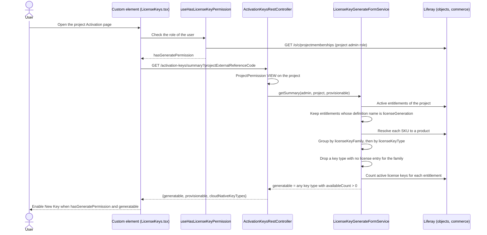
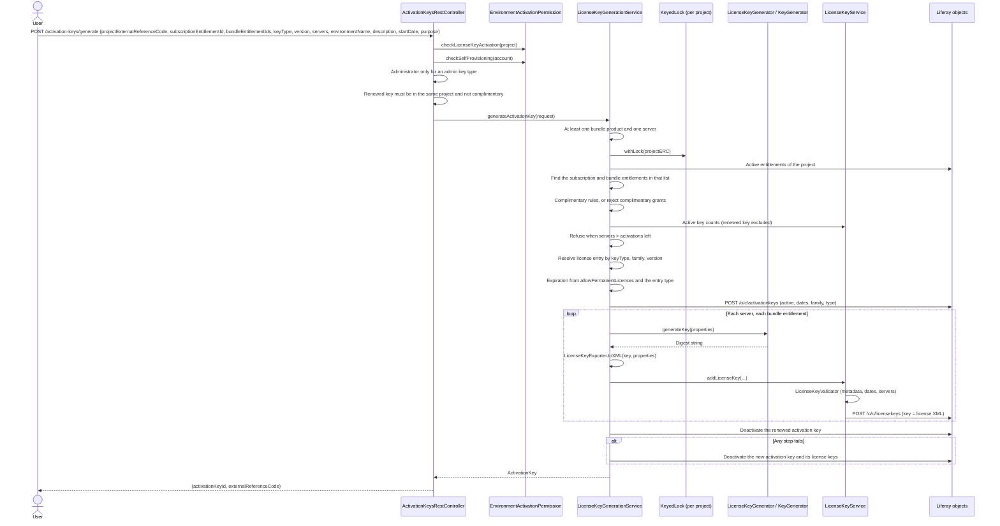
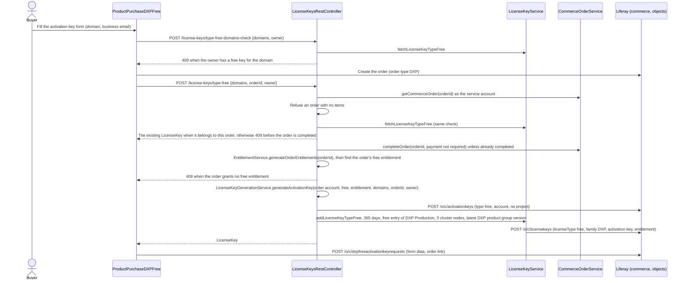
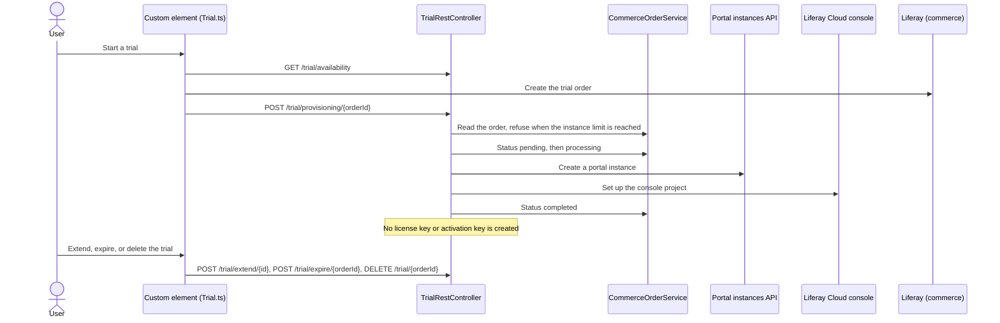
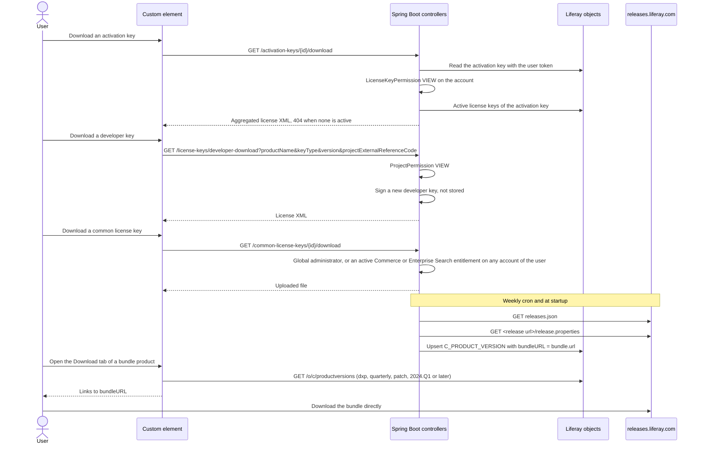
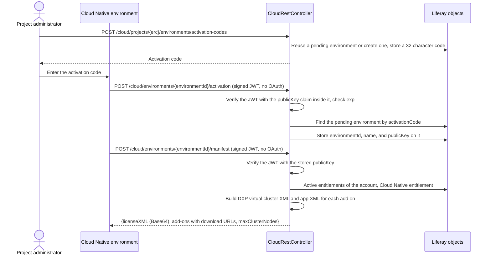
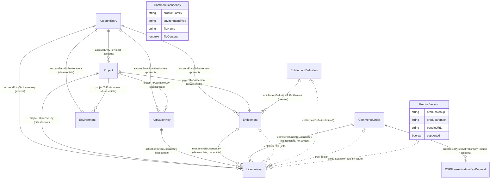

# Licensing

This file explains how Liferay One issues license keys, activation keys, and Cloud Native license files, who can call each licensing endpoint, and which rules the server applies before it signs a key. It also records an audit of the licensing code on 2026-10-16.

The source of truth is the code in `liferay-one-etc-spring-boot` (the controllers, `service/`, `license/`, and `permission/`), the custom element pages under `src/pages/MyAccount/Projects/LicenseKeys/`, and the object definitions in `client-extensions/liferay-one-batch/batch/03-object-definition.batch-engine-data.json`. When this file and the code disagree, the code is correct. The business rules are in [`licensing-and-activation.md`](../business/licensing-and-activation.md). The fields of each object are in [`data-model.md`](./data-model.md) and [`object-model.md`](./object-model.md).

## Path Prefixes

The citations in this file use two prefixes. Every path is relative to the workspace root.

| Prefix | Path |
| --- | --- |
| `ce/` | `client-extensions/liferay-one-custom-element/src/` |
| `sb/` | `client-extensions/liferay-one-etc-spring-boot/src/main/java/com/liferay/one/` |

## Summary

| Count | Item |
| --- | --- |
| 1 | Signing routine for every key type: `KeyGenerator.encrypt` from the private `liferay-release-tool-ee` repository |
| 3 | Leading license key families: `DXP`, `Portal`, and `Cloud Native` |
| 4 | Licensing objects that the code writes: `ActivationKey`, `LicenseKey`, `CommonLicenseKey`, and `ProductVersion` |
| 4 | Licensing controllers: `ActivationKeysRestController`, `LicenseKeysRestController`, `AppLicenseKeysRestController`, and `CommonLicenseKeysRestController` |
| 11 | License key types in `LicenseKeyType` |
| 49 | License entries in `license-entries.csv`, the table that maps a family, a key type, and a version range to a license entry name |
| 6 | Defects in the Findings section (1 to 6) that let a caller get a key, a completed order, an environment, or a trial action that the caller is not entitled to |

## Key Types and Families

### What Each Key Is

| Term | Meaning | Where the Code Makes It | Stored As |
| --- | --- | --- | --- |
| Activation key | A group of license keys that one request generates. The license keys activate, deactivate, and renew as one unit. | `sb/service/LicenseKeyGenerationService.java:614`, `sb/service/AppLicenseKeyGenerationService.java:220` | `C_ACTIVATION_KEY` |
| App license key | A license key for a Marketplace app, not for the portal product. An administrator creates it through `/app-license-keys`, or an account generates it from the One Time Purchases page. | `sb/AppLicenseKeysRestController.java:93`, `sb/service/AppLicenseKeyGenerationService.java:157` | `C_LICENSE_KEY` with `productExternalId` other than the portal product ID |
| Cloud Native license file | The license XML that a Cloud Native environment receives in its manifest. The server builds it on each manifest call and does not store it. | `sb/CloudRestController.java:1263`, `sb/CloudRestController.java:1005` | Not stored |
| Common license key | A license file that an administrator uploads once for a product family (Commerce or Enterprise Search). Every entitled customer downloads the same file. Liferay One does not sign it. | `sb/CommonLicenseKeysRestController.java:102` | `C_COMMON_LICENSE_KEY` |
| Complimentary key | A short free key for one server, against an entitlement whose definition has `licenseKeyType` `complimentary`. | `sb/service/LicenseKeyGenerationService.java:536` | `C_LICENSE_KEY` with `complimentary` true, under an activation key of type `complimentary` |
| Developer key | A developer or developer cluster key for DXP 7.4 and later. The server signs it on download and does not store it. | `sb/service/LicenseKeyGenerationService.java:79` | Not stored |
| DXP free key | A 365 day `free` key from the `free` license entry of `DXP Production` (`KOR-36354`), generated against an entitlement of key type `free`: the one that the free DXP purchase grants to the account, or one that staff grant to a project for New Key. On the account with no project, a free entitlement is offered only for a renewal (`sb/service/LicenseKeyGenerateFormService.java:569`). It matches the key of the legacy provisioning server: 3 cluster nodes, sizing `Sizing 4`, the name `Liferay Free Activation Key`, and the domains `<first domain>,localhost`. It is renewed from 90 days before it expires, and the renewal keeps its domains, owner, and order. | `sb/service/LicenseKeyService.java:183` | `C_LICENSE_KEY` with `licenseType` `free`, under an activation key of type `free`, on the project or on the account with no project. A key from the purchase flow before LPD-111041 has no activation key. |
| License key | One signed license file for one product and one server. | `sb/service/LicenseKeyService.java:57` | `C_LICENSE_KEY` |

A trial issues no license key. `TrialRestController` provisions a portal instance and a console project for a trial order. See [Trial Order](#d-trial-order).

AI Hub tiers are not license keys. `getAiHubTier` (`ce/utils/productUtils.ts:292`) removes the `plan-` prefix from the SKU option value (`plan-activate`, `plan-studio`) to get the tier that AI Hub expects. The licensing code does not read AI Hub tiers.

### License Key Types

`LicenseKeyType` (`sb/license/LicenseKeyType.java:79`) defines 10 types. A type that has a license entry type matches a row of `license-entries.csv` by its type and its name suffix. A type without one (complimentary, UAT) has no row of its own: complimentary resolves as production (`sb/service/LicenseKeyGenerateFormService.java:420`).

| Key | License Entry Type | Name Rule | Offered By Default | Administrator Only |
| --- | --- | --- | --- | --- |
| `backup` | `production` | Name ends with `Backup` | Yes | No |
| `complimentary` | None | Resolves as `production` | Yes | No |
| `developer` | `developer` | None | Yes | No |
| `developer-cluster` | `developer-cluster` | None | Yes | No |
| `enterprise` | `enterprise` | None | Yes | No |
| `free` | `free` | None | Yes | No |
| `non-production` | `production` | Name ends with `Non-Production` | Yes | No |
| `oem` | `oem` | None | Yes | No |
| `production` | `production` | Name ends with `Production` and not `Non-Production` | Yes | No |
| `uat` | None | None | Yes | No |

Virtual cluster is not a key type. An administrator delivers a `backup`, `non-production`, or `production` key as a virtual cluster, for a number of cluster nodes instead of a list of servers. The request carries `virtualCluster`, and the key uses the license entry of type `virtual-cluster` whose name ends with the suffix of its key type followed by ` (Virtual Cluster)`, such as `DXP Non-Production (Virtual Cluster)`. The activation key stores the type `virtual-cluster`, and its license keys carry the product name of the environment, such as `DXP Non-Production` (`sb/license/LicenseKeyType.java`).

An `enterprise` or `oem` key has no server, as in the legacy provisioning system (`LicenseServerId` and `noServerIdTypes` there). The generate form shows no server fields for it, and `LicenseKeyGenerationService` makes one license key with empty host names, IP addresses, and MAC addresses and the server ID `Enterprise` or `OEM` (`sb/service/LicenseKeyGenerationService.java`). The shared `KeyGenerator` signs servers only for `limited`, `per-user`, and `production` entries, so the server ID appears on the stored license key and not in the license file.

Two configuration keys set the last two columns: `liferay.one.license.key.types` and `liferay.one.license.key.admin-types` (`client-extensions/liferay-one-etc-spring-boot/src/main/resources/application-default.properties:117`). `LicenseKeyTypeService` reads them (`sb/license/LicenseKeyTypeService.java:185`).

### License Key Families

The family is the prefix of a license entry name, for example `DXP` in `DXP Production (Virtual Cluster)`. It comes from `EntitlementDefinition.licenseKeyFamily`, so licensing is decided at the SKU level and not by the product external reference code.

| Family | Leading | Product Name on the Form | Expiration Rule |
| --- | --- | --- | --- |
| `Cloud Native` | Yes | `Cloud Native` | Always ends with the subscription (`sb/service/LicenseKeyGenerateFormService.java:88`) |
| `DXP` | Yes | `Liferay DXP` | Permanent or termed, from the account setting |
| `Portal` | Yes | `Liferay Portal` | Permanent or termed, from the account setting |
| Any other value, for example `CMP` or `DSR` | No | The commerce product name | Permanent or termed, from the account setting |

The three leading families are in `leadingLicenseKeyFamilyProductNames` (`sb/constants/LicenseKeyGenerationConstants.java:52`). A leading family groups all of its SKUs into one product on the generate form (`sb/service/LicenseKeyGenerateFormService.java:605`). A developer key cannot bundle a second leading family (`sb/service/LicenseKeyGenerationService.java:744`).

Generation writes the family on the activation key (`sb/service/ActivationKeyService.java:52`) and on each license key (`sb/service/LicenseKeyService.java:119`). The free key always writes `DXP` (`sb/service/LicenseKeyService.java:216`). The code has no backfill, so a key created before LPD-102841 has an empty family. The key list shows no family label for such a key, and the renew form falls back to the family of the leading license key (`ce/hooks/useProjectActivationKeys.ts:289`, `ce/pages/MyAccount/Projects/LicenseKeys/GenerateActivationKey/hooks/useRenewSource.ts:79`).

## Diagrams

### (a) The New Key Button

The button shows when two conditions are true: the user has the generate permission, and the summary says that something is left to generate (`ce/pages/MyAccount/Projects/LicenseKeys/LicenseKeys.tsx:509`).

The fields of the entitlement definition decide `generatable` as follows:

| Definition Field | Effect on `generatable` | Source |
| --- | --- | --- |
| `name` | Must be `licenseGeneration`. Any other entitlement is ignored. | `sb/service/LicenseKeyGenerateFormService.java:383`, `:848` |
| `licenseKeyFamily` | Must not be empty. An empty value drops the entitlement. | `sb/service/LicenseKeyGenerateFormService.java:785` |
| `licenseKeyType` | Must not be empty, and must be in `liferay.one.license.key.types`. | `sb/service/LicenseKeyGenerateFormService.java:779`, `:668` |
| `maxQuantity` on the entitlement | Sets the activations. An empty value gives 0, so the key type is not generatable. | `sb/service/LicenseKeyGenerateFormService.java:156` |
| `generatesActivationKey` | No effect on `generatable`. It only puts the product in the `bundleProducts` list of the form. | `sb/service/LicenseKeyGenerateFormService.java:304`, `:477` |

The hint that UAT once showed no New Key because its definitions lacked `licenseKeyFamily` agrees with the code. The hint that a missing `generatesActivationKey` also hid the button does not: that field only changes the bundle list.

A user who cannot provision (`provisionable` false) still sees the button when a developer key type has activations left, because `_isGeneratable` keeps the downloadable types (`sb/service/LicenseKeyGenerateFormService.java:959`). The hook gives `hasGeneratePermission` to every user of an assigned project (`ce/pages/MyAccount/Projects/hooks/useHasActivationPermission.ts:136`), so such a user can open the form and download only a developer key.

For an account without a project (One Time Purchases), the summary comes from `AppLicenseKeyGenerationService.getSummary` (`sb/service/AppLicenseKeyGenerationService.java:105`). It is generatable when a paid, licensable app entitlement has activations left and the account allows self provisioning, or when a self service trial entitlement has activations left. The trial part ignores the self provisioning setting, and the generate form leaves out the app products when the account does not allow self provisioning.

### (b) Server Side Generation

The inputs of one license key are:

| Input | Source |
| --- | --- |
| Account name and owner | `project.getName()` is the account name in the XML. The owner and the key name are the environment name. `sb/service/LicenseKeyGenerationService.java:982`, `:301` |
| Cluster or instance size | Not taken from the request. `maxClusterNodes`, `maxServers`, `maxHttpSessions`, `maxUsers`, and `maxConcurrentUsers` are 0. The form always sends `instanceSize` 1. Sizing is `Sizing 1`, or `Sizing 4` for a complimentary key. `sb/service/LicenseKeyGenerationService.java:997`, `:1009`, `sb/service/LicenseKeyGenerateFormService.java:1110` |
| Dates | The start date is the subscription start date. A complimentary key starts on the requested date. The end date follows the rules table below. `sb/service/LicenseKeyGenerationService.java:529` |
| Entitlement | `subscriptionEntitlementId` and `bundleEntitlementIds`, each found among the active entitlements of the project. `sb/service/LicenseKeyGenerationService.java:519`, `:659` |
| Environment | `environmentName`, `dataCenterLocation`, `workspaceName`, `workspaceOwnerEmail` from the request. No `C_ENVIRONMENT` record is read or written. |
| License entry | `LicenseEntryService` reads `license-entries.csv` and matches the family prefix, the version, and the key type. An add-on without an entry uses the entry of the leading product. `sb/service/LicenseKeyGenerationService.java:811` |
| License version | `LicenseVersion.getLicenseVersion(productName, version)`. `sb/constants/LicenseVersion.java` |
| Product version | `version` from the request, one of the supported `dxp` product versions on the form. `sb/service/LicenseKeyGenerateFormService.java:816` |
| Servers | Host name, IP addresses, and MAC addresses for each server. One license key for each server and each bundle entitlement. |

The signing step is `KeyGenerator.encrypt` (`sb/license/LicenseKeyGenerator.java:22`). It refuses license version 1. For version 2 and later, it sorts the properties, digests each value with an algorithm that depends on the product ID and the position, shortens the digests, digests them again, and joins them. The portal product gets an interleaved digest. The algorithm and its constants are in the private repository that the build clones (`client-extensions/liferay-one-etc-spring-boot/build.gradle:45`, `:103`). No secret comes from configuration. `LicenseKeyExporter.toXML` then writes the properties and the digest into the license XML, and the server stores that XML in `LicenseKey.key`.

### (c) DXP Free Key

The browser decides that the product is a free DXP product (`ce/services/commerce/ProductPurchaseDXPFree.ts:37`). The server does not check the order type, the product, or the caller. See Finding 2.

### (d) Trial Order

### (e) Downloads of Keys and Product Bundles

LPD-108730 added `ProductVersion.bundleURL`. The sync reads `bundle.url` from each release's `release.properties` and skips a patch version without one (`sb/service/ProductVersionService.java:247`, `:420`). The Download tab lists the versions that have a bundle URL, newest first (`ce/hooks/useDXPProductVersions.ts:15`, `ce/pages/MyAccount/Projects/components/DownloadTab/DownloadTab.tsx:27`). The `LiferayBundle` object and its seed data were removed in 9aeb4acb9d4e8. The link goes straight to the public release host, so the bundle download has no entitlement check. The User role can view every `ProductVersion` (`client-extensions/liferay-one-site-initializer/site-initializer/resource-permissions.json:132`).

### (f) Cloud Native Activation and Manifest

## Validation Rules

These are the checks that the server applies before it issues a key. "Project path" is `LicenseKeyGenerationService`. "App path" is `AppLicenseKeyGenerationService`.

| Rule | Applies To | Source |
| --- | --- | --- |
| A bundle product is selected, unless the key is complimentary | Project path | `sb/service/LicenseKeyGenerationService.java:60` |
| A complimentary key covers exactly one server | Project path | `sb/service/LicenseKeyGenerationService.java:370` |
| A complimentary key has a purpose of 255 characters or fewer | Project path | `sb/service/LicenseKeyGenerationService.java:377` |
| A complimentary key starts before the subscription end date, ends after now, and does not outlive the subscription | Project path | `sb/service/LicenseKeyGenerationService.java:554`, `:567`, `:573` |
| A complimentary key lasts `licenseKeyDurationDays`, or 30 days when the value is 0 | Project path | `sb/service/LicenseKeyGenerationService.java:684` |
| A complimentary key uses only an entitlement whose type is `complimentary`, and such an entitlement grants no other key | Project path | `sb/service/LicenseKeyGenerationService.java:346` |
| A developer key needs a version of 7.4 or later | Developer download | `sb/service/LicenseKeyGenerationService.java:91` |
| A developer key needs a `licenseGeneration` entitlement whose type equals the requested key type | Developer download | `sb/service/LicenseKeyGenerationService.java:429` |
| A developer key ends after `licenseKeyDurationDays`, or on the entitlement end date. With neither, the download is refused. | Developer download | `sb/service/LicenseKeyGenerationService.java:780` |
| A developer key does not bundle an app, another leading family, or an add on that has no license entry for the version | Developer download | `sb/service/LicenseKeyGenerationService.java:728`, `:744`, `:755` |
| A free key is refused when the owner has a free key for the domain on any account, at any date, unless that key belongs to the same order | Free key | `sb/service/LicenseKeyService.java:555`, `sb/LicenseKeysRestController.java:286` |
| A free key on the account with no project is generated only as a renewal | Free key | `sb/ActivationKeysRestController.java:478` |
| Only an administrator deactivates or reactivates a free key on the account with no project | Free key | `sb/ActivationKeysRestController.java:311` |
| A free key needs an order with at least one item | Free key | `sb/LicenseKeysRestController.java:266` |
| A Marketplace app key is not renewed | App path | `sb/service/AppLicenseKeyGenerationService.java:60` |
| A Marketplace app key uses a paid, licensable app entitlement of the account outside any project | App path | `sb/service/AppLicenseKeyGenerationService.java:401` |
| A Marketplace app key type equals the key type of the entitlement | App path | `sb/service/AppLicenseKeyGenerationService.java:186` |
| A Marketplace app key ends on the entitlement end date, or 100 years after it starts | App path | `sb/service/AppLicenseKeyGenerationService.java:314` |
| A Marketplace app key has the product version 1, as in the legacy Marketplace, which DXP compares with the `product-version-id` of the app | App path | `sb/service/AppLicenseKeyGenerationService.java:538` |
| A Marketplace app entitlement allows its `maxQuantity`, or its `quantity` when `maxQuantity` is empty or 0 | App path | `sb/service/AppLicenseKeyGenerationService.java:367` |
| A project has at most one active complimentary activation key | Project path | `sb/service/LicenseKeyGenerationService.java:334` |
| A renewal names an activation key of the same project, not complimentary | Project path | `sb/ActivationKeysRestController.java:371`, `sb/service/LicenseKeyGenerationService.java:488` |
| An admin key type (none by default) or a virtual cluster key needs Administrator or Provisioning Administrator | Both paths | `sb/ActivationKeysRestController.java:390` |
| At least one server is given | Both paths | `sb/service/LicenseKeyGenerationService.java:67`, `sb/service/AppLicenseKeyGenerationService.java:55` |
| Complimentary keys need the account custom field `allowComplimentary` true | Project path | `sb/service/LicenseKeyGenerationService.java:327`, `sb/service/LicenseKeyGenerateFormService.java:924` |
| Each entitlement is active: the start date is empty or past, and the end date is empty or future. `terminationStatus` is not read. | Both paths | `sb/service/EntitlementService.java:608` |
| Each entitlement is in the project (project path) or in the account outside a project (app path) | Both paths | `sb/service/LicenseKeyGenerationService.java:515`, `sb/service/AppLicenseKeyGenerationService.java:262` |
| Each selected entitlement has activations left for every server. Activations are `maxQuantity` (app path falls back to `quantity`) minus the active keys. | Both paths | `sb/service/LicenseKeyGenerationService.java:395`, `sb/service/AppLicenseKeyGenerationService.java:136` |
| A permanent key with no active granting entitlement uses an activation of the latest entitlement with the same definition | Project path | `sb/service/LicenseKeyService.java:633` |
| A license entry exists for the key type, the family, and the version | Project path | `sb/service/LicenseKeyGenerationService.java:847` |
| Name and owner are 75 characters or fewer, description is 255 characters or fewer, product version is set | Every stored key | `sb/license/LicenseKeyValidator.java:55` |
| The expiration date is not before the start date | Every stored key | `sb/license/LicenseKeyValidator.java:43` |
| IP and MAC addresses are well formed and unique, and a backup, limited, per user, or production key names a server | Every stored key | `sb/license/LicenseKeyValidator.java:85`, `:139` |
| A virtual cluster key has at least one cluster node | Every stored key | `sb/license/LicenseKeyValidator.java:77` |
| The account allows self provisioning (`allowSelfProvisioning`, default true). A global role skips this check, and so does a key generated from a self service trial entitlement. | Generate, activate, deactivate | `sb/permission/EnvironmentActivationPermission.java:102` |
| Expiration: when the account does not allow permanent licenses (`allowPermanentLicenses`, default true) or the family is Cloud Native, the key ends with the subscription. A production type entry gets 36,500 days. Any other type gets 180 days after the subscription. | Project path | `sb/service/LicenseKeyGenerateFormService.java:82` |

## Entity Diagram

Solid lines are object relationships. Dotted lines are fields that hold an ID with no relationship. Since 57ba46a901e88 a license key has no link to the commerce product.

| Object | Account Restricted | Written By |
| --- | --- | --- |
| `C_ACTIVATION_KEY` | Yes, `r_accountEntryToActivationKey_accountEntryId` | `ActivationKeyService.addActivationKey` |
| `C_COMMON_LICENSE_KEY` | No | `CommonLicenseKeyService.addCommonLicenseKey` |
| `C_DXP_FREE_ACTIVATION_KEY_REQUEST` | No | The browser, after the free key (`ce/services/commerce/ProductPurchaseDXPFree.ts:43`) |
| `C_LICENSE_KEY` | Yes, `r_accountEntryToLicenseKey_accountEntryId` | `LicenseKeyService.addLicenseKey` and `addLicenseKeyTypeFree` |
| `C_PRODUCT_VERSION` | No | `ProductVersionService.syncProductVersions` |

`Environment` has no field that points to a license key. A Cloud Native environment gets its license file from the manifest, and the server keeps no copy.

## Security Notes

### Secrets and Signing Material

| Item | Where It Comes From |
| --- | --- |
| Cloud Native environment public key | The `publicKey` claim of the first activation JWT. The server stores it on the environment and uses it for every later manifest and download call. |
| License key digest algorithm | Java source in `liferay-release-tool-ee/ext/shared/ext-impl`, cloned at build time and ignored by git. No configuration key holds key material. The same source has an `Encryptor` class with key material in source; this workspace does not call it. |
| OAuth2 headless server client secret | `liferay-one-etc-spring-boot-oahs.oauth2.headless.server.client.secret`, from the environment variable `LIFERAY_ONE_ETC_SPRING_BOOT_OAHS_CLIENT_SECRET`. The property has a literal fallback value when the variable is missing (`application-default.properties:95`). |
| OAuth2 applications accepted as callers | `liferay.oauth.application.external.reference.codes`: `external-ai-hub`, `external-dxp`, `external-ssa`, `external-trial`, `liferay-one-etc-spring-boot-oahs`, `liferay-one-etc-spring-boot-oaua` (`application-default.properties:97`) |
| Paths that need no OAuth token | `liferay.oauth.urls.excludes`: Cloud Native activation, manifest, and add on download, plus `/error`, `/invitations/accept`, `/ready` (`application-default.properties:105`) |

### Who Can Call Each Endpoint

"Global role" in `EnvironmentActivationPermission` means Administrator, Liferay Staff, or Provisioning Administrator. "Global role" in `LicenseKeyPermission` means Administrator, Provisioning Administrator, or Provisioning Member, plus Liferay Staff for VIEW only.

| Endpoint | Caller Check | Ownership Checked Against the Caller |
| --- | --- | --- |
| `DELETE /common-license-keys/{id}` | Administrator or Provisioning Administrator | Not applicable |
| `DELETE /trial/{orderId}`, `POST /trial/expire/{orderId}`, `POST /trial/provisioning/{orderId}`, `POST /trial/extend/{id}` | A valid token only | No. See Finding 5. |
| `GET /activation-keys/{id}`, `/download`, `/subscriptions` | `LicenseKeyPermission` VIEW on the key's account | Yes, by account |
| `GET /activation-keys/generate-form`, `/summary` | `ProjectPermission` VIEW, or the account check of `checkAccountLicenseKeyActivation` | Yes, by project or account |
| `GET /app-license-keys/{id}`, `/download`, `POST /app-license-keys`, `PUT /activate`, `PUT /deactivate` | Administrator or Provisioning Administrator | Not applicable |
| `GET /common-license-keys`, `/{id}/download` | A global administrator role, or an active Commerce or Enterprise Search entitlement definition on any account of the user | By entitlement, not by account |
| `GET /license-keys/{id}/download`, `GET /download`, `GET /subscriptions`, `PUT /subscriptions` | `LicenseKeyPermission` VIEW on each key's account; at most 100 IDs | Yes, by account |
| `GET /license-keys/developer-download` | `ProjectPermission` VIEW | Yes, by project. No self provisioning check and no quota, by design (REQ-LICENSING-004, REQ-LICENSING-060). |
| `PATCH /activation-keys/{id}/active` | Project: account administrator, Partner Manager, project administrator, or global role. No project: account administrator, Partner Manager, or an account role that manages license keys. Plus self provisioning. A complimentary key, or a free key with no project, needs an administrator. | Yes, but no quota check. See Finding 4. |
| `PATCH /license-keys/{id}/active` | Refused for a key under an activation key. Otherwise the same as above, or `LicenseKeyPermission` UPDATE. | Yes, but no quota check |
| `POST /activation-keys/generate` | `checkLicenseKeyActivation` (project) or `checkAccountLicenseKeyActivation` (account), self provisioning (not for a self service trial entitlement), admin key types | Yes. Entitlements are read from the project or the account, so a caller cannot name another project's entitlement. |
| `POST /cloud/environments/{id}/activation` | None (no OAuth). The activation code and a self signed JWT. | No. See Finding 1. |
| `POST /cloud/environments/{id}/manifest`, `POST /cloud/products/{erc}/virtual-entry/{id}/download` | None (no OAuth). A JWT signed by the stored environment key. | Yes, by the stored key |
| `POST /common-license-keys` | Administrator or Provisioning Administrator | Not applicable |
| `POST /license-keys/type-free`, `POST /license-keys/type-free-domains-check` | A valid token only | No. See Finding 2. |

`KeyedLock` serializes generation for one project, or for one account on the app path, inside one JVM. The quota check depends on that lock. The service runs with `scale` 1 (`client-extensions/liferay-one-etc-spring-boot/LCP.json:30`). A second replica would let two requests pass the same quota check.

## Findings

1. **OData filter injection on the unauthenticated activation endpoint.** `sb/CloudRestController.java:789` builds `(activationCode eq '<code>')` with the raw `activationCode` claim and does not call `escapeODataString`. `/cloud/environments/*/activation` needs no OAuth token, and the JWT is verified with a public key that the caller puts in the same JWT (`sb/util/CloudNativeSignatureValidator.java:37`). A caller can send a code that closes the quote and widens the filter, which matches a pending Cloud Native environment of another account. The server then stores the caller's public key on it (`sb/CloudRestController.java:805`), and the caller can fetch the manifest with that account's license XML.

1. **The free key endpoint trusts any order ID.** `sb/LicenseKeysRestController.java:247` takes no `Jwt` and checks no permission. It reads the order with the service account, creates a free key on the order's account, and completes the order with payment status "not required" (`:279`). It does not check the order type or the product. `CommerceOrderService.completeOrder` also provisions AI Hub when the order type is `AI_HUB` (`sb/service/CommerceOrderService.java:146`). Any holder of a token from the six accepted OAuth applications, including `external-dxp`, can complete another customer's unpaid order.

1. **Bundle entitlements are not limited to license grants.** `sb/service/LicenseKeyGenerationService.java:659` accepts any active project entitlement as a bundle entitlement. Unlike the form (`sb/service/LicenseKeyGenerateFormService.java:848`) and the developer path (`:709`), it does not call `grantsLicense`. An entitlement for vCPU or seats, with a SKU and a `maxQuantity`, can become extra license keys that use the leading license entry.

1. **Reactivation skips the quota.** `sb/ActivationKeysRestController.java:245` and `sb/LicenseKeysRestController.java:207` set `active` true with no activation count. A user can deactivate a key, generate new keys in the freed activations, and reactivate the old key. A user can also reactivate the key that a renewal retired, which breaks REQ-LICENSING-020.

1. **Trial endpoints have no ownership check.** `TrialRestController` extends `BaseRestController` and reads no `Jwt` (`sb/TrialRestController.java:67`). The browser calls `DELETE /trial/{orderId}`, `POST /trial/expire/{orderId}`, and `POST /trial/provisioning/{orderId}` with the user token (`ce/services/spring-boot/Trial.ts:21`). Any signed in user can delete or expire another user's trial, or provision any order as a trial.

1. **A Cloud Native JWT has no maximum lifetime.** `sb/util/CloudNativeSignatureValidator.java:55` checks only that `exp` exists and is in the future. The environment chooses `exp`, so a captured manifest request can be replayed until that date.

1. **A failed generation leaves records behind.** The activation key is created before `LicenseKeyValidator` runs (`sb/service/LicenseKeyGenerationService.java:614`, `sb/service/LicenseKeyService.java:73`). On failure, `deactivatePartialActivationKey` deactivates the records and does not delete them (`sb/service/ActivationKeyService.java:74`). If that call also fails, it only logs, and the partial keys stay active.

1. **Two relationships are never written.** No code sets `r_entitlementToLicenseKey` or `r_commerceOrderToLicenseKey`. Generation writes the soft fields `entitlementId` and `orderId` instead (`sb/service/LicenseKeyService.java:111`, `:141`). `object-model.md` still lists `commerceProductToLicenseKey`, which 57ba46a901e88 removed from the batch files.

1. **The Cloud Native term moves when the entitlement has no end date.** `sb/CloudRestController.java:1288` uses now plus one year. Each manifest call issues a license file with a later end date.

1. **Termination is not part of "active".** `sb/service/EntitlementService.java:608` filters on dates only. An entitlement with a terminated `terminationStatus` still grants keys until its end date.

1. **The license key properties sit under the Okta heading.** `application-default.properties:113` labels the block `# Okta`, but lines 117 and 118 configure license key types.

## Open Questions

1. Can Liferay Staff change keys? `EnvironmentActivationPermission` treats Liferay Staff as a global role for generate, activate, and deactivate (`sb/permission/EnvironmentActivationPermission.java:210`). REQ-LICENSING-001 says Liferay Staff can see keys but cannot change them. REQ-LICENSING-004 and REQ-LICENSING-003 say Liferay Staff can generate.

1. Should the free key endpoint accept only orders of type `DXP` that the caller placed, and should it be callable by the `external-dxp` application at all?

1. Which component signs the Cloud Native environment's activation JWT, and should the server pin that signer instead of trusting the key in the token?

1. Should a reactivation recount activations, and should a retired renewal source be refused?

1. Should `ProductVersionService` accept a `bundle.url` from any host, or only from the release host? The value goes straight into a link on the Download tab.

1. Developer keys are not stored, so nothing records who downloaded one. Is an audit record needed?