# Object Model

This file maps every Liferay One object, the relationships between the objects, and the fields that hold a link without a relationship. It also records an audit of the model on 2026-10-15.

The source of truth is the batch client extension in `client-extensions/liferay-one-batch/batch/` (files `00` to `05`) and the custom fields in `client-extensions/liferay-one-site-initializer/site-initializer/expando-columns.json`. A script generated the reference tables from those files on 2026-10-15. When this file and the batch files disagree, the batch files are correct.

[`data-model.md`](./data-model.md) explains the meaning of the fields for 14 of the objects. This file covers the structure of all of them.

## Summary

| Count | Item |
| --- | --- |
| 34 | Custom objects (`C_*`), 28 in the Liferay One folder and 6 in the Requests folder |
| 7 | Liferay system objects that the model extends or links to (`L_*`) |
| 2 | Liferay entities with no object definition (Commerce SKU, Role). An object cannot hold a relationship to them. |
| 52 | Object relationships, all one to many |
| 20 | Soft links: fields that hold another record's ID, ERC, or name with no relationship |
| 13 | Objects restricted to the account by `accountEntryRestricted` |
| 23 | Picklists, of which 9 are not used by a field |
| 17 | Object actions, all handled by `liferay-one-etc-spring-boot` |

## How To Read the Model

The model has one center: the Liferay **Account** (`L_ACCOUNT`). 16 relationships start at the account. Most customer data is a child of the account and of a **Project** (`C_PROJECT`) at the same time. The account relationship gives the account restriction, and the project relationship gives the scope inside the account.

The commerce chain creates the customer's rights:

1. Salesforce events create a **Commerce Order** and its **Commerce Order Items**.

1. When the order is completed, entitlement generation finds every active **Entitlement Definition** for each order item's SKU and creates one **Entitlement** for each. The `EntitlementGeneration` action runs it for an item added to a completed order, and the `CommerceOrderUpdate` action runs it for every item when the order becomes completed.

1. Entitlements lead to **License Keys**, **Activation Keys**, and **Environments**, and metered entitlements collect **Usage Events**.

1. Each month, the usage report generator rolls the usage events into **Usage Reports**. An approved report creates an overage order, which starts the chain again.

The **Contract** sits beside this chain. It groups entitlements and environments, and a renewal contract points to its original contract.

The Requests folder holds form submissions. Most of them are children of a Commerce Order, because a trial or a free key is placed as an order.

### Deletion Types

| Deletion | Meaning |
| --- | --- |
| cascade | Deleting the parent deletes every child. |
| prevent | The parent cannot be deleted while it has children. |
| disassociate | Deleting the parent clears the link on each child and keeps the child. |

## Diagram

GitHub renders this diagram. Solid lines are relationships. Dotted lines are soft links.

```mermaid
erDiagram
    AccountEntry ||--o{ AccountNote : "accountEntryToAccountNote (cascade)"
    AccountEntry ||--o{ ActivationKey : "accountEntryToActivationKey (prevent)"
    AccountEntry ||--o{ Contract : "accountEntryToContract (prevent)"
    AccountEntry ||--o{ Entitlement : "accountEntryToEntitlement (prevent)"
    AccountEntry ||--o{ Environment : "accountEntryToEnvironment (disassociate)"
    AccountEntry ||--o{ LicenseKey : "accountEntryToLicenseKey (prevent)"
    AccountEntry ||--o{ OAuth2DxpAuthorization : "accountEntryToOAuth2DxpAuthorization (cascade)"
    AccountEntry ||--o{ Project : "accountEntryToProject (cascade)"
    AccountEntry ||--o{ ProjectMembership : "accountEntryToProjectMembership (cascade)"
    AccountEntry ||--o{ Property : "accountEntryToProperty (cascade)"
    AccountEntry ||--o{ PublisherAsset : "accountEntryToPublisherAsset (cascade)"
    AccountEntry ||--o{ PublisherDetail : "accountEntryToPublisherDetails (cascade)"
    AccountEntry ||--o{ PublisherSalesSummary : "accountEntryToPublisherSalesSummary (cascade)"
    AccountEntry ||--o{ TicketAttachment : "accountEntryToTicketAttachment (cascade)"
    AccountEntry ||--o{ TrialExtensionRequest : "accountEntryToTrialExtensionRequest (cascade)"
    AccountEntry ||--o{ AIHubApplication : "accountToAIHubApplication (cascade)"
    ActivationKey ||--o{ LicenseKey : "activationKeyToLicenseKey (disassociate)"
    CommerceOrderItem ||--o{ Entitlement : "commerceOrderItemToEntitlement (disassociate)"
    CommerceOrder ||--o{ LicenseKey : "commerceOrderToLicenseKey (disassociate)"
    CPDefinition ||--o{ LicenseKey : "commerceProductToLicenseKey (disassociate)"
    Contract ||--o{ Entitlement : "contractToEntitlement (disassociate)"
    Contract ||--o{ Environment : "contractToEnvironment (disassociate)"
    EntitlementDefinition ||--o{ Entitlement : "entitlementDefinitionToEntitlement (prevent)"
    Entitlement ||--o{ LicenseKey : "entitlementToLicenseKey (disassociate)"
    Entitlement ||--o{ UsageEvent : "entitlementToUsageEvent (cascade)"
    Environment ||--o{ EnvironmentAdmin : "environmentToEnvironmentAdmin (cascade)"
    Environment ||--o{ UsageEvent : "environmentToUsageEvent (cascade)"
    CommerceOrder ||--o{ AIHubApplication : "orderToAIHubApplication (disassociate)"
    CommerceOrder ||--o{ AIHubBetaPrivateAccessRequest : "orderToAIHubBetaPrivateAccessRequest (cascade)"
    CommerceOrder ||--o{ DSRRequest : "orderToDSRRequest (cascade)"
    CommerceOrder ||--o{ DXPFreeActivationKeyRequest : "orderToDXPFreeActivationKeyRequest (cascade)"
    CommerceOrder ||--o{ ProductFeedback : "orderToProductFeedback (cascade)"
    CommerceOrder ||--o{ TrialExtensionRequest : "orderToTrialExtensionRequest (cascade)"
    Organization ||--o{ Project : "organizationToProject (disassociate)"
    Contract ||--o{ Contract : "originalContractToContract (disassociate)"
    CPDefinition ||--o{ ProductFeedback : "productEntryToProductFeedback (cascade)"
    CPDefinition ||--o{ PublisherAsset : "productEntryToPublisherAsset (cascade)"
    Project ||--o{ ActivationKey : "projectToActivationKey (disassociate)"
    Project ||--o{ Contract : "projectToContract (disassociate)"
    Project ||--o{ Entitlement : "projectToEntitlement (disassociate)"
    Project ||--o{ Environment : "projectToEnvironment (disassociate)"
    Project ||--o{ LicenseKey : "projectToLicenseKey (disassociate)"
    Project ||--o{ ProjectMembership : "projectToProjectMembership (cascade)"
    Project ||--o{ UsageReport : "projectToUsageReport (cascade)"
    PublisherAsset ||--o{ PublisherAssetAttachment : "publisherAssetToAttachment (cascade)"
    PublisherSalesSummary ||--o{ CommerceOrder : "publisherToCommerceOrder (disassociate)"
    UsageDefinition ||--o{ EntitlementDefinition : "usageDefinitionToEntitlementDefinition (prevent)"
    UsageDefinition ||--o{ UsageEvent : "usageDefinitionToUsageEvent (disassociate)"
    UsageDefinition ||--o{ UsageReport : "usageDefinitionToUsageReport (cascade)"
    User ||--o{ LicenseKey : "createdByUser (disassociate)"
    User ||--o{ LicenseKey : "modifiedByUser (disassociate)"
    User ||--o{ ProjectMembership : "userToProjectMembership (cascade)"
    Project |o..o{ CommerceOrder : "projectName (soft)"
    Contract |o..o{ CommerceOrder : "contractId (soft)"
    AccountEntry |o..o{ Organization : "accountEntryId (soft)"
    CPInstance |o..o{ EntitlementDefinition : "skuExternalReferenceCode (soft)"
    CPInstance |o..o{ Entitlement : "overageSkuExternalReferenceCode (soft)"
    Entitlement |o..o{ LicenseKey : "entitlementId (soft)"
    CommerceOrder |o..o{ LicenseKey : "orderId (soft)"
    EntitlementDefinition |o..o{ LicenseKey : "entitlementDefinitionId (soft)"
    Project |o..o{ TrialExtensionRequest : "projectId (soft)"
    AccountEntry |o..o{ AccountInvitation : "accountExternalReferenceCode (soft)"
    Project |o..o{ AccountInvitation : "projectExternalReferenceCode (soft)"
    Role |o..o{ AccountInvitation : "roleExternalReferenceCodes (soft)"
    Role |o..o{ ProjectMembership : "roleExternalReferenceCode (soft)"
    User |o..o{ AccountNote : "createdByUserId (soft)"
    AccountEntry |o..o{ UsageReport : "accountExternalReferenceCode (soft)"
    Contract |o..o{ UsageReport : "contractExternalReferenceCode (soft)"
    CommerceOrder |o..o{ UsageReport : "commerceOrderId (soft)"
    CPDefinition |o..o{ UsageReport : "productExternalReferenceCode (soft)"
    CPInstance |o..o{ UsageReport : "skuExternalReferenceCode (soft)"
    User |o..o{ SubscriptionEntry : "customUserId (soft)"
```

## Relationships

The parent is side 1 and the child is side 2. Every relationship is one to many.

| Relationship | Parent | Child | Deletion |
| --- | --- | --- | --- |
| `accountEntryToAccountNote` | AccountEntry | AccountNote | cascade |
| `accountEntryToActivationKey` | AccountEntry | ActivationKey | prevent |
| `accountEntryToContract` | AccountEntry | Contract | prevent |
| `accountEntryToEntitlement` | AccountEntry | Entitlement | prevent |
| `accountEntryToEnvironment` | AccountEntry | Environment | disassociate |
| `accountEntryToLicenseKey` | AccountEntry | LicenseKey | prevent |
| `accountEntryToOAuth2DxpAuthorization` | AccountEntry | OAuth2DxpAuthorization | cascade |
| `accountEntryToProject` | AccountEntry | Project | cascade |
| `accountEntryToProjectMembership` | AccountEntry | ProjectMembership | cascade |
| `accountEntryToProperty` | AccountEntry | Property | cascade |
| `accountEntryToPublisherAsset` | AccountEntry | PublisherAsset | cascade |
| `accountEntryToPublisherDetails` | AccountEntry | PublisherDetail | cascade |
| `accountEntryToPublisherSalesSummary` | AccountEntry | PublisherSalesSummary | cascade |
| `accountEntryToTicketAttachment` | AccountEntry | TicketAttachment | cascade |
| `accountEntryToTrialExtensionRequest` | AccountEntry | TrialExtensionRequest | cascade |
| `accountToAIHubApplication` | AccountEntry | AIHubApplication | cascade |
| `activationKeyToLicenseKey` | ActivationKey | LicenseKey | disassociate |
| `commerceOrderItemToEntitlement` | CommerceOrderItem | Entitlement | disassociate |
| `commerceOrderToLicenseKey` | CommerceOrder | LicenseKey | disassociate |
| `commerceProductToLicenseKey` | CPDefinition | LicenseKey | disassociate |
| `contractToEntitlement` | Contract | Entitlement | disassociate |
| `contractToEnvironment` | Contract | Environment | disassociate |
| `createdByUser` | User | LicenseKey | disassociate |
| `entitlementDefinitionToEntitlement` | EntitlementDefinition | Entitlement | prevent |
| `entitlementToLicenseKey` | Entitlement | LicenseKey | disassociate |
| `entitlementToUsageEvent` | Entitlement | UsageEvent | cascade |
| `environmentToEnvironmentAdmin` | Environment | EnvironmentAdmin | cascade |
| `environmentToUsageEvent` | Environment | UsageEvent | cascade |
| `modifiedByUser` | User | LicenseKey | disassociate |
| `orderToAIHubApplication` | CommerceOrder | AIHubApplication | disassociate |
| `orderToAIHubBetaPrivateAccessRequest` | CommerceOrder | AIHubBetaPrivateAccessRequest | cascade |
| `orderToDSRRequest` | CommerceOrder | DSRRequest | cascade |
| `orderToDXPFreeActivationKeyRequest` | CommerceOrder | DXPFreeActivationKeyRequest | cascade |
| `orderToProductFeedback` | CommerceOrder | ProductFeedback | cascade |
| `orderToTrialExtensionRequest` | CommerceOrder | TrialExtensionRequest | cascade |
| `organizationToProject` | Organization | Project | disassociate |
| `originalContractToContract` | Contract | Contract | disassociate |
| `productEntryToProductFeedback` | CPDefinition | ProductFeedback | cascade |
| `productEntryToPublisherAsset` | CPDefinition | PublisherAsset | cascade |
| `projectToActivationKey` | Project | ActivationKey | disassociate |
| `projectToContract` | Project | Contract | disassociate |
| `projectToEntitlement` | Project | Entitlement | disassociate |
| `projectToEnvironment` | Project | Environment | disassociate |
| `projectToLicenseKey` | Project | LicenseKey | disassociate |
| `projectToProjectMembership` | Project | ProjectMembership | cascade |
| `projectToUsageReport` | Project | UsageReport | cascade |
| `publisherAssetToAttachment` | PublisherAsset | PublisherAssetAttachment | cascade |
| `publisherToCommerceOrder` | PublisherSalesSummary | CommerceOrder | disassociate |
| `usageDefinitionToEntitlementDefinition` | UsageDefinition | EntitlementDefinition | prevent |
| `usageDefinitionToUsageEvent` | UsageDefinition | UsageEvent | disassociate |
| `usageDefinitionToUsageReport` | UsageDefinition | UsageReport | cascade |
| `userToProjectMembership` | User | ProjectMembership | cascade |

## Soft Links

A soft link is a field that holds the ID, ERC, or name of another record. Liferay does not check it, does not delete it with the target, and does not show it in `nestedFields`.

| Object | Field | Points To | Note |
| --- | --- | --- | --- |
| CommerceOrder | `projectName` | Project | Project name, not a key. The order to project link since LPD-92222. |
| CommerceOrder | `contractId` | Contract | Contract ID. The order to contract link since LPD-92222. |
| Organization | `accountEntryId` | AccountEntry | Required: Liferay forbids a relationship between two system objects. |
| EntitlementDefinition | `skuExternalReferenceCode` | CPInstance | Required: a SKU has no system object definition. |
| Entitlement | `overageSkuExternalReferenceCode` | CPInstance | Required: a SKU has no system object definition. |
| LicenseKey | `entitlementId` | Entitlement | Runtime code writes and reads only this field; seed data writes only entitlementToLicenseKey. They are never set together. |
| LicenseKey | `orderId` | CommerceOrder | The only order reference in use. No code reads or writes commerceOrderToLicenseKey. |
| LicenseKey | `entitlementDefinitionId` | EntitlementDefinition | No relationship exists. |
| TrialExtensionRequest | `projectId` | Project | No relationship exists. |
| AccountInvitation | `accountExternalReferenceCode` | AccountEntry | No relationship exists. |
| AccountInvitation | `projectExternalReferenceCode` | Project | No relationship exists. |
| AccountInvitation | `roleExternalReferenceCodes` | Role | A list of role ERCs in one text field. |
| ProjectMembership | `roleExternalReferenceCode` | Role | Role ERC. |
| AccountNote | `createdByUserId` | User | LicenseKey uses relationships for the same data. |
| UsageReport | `accountExternalReferenceCode` | AccountEntry | Denormalized input for the approved action. |
| UsageReport | `contractExternalReferenceCode` | Contract | Denormalized input for the approved action. |
| UsageReport | `commerceOrderId` | CommerceOrder | The generated overage order. |
| UsageReport | `productExternalReferenceCode` | CPDefinition | Denormalized. |
| UsageReport | `skuExternalReferenceCode` | CPInstance | Overage bucket SKU. |
| SubscriptionEntry | `customUserId` | User | Subscriber. The target is polymorphic (className, classPK). |

## Audit, 2026-10-15

Each finding names the files to change. The open findings are ordered by risk.

### Fixed on 2026-10-15

These five findings are fixed in the batch files and in `data-model.md`. A deployed environment keeps the old deletion types until the `liferay-one-batch` client extension is redeployed.

1. `publisherToCommerceOrder` is now `disassociate`. Deleting a Publisher Sales Summary keeps its Commerce Orders.

1. `entitlementDefinitionToEntitlement` is now `prevent`. An Entitlement Definition with entitlements cannot be deleted; set `active: false` instead.

1. `contractToEnvironment` and `contractToEntitlement` are now `disassociate`, the same as the account and project links. `scripts/seed/teardown_records.sh` now deletes environments itself, because the contract delete no longer removes them.

1. `data-model.md` now matches the batch files for AccountNote, Contract, Entitlement, UsageEvent, Environment, LicenseKey, and the Commerce Order custom fields, and it describes the 20 objects it did not cover.

1. The ERC and friendly URL table in `data-model.md` is regenerated from the batch file.

### Medium: Links That Have Two Sources of Truth

1. **LicenseKey has two entitlement links that are never set together.** Key generation writes the `entitlementId` field, and the code reads only that field: active key counts (`LicenseKeyService._getActiveLicenseKeyCounts`), the account entitlement filter (`AccountsRestController`), and renewals (`useRenewSource`). Seed data sets only the `entitlementToLicenseKey` relationship, so every seeded key has `entitlementId` `0` and those three features skip it. Set the field in the seed data, or write both in `LicenseKeyService.addLicenseKey` and read one.

1. **`commerceOrderToLicenseKey` is unused.** The code stores the order in the text field `LicenseKey.orderId` and never writes or reads the relationship. Remove the relationship, or move the order link to it.

1. Two fields looked like duplicates and are not. `Environment.projectId` is the Liferay Cloud project ID typed on the activation form, not the Liferay Project. `AIHubApplication.accountEntryId` is the account ID in the external AI Hub. Both are documented in `data-model.md`.

1. **The order to project link is a project name.** Since LPD-92222, a Commerce Order finds its project through the `projectName` custom field and its contract through `contractId`. No relationship exists. A project rename breaks the link for every order of that project and no error appears. Store the project ERC beside the name, or read the name only for display.

### Medium: Soft Links Where a Relationship Is Possible

1. These fields point to a custom object, so a relationship can replace each of them:

	- `TrialExtensionRequest.projectId` (a required text field) to Project
	- `LicenseKey.entitlementDefinitionId` to EntitlementDefinition
	- `AccountInvitation.accountExternalReferenceCode` and `projectExternalReferenceCode`
	- `UsageReport.contractExternalReferenceCode` to Contract
	- `AccountNote.createdByUserId` and `modifiedByUserId` to User. LicenseKey uses the `createdByUser` and `modifiedByUser` relationships for the same data.

	The soft links that must stay are the links to a system object from a system object (`Organization.accountEntryId`), and the links to a SKU or a role, which have no object definition.

1. **Three objects use a polymorphic target** (`className` and `classPK`): Property, SubscriptionEntry, and UsageReport (`targetClassName`, `targetPK`). Nothing deletes these rows when the target is deleted. Find the orphans with a periodic check, or delete them in the target's `onAfterDelete` action.

### Medium: Account Data That Is Not Account Restricted

1. Three objects are children of the account but are not in `05-object-definition-account-entry-restricted`. Only role permissions control who reads them.

	- PublisherDetail is the public profile of a publisher, and the Marketplace site shows it to every visitor. Guest and User have company scope VIEW on purpose. Every field, `privateEmail`, `paypalAccount`, and `phone` included, is public information.
	- PublisherSalesSummary is for administrators only. Only Finance Administrator has a grant, and a publisher cannot see its own summaries, so an account restriction adds nothing.
	- Property holds account rows and also Organization and User rows keyed by `className` and `classPK`, which have no account. A restriction opens those rows to every signed in user, because a restricted entry whose account field is 0 grants every action. The rename to AccountProperty and the restriction are a separate task.

1. UsageReport has no account relationship. It reaches the account only through Project or Entitlement, so it depends on role permissions only.

### Low: Unused and Unreferenced Definitions

1. **9 picklists are not used by a field:** `LT_ACCOUNT_FLAG_CODE` and `LT_ACCOUNT_FLAG_VALUE` (both empty), `LT_ACCOUNT_REGION`, `LT_ACCOUNT_STATUS`, `LT_ACCOUNT_TIER`, `LT_ENTITLEMENT_RULE_TYPE`, `LT_ENTITLEMENT_STATUS`, `LT_ENVIRONMENT_PRIMARY_REGION`, and `LT_PRODUCT_TYPE`. The account custom field `accountTier` is a text field, not a picklist. Only the frontend reads `LT_ENVIRONMENT_PRIMARY_REGION`, to fill a form. Before you remove one, search the sibling `scripts` checkout for its ERC.

1. **No code in this workspace reads or writes 2 objects:** AIHubBetaPrivateAccessRequest and SalesRequest. AccountNote appears only in `resource-permissions.json`. The migration scripts in the sibling `scripts` checkout can use them; this audit did not search that checkout.

1. **Several text fields hold a fixed set of values** but have no picklist: `grantType` and `unit` on Entitlement and EntitlementDefinition, `type`, `offering`, `activationMode`, and `activationStatus` on Environment, `aggregationType` and `period` on UsageDefinition, and `targetType` on UsageReport. A typo in these fields saves with no error.

### Low: Naming

1. Relationship names use four patterns for the same parent: `accountEntryTo*` and `accountTo*`; `orderTo*` and `commerceOrderTo*`; `productEntryTo*` and `commerceProductTo*`; `createdByUser` with no `To`. The REST API exposes these names as `nestedFields` and as `r_<name>_*` fields, so a rename breaks callers. Use `<parent>To<Child>` for new relationships only.

1. Two labels have no space: `UsageDefinition` and `UsageEvent` (the plural labels are correct). The object `PublisherDetail` has the ERC `C_PUBLISHER_DETAILS`. The object `GetAppInformation` has a verb phrase as its name.

1. `Organization.accountEntryId` has two definitions: a system object field in `02-system-object-field` and a custom field in `expando-columns.json`. Keep one.

## Object Reference

A script generated this section from the batch files. System fields such as `id`, `externalReferenceCode`, `creator`, and `status` are not listed. Relationship fields (`r_<name>_*`) are listed under each relationship instead.

### Requests

#### Trial Extension Request (`C_TRIAL_EXTENSION_REQUEST`)

Object name `TrialExtensionRequest`. REST `/o/c/trialextensionrequests`. Title field `projectId`. Account restricted by `r_accountEntryToTrialExtensionRequest_accountEntryId`.

| Field | Type | Notes |
| --- | --- | --- |
| `dueStatus` | Picklist | required, picklist `LT_TRIAL_EXTENSION_REQUEST_STATUS` |
| `duration` | Integer | required |
| `projectId` | Text | required, soft link to `C_PROJECT` |
| `reason` | Text | |

| Relationship | Direction | Other side | Deletion |
| --- | --- | --- | --- |
| `accountEntryToTrialExtensionRequest` | child of one | `L_ACCOUNT` | cascade |
| `orderToTrialExtensionRequest` | child of one | `L_COMMERCE_ORDER` | cascade |

#### DXP Free Activation Key Request (`C_DXP_FREE_ACTIVATION_KEY_REQUEST`)

Object name `DXPFreeActivationKeyRequest`. REST `/o/c/dxpfreeactivationkeyrequests`. Title field `fullName`.

| Field | Type | Notes |
| --- | --- | --- |
| `businessEmailAddress` | Text | required |
| `companyName` | Text | |
| `country` | Text | required |
| `domain` | Text | required |
| `extension` | Text | |
| `fullName` | Text | required |
| `intlCode` | Text | |
| `jobTitle` | Text | |
| `notifyMe` | Boolean | |
| `phoneNumber` | Text | |
| `purpose` | Text | required |

| Relationship | Direction | Other side | Deletion |
| --- | --- | --- | --- |
| `orderToDXPFreeActivationKeyRequest` | child of one | `L_COMMERCE_ORDER` | cascade |

#### AI Hub Beta Private Access Request (`C_AI_HUB_BETA_PRIVATE_ACCESS_REQUEST`)

Object name `AIHubBetaPrivateAccessRequest`. REST `/o/c/aihubbetaprivateaccessrequests`. Title field `fullName`.

| Field | Type | Notes |
| --- | --- | --- |
| `administratorEmailAddress` | Text | required |
| `aiHubAccountName` | Text | required |
| `businessEmailAddress` | Text | required |
| `companyName` | Text | |
| `country` | Text | required |
| `extension` | Text | |
| `fullName` | Text | required |
| `intlCode` | Text | |
| `jobTitle` | Text | |
| `phoneNumber` | Text | |
| `purpose` | Text | required |

| Relationship | Direction | Other side | Deletion |
| --- | --- | --- | --- |
| `orderToAIHubBetaPrivateAccessRequest` | child of one | `L_COMMERCE_ORDER` | cascade |

#### DSR Request (`C_DSR_REQUEST`)

Object name `DSRRequest`. REST `/o/c/dsrrequests`. Title field `name`.

| Field | Type | Notes |
| --- | --- | --- |
| `acceptEulaAgreement` | Boolean | |
| `acceptTermsAndConditions` | Boolean | |
| `corpProjectName` | Text | |
| `corpProjectUuid` | Text | |
| `dataCenterLocation` | Text | |
| `hostName` | Text | |
| `incidentReportEmailAddresses` | Text | |
| `ipAddresses` | Text | |
| `macAddresses` | Text | |
| `name` | Text | |
| `ownerEmailAddress` | Text | |
| `serverLocation` | Text | |
| `workspaceName` | Text | |
| `workspaceOwnerEmail` | Text | |

| Relationship | Direction | Other side | Deletion |
| --- | --- | --- | --- |
| `orderToDSRRequest` | child of one | `L_COMMERCE_ORDER` | cascade |

#### Product Feedback (`C_PRODUCT_FEEDBACK`)

Object name `ProductFeedback`. REST `/o/c/productfeedbacks`. Title field `fullName`.

| Field | Type | Notes |
| --- | --- | --- |
| `companyName` | Text | |
| `emailAddress` | Text | required |
| `fullName` | Text | required |
| `jobTitle` | Text | |
| `notify` | Boolean | |
| `orderType` | Text | |
| `ratingEaseOfUse` | Integer | |
| `ratingSatisfaction` | Integer | |
| `ratingUsefulness` | Integer | |
| `suggestionFeatures` | Text | |
| `suggestionImprovements` | Text | |
| `suggestionSatisfaction` | LongText | |

| Relationship | Direction | Other side | Deletion |
| --- | --- | --- | --- |
| `orderToProductFeedback` | child of one | `L_COMMERCE_ORDER` | cascade |
| `productEntryToProductFeedback` | child of one | `L_COMMERCE_PRODUCT_DEFINITION` | cascade |

#### Publisher Account Request (`C_PUBLISHER_ACCOUNT_REQUEST`)

Object name `PublisherAccountRequest`. REST `/o/c/publisheraccountrequests`. Title field `emailAddress`.

| Field | Type | Notes |
| --- | --- | --- |
| `emailAddress` | Text | |
| `extension` | Text | |
| `firstName` | Text | |
| `intlCode` | Text | |
| `lastName` | Text | |
| `phoneNumber` | Text | |
| `publisherType` | MultiselectPicklist | picklist `LT_PUBLISHER_TYPE` |
| `requestDescription` | LongText | |
| `requestStatus` | Picklist | picklist `LT_REQUEST_STATUS` |

#### Sales Request (`C_SALES_REQUEST`)

Object name `SalesRequest`. REST `/o/c/salesrequests`. Title field `email`.

| Field | Type | Notes |
| --- | --- | --- |
| `accountName` | Text | |
| `additionalAppsRequested` | LongText | |
| `comments` | LongText | |
| `email` | Text | |
| `name` | Text | |

### Commerce (Liferay)

#### Commerce Product (`L_COMMERCE_PRODUCT_DEFINITION`)

Liferay system object `CPDefinition`.

| Field | Type | Notes |
| --- | --- | --- |
| `isPrimary` | Boolean | object field |
| `licenseKeyProductVersion` | Text | object field |
| `metricCoverage` | Text | object field |
| `productFamily` | Picklist | picklist `LT_PRODUCT_FAMILY`, object field |

| Relationship | Direction | Other side | Deletion |
| --- | --- | --- | --- |
| `commerceProductToLicenseKey` | parent of many | `C_LICENSE_KEY` | disassociate |
| `productEntryToProductFeedback` | parent of many | `C_PRODUCT_FEEDBACK` | cascade |
| `productEntryToPublisherAsset` | parent of many | `C_PUBLISHER_ASSET` | cascade |

Object actions: `CommerceProductDefinitionUpdate` (onAfterUpdate).

#### Commerce SKU (`X_CP_INSTANCE`)

Liferay entity `CPInstance` with no object definition. Objects cannot hold a relationship to it.

| Field | Type | Notes |
| --- | --- | --- |
| `description` | Text | custom field |
| `icon-url` | Text | custom field |

#### Commerce Order (`L_COMMERCE_ORDER`)

Liferay system object `CommerceOrder`.

| Field | Type | Notes |
| --- | --- | --- |
| `accountOwnerEmailAddress` | Text | custom field |
| `accountOwnerFirstName` | Text | custom field |
| `accountOwnerLastName` | Text | custom field |
| `cloud-provisioning` | Text | custom field |
| `cloudProjectName` | Text | custom field |
| `contractId` | Long | custom field, soft link to `C_CONTRACT` |
| `dossieraProjectKey` | Text | custom field |
| `dsrAnalyticsCloudProject` | Text | custom field |
| `dsrError` | Text | custom field |
| `dsrErrorDate` | Text | custom field |
| `dsrSettings` | Text | custom field |
| `dsrWorkspaceName` | Text | custom field |
| `gsInvolved` | Text | custom field |
| `ldpAnalyticsCloudProject` | Text | custom field |
| `ldpError` | Text | custom field |
| `ldpErrorDate` | Text | custom field |
| `ldpSettings` | Text | custom field |
| `ldpWorkspaceName` | Text | custom field |
| `marketplaceOrderType` | Text | custom field |
| `order-metadata` | Text | custom field |
| `opportunityProductFamily` | Text | custom field |
| `opportunitySoldBy` | Text | custom field |
| `opportunityStageName` | Text | custom field |
| `opportunityTerritory` | Text | custom field |
| `opportunityType` | Text | custom field |
| `parentOpportunityId` | Text | custom field |
| `partnerAccount` | Text | custom field |
| `partnerFirstLineSupport` | Text | custom field |
| `projectDescription` | Text | custom field |
| `projectKey` | Text | custom field |
| `projectName` | Text | custom field, soft link to `C_PROJECT` |
| `projectSolution` | Text | custom field |
| `renewal` | Boolean | custom field |
| `salesforceOpportunityId` | Text | custom field |
| `salesforcePricebookId` | Text | custom field |
| `salesforceProjectId` | Text | custom field |
| `trial-end-date` | Text | custom field |
| `trial-error` | Text | custom field |
| `trial-error-date` | Text | custom field |
| `trial-notify-end-date` | Text | custom field |
| `trial-settings` | Text | custom field |
| `trial-start-date` | Text | custom field |
| `trial-virtual-host` | Text | custom field |

| Relationship | Direction | Other side | Deletion |
| --- | --- | --- | --- |
| `commerceOrderToLicenseKey` | parent of many | `C_LICENSE_KEY` | disassociate |
| `orderToAIHubApplication` | parent of many | `C_AI_HUB_APPLICATION` | disassociate |
| `orderToAIHubBetaPrivateAccessRequest` | parent of many | `C_AI_HUB_BETA_PRIVATE_ACCESS_REQUEST` | cascade |
| `orderToDSRRequest` | parent of many | `C_DSR_REQUEST` | cascade |
| `orderToDXPFreeActivationKeyRequest` | parent of many | `C_DXP_FREE_ACTIVATION_KEY_REQUEST` | cascade |
| `orderToProductFeedback` | parent of many | `C_PRODUCT_FEEDBACK` | cascade |
| `orderToTrialExtensionRequest` | parent of many | `C_TRIAL_EXTENSION_REQUEST` | cascade |
| `publisherToCommerceOrder` | child of one | `C_PUBLISHER_SALES_SUMMARY` | disassociate |

Object actions: `CommerceOrderUpdate` (onAfterUpdate).

#### Commerce Order Item (`L_COMMERCE_ORDER_ITEM`)

Liferay system object `CommerceOrderItem`.

| Field | Type | Notes |
| --- | --- | --- |
| `cloudRegion` | Text | custom field |
| `customStatus` | Text | custom field |
| `effectiveEndDate` | Date | custom field |
| `endDate` | Date | custom field |
| `machineType` | Text | custom field |
| `opportunitySoldBy` | Text | custom field |
| `orderType` | Text | custom field |
| `sizing` | Integer | custom field |
| `spendLimit` | Double | custom field |
| `startDate` | Date | custom field |

| Relationship | Direction | Other side | Deletion |
| --- | --- | --- | --- |
| `commerceOrderItemToEntitlement` | parent of many | `C_ENTITLEMENT` | disassociate |

Object actions: `EntitlementGeneration` (onAfterAdd); `EntitlementUpdate` (onAfterUpdate); `CommerceOrderItemUpdate` (onAfterUpdate).

#### Postal Address (`L_POSTAL_ADDRESS`)

Liferay system object `Address`.

Object actions: `PostalAddressCreate` (onAfterAdd).

### Accounts and Users (Liferay)

#### Organization (`L_ORGANIZATION`)

Liferay system object `Organization`.

| Field | Type | Notes |
| --- | --- | --- |
| `accountEntryId` | LongInteger | object field, soft link to `L_ACCOUNT` |
| `accountEntryId` | Long | custom field, soft link to `L_ACCOUNT` |

| Relationship | Direction | Other side | Deletion |
| --- | --- | --- | --- |
| `organizationToProject` | parent of many | `C_PROJECT` | disassociate |

Object actions: `OrganizationCreate` (onAfterAdd); `OrganizationUpdate` (onAfterUpdate); `OrganizationDelete` (onAfterDelete).

#### Account (`L_ACCOUNT`)

Liferay system object `AccountEntry`.

| Field | Type | Notes |
| --- | --- | --- |
| `accountCode` | Text | custom field |
| `AccountType` | Text | custom field |
| `accountTier` | Text | custom field |
| `allowComplimentary` | Boolean | custom field |
| `allowPermanentLicenses` | Boolean | custom field |
| `allowSelfProvisioning` | Boolean | custom field |
| `contactEmail` | Text | custom field |
| `industry` | Text | custom field |
| `oktaSSO` | Text | custom field |
| `passwordPolicy` | Text | custom field |
| `twoFactorAuthentication` | Text | custom field |

| Relationship | Direction | Other side | Deletion |
| --- | --- | --- | --- |
| `accountEntryToAccountNote` | parent of many | `C_ACCOUNT_NOTE` | cascade |
| `accountEntryToActivationKey` | parent of many | `C_ACTIVATION_KEY` | prevent |
| `accountEntryToContract` | parent of many | `C_CONTRACT` | prevent |
| `accountEntryToEntitlement` | parent of many | `C_ENTITLEMENT` | prevent |
| `accountEntryToEnvironment` | parent of many | `C_ENVIRONMENT` | disassociate |
| `accountEntryToLicenseKey` | parent of many | `C_LICENSE_KEY` | prevent |
| `accountEntryToOAuth2DxpAuthorization` | parent of many | `C_OAUTH2_DXP_AUTHORIZATION` | cascade |
| `accountEntryToProject` | parent of many | `C_PROJECT` | cascade |
| `accountEntryToProjectMembership` | parent of many | `C_PROJECT_MEMBERSHIP` | cascade |
| `accountEntryToProperty` | parent of many | `C_PROPERTY` | cascade |
| `accountEntryToPublisherAsset` | parent of many | `C_PUBLISHER_ASSET` | cascade |
| `accountEntryToPublisherDetails` | parent of many | `C_PUBLISHER_DETAILS` | cascade |
| `accountEntryToPublisherSalesSummary` | parent of many | `C_PUBLISHER_SALES_SUMMARY` | cascade |
| `accountEntryToTicketAttachment` | parent of many | `C_TICKET_ATTACHMENT` | cascade |
| `accountEntryToTrialExtensionRequest` | parent of many | `C_TRIAL_EXTENSION_REQUEST` | cascade |
| `accountToAIHubApplication` | parent of many | `C_AI_HUB_APPLICATION` | cascade |

Object actions: `AccountCreate` (onAfterAdd); `AccountUpdate` (onAfterUpdate); `AccountDelete` (onAfterDelete).

#### User (`L_USER`)

Liferay system object `User`.

| Field | Type | Notes |
| --- | --- | --- |
| `agreedToContactEvents` | Boolean | custom field |
| `agreedToContactSales` | Boolean | custom field |
| `agreedToContactTrainings` | Boolean | custom field |
| `agreedToContactTrialLicenses` | Boolean | custom field |
| `uuid_` | Text | custom field |
| `verified` | Boolean | custom field |

| Relationship | Direction | Other side | Deletion |
| --- | --- | --- | --- |
| `createdByUser` | parent of many | `C_LICENSE_KEY` | disassociate |
| `modifiedByUser` | parent of many | `C_LICENSE_KEY` | disassociate |
| `userToProjectMembership` | parent of many | `C_PROJECT_MEMBERSHIP` | cascade |

Object actions: `UserCreate` (onAfterAdd); `UserUpdate` (onAfterUpdate); `UserDelete` (onAfterDelete).

#### Role (`X_ROLE`)

Liferay entity `Role` with no object definition. Objects cannot hold a relationship to it.

### Projects and Membership

#### Project (`C_PROJECT`)

Object name `Project`. REST `/o/c/projects`. Title field `name`. Account restricted by `r_accountEntryToProject_accountEntryId`.

| Field | Type | Notes |
| --- | --- | --- |
| `aiHubAccountName` | Text | |
| `allowedEmailDomains` | Text | |
| `dataCenterLocation` | Text | |
| `friendlyWorkspaceURL` | Text | |
| `liferayVersion` | Text | |
| `name` | Text | required |
| `securityContactEmailAddress` | Text | |

| Relationship | Direction | Other side | Deletion |
| --- | --- | --- | --- |
| `accountEntryToProject` | child of one | `L_ACCOUNT` | cascade |
| `organizationToProject` | child of one | `L_ORGANIZATION` | disassociate |
| `projectToActivationKey` | parent of many | `C_ACTIVATION_KEY` | disassociate |
| `projectToContract` | parent of many | `C_CONTRACT` | disassociate |
| `projectToEntitlement` | parent of many | `C_ENTITLEMENT` | disassociate |
| `projectToEnvironment` | parent of many | `C_ENVIRONMENT` | disassociate |
| `projectToLicenseKey` | parent of many | `C_LICENSE_KEY` | disassociate |
| `projectToProjectMembership` | parent of many | `C_PROJECT_MEMBERSHIP` | cascade |
| `projectToUsageReport` | parent of many | `C_USAGE_REPORT` | cascade |

#### Project Membership (`C_PROJECT_MEMBERSHIP`)

Object name `ProjectMembership`. REST `/o/c/projectmemberships`. Title field `roleExternalReferenceCode`. Account restricted by `r_accountEntryToProjectMembership_accountEntryId`.

| Field | Type | Notes |
| --- | --- | --- |
| `roleExternalReferenceCode` | Text | required, soft link to `X_ROLE` |

| Relationship | Direction | Other side | Deletion |
| --- | --- | --- | --- |
| `accountEntryToProjectMembership` | child of one | `L_ACCOUNT` | cascade |
| `projectToProjectMembership` | child of one | `C_PROJECT` | cascade |
| `userToProjectMembership` | child of one | `L_USER` | cascade |

#### Account Invitation (`C_ACCOUNT_INVITATION`)

Object name `AccountInvitation`. REST `/o/c/accountinvitations`. Title field `emailAddress`.

| Field | Type | Notes |
| --- | --- | --- |
| `accepted` | Boolean | |
| `accountExternalReferenceCode` | Text | soft link to `L_ACCOUNT` |
| `customExpirationDate` | DateTime | |
| `emailAddress` | Text | |
| `familyName` | Text | |
| `givenName` | Text | |
| `projectExternalReferenceCode` | Text | soft link to `C_PROJECT` |
| `projectRoleExternalReferenceCode` | Text | |
| `roleExternalReferenceCodes` | Text | soft link to `X_ROLE` |
| `token` | Text | |

Object actions: `AccountInvitationAccepted` (onAfterUpdate).

#### Account Note (`C_ACCOUNT_NOTE`)

Object name `AccountNote`. REST `/o/c/accountnotes`. Title field `content`. Account restricted by `r_accountEntryToAccountNote_accountEntryId`.

| Field | Type | Notes |
| --- | --- | --- |
| `content` | LongText | |
| `createdByUserId` | LongInteger | soft link to `L_USER` |
| `createdByUserName` | Text | |
| `customStatus` | Picklist | picklist `LT_ACCOUNT_NOTE_STATUS` |
| `format` | Text | |
| `koroneikiAccountKey` | Text | |
| `koroneikiProjectName` | Text | |
| `modifiedByUserId` | LongInteger | |
| `modifiedByUserName` | Text | |
| `priority` | Picklist | picklist `LT_ACCOUNT_NOTE_PRIORITY` |
| `type` | Picklist | picklist `LT_ACCOUNT_NOTE_TYPE` |

| Relationship | Direction | Other side | Deletion |
| --- | --- | --- | --- |
| `accountEntryToAccountNote` | child of one | `L_ACCOUNT` | cascade |

#### Ticket Attachment (`C_TICKET_ATTACHMENT`)

Object name `TicketAttachment`. REST `/o/c/ticketattachments`. Title field `fileName`. Account restricted by `r_accountEntryToTicketAttachment_accountEntryId`.

| Field | Type | Notes |
| --- | --- | --- |
| `accountKey` | Text | required |
| `draftCommentBody` | LongText | |
| `fileName` | Text | required |
| `fileSize` | Text | required |
| `gcsBucketName` | Text | required |
| `jiraIssueKey` | Text | |
| `md5Checksum` | Text | |
| `projectKey` | Text | |
| `state` | LongInteger | |
| `storageProvider` | Text | required |
| `type` | Text | |

| Relationship | Direction | Other side | Deletion |
| --- | --- | --- | --- |
| `accountEntryToTicketAttachment` | child of one | `L_ACCOUNT` | cascade |

#### OAuth2 DXP Authorization (`C_OAUTH2_DXP_AUTHORIZATION`)

Object name `OAuth2DxpAuthorization`. REST `/o/c/oauth2dxpauthorizations`. Title field `connectionSource`. Account restricted by `r_accountEntryToOAuth2DxpAuthorization_accountEntryId`.

| Field | Type | Notes |
| --- | --- | --- |
| `connectionSource` | Text | |

| Relationship | Direction | Other side | Deletion |
| --- | --- | --- | --- |
| `accountEntryToOAuth2DxpAuthorization` | child of one | `L_ACCOUNT` | cascade |

#### Property (`C_PROPERTY`)

Object name `Property`. REST `/o/c/properties`. Title field `name`.

| Field | Type | Notes |
| --- | --- | --- |
| `className` | Text | |
| `classNameId` | LongInteger | |
| `classPK` | LongInteger | |
| `metadataJson` | LongText | |
| `name` | Text | required |
| `value` | Text | |

| Relationship | Direction | Other side | Deletion |
| --- | --- | --- | --- |
| `accountEntryToProperty` | child of one | `L_ACCOUNT` | cascade |

#### Subscription Entry (`C_SUBSCRIPTION_ENTRY`)

Object name `SubscriptionEntry`. REST `/o/c/subscriptionentries`. Title field `classPK`.

| Field | Type | Notes |
| --- | --- | --- |
| `className` | Text | required |
| `classPK` | LongInteger | required |
| `customUserId` | LongInteger | required, soft link to `L_USER` |

### Contracts, Entitlements, Usage

#### Contract (`C_CONTRACT`)

Object name `Contract`. REST `/o/c/contracts`. Title field `ownerEmailAddress`. Account restricted by `r_accountEntryToContract_accountEntryId`.

| Field | Type | Notes |
| --- | --- | --- |
| `contractBillingCadence` | Integer | |
| `contractTerm` | Integer | |
| `contractType` | Picklist | picklist `LT_CONTRACT_TYPE` |
| `endDate` | DateTime | |
| `opportunityId` | Text | |
| `overageBillingCadence` | Integer | |
| `ownerEmailAddress` | Text | |
| `renewalOpportunityId` | Text | |
| `renewalState` | Text | |
| `spendLimit` | Decimal | |
| `startDate` | DateTime | |

| Relationship | Direction | Other side | Deletion |
| --- | --- | --- | --- |
| `accountEntryToContract` | child of one | `L_ACCOUNT` | prevent |
| `contractToEntitlement` | parent of many | `C_ENTITLEMENT` | disassociate |
| `contractToEnvironment` | parent of many | `C_ENVIRONMENT` | disassociate |
| `originalContractToContract` | self | `C_CONTRACT` | disassociate |
| `originalContractToContract` | self | `C_CONTRACT` | disassociate |
| `projectToContract` | child of one | `C_PROJECT` | disassociate |

#### Entitlement Definition (`C_ENTITLEMENT_DEFINITION`)

Object name `EntitlementDefinition`. REST `/o/c/entitlementdefinitions`. Title field `name`.

| Field | Type | Notes |
| --- | --- | --- |
| `active` | Boolean | |
| `defaultQuantity` | Decimal | |
| `displayName` | Text | |
| `generatesActivationKey` | Boolean | |
| `grantType` | Text | |
| `licenseKeyDurationDays` | Integer | |
| `licenseKeyFamily` | Text | |
| `licenseKeyType` | Text | |
| `maxQuantity` | Decimal | |
| `name` | Text | required |
| `overageRate` | Decimal | |
| `overageSkuExternalReferenceCode` | Text | |
| `productOptions` | LongText | |
| `skuExternalReferenceCode` | Text | required, soft link to `X_CP_INSTANCE` |
| `unit` | Text | |

| Relationship | Direction | Other side | Deletion |
| --- | --- | --- | --- |
| `entitlementDefinitionToEntitlement` | parent of many | `C_ENTITLEMENT` | prevent |
| `usageDefinitionToEntitlementDefinition` | child of one | `C_USAGE_DEFINITION` | prevent |

#### Entitlement (`C_ENTITLEMENT`)

Object name `Entitlement`. REST `/o/c/entitlements`. Title field `name`. Account restricted by `r_accountEntryToEntitlement_accountEntryId`.

| Field | Type | Notes |
| --- | --- | --- |
| `endDate` | DateTime | |
| `grantType` | Text | |
| `maxQuantity` | Decimal | |
| `name` | Text | required |
| `overageRate` | Decimal | |
| `overageSkuExternalReferenceCode` | Text | soft link to `X_CP_INSTANCE` |
| `productOptions` | LongText | |
| `quantity` | Decimal | |
| `startDate` | DateTime | |
| `terminationStatus` | Text | |

| Relationship | Direction | Other side | Deletion |
| --- | --- | --- | --- |
| `accountEntryToEntitlement` | child of one | `L_ACCOUNT` | prevent |
| `commerceOrderItemToEntitlement` | child of one | `L_COMMERCE_ORDER_ITEM` | disassociate |
| `contractToEntitlement` | child of one | `C_CONTRACT` | disassociate |
| `entitlementDefinitionToEntitlement` | child of one | `C_ENTITLEMENT_DEFINITION` | prevent |
| `entitlementToLicenseKey` | parent of many | `C_LICENSE_KEY` | disassociate |
| `entitlementToUsageEvent` | parent of many | `C_USAGE_EVENT` | cascade |
| `projectToEntitlement` | child of one | `C_PROJECT` | disassociate |

#### UsageDefinition (`C_USAGE_DEFINITION`)

Object name `UsageDefinition`. REST `/o/c/usagedefinitions`. Title field `unit`.

| Field | Type | Notes |
| --- | --- | --- |
| `aggregationType` | Text | |
| `overageBucketSize` | Decimal | |
| `period` | Text | |
| `unit` | Text | |
| `usageSource` | Text | |
| `usageSourceMetricKey` | Text | |
| `usageSourceUnit` | Text | |

| Relationship | Direction | Other side | Deletion |
| --- | --- | --- | --- |
| `usageDefinitionToEntitlementDefinition` | parent of many | `C_ENTITLEMENT_DEFINITION` | prevent |
| `usageDefinitionToUsageEvent` | parent of many | `C_USAGE_EVENT` | disassociate |
| `usageDefinitionToUsageReport` | parent of many | `C_USAGE_REPORT` | cascade |

#### UsageEvent (`C_USAGE_EVENT`)

Object name `UsageEvent`. REST `/o/c/usageevents`. Title field `dedupeKey`. Account restricted by `r_accountEntryToUsageEvent_accountEntryId`.

| Field | Type | Notes |
| --- | --- | --- |
| `dedupeKey` | Text | |
| `eventTimestamp` | DateTime | |
| `quantity` | Decimal | |

| Relationship | Direction | Other side | Deletion |
| --- | --- | --- | --- |
| `entitlementToUsageEvent` | child of one | `C_ENTITLEMENT` | cascade |
| `environmentToUsageEvent` | child of one | `C_ENVIRONMENT` | cascade |
| `usageDefinitionToUsageEvent` | child of one | `C_USAGE_DEFINITION` | disassociate |

#### Usage Report (`C_USAGE_REPORT`)

Object name `UsageReport`. REST `/o/c/usagereports`. Title field `generatorClassName`.

| Field | Type | Notes |
| --- | --- | --- |
| `accountExternalReferenceCode` | Text | soft link to `L_ACCOUNT` |
| `aggregateQuantity` | Decimal | |
| `commerceOrderId` | LongInteger | soft link to `L_COMMERCE_ORDER` |
| `contractExternalReferenceCode` | Text | soft link to `C_CONTRACT` |
| `dateFrom` | DateTime | |
| `dateTo` | DateTime | |
| `entitledQuantity` | Decimal | |
| `generatedAt` | DateTime | |
| `generatorClassName` | Text | |
| `overageAmount` | Decimal | |
| `overageCurrency` | Text | |
| `overageQuantity` | Decimal | |
| `overageSkuQuantity` | Decimal | |
| `productExternalReferenceCode` | Text | soft link to `L_COMMERCE_PRODUCT_DEFINITION` |
| `productName` | Text | |
| `reviewStatus` | Picklist | required, state field, picklist `LT_USAGE_REPORT_REVIEW_STATUS` |
| `skuExternalReferenceCode` | Text | soft link to `X_CP_INSTANCE` |
| `targetClassName` | Text | |
| `targetPK` | LongInteger | |
| `targetType` | Text | |

| Relationship | Direction | Other side | Deletion |
| --- | --- | --- | --- |
| `projectToUsageReport` | child of one | `C_PROJECT` | cascade |
| `usageDefinitionToUsageReport` | child of one | `C_USAGE_DEFINITION` | cascade |

Object actions: `UsageReportApproved` (onAfterUpdate).

#### Report (`C_REPORT`)

Object name `Report`. REST `/o/c/reports`. Title field `name`.

| Field | Type | Notes |
| --- | --- | --- |
| `name` | Text | |
| `value` | LongText | |

### Environments and Licensing

#### Environment (`C_ENVIRONMENT`)

Object name `Environment`. REST `/o/c/environments`. Title field `hostName`. Account restricted by `r_accountEntryToEnvironment_accountEntryId`.

| Field | Type | Notes |
| --- | --- | --- |
| `activationCode` | Text | |
| `activationMode` | Text | |
| `activationStatus` | Text | |
| `adminEmailAddress` | Text | |
| `adminFirstName` | Text | |
| `adminLastName` | Text | |
| `aiHubURL` | Text | |
| `allowedEmailDomains` | Text | |
| `bundledEntitlementIds` | LongText | |
| `currentEntitlementHash` | Text | |
| `disasterRecoveryRegion` | Text | |
| `domains` | Text | |
| `friendlyURL` | Text | |
| `githubUsername` | Text | |
| `hostName` | Text | |
| `ipAddresses` | LongText | |
| `lastHeartbeatAt` | DateTime | |
| `macAddresses` | LongText | |
| `name` | Text | |
| `offering` | Text | |
| `ownerEmailAddress` | Text | |
| `projectId` | Text | |
| `publicKey` | LongText | |
| `region` | Text | |
| `requestedVersion` | Text | |
| `serverId` | LongText | |
| `timeZone` | Text | |
| `tokenMonthlyAllowance` | Text | |
| `type` | Text | |
| `workspaceName` | Text | |

| Relationship | Direction | Other side | Deletion |
| --- | --- | --- | --- |
| `accountEntryToEnvironment` | child of one | `L_ACCOUNT` | disassociate |
| `contractToEnvironment` | child of one | `C_CONTRACT` | disassociate |
| `environmentToEnvironmentAdmin` | parent of many | `C_ENVIRONMENT_ADMIN` | cascade |
| `environmentToUsageEvent` | parent of many | `C_USAGE_EVENT` | cascade |
| `projectToEnvironment` | child of one | `C_PROJECT` | disassociate |

#### Environment Admin (`C_ENVIRONMENT_ADMIN`)

Object name `EnvironmentAdmin`. REST `/o/c/environmentadmins`. Title field `emailAddress`.

| Field | Type | Notes |
| --- | --- | --- |
| `emailAddress` | Text | |
| `firstName` | Text | |
| `githubUsername` | Text | |
| `lastName` | Text | |

| Relationship | Direction | Other side | Deletion |
| --- | --- | --- | --- |
| `environmentToEnvironmentAdmin` | child of one | `C_ENVIRONMENT` | cascade |

#### Activation Key (`C_ACTIVATION_KEY`)

Object name `ActivationKey`. REST `/o/c/activationkeys`. Title field `name`. Account restricted by `r_accountEntryToActivationKey_accountEntryId`.

| Field | Type | Notes |
| --- | --- | --- |
| `active` | Boolean | |
| `endDate` | DateTime | |
| `licenseKeyFamily` | Text | |
| `startDate` | DateTime | |
| `type` | Text | |

| Relationship | Direction | Other side | Deletion |
| --- | --- | --- | --- |
| `accountEntryToActivationKey` | child of one | `L_ACCOUNT` | prevent |
| `activationKeyToLicenseKey` | parent of many | `C_LICENSE_KEY` | disassociate |
| `projectToActivationKey` | child of one | `C_PROJECT` | disassociate |

#### License Key (`C_LICENSE_KEY`)

Object name `LicenseKey`. REST `/o/c/licensekeys`. Title field `name`. Account restricted by `r_accountEntryToLicenseKey_accountEntryId`.

| Field | Type | Notes |
| --- | --- | --- |
| `accountName` | Text | |
| `active` | Boolean | |
| `additionalInfo` | LongText | |
| `clusterId` | LongInteger | |
| `complimentary` | Boolean | |
| `customExpirationDate` | DateTime | |
| `dataCenterLocation` | Text | |
| `description` | Text | |
| `domains` | LongText | |
| `entitlementDefinitionId` | LongInteger | soft link to `C_ENTITLEMENT_DEFINITION` |
| `entitlementId` | LongInteger | soft link to `C_ENTITLEMENT` |
| `hostName` | Text | |
| `ipAddresses` | LongText | |
| `key` | LongText | |
| `licenseKeyFamily` | Text | |
| `licenseName` | Text | |
| `licenseType` | Text | |
| `licenseVersion` | Integer | |
| `macAddresses` | LongText | |
| `maxClusterNodes` | Integer | |
| `maxConcurrentUsers` | LongInteger | |
| `maxHttpSessions` | Integer | |
| `maxServers` | Integer | |
| `maxUsers` | LongInteger | |
| `name` | Text | |
| `orderId` | Text | soft link to `L_COMMERCE_ORDER` |
| `owner` | Text | |
| `productExternalId` | Text | |
| `productName` | Text | |
| `productVersion` | Text | |
| `productVersionLabel` | Text | |
| `serverId` | LongText | |
| `sizing` | Text | |
| `startDate` | DateTime | |
| `workspaceName` | Text | |
| `workspaceOwnerEmail` | Text | |

| Relationship | Direction | Other side | Deletion |
| --- | --- | --- | --- |
| `accountEntryToLicenseKey` | child of one | `L_ACCOUNT` | prevent |
| `activationKeyToLicenseKey` | child of one | `C_ACTIVATION_KEY` | disassociate |
| `commerceOrderToLicenseKey` | child of one | `L_COMMERCE_ORDER` | disassociate |
| `commerceProductToLicenseKey` | child of one | `L_COMMERCE_PRODUCT_DEFINITION` | disassociate |
| `createdByUser` | child of one | `L_USER` | disassociate |
| `entitlementToLicenseKey` | child of one | `C_ENTITLEMENT` | disassociate |
| `modifiedByUser` | child of one | `L_USER` | disassociate |
| `projectToLicenseKey` | child of one | `C_PROJECT` | disassociate |

#### Common License Key (`C_COMMON_LICENSE_KEY`)

Object name `CommonLicenseKey`. REST `/o/c/commonlicensekeys`. Title field `fileContent`.

| Field | Type | Notes |
| --- | --- | --- |
| `endDate` | DateTime | |
| `environmentType` | Picklist | picklist `LT_ENVIRONMENT_TYPE` |
| `fileContent` | LongText | |
| `fileName` | Text | |
| `fileSize` | LongInteger | |
| `productFamily` | Picklist | picklist `LT_PRODUCT_FAMILY` |
| `productVersion` | Text | |
| `startDate` | DateTime | |

#### Product Version (`C_PRODUCT_VERSION`)

Object name `ProductVersion`. REST `/o/c/productversions`. Title field `productVersion`.

| Field | Type | Notes |
| --- | --- | --- |
| `bundleURL` | Text | |
| `productGroup` | Text | required |
| `productGroupVersion` | Text | required |
| `productVersion` | Text | required |
| `supported` | Boolean | |
| `type` | Picklist | picklist `LT_PRODUCT_VERSION_TYPE` |
| `versionLevel` | Picklist | picklist `LT_PRODUCT_VERSION_LEVEL` |

### Marketplace and Publishers

#### Publisher Detail (`C_PUBLISHER_DETAILS`)

Object name `PublisherDetail`. REST `/o/c/publisherdetails`. Title field `catalogExternalId`.

| Field | Type | Notes |
| --- | --- | --- |
| `catalogExternalId` | Text | |
| `catalogId` | LongInteger | |
| `description` | RichText | |
| `email` | Text | |
| `fullName` | Text | |
| `location` | Text | |
| `paypalAccount` | Text | |
| `phone` | Text | |
| `privateEmail` | Text | |
| `publisherName` | Text | |
| `publisherProfileImageURL` | LongText | |
| `role` | Text | |
| `salesEmail` | Text | |
| `showContactForm` | Boolean | |
| `showOnHomePage` | Boolean | |
| `supportEmail` | Text | |
| `websiteURL` | LongText | |

| Relationship | Direction | Other side | Deletion |
| --- | --- | --- | --- |
| `accountEntryToPublisherDetails` | child of one | `L_ACCOUNT` | cascade |

#### Publisher Sales Summary (`C_PUBLISHER_SALES_SUMMARY`)

Object name `PublisherSalesSummary`. REST `/o/c/publishersalessummaries`. Title field `publisherName`.

| Field | Type | Notes |
| --- | --- | --- |
| `paidBy` | Text | |
| `paidDate` | Text | |
| `paymentStatus` | Picklist | required, picklist `LT_PAYMENT_STATUS` |
| `publisherName` | Text | required |
| `quarter` | Text | required |

| Relationship | Direction | Other side | Deletion |
| --- | --- | --- | --- |
| `accountEntryToPublisherSalesSummary` | child of one | `L_ACCOUNT` | cascade |
| `publisherToCommerceOrder` | parent of many | `L_COMMERCE_ORDER` | disassociate |

#### Publisher Asset (`C_PUBLISHER_ASSET`)

Object name `PublisherAsset`. REST `/o/c/publisherassets`. Title field `version`. Account restricted by `r_accountEntryToPublisherAsset_accountEntryId`.

| Field | Type | Notes |
| --- | --- | --- |
| `version` | Text | |

| Relationship | Direction | Other side | Deletion |
| --- | --- | --- | --- |
| `accountEntryToPublisherAsset` | child of one | `L_ACCOUNT` | cascade |
| `productEntryToPublisherAsset` | child of one | `L_COMMERCE_PRODUCT_DEFINITION` | cascade |
| `publisherAssetToAttachment` | parent of many | `C_PUBLISHER_ASSET_ATTACHMENT` | cascade |

#### Publisher Asset Attachment (`C_PUBLISHER_ASSET_ATTACHMENT`)

Object name `PublisherAssetAttachment`. REST `/o/c/publisherassetattachments`. Title field `name`.

| Field | Type | Notes |
| --- | --- | --- |
| `name` | Text | |
| `processed` | Boolean | |
| `publisherAssetAttachmentType` | Picklist | picklist `LT_PUBLISHER_ASSET_ATTACHMENT_TYPE` |
| `sourceCode` | Attachment | required |

| Relationship | Direction | Other side | Deletion |
| --- | --- | --- | --- |
| `publisherAssetToAttachment` | child of one | `C_PUBLISHER_ASSET` | cascade |

#### AI Hub Application (`C_AI_HUB_APPLICATION`)

Object name `AIHubApplication`. REST `/o/c/aihubapplications`. Title field `accountName`. Account restricted by `r_accountToAIHubApplication_accountEntryId`.

| Field | Type | Notes |
| --- | --- | --- |
| `accountEntryId` | LongInteger | |
| `accountName` | Text | |
| `administratorEmailAddress` | Text | |

| Relationship | Direction | Other side | Deletion |
| --- | --- | --- | --- |
| `accountToAIHubApplication` | child of one | `L_ACCOUNT` | cascade |
| `orderToAIHubApplication` | child of one | `L_COMMERCE_ORDER` | disassociate |

#### Get App Information (`C_GET_APP_INFORMATION`)

Object name `GetAppInformation`. REST `/o/c/getappinformation`. Title field `orderId`.

| Field | Type | Notes |
| --- | --- | --- |
| `dashboardLink` | Text | |
| `orderId` | Text | |
| `priceModel` | Text | |
| `productName` | Text | |
| `productType` | Text | |