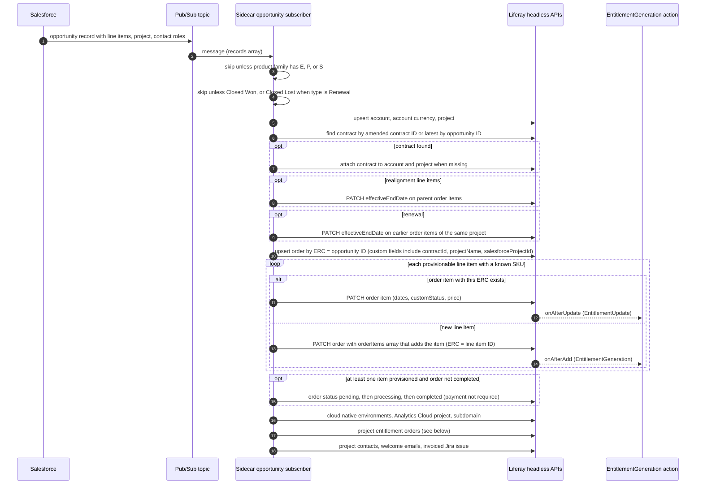
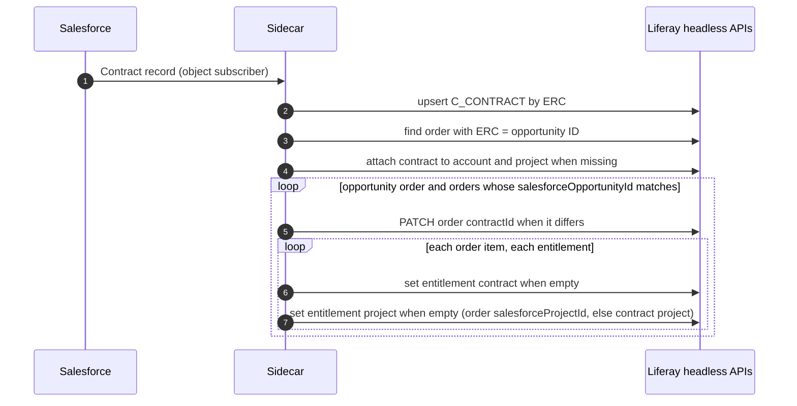
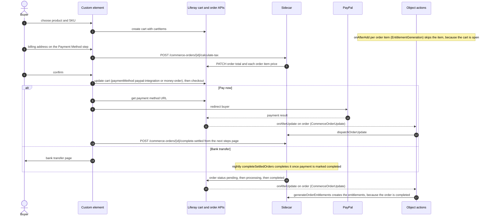
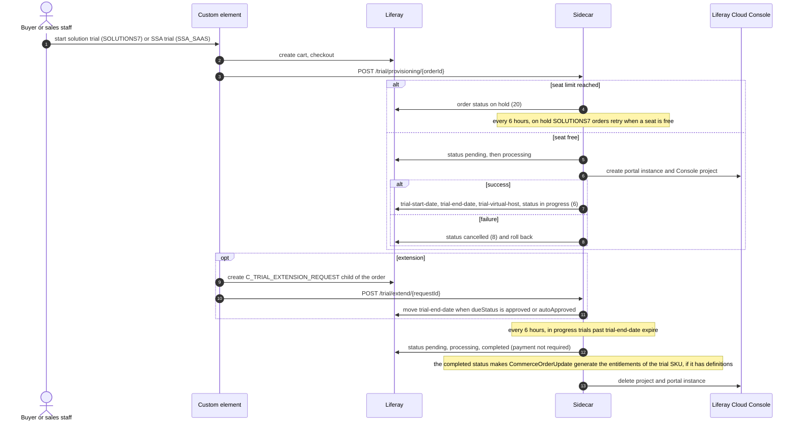
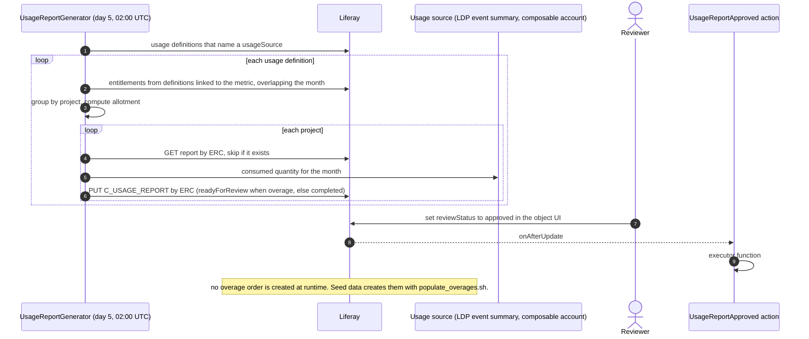
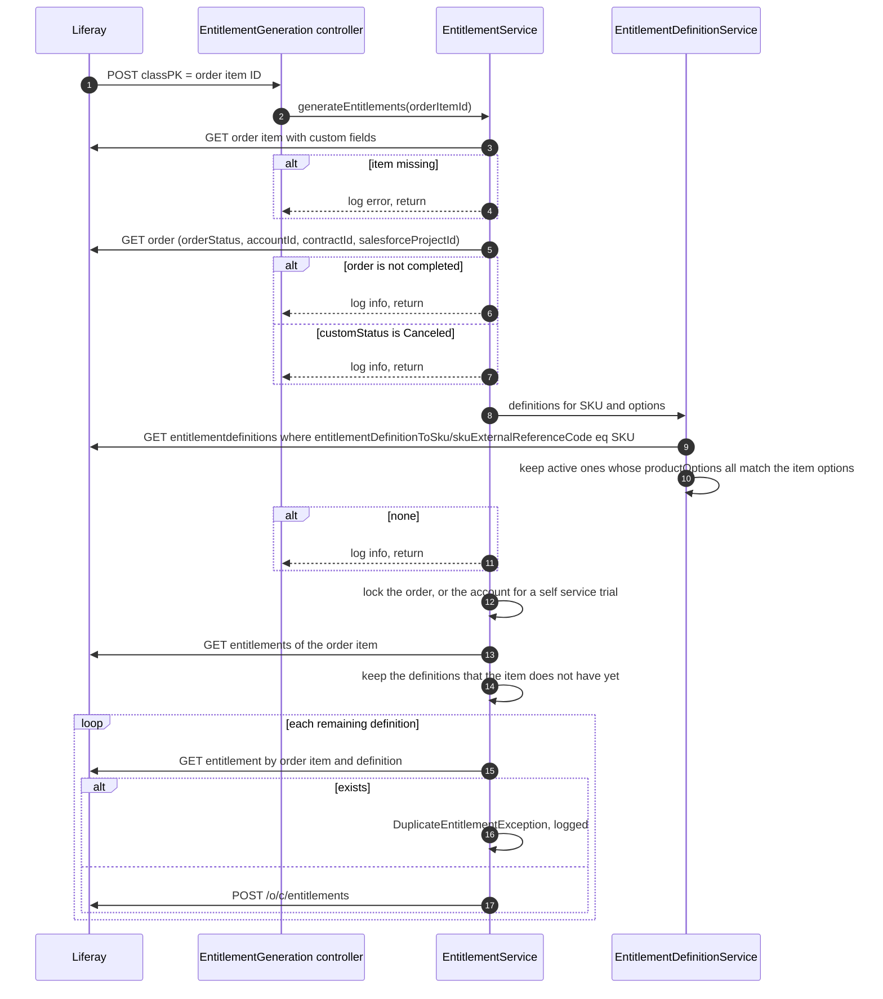

# Order to Entitlement

This file shows how a commerce order comes into existence, how each order item turns into entitlements, and what the customer can then do with those entitlements. It is the money path of Liferay One.

The code is the source of truth. On 2026-10-16 this file was checked against these sources:

- `client-extensions/liferay-one-etc-spring-boot/src/main/java/com/liferay/one/**`, mainly the Salesforce subscribers, `CommerceOrderService`, `CommerceOrderItemService`, `EntitlementService`, `EntitlementDefinitionService`, `ContractService`, `TrialRestController`, and `UsageReportGenerator`.
- `client-extensions/liferay-one-etc-spring-boot/client-extension.yaml` for the object action client extensions.
- `client-extensions/liferay-one-batch/batch/03-system-object-field.batch-engine-data.json`, `03-object-definition.batch-engine-data.json`, and `04-object-relationship.batch-engine-data.json` for the object actions, fields, and relationships.
- `client-extensions/liferay-one-site-initializer/site-initializer/expando-columns.json` and `object-actions/commerce-order.object-actions.json`.
- `client-extensions/liferay-one-custom-element/src/services/commerce/**`, `src/hooks/useProjectItems.ts`, `useProjectOrders.ts`, `useProjectCommerce.ts`, and `useProjectUsage.ts`.
- `scripts/seed/populate_orders.sh` and `scripts/seed/populate_overages.sh`.

When this file and the code disagree, the code is correct. All paths below are relative to the workspace root, and `…/one/` is short for `client-extensions/liferay-one-etc-spring-boot/src/main/java/com/liferay/one/`.

[`object-model.md`](./object-model.md) maps the objects and relationships. [`consumable-products.md`](./consumable-products.md) explains the usage report data. This file covers the runtime flow between them.

## Summary

| Count | Item |
| --- | --- |
| 4 | Ways an order is born: a Salesforce opportunity, a self service checkout, a trial or free key request, and an overage order |
| 1 | Object action that creates entitlements: `EntitlementGeneration`, `onAfterAdd` on `L_COMMERCE_ORDER_ITEM` |
| 4 | Other commerce object actions: `EntitlementUpdate`, `CommerceOrderItemUpdate`, `CommerceOrderUpdate`, `CommerceProductDefinitionUpdate` |
| 1 | Object action whose handler does not do its work yet: `UsageReportApproved` on `C_USAGE_REPORT` |
| 2 | Order custom fields that attribute an order to a project: `salesforceProjectId`, then `projectName` |
| 1 | Order custom field that attributes an order to a contract: `contractId` |
| 0 | Relationships from an order to a project or a contract (removed by LPD-92222) |
| 3 | Scheduled jobs on this path: contract reconcile (every 15 minutes), entitlement definition reconcile (03:00 daily), settled order completion (00:00 daily) |
| 1 | Scheduled job that makes usage reports: 02:00 UTC on day 5 of each month |
| 0 | Scheduled jobs that repair a missing entitlement |

## How To Read This File

Each source has its own section with a sequence diagram. All four sources end at the same place: an order item belongs to a completed order, and entitlement generation runs for it. Generation runs when the item is added to an order that is already completed, and again for every item when the order becomes completed. A pending or processing order is not paid or not closed yet (a bank transfer, or an `AI_HUB` order that waits for Salesforce), so it gets no entitlements. That shared step is in [The Shared Tail](#the-shared-tail). The sections after it cover what the entitlements unlock, how an order is attributed to a project and a contract, where the custom element reads each record, the state of each record, and what happens on a retry or a failure.

Three terms recur:

- **Order** is a Liferay `CommerceOrder`. Its external reference code (ERC) is the Salesforce opportunity ID or project entitlement ID when Salesforce is the source.
- **Order item** is a Liferay `CommerceOrderItem`. Its ERC is the Salesforce line item ID when Salesforce is the source. Its custom fields `startDate`, `endDate`, `effectiveEndDate`, and `customStatus` drive the entitlement dates.
- **Sidecar** is the `liferay-one-etc-spring-boot` client extension, which handles the Pub/Sub messages and the object actions.

## Source 1: Salesforce Opportunity

A closed won opportunity in Salesforce becomes one order. A closed lost renewal opportunity also gets an order, with canceled items. The handler is `SalesforceOpportunityPubsubSubscriber._processProvisioningRecord` (`…/one/salesforce/pubsub/SalesforceOpportunityPubsubSubscriber.java:275`).

### How the Fields Are Set

| Target | Value | Source in code |
| --- | --- | --- |
| Order ERC | Salesforce opportunity ID | `CommerceOrderService.upsertOrder` → `_upsertOrder` (`…/one/service/CommerceOrderService.java:1947`) |
| Order `contractId` | ID of the `C_CONTRACT` found for the opportunity, or not set | `_getCustomFields` (`CommerceOrderService.java:1178`) |
| Order `projectName` | Name of the Salesforce project in the message, when there is one | `_getCustomFields` |
| Order `salesforceProjectId` | `ProjectId` of the opportunity | `_getCustomFields` |
| Order `salesforceOpportunityId` | Opportunity ID | `_getCustomFields` |
| Order `renewal`, `opportunityType`, `opportunityStageName`, `parentOpportunityId` | From the opportunity | `_getCustomFields` |
| Order type | `CMP`, `DSR`, or `LDP` when all SKUs share one `solution-type` specification, otherwise none | `_getOrderTypeExternalReferenceCode` (`CommerceOrderService.java:1326`) |
| Order total | Sum of line item `TotalPrice`, or not set when the sum is negative | `_getTotal` (`CommerceOrderService.java:1525`) |
| Order item ERC | Salesforce line item ID | `CommerceOrderItemService.upsertOrderItem` (`…/one/service/CommerceOrderItemService.java:91`) |
| Order item SKU | `Product2Id`, which is the SKU ERC | `upsertOrderItem` |
| Order item `startDate` | Line item `ServiceDate` | `_getCustomFieldValues` |
| Order item `endDate` | Line item end date | `_getCustomFieldValues` |
| Order item `effectiveEndDate` | End date plus 30 days (`EFFECTIVE_END_DATE_GRACE`) | `_getCustomFieldValues`, `…/one/constants/CommerceOrderItemConstants.java` |
| Order item `customStatus` | Closed Won → Approved. Closed, Closed Lost, Disqualified, Rejected → Canceled. Any other stage → On Hold. | `_stageNameCustomStatuses` (`CommerceOrderItemService.java:321`) |

On reprocessing, `upsertOrderItem` keeps a Canceled status and keeps a trimmed `effectiveEndDate` unless the new end date is earlier.

### Project Entitlements

An opportunity can split its lines across projects through Salesforce `ProjectEntitlement__c` records. Each project entitlement becomes its own order, with ERC = project entitlement ID, `salesforceProjectId` = the target project, and `projectName` patched to that project's name (`…/one/service/ProvisioningProjectEntitlementService.java:344`). The same records can also arrive one at a time through `SalesforceObjectPubsubSubscriber`, which calls `upsertProjectEntitlement` and `upsertProjectEntitlementLineItem` (`ProvisioningProjectEntitlementService.java:163`, `:219`). A deleted project entitlement or line item sets `effectiveEndDate` to now on its order items.

### A Contract That Arrives Late

The contract can reach Liferay after the opportunity. `ContractService.upsertContract` then calls `reconcileOpportunityContract`, and a scheduled job runs the same method every 15 minutes for contracts modified in the lookback window (`…/one/service/ContractService.java:167`, `:212`).

This is the only job that repairs an entitlement after it exists, and it repairs only the contract and project links.

## Source 2: Self Service Checkout

The custom element places marketplace and Liferay product orders through the headless delivery cart. The base flow is `ProductPurchase.createOrder` (`client-extensions/liferay-one-custom-element/src/services/commerce/ProductPurchase.ts:92`). Each product type has a subclass that sets the order type and extra custom fields.

| Purchase class | Order type | Extra custom fields | Follow up call |
| --- | --- | --- | --- |
| `ProductPurchaseApp` | From the `app-type` specification, or `SEO_STUDIO` | `order-metadata.salesforceProjectId` when a project is chosen | `postGetAppInformation` |
| `ProductPurchaseAIHub` | `AI_HUB` | `order-metadata` with the form and `salesforceProjectId` | None. `CommerceOrderUpdate` creates the Salesforce opportunity. |
| `ProductPurchaseAIHubOpenBeta` | `AI_HUB` | `order-metadata` with `contractEntityId`, `salesforceContractId`, `salesforceProjectId`, `tier` | Payment URL |
| `ProductPurchaseDSR` | `DSR` | `dsrSettings` | `POST /digital-sales-room/provisioning/{id}` |
| `ProductPurchaseDXPFree` | `DXP` | None | `POST /license-keys/type-free`, then a `C_DXP_FREE_ACTIVATION_KEY_REQUEST` |
| `ProductPurchaseLDP` | `LDP` | `ldpSettings` | `POST /liferay-data-platform/provisioning/{id}` |
| `ProductPurchaseSolutionTrial` | `SOLUTIONS7` | None | `POST /trial/provisioning/{id}` |
| `ProductPurchaseSSATrial` | `SSA_SAAS` | None | Admin trial modal |

`completeSettledOrder` completes an order only when its type is in `_completableOrderTypeExternalReferenceCodes` (`AI_HUB_TOKEN`, `CLIENT_EXTENSION`, `CLOUDAPP`, `CLOUD_APP`, `COMPOSITE_APP`, `DXP_APP`, `LOW_CODE_CONFIGURATION`, `OTHER`), its payment status is completed (0) or not required (23), and its status is pending (1) or processing (10) (`CommerceOrderService.java:158`, `:1974`).

### AI Hub Orders Loop Through Salesforce

An `AI_HUB` order in pending status triggers `createAIHubOpportunity` (`CommerceOrderService.java:254`). The sidecar posts a Salesforce opportunity, renames the order ERC to the new opportunity ID, and renames each order item ERC to its Salesforce line item ID (`_createSalesforceOpportunity`, `CommerceOrderService.java:908`). When Salesforce later sends the closed won message, Source 1 finds the same order and items by ERC, completes the order, and provisions AI Hub. The ERCs are what keep this from creating a second order.

## Source 3: Trials and Free Keys

A trial or a free key is placed as an order through the Source 2 cart. The Requests folder objects are children of that order. The sidecar then moves the order through its own statuses.

| Request object | Parent order type | Writer | What happens next |
| --- | --- | --- | --- |
| `C_TRIAL_EXTENSION_REQUEST` | `SSA_SAAS`, `SOLUTIONS7` | `ExtendSSATrialModal.tsx` | Notification templates on add and on approval. `POST /trial/extend/{id}` moves the end date. |
| `C_DXP_FREE_ACTIVATION_KEY_REQUEST` | `DXP` | `ProductPurchaseDXPFree.ts` | Record only. The license key comes from `POST /license-keys/type-free`, which also completes the order (`…/one/LicenseKeysRestController.java:247`). |
| `C_DSR_REQUEST` | `DSR` | `ProductPurchaseDSR.ts` | Record only. Provisioning comes from `POST /digital-sales-room/provisioning/{id}`. |
| `C_AI_HUB_BETA_PRIVATE_ACCESS_REQUEST` | Not verified | No writer in the custom element | Not verified |
| `C_PRODUCT_FEEDBACK` | Not verified | No writer in the custom element | Not verified |

The free DXP key does not go through entitlements. `addLicenseKeyTypeFree` writes a license key with the order ID as a soft link.

## Source 4: Monthly Usage and Overage

The usage report generator measures each metered entitlement against what the project consumed. An approved report is meant to create an overage order. **That last step is not in the code.** The handler for the approved report only logs a warning.

The report ERC is the prefix plus the project ERC, the usage definition ERC, and the year and month (`…/one/usage/UsageReportGenerator.java:462`). A second run for the same month skips the report.

`scripts/seed/populate_overages.sh` shows the intended overage order: a separate order with `marketplaceOrderType` = `overage`, `contractId`, and `salesforceProjectId`, one order item for the overage SKU, and the report's `commerceOrderId` set to the order ID. When such an order item is added, the shared tail runs like any other.

## The Shared Tail

Every source ends when an order item is added or changed. The object actions are defined on the Liferay system objects in `03-system-object-field.batch-engine-data.json`, except `CommerceOrderUpdate`, which the site initializer adds (`client-extensions/liferay-one-site-initializer/site-initializer/object-actions/commerce-order.object-actions.json`).

| Action | Object | Trigger | Condition | Handler path | What it changes |
| --- | --- | --- | --- | --- | --- |
| `CommerceOrderItemUpdate` | `L_COMMERCE_ORDER_ITEM` | `onAfterUpdate` | None | `/object/action/commerce/order/item/update` | When a PaaS Experience item becomes Canceled and the account has no other active PaaS Experience item, deletes the account's Okta application and its property (`…/one/ObjectActionCommerceOrderItemUpdateRestController.java`). Nothing else. |
| `CommerceOrderUpdate` | `L_COMMERCE_ORDER` | `onAfterUpdate` | None | `/object/action/commerce/order/update` | When the order is completed, generates the missing entitlements of every order item (`EntitlementService.generateOrderEntitlements`). A failure is logged and does not stop the rest. Then sets the default currency. `AI_HUB` in pending: creates the Salesforce opportunity. `SEO_STUDIO`: provisions SEO Studio. Other types: `completeSettledOrder` (`CommerceOrderService.java:340`). |
| `CommerceProductDefinitionUpdate` | `L_COMMERCE_PRODUCT_DEFINITION` | `onAfterUpdate` | `status == 0` | `/object/action/commerce/product/definition/update` | For an approved paid App product, upserts one entitlement definition per SKU that has a license usage type option (`EntitlementDefinitionService.generateEntitlementDefinition`). The definition has a default quantity and a maximum quantity of 1, so each purchased unit allows one app key. |
| `EntitlementGeneration` | `L_COMMERCE_ORDER_ITEM` | `onAfterAdd` | None | `/object/action/commerce/order/item/entitlement/generation` | When the order is completed, creates one entitlement for each active matching entitlement definition that the item does not have yet. Skips an item of an order in any other status. |
| `EntitlementUpdate` | `L_COMMERCE_ORDER_ITEM` | `onAfterUpdate` | None | `/object/action/commerce/order/item/entitlement/update` | Updates start date, end date, quantity, and max quantity of the item's existing entitlements. |
| `UsageReportApproved` | `C_USAGE_REPORT` | `onAfterUpdate` | None | `/object/action/usage/report/approved` (`ObjectActionUsageReportApprovedRestController`) | Nothing, only a warning in the log for an approved report. See Findings. |

### Entitlement Generation

Each new entitlement gets these values (`…/one/service/EntitlementService.java:55`, `:161`):

| Entitlement field | Value |
| --- | --- |
| `externalReferenceCode` | `<orderItemId>-<entitlementDefinitionId>` |
| `name` | Definition `name` |
| `quantity` | Definition `defaultQuantity` × order item quantity |
| `maxQuantity` | Definition `maxQuantity` × order item quantity. This sets the activations of a license entitlement. |
| `grantType`, overage pricing | From the definition |
| `startDate` | Order item `startDate`, or empty |
| `endDate` | Order item `endDate`, or empty. The `effectiveEndDate` is not used here. |
| `skuExternalReferenceCode` | Order item SKU |
| `productOptions` | Order item options as JSON |
| `r_accountEntryToEntitlement_accountEntryId` | Order account |
| `r_contractToEntitlement_c_contractId` | Order `contractId`, when above 0 |
| `r_projectToEntitlement_c_projectERC` | Order `salesforceProjectId`, when not empty |
| `r_commerceOrderItemToEntitlement_commerceOrderItemId` | Order item |
| `r_entitlementDefinitionToEntitlement_c_entitlementDefinitionId` | Definition |

The SKU join is the `C_ENTITLEMENT_DEFINITION_SKU` object: one row per SKU, linked to its definition by the `entitlementDefinitionToSku` relationship (`04-object-relationship.batch-engine-data.json:249`). One definition can serve many SKUs. A definition has no `skuExternalReferenceCode` field of its own.

### Entitlement Update

`updateEntitlements` (`EntitlementService.java:530`) reads the item again and, for each entitlement of the item, changes only what differs:

- `startDate` from the item `startDate`.
- `endDate` from the earlier of the item `endDate` and `effectiveEndDate`, but never before the start date.
- `quantity` from definition `defaultQuantity` × item quantity.
- `maxQuantity` from definition `maxQuantity` × item quantity.

It does not look at `customStatus`. A Canceled item keeps its entitlements until its `effectiveEndDate` moves. Renewals, realignments, and deleted project entitlements use exactly that: they move `effectiveEndDate` earlier, and `EntitlementUpdate` shortens the entitlement.

### Entitlement Definition Sources

| Source | Name convention | ERC | Code |
| --- | --- | --- | --- |
| Seed and manual definitions for Liferay products | Machine key, for example `liferay-dxp-production`, `disasterRecovery`, `production-pods`. | Chosen by the author | `scripts/seed/data/15-entitlement-definition.batch-engine-data.json` |
| Generated definitions for paid App SKUs | Display label `<product name> - <SKU>`, used for both `name` and `displayName` | The SKU ERC | `EntitlementDefinitionService._syncEntitlementDefinition` (`…/one/service/EntitlementDefinitionService.java:380`) |

The sidecar checks entitlements by machine key from `EntitlementConstants` (for example `NAME_DISASTER_RECOVERY` in `CloudRestController.java:187` and `CloudActivationRequestService.java:73`, and `namesSLAs` and `NAME_PARTNER` in `ProvisioningEmailService.java:407`). So `Entitlement.name` is a key for Liferay products and a label for marketplace apps. Code that matches on `name` must know which kind it expects.

## Downstream of an Entitlement

| Record | Created by | Link to the entitlement | Notes |
| --- | --- | --- | --- |
| Activation key (`C_ACTIVATION_KEY`) | `POST /activation-keys/generate` → `LicenseKeyGenerationService.generateActivationKey` | Through its license keys | Carries `licenseKeyFamily` from the definition of the chosen entitlements. One lock per project serializes generation. |
| License key (`C_LICENSE_KEY`) | Same call, one key per server and product | `entitlementId` and `entitlementDefinitionId` soft links, `licenseKeyFamily` | Expiration comes from the entitlement end date. A production key from a leading family is permanent. Cloud Native keys always end with the entitlement (`LicenseKeyGenerateFormService.getLicenseKeyExpirationInstant`). |
| App license key | `/app-license-keys` → `AppLicenseKeyGenerationService` | Entitlement ID | Same family rules |
| Free DXP license key | `POST /license-keys/type-free` | None. Order ID soft link only. | No entitlement needed |
| Cloud native environment (`C_ENVIRONMENT`) | Source 1, `ProvisioningEnvironmentService.provisionCloudNativeEnvironments` | Contract and project, not the entitlement | One per environment type, only when the account has no cloud native environment yet and a contract was found |
| Usage event (`C_USAGE_EVENT`) | Seed only (`populate_orders.sh`) | `entitlementToUsageEvent` | No production code writes usage events. The usage report generator reads usage sources instead. |
| Usage report (`C_USAGE_REPORT`) | `UsageReportGenerator` | Through the project and usage definition | See Source 4 |

`licenseKeyFamily` comes only from the entitlement definition (`LicenseKeyGenerateFormService.getLicenseKeyFamily`). The three leading families are Cloud Native, DXP, and Portal (`…/one/constants/LicenseKeyGenerationConstants.java:53`).

## Attribution to a Project and a Contract

Since LPD-92222 there is no relationship from `L_COMMERCE_ORDER` to `C_PROJECT` or `C_CONTRACT`. The batch files keep only order relationships to the Requests folder objects, AI Hub applications, license keys, and the publisher sales summary. An order points to a project and a contract only through custom fields on the order.

| Question | Sidecar answer | Custom element answer |
| --- | --- | --- |
| Which project owns this order? | `salesforceProjectId` only (`EntitlementService._getProjectExternalReferenceCode`, `ProvisioningOrderService._isProjectOrder`, `ContractService._getSalesforceProjectId`) | `salesforceProjectId`, else `order-metadata.salesforceProjectId`, else `projectName`, else `koroneiki-project` (`useProjectOrders.ts:110`, `:147`, `:153`) |
| Which contract owns this order? | `contractId` (`EntitlementService._getContractId`) | Not read from the order |
| Which project owns this entitlement? | `r_projectToEntitlement_c_projectERC`, set at generation from the order, or later by contract reconcile | Same relationship |
| Which contract owns this entitlement? | `r_contractToEntitlement_c_contractId`, set at generation or by contract reconcile | Same relationship |

The consequences:

- **Project orders** match by `salesforceProjectId` first. `projectName` is a fallback, so a renamed project still matches when the ID is present.
- **One Time Purchases** are, on the order side, orders for which `hasProject` is false: no `salesforceProjectId`, no `order-metadata.salesforceProjectId`, no `projectName`, and no `koroneiki-project`. The Unassigned pseudo project lists them (`useProjectItems.ts:43`). On the entitlement side, the One Time Purchases pseudo contract holds the project's entitlements whose contract is not one of the project's contracts (`useProjectCommerce.ts:308`).
- **Account level contracts** have no project. When a project has no contract of its own, `useProjectCommerce` falls back to the account level contracts (`usingAccountFallback`). Their entitlements reach a project only through `r_projectToEntitlement_c_projectERC`, which comes from the order's `salesforceProjectId`, or from the contract's project during reconcile.
- **Self service orders** store the project in `order-metadata.salesforceProjectId` and have no `contractId`. The custom element counts the order for the project. The sidecar does not, so the entitlements of a self service order have no project and no contract. See Findings.

## Where the Custom Element Reads Each Thing

| View | Reads | Join | Code |
| --- | --- | --- | --- |
| Project Applications list | Placed orders of the account, filtered to the project, then mapped to delivery catalog products | `placedOrderItem.productId` → delivery product | `Applications.tsx` → `useProjectItems` |
| Project Products list | The same orders, then filtered by the selected contract through the project's entitlements | `entitlement.skuExternalReferenceCode` → product of that SKU in the delivery catalog | `Products.tsx` → `useProjectContractItems` (`useProjectItems.ts:122`) |
| Project item detail | The product from `useProjectItems`, the order from `getProductOrderInfo` | `productId` | `ProjectItemDetails.tsx` |
| Detail Utilization tab | `/o/c/entitlements` by project, `/o/c/usagedefinitions`, `/o/c/usageevents` (one page of 500) | Entitlement ID | `useProjectUsage.ts` |
| Account products | Account contracts with nested entitlements | `entitlement.skuExternalReferenceCode` → product | `useAccountProducts` (`useProjectCommerce.ts`) |

The list reads orders and the detail reads orders too. The detail does not read entitlements, except in the Utilization tab. The join from an entitlement to a product goes through `Entitlement.skuExternalReferenceCode`, not through the entitlement definition.

The project views read their products from the Spring Boot endpoint `GET /accounts/{externalReferenceCode}/products` (`projectProductsQuery` in `useProjectCommerce.ts`), not from the delivery catalog. The endpoint returns the products of the account's order items and of the SKUs on its entitlements, read through the admin catalog, so a draft product and an unpublished SKU are included and there is no page cap. Placed orders are fetched in pages of 200 with no page cap (`useProjectOrders.ts:18`).

## States

### Order Status

The numbers are the Liferay order status codes in `…/one/constants/CommerceOrderConstants.java`.

| From | To | Moved by |
| --- | --- | --- |
| None | Open (2) | Cart creation in the custom element. Source 1 `postOrder`. |
| Open (2) | Pending (1) | Cart checkout (Liferay). `completeOrder`. Trial, DSR, and LDP provisioning. |
| Pending (1) | Processing (10) | `completeOrder`. `createAIHubOpportunity`. Trial, DSR, and LDP provisioning. |
| Processing (10) | Completed (0) | `completeOrder` (with payment status completed or not required) |
| Processing (10) | In Progress (6) | Trial provisioning succeeded |
| In Progress (6) | Completed (0) | Trial expiry (`postExpire`), through pending and processing |
| Open or Pending | On Hold (20) | Trial seat limit reached |
| Processing (10) | Cancelled (8) | Trial, DSR, or LDP provisioning failed |

`completeOrder` always writes pending, then processing, then completed, whatever the current status (`CommerceOrderService.java:130`). For an `AI_HUB` order it then provisions AI Hub.

### Order Item Custom Status

| Value | Set by | Effect |
| --- | --- | --- |
| Approved | Source 1, stage Closed Won | Counts as active for renewal trims, realignment trims, and the PaaS Experience check |
| Canceled | Source 1, stages Closed, Closed Lost, Disqualified, Rejected | `EntitlementGeneration` skips the item. `CommerceOrderItemUpdate` may delete the Okta application. |
| On Hold | Source 1, any other stage | Not approved, not canceled |
| Empty | Self service, trial, and free orders | Not approved, not canceled. Generation runs. Renewal and realignment trims skip the item. |

### Entitlement State

An entitlement has no status field. The sidecar derives the state from the dates (`EntitlementService._getEntitlementState`). The `terminationStatus` field exists, and no code writes it.

| State | Rule |
| --- | --- |
| Unactivated | `startDate` is in the future |
| Active | Not expired and not unactivated. An empty `endDate` never expires. |
| Expired | `endDate` is in the past |

Only `EntitlementUpdate` moves the dates, and only from the order item custom fields.

### Usage Report Review Status

| From | To | Moved by |
| --- | --- | --- |
| None | `completed` | Generator, no overage |
| None | `readyForReview` | Generator, overage above 0 |
| `readyForReview` | `approved` | A reviewer in the object UI |
| `approved` | Overage order | Not implemented |

## Idempotency and Failure

| Step | On a retry or a second run | On a failure |
| --- | --- | --- |
| Opportunity message | Upserts by ERC. The order is found by opportunity ID and items by line item ID, so a resend changes the existing records. Welcome emails go only to newly assigned contacts. | Every exception is caught and logged, and a Jira provisioning issue is filed. The message is acknowledged, so Pub/Sub does not redeliver it (`SalesforceOpportunityPubsubSubscriber.java:93`, `:104`). |
| Salesforce object message (contract, project entitlement) | Upserts by ERC | One failed record makes the message throw, so it is not acknowledged and Pub/Sub redelivers it until the dead letter topic (`SalesforceObjectPubsubSubscriber.java:121`, `BasePubsubSubscriber.java:100`, `:110`). The records that succeeded run again. |
| Order item with an unknown SKU | Skipped with a warning | The order completes without that item |
| `EntitlementGeneration` or `CommerceOrderUpdate` on the same item twice | Generation skips each definition that the item already has. A lock on the order, or on the account for a self service trial, makes concurrent runs wait. The check by order item and definition, and the unique ERC `<orderItemId>-<definitionId>`, stop a duplicate. | Each definition is in its own `try`. An error is logged, and the next update of the order tries again. |
| `EntitlementGeneration` with no `classPK` | Not applicable | `getLong("classPK")` throws, and the controller answers 500 |
| `EntitlementGeneration` with no matching definition | Not applicable | Skipped with an info log. A definition created later does not reach the existing items. |
| `EntitlementGeneration` on a deleted item | Not applicable | Logged and skipped |
| `EntitlementUpdate` | Writes only the fields that differ | An exception answers 500. The next item update tries again. |
| Contract reconcile | Every 15 minutes. Writes only links that are empty or differ. | Each opportunity is in its own `try` |
| Entitlement definition reconcile | Daily. Upserts by SKU ERC, and sets the maximum quantity of a generated definition to 1 when it is empty or 0. Deactivates generated definitions whose SKU no longer exists. | Each product and SKU is in its own `try` |
| Settled order completion | Daily, and on each order update. An in memory set stops two threads from completing the same order. | Each order is in its own `try` |
| Usage report generation | Skips a report whose ERC exists | Each project is in its own `try` |
| Self service checkout | A second click is blocked in the page. A cart that fails checkout throws. | The order stays open, so its items have no entitlements |

## Hints Checked

| Hint | Verdict | Evidence |
| --- | --- | --- |
| An order item PATCH regenerates its ERC unless the ERC is in the body | Consistent with the code, not proven by it. `patchOrderItemCustomFields` copies the ERC on purpose, and the seed script says so. `calculateTax` does not copy it. | `CommerceOrderItemService.java:70`, `populate_orders.sh:513`, `CommerceOrderService.java:109` |
| Seeded orders total $0 until a PATCH | True. Commerce prices from the channel price list, so the script PATCHes item prices and the order subtotal and total. | `populate_orders.sh:896`, `:929` |
| `Entitlement.name` has two conventions | True: machine keys for seeded definitions, labels for generated App definitions | See [Entitlement Definition Sources](#entitlement-definition-sources) |
| Orders link to project and contract only through custom fields | True | LPD-92222, `04-object-relationship.batch-engine-data.json` |
| One Time Purchases are orders with no `projectName` | Partly. An order is unassigned only when all four project fields are empty, and `salesforceProjectId` wins over `projectName`. | `useProjectOrders.ts:147` |
| The DETAIL page reads entitlements | False. The detail page reads orders. Only the Products list and the Utilization tab read entitlements. | `ProjectItemDetails.tsx`, `useProjectItems.ts:122` |
| The join uses `EntitlementDefinition.skuExternalReferenceCode` | False. The UI joins on `Entitlement.skuExternalReferenceCode`, and the sidecar joins through `C_ENTITLEMENT_DEFINITION_SKU`. | `useProjectItems.ts:155`, `EntitlementDefinitionService.java:123` |
| The delivery catalog is capped at 100 | Outdated. The cap is 20 pages of 100. | `useProjectCommerce.ts:35`, `:37` |

## Findings

1. **High. An approved usage report creates no overage order.** `C_USAGE_REPORT` has the action `UsageReportApproved` with executor `function#liferay-one-etc-spring-boot-object-action-usage-report-approved` (`client-extensions/liferay-one-batch/batch/03-object-definition.batch-engine-data.json:8072`). `client-extensions/liferay-one-etc-spring-boot/client-extension.yaml:133` declares the client extension, and `ObjectActionUsageReportApprovedRestController` handles the path. The controller does nothing unless the review status of the usage report is `approved`. For an approved report it only logs the warning "Unable to create an overage order for usage report". It creates no overage order and no Salesforce opportunity. Overage orders exist only in seed data (`scripts/seed/populate_overages.sh`).

1. **Resolved by LPD-110003. Entitlement generation now checks the order status.** Generation runs only for a completed order, so an open cart, an unpaid PayPal order (in progress), and a pending bank transfer order get no entitlements. Entitlements that carts created before this change stay in place, including the ones whose order item was removed (order item ID 0).

1. **High. Self service entitlements have no dates.** Self service order items carry no `startDate` or `endDate` custom fields, and generation copies those fields as they are (`EntitlementService.java:214`). The entitlement then never expires (`EntitlementService._getActiveEntitlements`, `:608`).

1. **Medium. The sidecar and the custom element disagree on the project of a self service order.** `ProductPurchaseApp`, `ProductPurchaseAIHub`, and `ProductPurchaseAIHubOpenBeta` write the project to `order-metadata.salesforceProjectId`. `EntitlementService._getProjectExternalReferenceCode` (`:710`) reads only the `salesforceProjectId` custom field. The custom element shows the order under the project (`useProjectOrders.ts:110`), but its entitlements have no project, so the Products list contract filter and the Utilization tab do not see them. `createAIHubOpportunity` copies the field for `AI_HUB` orders only, and only after the items exist (`CommerceOrderService.java:329`).

1. **Medium. Nothing repairs a missing entitlement.** A failed `POST /o/c/entitlements`, a definition created after the order, or a definition that becomes active later leaves the order item without its entitlement. Contract reconcile fixes only the contract and project links (`…/one/service/ContractService.java:602`).

1. **Medium. `EntitlementUpdate` ignores cancellation.** A Salesforce item that changes to Canceled keeps its entitlements at full length unless something also moves `effectiveEndDate` (`EntitlementService.java:530`).

1. **Low. Generation and update use different end dates.** Generation uses `endDate` (`EntitlementService.java:214`). Update uses the earlier of `endDate` and `effectiveEndDate` (`CommerceOrderItemUtil.getEntitlementEndDateInstant`). An item whose `effectiveEndDate` was trimmed before its entitlements were created starts with the longer date until the next update.

1. **Low. `calculateTax` PATCHes order items without their ERC.** `CommerceOrderService.java:109` to `:120` sends a body with prices only. If the ERC hint holds, each self service order item gets a new ERC at the Payment Method step.

1. **Low. The custom element reads a custom field that does not exist.** `getProjectName` falls back to `koroneiki-project` (`useProjectOrders.ts:140`), and `expando-columns.json` defines no such column on `CommerceOrder`.

1. **Low. Usage events have readers and no runtime writer.** `useProjectUsage.ts:158` reads `/o/c/usageevents` in one page of 500. Only `scripts/seed/populate_orders.sh` writes them.

1. **Low. `terminationStatus` is read and never written.** `CloudRestController.java:1098` and `:1344` read it. No code or script sets it.

1. **Low. `object-model.md` is stale on the SKU link.** It lists a soft link `CPInstance → EntitlementDefinition` on `skuExternalReferenceCode`. Commit `5cf8a2e974a12` moved the link to `C_ENTITLEMENT_DEFINITION_SKU`.

## Open Questions

1. **Does Liferay send a payload for `onAfterAdd` on a commerce order item?** `scripts/seed/populate_orders.sh:49` says that the add of a system object sends a null payload and logs a PortalCatapult error for every order item, and the script turns the action off while it seeds. If this is true for every add, `EntitlementGeneration` never runs at runtime, and entitlements come only from the seed and from manual work. Test with one Salesforce order item on a live instance.

1. Does Liferay retry a function object action whose endpoint answers 500? The code assumes no retry for generation.

1. Does Liferay write the order item custom fields before it fires `onAfterAdd`? The Source 1 item is added through an order PATCH that carries the custom fields. If the fields come later, generation sees no dates, and only a later update fixes them.

1. Is entitlement creation for an open cart intended (Finding 2), for example so that the next steps page can show the grant before payment completes?

1. Which code writes `C_AI_HUB_BETA_PRIVATE_ACCESS_REQUEST` and `C_PRODUCT_FEEDBACK`, and do they hang off orders in practice?

1. Does an order item PATCH regenerate the ERC (Hints Checked)? The code is written as if it does. This file did not test it.

1. What is the Liferay status of an order right after cart checkout for each payment method? The code treats pending (1) as the usual next status, but this file did not test it.