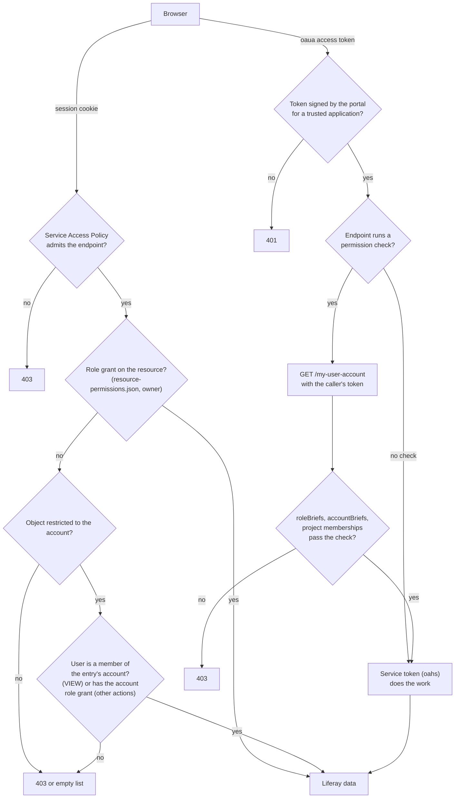

# Permissions and Visibility

This file maps who can read and change what in Liferay One. It covers the role catalog, the object permission matrix, guest access, the role checks in the pages, and the checks in the Spring Boot service. It also records an audit of these checks on 2026-10-16.

The source of truth is the code:

- The role catalog in `client-extensions/liferay-one-batch/batch/13-role.batch-engine-data.json` and the user groups in `16-user-group.batch-engine-data.json`.
- The account restriction in `client-extensions/liferay-one-batch/batch/05-object-definition-account-entry-restricted.batch-engine-data.json`.
- The grants in `client-extensions/liferay-one-site-initializer/site-initializer/resource-permissions.json` and the page permissions in `site-initializer/layouts/**/page.json`.
- The checks in `client-extensions/liferay-one-etc-spring-boot/src/main/java/com/liferay/one/permission/` and in the controllers beside them.
- The role gates in `client-extensions/liferay-one-custom-element/src/`.

Two scripts generated the tables from those files on 2026-10-16: one for the roles, the grants, and the pages, and one for the service endpoints. The tables were then checked by hand against the code and against the Liferay source that evaluates them. When this file and the code disagree, the code is correct.

In this file, `L<n>` means line `<n>` of `resource-permissions.json`, and a scope is the `ResourceConstants` integer: `1` company, `2` group, `3` group template, `4` individual.

## Summary

| Count | Item |
| --- | --- |
| 49 | Roles in the role batch: 33 account roles, 13 regular roles, and 3 site roles |
| 4 | Batch roles that are Liferay built in roles and keep their `L_` ERC |
| 5 | Liferay built in roles that the trees use but do not define: Administrator, Guest, Organization User, Site Member, User |
| 125 | Grants in `resource-permissions.json` |
| 43 | Grants on a custom object: 34 at scope 1 and 9 at scope 3 |
| 64 | Grants at scope 3. All of them go to site, account, or organization roles, where scope 3 is correct. None goes to a regular role. |
| 3 | Self `VIEW` grants on a regular role, so that the role appears in `roleBriefs` |
| 34 | Custom objects (`C_*`) in the batch |
| 14 | Custom objects restricted to the account |
| 10 | Custom objects with no grant at all. 9 of them are readable only by the owner and an administrator. |
| 24 | Pages. 10 set their own permissions. 14 keep the Liferay default, which lets a guest view them. |
| 0 | Service Access Policies in the trees. The portal adds `OBJECT_DEFAULT` itself. |
| 126 | Endpoints in the Spring Boot service |
| 42 | Endpoints with no permission check: 16 object action handlers and 26 others |

## How a Request Is Authorized

A browser reaches data on two paths.

1. **Liferay session.** The page calls a headless API or `/o/c/<plural>` with the session cookie. The Service Access Policy decides if the endpoint is reachable. Then Liferay checks the permission of the user's roles on the resource. For an object restricted to the account, Liferay also lets a member of the entry's account read the entry, whatever the member's account role is.

1. **Spring Boot service.** The page gets an access token from the `liferay-one-etc-spring-boot-oaua` application and calls the service. The service accepts a token that the portal signed for one of six trusted applications (`application-default.properties:97`). The service then reads the caller with `/my-user-account`, using the caller's own token, and runs its own role checks. After the check, most services call Liferay with the service's own token, which the `liferay-one-etc-spring-boot-oahs` application issues. That token can read and change most objects in the company.

The service has no other gate. An endpoint without a check does its work with the service token for any holder of a trusted token, and every signed in user can get one (`L947` grants `CREATE_TOKEN` to User).

## Role Catalog

The role batch matches a role by its ERC only. A built in role must keep its Liferay `L_` ERC, or the import fails with `DuplicateRoleException` for that role. The 4 built in roles in the batch do so.

"Assigned by" names the code that gives the role to a user. "Manual" means that no code in the workspace assigns the role, so an administrator assigns it in the Control Panel.

All role sources in this table are in `client-extensions/liferay-one-batch/batch/13-role.batch-engine-data.json`, and the line is the start of the entry.

| Role | ERC | Type | Line | Assigned By |
| --- | --- | --- | --- | --- |
| Account Administrator | `L_ACCOUNT_ADMINISTRATOR` | account | 228 | The creator of an account (`AccountsRestController.java:311`). The first Salesforce contact of an account that has no designated administrator (`ProvisioningContactService.java:136`). An accepted invitation (`AccountInvitationAcceptanceService.java:93`). An account manager (`AccountsRestController.java:538`). |
| Account Buyer | `C_ACCOUNT_BUYER` | account | 13 | An account manager or an invitation |
| Account Member | `L_ACCOUNT_MEMBER` | account | 233 | An account manager or an invitation |
| Account Solution Publisher | `C_ACCOUNT_SOLUTION_PUBLISHER` | account | 18 | Manual |
| Account Supplier | `L_ACCOUNT_SUPPLIER` | account | 238 | Manual. No code reads it. |
| Analytics Cloud Owner | `C_ANALYTICS_CLOUD_OWNER` | account | 23 | Manual |
| Article Administrator | `C_ARTICLE_ADMIN` | site | 28 | Manual |
| Cloud Native Contact | `C_CLOUD_NATIVE_CONTACT` | account | 33 | A project contact designation (`ProjectRestController.java:298`). Its holders get the Okta Cloud Native app (`UserAssignmentService.java:119`). |
| Critical Incident Contact | `C_CRITICAL_INCIDENT_CONTACT` | account | 38 | A project contact designation (`ProjectRestController.java:298`) or an invitation |
| Customer | `C_CUSTOMER` | regular | 43 | Membership in the Customers user group (`16-user-group.batch-engine-data.json:13`). No code adds users to the group. |
| Customer Experience Manager | `C_CUSTOMER_EXPERIENCE_MANAGER` | account | 48 | A Salesforce contact role (`ProvisioningContactService.java:118`) |
| Dashboard Viewer | `C_DASHBOARD_VIEWER` | regular | 53 | Manual. No code reads it. |
| Data Breach Contact | `C_DATA_BREACH_CONTACT` | account | 58 | A project contact designation |
| Documentation Administrator | `C_DOCUMENTATION_ADMIN` | site | 63 | Manual |
| Finance Administrator | `C_FINANCE_ADMIN` | regular | 68 | Manual |
| LDP Administrator | `C_LDP_ADMIN` | account | 73 | A project contact designation |
| Liferay Sales | `C_LIFERAY_SALES` | account | 78 | A Salesforce contact role |
| Liferay Staff | `C_LIFERAY_STAFF` | regular | 83 | Membership in the Employees user group (`16-user-group.batch-engine-data.json:24`). No code adds users to the group. |
| Marketplace Account Administrator | `C_MARKETPLACE_ACCOUNT_ADMIN` | account | 88 | Manual. No code reads it. |
| Marketplace Publisher | `C_MARKETPLACE_PUBLISHER` | regular | 93 | Manual |
| PaaS User | `C_PAAS_USER` | account | 98 | A project contact designation |
| Partner | `C_PARTNER` | regular | 103 | Membership in the Partners user group (`16-user-group.batch-engine-data.json:39`). No code adds users to the group. |
| Partner Account Admin | `C_PARTNER_ACCOUNT_ADMIN` | account | 108 | An account manager or an invitation |
| Partner Manager | `C_PARTNER_MANAGER` | account | 113 | An account manager or an invitation |
| Partner Marketing User | `C_PARTNER_MARKETING_USER` | account | 118 | An account manager or an invitation |
| Partner Member | `C_PARTNER_MEMBER` | account | 123 | An account manager or an invitation |
| Partner Sales User | `C_PARTNER_SALES_USER` | account | 128 | An account manager or an invitation |
| Partner Technical User | `C_PARTNER_TECHNICAL_USER` | account | 133 | An account manager or an invitation |
| Primary Contact | `C_PRIMARY_CONTACT` | account | 138 | A Salesforce contact role |
| Privacy Breach Contact | `C_PRIVACY_BREACH_CONTACT` | account | 143 | A project contact designation |
| Project Admin | `C_PROJECT_ADMIN` | account | 148 | A project membership (`ProjectRestController.java:266`) or an invitation. The ERC is stored on the `ProjectMembership` entry. It is not assigned as a Liferay account role. |
| Project Requester | `C_PROJECT_REQUESTER` | account | 153 | The same as Project Admin |
| Project User | `C_PROJECT_USER` | account | 158 | The same as Project Admin. Every Salesforce project contact gets it (`ProvisioningContactService.java:197`). |
| Provisioning Administrator | `C_PROVISIONING_ADMIN` | regular | 163 | Manual |
| Provisioning Contact Worker | `C_PROVISIONING_CONTACT_WORKER` | regular | 168 | Manual. No code reads it. |
| Provisioning Member | `C_PROVISIONING_MEMBER` | regular | 173 | Manual |
| Provisioning Subscription Worker | `C_PROVISIONING_SUBSCRIPTION_WORKER` | regular | 178 | Manual. No code reads it. |
| Provisioning Watcher | `C_PROVISIONING_WATCHER` | regular | 183 | Manual. No code reads it. |
| Provisioning Worker | `C_PROVISIONING_WORKER` | regular | 188 | Manual. No code reads it. |
| SSA | `C_SSA` | regular | 213 | Manual. No code reads it. |
| SSA Administrator | `C_SSA_ADMIN` | account | 218 | The SSA dashboard, in the SSA account (`ManageUserRolesModal.tsx`) |
| SSA User | `C_SSA_USER` | account | 223 | The SSA dashboard, in the SSA account |
| Secondary Contact | `C_SECONDARY_CONTACT` | account | 193 | A Salesforce contact role |
| Security Breach Contact | `C_SECURITY_BREACH_CONTACT` | account | 198 | A project contact designation |
| Security Incident Contact | `C_SECURITY_INCIDENT_CONTACT` | account | 203 | A project contact designation, or the Salesforce contact role Security Incident Contact on the project of the record (`ProvisioningContactService.java:166`). It is never an account role. |
| Site Content Reviewer | `L_SITE_CONTENT_REVIEWER` | site | 243 | Manual |
| Solution Architect | `C_SOLUTION_ARCHITECT` | account | 208 | A Salesforce contact role |

The Salesforce contact role is the `Contact_Role__c` value, matched to an account role by name (`ProvisioningContactService.java:114`). Security Incident Contact is the exception: it becomes a project membership, not an account role. The table lists the 5 roles that `EmployeeRoles.java:19` names as Liferay workers; Salesforce can send any account role name.

### Built In Roles That the Trees Use

| Role | Type | Used In |
| --- | --- | --- |
| Administrator | regular | Every service check (`RoleConstants.NAME_ADMINISTRATOR`) and every page gate. Liferay skips permission checks for it. |
| Guest | regular | 3 grants (`L163`, `L744`, `L753`), the Become a Publisher page, and the commerce channel (`commerce-channel.model-resource-permissions.json`) |
| Organization User | organization | 2 scope 3 grants (`L991`, `L1027`) |
| Site Member | site | Page permissions in 4 `page.json` files |
| User | regular | 10 grants, and the commerce channel. Every signed in user has it. |

## Object Permissions

### How Liferay Evaluates an Object Grant

An object has two resources, and a grant on the wrong one applies and grants nothing.

| Resource | Token in the Tree | Actions |
| --- | --- | --- |
| `com.liferay.object.model.ObjectDefinition#<id>` (the entry resource) | `[$OBJECT_DEFINITION_CLASS_NAME:<Name>$]` | `VIEW`, `UPDATE`, `DELETE`, `PERMISSIONS` |
| `com.liferay.object#<id>` (the portlet resource) | `com.liferay.object#[$OBJECT_DEFINITION_ID:<Name>$]` | `ADD_OBJECT_ENTRY`, `PERMISSIONS` |

`ObjectEntryModelResourcePermission` in `modules/apps/object/object-service` adds three rules for an object restricted to the account:

- `VIEW` passes for every member of the entry's account, with any account role or none.
- Other actions pass when the user's account role, or the role of an organization linked to the account, has the grant in the account's group. Liferay stores the grant of an account role or a site role at scope 3, and applies it in each account or site where the user holds the role. So scope 3 is the correct scope for those roles, and it is not the trap that `.agents/rules/site-initializer-format.md` describes for regular roles.
- An entry whose restricting field is `0` passes every action for every signed in user.

`ObjectEntryPortletResourcePermissionLogic` applies the same account and organization rule to `ADD_OBJECT_ENTRY`.

### Object Matrix

Rows are the 34 custom objects and the 6 system objects that the batch extends. Columns are the 10 roles that hold a grant on an object. A cell lists the actions, the scope, and the line: `V` is `VIEW`, `A` is `ADD_OBJECT_ENTRY`, `U` is `UPDATE`, `D` is `DELETE`. An empty cell means no grant. "Restricted By" is the `accountEntryRestrictedObjectFieldName` from batch file `05`.

| Object | Restricted By | Account Administrator | Account Member | Finance Administrator | Guest | Organization User | Project Admin | Project Requester | Provisioning Administrator | Provisioning Member | User |
| --- | --- | --- | --- | --- | --- | --- | --- | --- | --- | --- | --- |
| AccountInvitation (`C_ACCOUNT_INVITATION`) | — | | | | | | | | V s1 L19 | | |
| AccountNote (`C_ACCOUNT_NOTE`) | `r_accountEntryToAccountNote_accountEntryId` | | | | | | | | V s1 L28 | | |
| ActivationKey (`C_ACTIVATION_KEY`) | `r_accountEntryToActivationKey_accountEntryId` | | | | | | | | V s1 L37 | | |
| AIHubBetaPrivateAccessRequest (`C_AI_HUB_BETA_PRIVATE_ACCESS_REQUEST`) | — | | | | | | | | | | |
| CommonLicenseKey (`C_COMMON_LICENSE_KEY`) | — | | | | | | | | V s1 L46 | | |
| Contract (`C_CONTRACT`) | `r_accountEntryToContract_accountEntryId` | | | | | | | | V s1 L55 | | |
| DSRRequest (`C_DSR_REQUEST`) | — | | | | | | | | | | A s1 L955 |
| DXPFreeActivationKeyRequest (`C_DXP_FREE_ACTIVATION_KEY_REQUEST`) | — | | | | | | | | | | A s1 L964 |
| Entitlement (`C_ENTITLEMENT`) | `r_accountEntryToEntitlement_accountEntryId` | | | | | | | | V s1 L64 | | |
| EntitlementDefinition (`C_ENTITLEMENT_DEFINITION`) | — | | | | | | | | V s1 L73 | | V s1 L82 |
| EntitlementDefinitionSku (`C_ENTITLEMENT_DEFINITION_SKU`) | — | | | | | | | | | | |
| Environment (`C_ENVIRONMENT`) | — | | | | | | | | V s1 L91 | | V s1 L100 |
| EnvironmentAdmin (`C_ENVIRONMENT_ADMIN`) | — | | | | | | | | | | |
| GetAppInformation (`C_GET_APP_INFORMATION`) | — | | | | | | | | | | |
| LicenseKey (`C_LICENSE_KEY`) | `r_accountEntryToLicenseKey_accountEntryId` | | | | | | | | V s1 L109 | | |
| OAuth2DxpAuthorization (`C_OAUTH2_DXP_AUTHORIZATION`) | `r_accountEntryToOAuth2DxpAuthorization_accountEntryId` | A s3 L973 | A s3 L982 | | | A s3 L991 | A s3 L1000 | A s3 L1009 | | | |
| ProductFeedback (`C_PRODUCT_FEEDBACK`) | — | | | | | | | | | | |
| ProductVersion (`C_PRODUCT_VERSION`) | — | | | | | | | | V s1 L118 | | V s1 L127 |
| Project (`C_PROJECT`) | `r_accountEntryToProject_accountEntryId` | | | | | | | | V s1 L136 | | |
| ProjectMembership (`C_PROJECT_MEMBERSHIP`) | `r_accountEntryToProjectMembership_accountEntryId` | | | | | | | | V s1 L145 | | |
| Property (`C_PROPERTY`) | `r_accountEntryToProperty_accountEntryId` | | | | | | | | V s1 L154 | | |
| PublisherAccountRequest (`C_PUBLISHER_ACCOUNT_REQUEST`) | — | | | | | | | | | | |
| PublisherAsset (`C_PUBLISHER_ASSET`) | `r_accountEntryToPublisherAsset_accountEntryId` | | | | | | | | | | |
| PublisherAssetAttachment (`C_PUBLISHER_ASSET_ATTACHMENT`) | — | | | | | | | | | | |
| PublisherDetail (`C_PUBLISHER_DETAILS`) | — | | | | V s1 L163 | | | | | | V s1 L172 |
| PublisherSalesSummary (`C_PUBLISHER_SALES_SUMMARY`) | — | | | VU s1 L181 | | | | | | | |
| Report (`C_REPORT`) | — | | | | | | | | | | |
| SalesRequest (`C_SALES_REQUEST`) | — | | | | | | | | | | |
| SubscriptionEntry (`C_SUBSCRIPTION_ENTRY`) | — | | | | | | | | V s1 L191 | | |
| TicketAttachment (`C_TICKET_ATTACHMENT`) | `r_accountEntryToTicketAttachment_accountEntryId` | A s3 L1018 | | | | A s3 L1027 | A s3 L1036 | A s3 L1045 | V s1 L200 | VUD s1 L209 A s1 L1054 | |
| TrialExtensionRequest (`C_TRIAL_EXTENSION_REQUEST`) | `r_accountEntryToTrialExtensionRequest_accountEntryId` | | | | | | | | V s1 L220 | | |
| UsageDefinition (`C_USAGE_DEFINITION`) | — | | | | | | | | V s1 L229 | | V s1 L238 |
| UsageEvent (`C_USAGE_EVENT`) | — | | | | | | | | V s1 L247 | | V s1 L256 |
| UsageReport (`C_USAGE_REPORT`) | — | | | | | | | | V s1 L265 | | |
| AccountEntry (`L_ACCOUNT`) | — | See the system grants below | | | | | | | | | |
| Address (`L_POSTAL_ADDRESS`) | — | | | | | | | | | | |
| CommerceOrderItem (`L_COMMERCE_ORDER_ITEM`) | — | | | | | | | | | | |
| CPDefinition (`L_COMMERCE_PRODUCT_DEFINITION`) | — | | | | | | | | | | |
| Organization (`L_ORGANIZATION`) | — | | | | | | | | | | |
| User (`L_USER`) | — | | | | | | | | | | |

Two further grants open the object admin portlets of ActivationKey (`L274`) and LicenseKey (`L284`) to the Provisioning Administrator.

The system objects keep their native permissions. The batch adds fields to them, not grants.

### Grants on System Resources

These are the grants at scope 1 and scope 4 that do not name a custom object.

| Resource | Role | Actions | Scope | Line |
| --- | --- | --- | --- | --- |
| `90` (portal) | Provisioning Administrator | `VIEW_CONTROL_PANEL` | 1 | L2 |
| `com.liferay.account.model.AccountEntry` | Finance Administrator | `VIEW`, `VIEW_ADDRESSES` | 1 | L313 |
| `com.liferay.account.model.AccountEntry` | Provisioning Administrator | `ASSIGN_USERS`, `MANAGE_ADDRESSES`, `MANAGE_DOMAINS`, `UPDATE`, `VIEW`, `VIEW_ACCOUNT_ROLES`, `VIEW_ADDRESSES`, `VIEW_ORGANIZATIONS`, `VIEW_USERS` | 1 | L402 |
| `com.liferay.account.model.AccountRole` | Provisioning Administrator | `VIEW` | 1 | L437 |
| `com.liferay.commerce.model.CommerceOrder` | Finance Administrator | `VIEW` | 1 | L515 |
| `com.liferay.commerce.model.CommerceOrder` | Provisioning Administrator | `VIEW` | 1 | L524 |
| `com.liferay.commerce.model.CommerceOrderType` | Finance Administrator | `VIEW` | 1 | L533 |
| `com.liferay.commerce.model.CommerceOrderType` | Provisioning Administrator | `VIEW` | 1 | L542 |
| `com.liferay.commerce.order` | Finance Administrator | `MANAGE_COMMERCE_ORDERS`, `MANAGE_COMMERCE_ORDER_PRICES`, `VIEW_COMMERCE_ORDERS` | 1 | L551 |
| `com.liferay.commerce.order` | Liferay Staff | `VIEW_COMMERCE_ORDERS`, `VIEW_OPEN_COMMERCE_ORDERS` | 1 | L562 |
| `com.liferay.commerce.order` | Provisioning Administrator | `VIEW_COMMERCE_ORDERS`, `VIEW_OPEN_COMMERCE_ORDERS` | 1 | L592 |
| `com.liferay.commerce.payment.model.CommercePaymentEntry` | Finance Administrator | `VIEW` | 1 | L602 |
| `com.liferay.commerce.product.model.CommerceCatalog` | Finance Administrator | `VIEW` | 1 | L611 |
| `com.liferay.commerce.product.model.CommerceCatalog` | Provisioning Administrator | `VIEW` | 1 | L620 |
| `com.liferay.dynamic.data.mapping.model.DDMStructure-com.liferay.journal.model.JournalArticle` | Guest | `VIEW` on the `ANNOUNCEMENT` structure | 4 | L744 |
| `com.liferay.expando.kernel.model.ExpandoColumn` | Guest | `VIEW` | 1 | L753 |
| `com.liferay.expando.kernel.model.ExpandoColumn` | Provisioning Administrator | `UPDATE`, `VIEW` | 1 | L762 |
| `com.liferay.expando.kernel.model.ExpandoColumn` | User | `VIEW` | 1 | L772 |
| `com.liferay.oauth2.provider.model.OAuth2Application` | User | `CREATE_TOKEN` | 1 | L947 |
| `com.liferay.portal.kernel.model.Role` | Finance Administrator | `VIEW` on its own role | 4 | L1093 |
| `com.liferay.portal.kernel.model.Role` | Liferay Staff | `VIEW` on its own role | 4 | L1102 |
| `com.liferay.portal.kernel.model.Role` | Provisioning Administrator | `VIEW` on its own role | 4 | L1111 |
| `com.liferay.portal.kernel.model.User` | Provisioning Administrator | `VIEW` | 1 | L1120 |
| `com.liferay.portal.kernel.model.User` | Provisioning Member | `VIEW` | 1 | L1129 |
| `com_liferay_account_admin_web_internal_portlet_AccountEntriesAdminPortlet` | Provisioning Administrator | `ACCESS_IN_CONTROL_PANEL`, `VIEW` | 1 | L1138 |
| `com_liferay_commerce_product_definitions_web_internal_portlet_CPDefinitionsPortlet` | Provisioning Administrator | `ACCESS_IN_CONTROL_PANEL`, `VIEW` | 1 | L1176 |
| `com_liferay_users_admin_web_portlet_UsersAdminPortlet` | Provisioning Administrator | `ACCESS_IN_CONTROL_PANEL`, `VIEW` | 1 | L1273 |

### Grants at Scope 3

The 64 scope 3 grants go to 42 site role grants, 20 account role grants, and 2 organization role grants. Each one applies in every account, site, or organization where the user holds the role.

| Role | Type | What the Grants Give | Lines |
| --- | --- | --- | --- |
| Account Administrator | account | `ADD_OBJECT_ENTRY` on OAuth2DxpAuthorization and TicketAttachment | L973, L1018 |
| Account Buyer | account | `VIEW` on the account | L294 |
| Account Member | account | `VIEW`, `VIEW_USERS` on the account. `ADD_OBJECT_ENTRY` on OAuth2DxpAuthorization. | L303, L982 |
| Article Administrator | site | Web content and folders, and Site Administration | L629 to L1209 (6 grants) |
| Documentation Administrator | site | Web content, categories, pages, page templates, and SEO | L446 to L1251 (14 grants) |
| Organization User | organization | `ADD_OBJECT_ENTRY` on OAuth2DxpAuthorization and TicketAttachment | L991, L1027 |
| Partner Account Admin | account | Account update, users, addresses, and account roles | L323, L419 |
| Partner Manager | account | Account users and roles, and the account's orders | L339, L428, L572 |
| Partner Marketing User, Partner Sales User, Partner Technical User | account | `VIEW`, `VIEW_USERS` on the account | L351, L371, L381 |
| Partner Member | account | `VIEW`, `VIEW_USERS` on the account, and the account's orders | L361, L582 |
| Project Admin | account | `ASSIGN_USERS`, `VIEW`, `VIEW_USERS` on the account. `ADD_OBJECT_ENTRY` on OAuth2DxpAuthorization and TicketAttachment. | L391, L1000, L1036 |
| Project Requester | account | `ADD_OBJECT_ENTRY` on OAuth2DxpAuthorization and TicketAttachment | L1009, L1045 |
| Site Content Reviewer | site | Documents, web content, categories, tags, and templates, with `PERMISSIONS` | L455 to L1261 (22 grants) |

## Guest Access

### What a Guest Can Read

| Data | Grant | Gate |
| --- | --- | --- |
| Publisher Detail entries | Guest `VIEW`, scope 1 (`L163`) | The `OBJECT_DEFAULT` Service Access Policy admits `/o/c/*` reads and creates |
| Custom field definitions and the values on records the guest can see | Guest `VIEW` on ExpandoColumn, scope 1 (`L753`) | — |
| The Announcement web content structure | Guest `VIEW`, scope 4 (`L744`) | — |
| The commerce channel | Guest `VIEW` (`commerce-channel.model-resource-permissions.json`) | — |

A guest has no `ADD_OBJECT_ENTRY` grant, so a guest cannot create an object entry. No `UNASSIGN_USERS` action appears in the tree.

### Service Access Policies

The trees define no Service Access Policy. The instance settings client extension holds 4 configurations, and none of them is a policy (`client-extensions/liferay-one-instance-settings/client-extension.yaml`). The portal adds the `OBJECT_DEFAULT` policy to each company. It is default and enabled, and it admits `getByExternalReferenceCode`, `getObjectEntriesPage`, `getObjectEntry`, `postObjectEntry`, and `postScopeScopeKey` on `ObjectEntryResourceImpl` (`SAPEntryPortalInstanceLifecycleListener.java` in `modules/apps/object/object-service`). A guest call to any other headless API stops at this gate.

### Pages

All pages are in `client-extensions/liferay-one-site-initializer/site-initializer/layouts/`. "Default" means that the `page.json` has no `permissions` key. The page then gets the Liferay default permissions for a public page, which give the Guest role `VIEW`.

| Page | Hidden | Who Can View | Source |
| --- | --- | --- | --- |
| `/account-invitation` | yes | Default (guest) | `08_account-invitation/page.json` |
| `/admin` | yes | Finance Administrator, Liferay Staff, Provisioning Administrator | `05_admin/page.json` |
| `/authorize` | yes | User | `10_authorize/page.json` |
| `/home` | no | Default (guest) | `01_home/page.json` |
| `/license-agreement` | yes | User | `09_license-agreement/page.json` |
| `/marketplace` | no | Default (guest) | `04_marketplace/page.json` |
| `/marketplace/applications` | no | Default (guest) | `04_marketplace/01_applications/page.json` |
| `/marketplace/become-a-publisher` | yes | Guest | `04_marketplace/05_become-a-publisher/page.json` |
| `/marketplace/products` | no | Default (guest) | `04_marketplace/02_products/page.json` |
| `/marketplace/publishers` | no | Default (guest) | `04_marketplace/04_publishers/page.json` |
| `/marketplace/solutions` | no | Default (guest) | `04_marketplace/03_solutions/page.json` |
| `/my-account` | no | Site Member, User | `02_my-account/page.json` |
| `/my-account/publisher-dashboard` | no | Marketplace Publisher | `02_my-account/01_publisher-dashboard/page.json` |
| `/next-steps` | yes | User | `07_next-steps/page.json` |
| `/product-purchase` | yes | User | `06_product-purchase/page.json` |
| `/search` | yes | Default (guest) | `06_search/page.json` |
| `/support` | no | Default (guest) | `03_support/page.json` |
| `/support/announcements` | no | Default (guest) | `03_support/03_announcements/page.json` |
| `/support/business-events` | no | Default (guest) | `03_support/04_business-events/page.json` |
| `/support/customer-portal-help` | no | Default (guest) | `03_support/02_customer-portal-help/page.json` |
| `/support/customer-portal-help/getting-started` | no | Default (guest) | `03_support/02_customer-portal-help/01_getting-started/page.json` |
| `/support/customer-portal-help/using-customer-portal` | no | Default (guest) | `03_support/02_customer-portal-help/02_using-customer-portal/page.json` |
| `/support/large-file-uploader` | yes | Site Member, User | `03_support/05_large-file-uploader/page.json` |
| `/support/ticket-attachments` | no | Site Member, User | `03_support/06_ticket-attachments/page.json` |

The administrator always has access. A page that grants `VIEW` to Guest also lets every signed in user view it.

## Frontend Gates

The pages read the user from `/my-user-account`. Two rules decide what a gate sees:

- `roleBriefs` lists only the regular roles that the user can `VIEW` (`UserResourceDTOConverter._toRoleBriefs` in `headless-admin-user-impl`). Each regular role that a gate reads needs a self `VIEW` grant. Finance Administrator (`L1093`), Liferay Staff (`L1102`), and Provisioning Administrator (`L1111`) have one. Administrator needs none.
- `roleBriefs` comes from `UserBag.getRoles()`, which includes the roles of the user's user groups. So Liferay Staff through the Employees group does appear, when its self grant exists.

All paths in this table are in `client-extensions/liferay-one-custom-element/src/`, except the last row.

| Gate | Condition | Depends On |
| --- | --- | --- |
| `UserAccountModel.isAdmin`, `isFinanceAdministrator`, `isProvisioningAdministrator`, `isLiferayStaff` (`services/models/UserAccountModel.ts:52`) | The regular role is in `roleBriefs` | `roleBriefs` and the self `VIEW` grant |
| `UserAccountModel.canManageAllAccounts` (`services/models/UserAccountModel.ts:32`) | Administrator or Provisioning Administrator | `roleBriefs` |
| `UserAccountModel.canViewAllAccounts` (`services/models/UserAccountModel.ts:36`) | Administrator, Finance Administrator, or Provisioning Administrator | `roleBriefs` |
| `UserAccountModel.hasAccountRoleName` (`services/models/UserAccountModel.ts:80`) | The account role is held in the current account | `accountBriefs` and `Liferay.CommerceContext.account` |
| `UserAccountModel.isSSAAdmin`, `isSSAUser` (`services/models/UserAccountModel.ts:72`) | The SSA role in the SSA account. Administrator is also an SSA administrator. | `accountBriefs` |
| `useHasAdminPermissions` (`hooks/useHasAdminPermissions.ts:21`), used by `SyncToJSMButton.tsx:20` and `PubSub.tsx:31` | Administrator or Provisioning Administrator | `roleBriefs` |
| `useHasAdminPermission` (`pages/MyAccount/Projects/hooks/useHasAdminPermission.ts:8`), used by `LicenseKeys.tsx:290` and `LicenseKeyDetails.tsx:41` | `canManageAllAccounts` | `roleBriefs` |
| Admin routes (`pages/Admin/adminRoutes.tsx:42`, applied by `AdminRouter.tsx:35`) | Admin pages: Administrator. Finance pages: Administrator or Finance Administrator. Provisioning pages: Administrator or Provisioning Administrator. SSA pages: SSA Administrator or SSA User. | `roleBriefs`, `accountBriefs` |
| `isAccountManager` (`pages/MyAccount/AccountMembers/accountRoles.ts:127`) | Account Administrator, Partner Account Admin, or Partner Manager in the current account, or `canManageAllAccounts` | `accountBriefs`, `roleBriefs` |
| `canEditAccountDetails` (`accountRoles.ts:136`) | `isAccountManager` | — |
| `canAccessAccountMembers` (`accountRoles.ts:142`), used by `AccountMembers.tsx:166` and `AccountTabsLayout.tsx:35` | An account manager, or any user who is not an Account Buyer without Account Member | `accountBriefs` |
| `canAccessOrders` (`accountRoles.ts:155`), used by `Orders.tsx:320` | An account manager, or a user with one of the 9 manageable account roles | `accountBriefs` |
| `canViewAllAccountProjects` (`accountRoles.ts:162`), used by `useUserProjects.ts:51` | Account Administrator, Account Member, a partner role, or `canManageAllAccounts`. Other users see only the projects where they have a membership. | `accountBriefs`, `/o/c/projectmemberships` |
| `useHasProject` (`pages/MyAccount/Projects/hooks/useHasProject.ts:15`), used by `AccountMembers.tsx:76` | The current account has at least one project. The query counts the account's projects, not the user's memberships. | `/o/c/projects` read as the user |
| `useProjectsWithOrders` `hasAccountProjects` (`pages/MyAccount/Projects/hooks/useProjectsWithOrders.ts:12`), used by `ProjectMembers.tsx:90` | The current account has at least one project with a placed order. The check counts the account's projects, not the user's memberships. When the orders cannot be read, it counts every project of the account. | `/o/c/projects`, placed orders |
| `useProjectsWithOrders` with no projects, used by `BusinessEvents.tsx:437`, `TicketAttachmentsList.tsx:160`, and `TicketAttachmentsAdd.tsx:87` | The user sees no project with a placed order, after the membership filter | `/o/c/projects`, `/o/c/projectmemberships`, placed orders |
| `useUserProjects` with no projects, used by `TicketAttachmentsUploaderOutlet.tsx:65` | The user sees no project, after the membership filter | `/o/c/projects`, `/o/c/projectmemberships` |
| `ProjectMembers.canManageProject` (`pages/MyAccount/ProjectMembers/ProjectMembers.tsx:66`) | An account manager, or the project's Project Admin | `accountBriefs`, memberships |
| `useHasActivationPermission` (`pages/MyAccount/Projects/hooks/useHasActivationPermission.ts:92`) | Account Administrator, `canManageAllAccounts`, Liferay Staff, or the project's Project Admin | `accountBriefs`, `roleBriefs`, memberships |
| `useHasLicenseKeyPermission` (`useHasActivationPermission.ts:107`) | The activation roles, Partner Manager, or a license key manager role for a key with no project | `accountBriefs`, `roleBriefs` |
| `useHasAllEventsPermissions` (`pages/BusinessEvents/hooks/useHasAllEventsPermissions.ts:28`) | Administrator, Liferay Staff, Account Administrator, or a Project Admin or Project Requester membership | `roleBriefs`, `accountBriefs`, memberships |
| `useCanViewTickets` (`pages/BusinessEvents/hooks/useCanViewTickets.ts:16`) | The service returns a Jira object key for the project | `GET /projects/{erc}/jira/object-key` |
| `TicketAttachmentsList.canManageAttachments` (`pages/TicketAttachments/TicketAttachmentsList/TicketAttachmentsList.tsx:73`) | Administrator, Liferay Staff, or Account Administrator | `roleBriefs`, `accountBriefs` |
| `ActivationKeyDownload.isAccountAdministrator` (`pages/MyAccount/Projects/components/ActivationKeyDownload/ActivationKeyDownload.tsx:134`) | Account Administrator | `accountBriefs` |
| `MarketplaceUserAccount` (`services/models/MarketplaceUserAccount.ts:27`) | Administrator, Account Solution Publisher, SSA Administrator, or SSA User | `roleBriefs`, `accountBriefs` |
| Primary navigation (`client-extensions/liferay-one-site-initializer/site-initializer/ddm-templates/navigation-primary/ddm-template.ftl:37`) | `canBypassMyAccount` for Administrator or Liferay Staff | `User.getRoles()`, which holds only the roles assigned to the user directly |

## Spring Boot Service Checks

### The Permission Classes

All classes are in `client-extensions/liferay-one-etc-spring-boot/src/main/java/com/liferay/one/permission/`. Each class reads `/my-user-account` with the caller's token, so the same `roleBriefs` rule applies.

| Class | Global Roles That Pass | Other Rules |
| --- | --- | --- |
| `AdminPermission` (line 30) | Administrator, Provisioning Administrator | None |
| `AccountPermission` (line 46) | Administrator, Liferay Staff, Provisioning Administrator | `VIEW`: any member of the account. `ASSIGN_MEMBERS`: Account Administrator or SSA Administrator, or a partner manager when the account has the partner entitlement. `UPDATE`: Account Administrator, a partner manager with the entitlement, or any member of an organization linked to the account. |
| `ProjectPermission` (line 52) | Administrator, Liferay Staff, Provisioning Administrator | Account Administrator of the project's account: every action. Account Member: `VIEW`. Partner roles: `VIEW`, and `UPDATE` for partner managers, with the partner entitlement. Project Admin: `ASSIGN_MEMBERS`. Every project role: `VIEW`. Project Admin and Project Requester: `UPDATE`. A member of a linked organization: `VIEW` and `UPDATE`. |
| `CommerceOrderPermission` (line 42) | Administrator, Liferay Staff, Provisioning Administrator | Any member of the order's account |
| `LicenseKeyPermission` (line 47) | Administrator, Provisioning Administrator, Provisioning Member. Liferay Staff for `VIEW` only. | `UPDATE`: Liferay Sales or Partner Manager in the account. `VIEW`: any member of the account, or a member of a linked organization. |
| `CommonLicenseKeyPermission` (line 39) | Administrator, Provisioning Administrator | An active entitlement definition of the product family in one of the user's accounts |
| `EnvironmentActivationPermission` (line 137) | Administrator, Liferay Staff, Provisioning Administrator | Account Administrator of the project's account, Partner Manager where allowed, or the project's Project Admin |

### Endpoint Table

"Reads User" is `yes` when the endpoint takes the caller's token. All files are in `client-extensions/liferay-one-etc-spring-boot/src/main/java/com/liferay/one/`. The 16 object action handlers are listed after this table.

| Endpoint | Check | Reads User | Source |
| --- | --- | --- | --- |
| `GET /accounts/{accountKey}/products/{productExternalReferenceCode}/usage` | LicenseKeyPermission (VIEW) | yes | `AccountsRestController.java:205` |
| `GET /accounts/{externalReferenceCode}/invitations` | AccountPermission (VIEW) | yes | `AccountsRestController.java:131` |
| `POST /accounts/{externalReferenceCode}/invitations` | AccountPermission or ProjectPermission (UPDATE) | yes | `AccountsRestController.java:328` |
| `DELETE /accounts/{externalReferenceCode}/invitations/{accountInvitationId}` | AccountPermission or ProjectPermission (UPDATE) | yes | `AccountsRestController.java:96` |
| `POST /accounts/{externalReferenceCode}/invitations/{accountInvitationId}/resend` | AccountPermission or ProjectPermission (UPDATE) | yes | `AccountsRestController.java:411` |
| `GET /accounts/{externalReferenceCode}/jira/object-key` | AccountPermission (VIEW) | yes | `AccountsRestController.java:152` |
| `GET /accounts/{externalReferenceCode}/license-keys` | LicenseKeyPermission (VIEW) | yes | `AccountsRestController.java:165` |
| `GET /accounts/{externalReferenceCode}/license-keys/export` | LicenseKeyPermission (VIEW) | yes | `AccountsRestController.java:180` |
| `GET /accounts/{externalReferenceCode}/products` | AccountPermission (VIEW) | yes | `AccountsRestController.java:257` |
| `POST /accounts/{externalReferenceCode}/sync-to-jsm` | AdminPermission | yes | `AccountsRestController.java:447` |
| `POST /accounts/{externalReferenceCode}/user-accounts/by-email-address` | AdminPermission | yes | `AccountsRestController.java:461` |
| `DELETE /accounts/{externalReferenceCode}/user-accounts/{userId}` | AccountPermission (ASSIGN_MEMBERS) | yes | `AccountsRestController.java:110` |
| `PUT /accounts/{externalReferenceCode}/user-accounts/{userId}/account-roles` | AccountPermission (ASSIGN_MEMBERS) | yes | `AccountsRestController.java:538` |
| `POST /accounts` | None. Any signed in user creates an account and becomes its Account Administrator. | yes | `AccountsRestController.java:247` |
| `POST /activation-keys/generate` | AdminPermission, EnvironmentActivationPermission, LicenseKeyPermission (VIEW) | yes | `ActivationKeysRestController.java:290` |
| `GET /activation-keys/generate-form` | AdminPermission, EnvironmentActivationPermission, LicenseKeyPermission, ProjectPermission (VIEW) | yes | `ActivationKeysRestController.java:128` |
| `DELETE /activation-keys/subscriptions` | LicenseKeyPermission (VIEW) | yes | `ActivationKeysRestController.java:73` |
| `GET /activation-keys/subscriptions` | LicenseKeyPermission (VIEW) | yes | `ActivationKeysRestController.java:219` |
| `PUT /activation-keys/subscriptions` | LicenseKeyPermission (VIEW) | yes | `ActivationKeysRestController.java:341` |
| `GET /activation-keys/summary` | AdminPermission, EnvironmentActivationPermission, ProjectPermission (VIEW) | yes | `ActivationKeysRestController.java:177` |
| `GET /activation-keys/{activationKeyId}` | LicenseKeyPermission (VIEW) | yes | `ActivationKeysRestController.java:92` |
| `PATCH /activation-keys/{activationKeyId}/active` | AdminPermission, EnvironmentActivationPermission | yes | `ActivationKeysRestController.java:245` |
| `GET /activation-keys/{activationKeyId}/download` | LicenseKeyPermission (VIEW) | yes | `ActivationKeysRestController.java:101` |
| `POST /admin/jira/team-roles/sync` | AdminPermission | yes | `AdminRestController.java:83` |
| `POST /admin/pubsub/dispatch` | AdminPermission | yes | `AdminRestController.java:101` |
| `GET /admin/pubsub/subscribers` | AdminPermission | yes | `AdminRestController.java:51` |
| `POST /admin/usage-reports/generate` | AdminPermission | yes | `AdminRestController.java:152` |
| `POST /app-license-keys` | AdminPermission | yes | `AppLicenseKeysRestController.java:93` |
| `PUT /app-license-keys/activate` | AdminPermission | yes | `AppLicenseKeysRestController.java:144` |
| `PUT /app-license-keys/deactivate` | AdminPermission | yes | `AppLicenseKeysRestController.java:155` |
| `GET /app-license-keys/{appLicenseKeyId}` | AdminPermission | yes | `AppLicenseKeysRestController.java:48` |
| `GET /app-license-keys/{appLicenseKeyId}/download` | AdminPermission | yes | `AppLicenseKeysRestController.java:66` |
| `POST /cloud/environments/activation-request` | EnvironmentActivationPermission | yes | `CloudRestController.java:441` |
| `POST /cloud/environments/offline-activation` | None. A signed Cloud Native token is required. | no | `CloudRestController.java:495` |
| `POST /cloud/environments/offline-activation/token-validation` | None. Validates a signed token. | no | `CloudRestController.java:636` |
| `POST /cloud/environments/{environmentId}/activation` | None. Public path. A signed Cloud Native token is required. | no | `CloudRestController.java:417` |
| `GET /cloud/environments/{environmentId}/entitlements` | EnvironmentActivationPermission | yes | `CloudRestController.java:121` |
| `POST /cloud/environments/{environmentId}/manifest` | None. Public path. | no | `CloudRestController.java:471` |
| `POST /cloud/environments/{environmentId}/offline-activation-bundle` | None. Reads the environment as the user, which every user can do. | yes | `CloudRestController.java:550` |
| `POST /cloud/products/{externalReferenceCode}/virtual-entry/{virtualEntryId}/download` | None. Public path. Checks that the request body names an entitled add on. | no | `CloudRestController.java:652` |
| `GET /cloud/projects/{projectExternalReferenceCode}/entitlements/disaster-recovery` | EnvironmentActivationPermission | yes | `CloudRestController.java:169` |
| `GET /cloud/projects/{projectExternalReferenceCode}/environments/activation-codes` | EnvironmentActivationPermission | yes | `CloudRestController.java:195` |
| `POST /cloud/projects/{projectExternalReferenceCode}/environments/activation-codes` | EnvironmentActivationPermission | yes | `CloudRestController.java:714` |
| `GET /cloud/projects/{projectExternalReferenceCode}/environments/offline` | EnvironmentActivationPermission | yes | `CloudRestController.java:250` |
| `POST /commerce-orders/{commerceOrderId}/calculate-tax` | CommerceOrderPermission | yes | `CommerceOrdersRestController.java:26` |
| `POST /commerce-orders/{commerceOrderId}/complete-cloud-app` | CommerceOrderPermission | yes | `CommerceOrdersRestController.java:37` |
| `POST /commerce-orders/{commerceOrderId}/complete-settled` | CommerceOrderPermission | yes | `CommerceOrdersRestController.java:48` |
| `GET /common-license-keys` | CommonLicenseKeyPermission | yes | `CommonLicenseKeysRestController.java:52` |
| `POST /common-license-keys` | AdminPermission | yes | `CommonLicenseKeysRestController.java:102` |
| `DELETE /common-license-keys/{commonLicenseKeyId}` | AdminPermission | yes | `CommonLicenseKeysRestController.java:41` |
| `GET /common-license-keys/{commonLicenseKeyId}/download` | CommonLicenseKeyPermission | yes | `CommonLicenseKeysRestController.java:80` |
| `GET /console/projects-usage` | None. Scoped to the caller's email address. | yes | `ConsoleRestController.java:47` |
| `POST /console/provisioning/{orderId}` | CommerceOrderPermission | yes | `ConsoleRestController.java:62` |
| `POST /console/uninstall-app/{orderId}` | CommerceOrderPermission | yes | `ConsoleRestController.java:112` |
| `GET /contacts/{contactEmailAddress}/validate` | None. Tells the caller if Okta has a contact for a Liferay email address. | no | `ContactsRestController.java:25` |
| `POST /digital-sales-room/provisioning/{orderId}` | None | no | `DigitalSalesRoomRestController.java:45` |
| `GET /dxp/project-usage` | None. Scoped to the caller's email address. | yes | `DXPRestController.java:50` |
| `POST /dxp/provisioning/{orderId}` | CommerceOrderPermission | yes | `DXPRestController.java:74` |
| `POST /entitlements/generate` | None | no | `EntitlementsRestController.java:23` |
| `GET /invitations/accept` | None. Public path. The invitation token is the check. | no | `AccountInvitationsRestController.java:33` |
| `GET /jira/business-events/fields/{fieldName}/options` | None. Reads Jira field options. | no | `BusinessEventsRestController.java:57` |
| `GET /jira/product-versions` | None. Reads Jira product versions. | no | `BusinessEventsRestController.java:67` |
| `GET /jira/projects/{externalReferenceCode}/business-events` | ProjectPermission (VIEW) | yes | `BusinessEventsRestController.java:74` |
| `POST /jira/projects/{externalReferenceCode}/business-events` | ProjectPermission (UPDATE) | yes | `BusinessEventsRestController.java:121` |
| `DELETE /jira/projects/{externalReferenceCode}/business-events/{id}` | ProjectPermission (UPDATE) | yes | `BusinessEventsRestController.java:43` |
| `GET /jira/projects/{externalReferenceCode}/business-events/{id}` | ProjectPermission (VIEW) | yes | `BusinessEventsRestController.java:87` |
| `PUT /jira/projects/{externalReferenceCode}/business-events/{id}` | ProjectPermission (UPDATE) | yes | `BusinessEventsRestController.java:141` |
| `GET /jira/projects/{externalReferenceCode}/business-events/{id}/versions` | ProjectPermission (VIEW) | yes | `BusinessEventsRestController.java:105` |
| `GET /jira/projects/{externalReferenceCode}/tickets` | ProjectPermission (VIEW) | yes | `JiraRestController.java:31` |
| `GET /license-keys/developer-download` | ProjectPermission (VIEW) | yes | `LicenseKeysRestController.java:82` |
| `GET /license-keys/download` | LicenseKeyPermission (VIEW) | yes | `LicenseKeysRestController.java:153` |
| `DELETE /license-keys/subscriptions` | None. Deletes only the caller's own subscriptions. | yes | `LicenseKeysRestController.java:67` |
| `GET /license-keys/subscriptions` | LicenseKeyPermission (VIEW) | yes | `LicenseKeysRestController.java:181` |
| `PUT /license-keys/subscriptions` | LicenseKeyPermission (VIEW) | yes | `LicenseKeysRestController.java:307` |
| `POST /license-keys/type-free` | None | no | `LicenseKeysRestController.java:247` |
| `POST /license-keys/type-free-domains-check` | None. Tells the caller if a free key exists for an owner and domain. | no | `LicenseKeysRestController.java:290` |
| `PATCH /license-keys/{licenseKeyId}/active` | EnvironmentActivationPermission, LicenseKeyPermission (UPDATE) | yes | `LicenseKeysRestController.java:207` |
| `GET /license-keys/{licenseKeyId}/download` | LicenseKeyPermission (VIEW) | yes | `LicenseKeysRestController.java:125` |
| `POST /liferay-data-platform/provisioning/{orderId}` | None | no | `LiferayDataPlatformRestController.java:45` |
| `DELETE /organizations/{organizationId}/accounts/{accountId}` | AdminPermission | yes | `OrganizationsRestController.java:52` |
| `POST /organizations/{organizationId}/accounts/{accountId}` | AdminPermission | yes | `OrganizationsRestController.java:83` |
| `POST /organizations/{organizationId}/sync-from-okta` | AdminPermission | yes | `OrganizationsRestController.java:97` |
| `POST /organizations/{organizationId}/sync-to-jsm` | AdminPermission | yes | `OrganizationsRestController.java:180` |
| `DELETE /organizations/{organizationId}/user-accounts/{userId}/organization-roles` | AdminPermission | yes | `OrganizationsRestController.java:66` |
| `POST /organizations/{organizationId}/user-accounts/{userId}/organization-roles` | AdminPermission | yes | `OrganizationsRestController.java:192` |
| `GET /projects/{externalReferenceCode}/jira/object-key` | ProjectPermission (VIEW) | yes | `ProjectRestController.java:139` |
| `POST /projects/{externalReferenceCode}/sync-to-jsm` | ProjectPermission (UPDATE) | yes | `ProjectRestController.java:284` |
| `GET /projects/{externalReferenceCode}/usage` | ProjectPermission (VIEW) | yes | `ProjectRestController.java:152` |
| `GET /projects/{externalReferenceCode}/usage/event-history` | ProjectPermission (VIEW) | yes | `ProjectRestController.java:183` |
| `GET /projects/{externalReferenceCode}/usage/event-summary` | ProjectPermission (VIEW) | yes | `ProjectRestController.java:208` |
| `DELETE /projects/{projectId}/user-accounts/{userId}/account-roles` | ProjectPermission (ASSIGN_MEMBERS) | yes | `ProjectRestController.java:82` |
| `POST /projects/{projectId}/user-accounts/{userId}/account-roles` | ProjectPermission (ASSIGN_MEMBERS) | yes | `ProjectRestController.java:266` |
| `PUT /projects/{projectId}/user-accounts/{userId}/account-roles` | ProjectPermission (ASSIGN_MEMBERS) | yes | `ProjectRestController.java:330` |
| `DELETE /projects/{projectId}/user-accounts/{userId}/contact-roles` | ProjectPermission (ASSIGN_MEMBERS) | yes | `ProjectRestController.java:113` |
| `POST /projects/{projectId}/user-accounts/{userId}/contact-roles` | ProjectPermission (ASSIGN_MEMBERS) | yes | `ProjectRestController.java:298` |
| `GET /ready` | None. Public path. | no | `ReadyRestController.java:21` |
| `GET /ticket-attachments/by-external-reference-code/{externalReferenceCode}/download` | ProjectPermission (VIEW). Provisioning Member skips it. | yes | `TicketAttachmentsRestController.java:113` |
| `GET /ticket-attachments/by-id/{id}/download` | ProjectPermission (VIEW). Provisioning Member skips it. | yes | `TicketAttachmentsRestController.java:125` |
| `POST /ticket-attachments/initiate-upload` | ProjectPermission (UPDATE). Provisioning Member skips it. | yes | `TicketAttachmentsRestController.java:271` |
| `DELETE /ticket-attachments/{ticketAttachmentId}` | ProjectPermission (UPDATE). Provisioning Member skips it. | yes | `TicketAttachmentsRestController.java:79` |
| `POST /ticket-attachments/{ticketAttachmentId}/complete-upload` | ProjectPermission (UPDATE). Provisioning Member skips it. | yes | `TicketAttachmentsRestController.java:232` |
| `GET /tickets/{ticketId}/ticket-attachments/download-access-check` | ProjectPermission (VIEW). Provisioning Member skips it. | yes | `TicketsTicketAttachmentsRestController.java:45` |
| `GET /tickets/{ticketId}/ticket-attachments/upload-access-check` | ProjectPermission (UPDATE). Provisioning Member skips it. | yes | `TicketsTicketAttachmentsRestController.java:54` |
| `GET /trial/availability` | None | no | `TrialRestController.java:113` |
| `GET /trial/domain-availability/{projectPrefix}` | None | no | `TrialRestController.java:134` |
| `POST /trial/expire/{orderId}` | None | no | `TrialRestController.java:165` |
| `POST /trial/extend/{id}` | None. Acts only when the request is approved. | no | `TrialRestController.java:177` |
| `POST /trial/provisioning/{orderId}` | None | no | `TrialRestController.java:241` |
| `DELETE /trial/{orderId}` | None | no | `TrialRestController.java:69` |
| `POST /user-accounts/{userId}/sync-to-jsm` | AdminPermission | yes | `UserAccountsRestController.java:30` |
| `POST /user-accounts/{userId}/sync-with-okta` | AdminPermission | yes | `UserAccountsRestController.java:42` |

### Object Action Handlers

Liferay calls the 17 handlers under `/object/action/**` when an object action fires. No handler checks the caller. Each one trusts the `classPK` and the model in the request body, and acts with the service token. A handler cannot tell a call from Liferay apart from a call from a browser, because both carry a token of a trusted application.

| Handler | What It Does With the Body | Source |
| --- | --- | --- |
| `POST /object/action/account/create` | Assigns the default currency to the account | `ObjectActionAccountCreateRestController.java:32` |
| `POST /object/action/account/delete` | Deletes the account's JSM asset | `ObjectActionAccountDeleteRestController.java:29` |
| `POST /object/action/account/invitation/accepted` | Completes the accepted invitation | `ObjectActionAccountInvitationAcceptedRestController.java:30` |
| `POST /object/action/account/update` | Syncs the account | `ObjectActionAccountUpdateRestController.java:32` |
| `POST /object/action/commerce/order/item/entitlement/generation` | Generates entitlements for the order item | `ObjectActionCommerceOrderItemEntitlementGenerationRestController.java:28` |
| `POST /object/action/commerce/order/item/entitlement/update` | Updates the order item's entitlements | `ObjectActionCommerceOrderItemEntitlementUpdateRestController.java:28` |
| `POST /object/action/commerce/order/item/update` | Handles an order item update | `ObjectActionCommerceOrderItemUpdateRestController.java:40` |
| `POST /object/action/commerce/order/update` | Dispatches an order update | `ObjectActionCommerceOrderUpdateRestController.java:26` |
| `POST /object/action/commerce/product/definition/update` | Handles a product update | `ObjectActionCommerceProductDefinitionUpdateRestController.java:30` |
| `POST /object/action/organization/create` | Syncs the organization | `ObjectActionOrganizationCreateRestController.java:30` |
| `POST /object/action/organization/delete` | Deletes the organization's JSM asset | `ObjectActionOrganizationDeleteRestController.java:29` |
| `POST /object/action/organization/update` | Syncs the organization | `ObjectActionOrganizationUpdateRestController.java:30` |
| `POST /object/action/postal/address/create` | Handles a new address | `ObjectActionPostalAddressCreateRestController.java:34` |
| `POST /object/action/user/create` | Syncs the user | `ObjectActionUserCreateRestController.java:30` |
| `POST /object/action/user/delete` | Deletes the user's subscriptions and JSM asset | `ObjectActionUserRestController.java:30` |
| `POST /object/action/user/update` | Syncs the user | `ObjectActionUserUpdateRestController.java:30` |

## Findings

Each finding names the file and line. The findings are ordered by risk.

### High

1. **A user who can change an account or a project can invite an Account Administrator.** `POST /accounts/{erc}/invitations` checks `UPDATE`, not `ASSIGN_MEMBERS` (`AccountsRestController.java:356` and `:367`). The invitation can carry any account role ERC, including `L_ACCOUNT_ADMINISTRATOR` (`AccountsRestController.java:753`), and the acceptance assigns every role in it (`AccountInvitationAcceptanceService.java:93`). `UPDATE` passes for a Project Admin and a Project Requester on a project (`ProjectPermission.java:128`), and for every member of a linked organization (`AccountPermission.java:117`). This breaks REQ-ACCESS-061. Check `ASSIGN_MEMBERS` when the invitation carries account roles. The resend and delete paths have the same check (`AccountsRestController.java:411`, `:666`).

1. **The trial, provisioning, free key, and entitlement endpoints trust the caller.** Any signed in user can call them from the browser, and the pages do (`services/spring-boot/Trial.ts:21`, `LicenseKeys.ts:32`, `LiferayDataPlatform.ts:10`, `DigitalSalesRoom.ts:10`). With the service token, they:

	- delete the Cloud project of any trial order (`TrialRestController.java:69`) and complete and delete any order (`:165`);
	- provision any trial order (`:241`), any Digital Sales Room order (`DigitalSalesRoomRestController.java:45`), and any LDP order (`LiferayDataPlatformRestController.java:45`);
	- create a free license key on the account of any order and complete that order (`LicenseKeysRestController.java:247`);
	- generate entitlements for any order item (`EntitlementsRestController.java:23`).

	Add `CommerceOrderPermission.check` with the caller's token, as `DXPRestController.java:74` does, or limit these paths to the service's own application.

1. **The object action handlers trust the caller.** The 16 handlers under `/object/action/**` accept any trusted token, and every signed in user has an `oaua` token. A forged body can delete the JSM asset of any user, account, or organization (`ObjectActionUserRestController.java:30`, `ObjectActionAccountDeleteRestController.java:29`, `ObjectActionOrganizationDeleteRestController.java:29`) or generate entitlements (`ObjectActionCommerceOrderItemEntitlementGenerationRestController.java:28`). Accept only the token that Liferay sends for object actions, or check the `classPK` against Liferay before acting.

1. **Every signed in user can read every Environment.** User has `VIEW` at scope 1 (`L100`), and Environment is not restricted to the account. An Environment holds the activation code, the admin and owner email addresses, the IP and MAC addresses, the host name, and the public key (`03-object-definition.batch-engine-data.json:3072`). The same grant lets any user call `POST /cloud/environments/{id}/offline-activation-bundle` for any environment (`CloudRestController.java:550`), which downloads the entitled products and writes the bundle record. UsageEvent has the same company wide grant (`L256`). Restrict both objects to the account. Environment first needs a deletion type other than `disassociate` on `accountEntryToEnvironment`, because the portal refuses an account restriction on a `disassociate` relationship.

### Medium

1. **Provisioning Member has no self `VIEW` grant, so its checks never pass.** `LicenseKeyPermission.java:106` and the ticket attachment bypass (`TicketAttachmentsRestController.java:546`, `TicketsTicketAttachmentsRestController.java:99`) look for Provisioning Member in `roleBriefs`, which omits a role that the user cannot view. Add a scope 4 `VIEW` grant on `[$ROLE_ID:Provisioning Member$]` beside `L1111`.

1. **The project role grants are inert.** The 4 scope 3 grants to Project Admin and Project Requester (`L1000`, `L1009`, `L1036`, `L1045`) and the account grant to Project Admin (`L391`) apply only to a user who holds the role as a Liferay account role. The code stores project roles on `ProjectMembership` and never assigns them as account roles (`UserAssignmentService.java:194`). So a Project Admin or a Project Requester with no account role cannot record a DXP authorization (`Congratulations.tsx:47`), against REQ-ACCESS-027.

1. **Pages write to objects that the user cannot add to.** `POST /o/c/trialextensionrequests` (`ExtendSSATrialModal.tsx:106`) and its `PATCH` (`ExtendRequestModal.tsx:239`) have no `ADD_OBJECT_ENTRY` or `UPDATE` grant for the SSA roles. `POST /o/c/publisheraccountrequests` (`RequestAccount.tsx:84`) has no grant for Guest or User. `POST /o/c/getappinformations` (`GetAppInformations.ts:20`) has no grant. Each call works only for an administrator.

1. **SSA users cannot open the SSA pages.** The SSA routes live under `/admin` (`adminRoutes.tsx:142`), but the `/admin` page grants `VIEW` only to Finance Administrator, Liferay Staff, and Provisioning Administrator (`05_admin/page.json`). An SSA Administrator or SSA User without one of those roles gets no page. Liferay Staff has the page but no route.

1. **The restricted pages use two conditions.** REQ-ACCESS-091 asks for one shared condition, the account's projects. Account Members uses `useHasProject` (`AccountMembers.tsx:76`), and Project Members counts the account's projects with a placed order (`ProjectMembers.tsx:90`). Business Events and Ticket Attachments use the membership filtered `useProjectsWithOrders` (`BusinessEvents.tsx:437`, `TicketAttachmentsList.tsx:160`, `TicketAttachmentsAdd.tsx:87`), and the attachment uploader uses the membership filtered `useUserProjects` (`TicketAttachmentsUploaderOutlet.tsx:65`). A user in an account with projects and no membership sees "not included in your current plan" on those pages.

1. **The account manager differs between the pages and the service.** The pages count Partner Manager and Provisioning Administrator as account managers (`accountRoles.ts:127`), with no partner entitlement check. The service counts Account Administrator and SSA Administrator, and partner managers only with the partner entitlement (`AccountPermission.java:75`). REQ-ACCESS-070 names Account Administrator, Partner Account Admin, and Administrator. A Partner Manager in an account without the entitlement sees the member actions and gets 403.

1. **An account restricted entry with no account is open to every user.** Liferay passes every action when the restricting field is `0` (`ObjectEntryModelResourcePermission.java:222` in `modules/apps/object/object-service`). Seed data or code that leaves the account field empty on Project, ProjectMembership, LicenseKey, or another of the 12 objects makes that entry readable and writable by every signed in user. Make the account relationship field required on these objects.

### Low

1. **The primary navigation misses Liferay Staff from the Employees group.** `navigation-primary/ddm-template.ftl:37` reads `User.getRoles()`, which holds only directly assigned roles. Liferay Staff comes from the Employees user group, so `canBypassMyAccount` stays false for most staff.

1. **10 custom objects have no grant.** AIHubBetaPrivateAccessRequest, EntitlementDefinitionSku, EnvironmentAdmin, GetAppInformation, ProductFeedback, PublisherAccountRequest, PublisherAssetAttachment, Report, and SalesRequest are readable only by the owner and an administrator. PublisherAsset is restricted to the account, so the members of its account can read it. Confirm that only the service reads the other 9.

1. **`POST /accounts` has no limit.** Any signed in user can create any number of accounts and becomes the Account Administrator of each (`AccountsRestController.java:247`).

1. **The guest access card named the wrong entry resource.** `.agents/rules/guest-access.md` said that `[$OBJECT_DEFINITION_CLASS_NAME:<Name>$]` resolves to `com.liferay.object.model.ObjectEntry#<id>`. The portal prefix is `com.liferay.object.model.ObjectDefinition#` (`ObjectDefinitionConstants.java:14` in `modules/apps/object/object-api`). Fixed on 2026-10-20 (Go-Live Tasks T6.3). `.agents/rules/site-initializer-format.md` presents scope 3 as a trap in general. It is a trap only for a regular role.

1. **Two pages read objects that do not exist.** `utils/apiUtils.ts:79` reads `/o/c/licensetypesdescriptions` and `utils/apiUtils.ts:108` reads `/o/c/contactsaleses`. No batch file defines either object.

### History Verified

- The User `VIEW` grant on EntitlementDefinition is present (`L82`). LiferayBundle no longer exists in the batch, so its old grant is not needed.
- No `UNASSIGN_USERS` action appears in `resource-permissions.json`.
- Liferay Staff through the Employees group does appear in `roleBriefs`, because `UserBagFactoryUtil` reads the roles of the user's groups. The earlier note that group roles never appear is wrong for `roleBriefs`. It is correct for `User.getRoles()`, which the navigation template uses.
- The memory note that LPD-92707 moved Business Events and Ticket Attachments to `useHasProject` is wrong. Only Account Members and Project Members use it.

## Open Questions

1. Who adds users to the Customers, Employees, and Partners user groups? No workspace code does, so Liferay Staff, Customer, and Partner depend on a manual step or an Okta provisioning flow outside the workspace.

1. Who assigns Marketplace Publisher, Account Solution Publisher, Finance Administrator, Provisioning Administrator, and Provisioning Member? The Publisher Dashboard page needs the regular role Marketplace Publisher, while the pages check the account role Account Solution Publisher.

1. Are the 9 roles that no code reads still needed: Account Supplier, Dashboard Viewer, Marketplace Account Administrator, Provisioning Contact Worker, Provisioning Subscription Worker, Provisioning Watcher, Provisioning Worker, SSA, and Analytics Cloud Owner?

1. Which caller is meant to use the trial and provisioning endpoints: the browser, a Liferay workflow, or an external application? The answer decides between an order check and an application allow list.

1. Is the company wide guest `VIEW` on ExpandoColumn (`L753`) meant to expose the values of every custom field on records that a guest can see, such as the commerce channel and the products?

1. Does the deployed environment still match the tree? The site initializer runs once, at site creation, so a grant added later reaches an existing site only through a manual call or a reprovision.