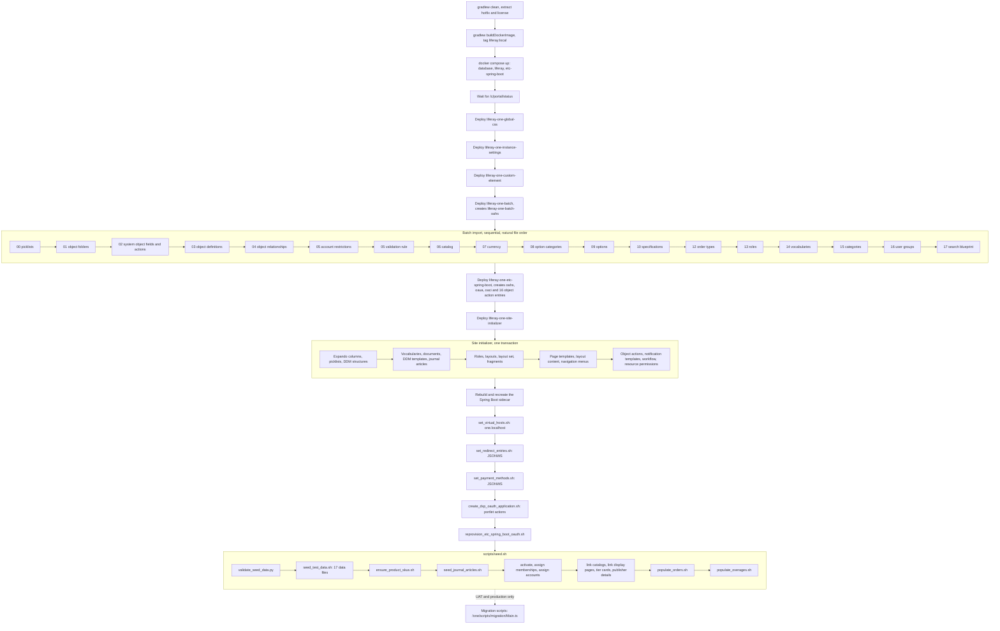
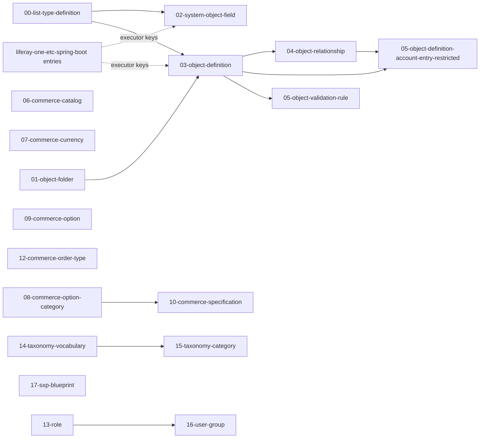

# Provisioning Pipeline and Data Ownership

This file shows how a Liferay One environment goes from nothing to a working portal, which layer owns each kind of data, and what happens when a step runs a second time. It also records an audit of the pipeline on 2026-10-16.

The source of truth is the code: the client extensions under `client-extensions/`, the scripts under `scripts/`, the `one-*` skills under `.claude/skills/`, and the migration scripts in the Liferay One scripts repository. A script generated the batch file table, the item counts, and the dependency graph from `client-extensions/liferay-one-batch/batch/` and `scripts/seed/data/` on 2026-10-16. When this file and the code disagree, the code is correct.

The claims about Liferay behavior cite the portal source in this repository (`modules/apps/...`). The workspace runs `dxp-2026.q1.2-lts` (`gradle-local.properties`), so the deployed portal can differ from the source in this checkout. Each such claim says so.

The migration scripts are not in this repository. The Related Repos section of `CLAUDE.md` shows how to find the `liferay-one/scripts` checkout. Paths in this file use `<scripts>/` for its root.

## Summary

| Count | Item |
| --- | --- |
| 7 | Client extensions that bootstrap deploys, in a fixed order |
| 18 | Batch files in `liferay-one-batch`, numbered `00` to `17` with no `11` and two `05` files |
| 407 | Items in the batch files |
| 10 | Dependency edges between batch files. The file order respects all 10. |
| 1 | Batch reference to a client extension entry that does not exist |
| 23 | Relationships that a second import of `02-system-object-field` deletes |
| 5 | Bootstrap scripts that run after the client extensions |
| 12 | Seed steps in `scripts/seed.sh` |
| 17 | Seed data files in `scripts/seed/data/` |
| 3 | Reset tiers: site, instance, and environment |
| 4 | Environment types: local Docker, partitioned instance, stack, and UAT |
| 12 | Findings, of which 4 are high |

## Pipeline From Zero

`scripts/bootstrap.sh` is the orchestrator for a local environment. It pins the seed scripts to basic auth against `LIFERAY_BOOTSTRAP_URL` (`scripts/bootstrap.sh:32-36`), so a bootstrap never writes to the remote environment that `.env` can name. The migration scripts are not part of any bootstrap. A person runs them against UAT or production to load real data.

### Steps and Sources

| Step | What It Does | Source |
| --- | --- | --- |
| Build | Runs `gradlew clean`, extracts the hotfix and the license, builds the portal image, and tags it `liferay:local`. | `scripts/bootstrap.sh:44-57` |
| Containers | Starts `database`, `liferay`, and `liferay-one-etc-spring-boot`. The sidecar shares the network of the `liferay` container. | `scripts/bootstrap.sh:60`, `docker-compose.yaml` |
| Liferay ready | Polls `/c/portal/status` every 10 seconds with no limit. | `scripts/bootstrap.sh:63-67` |
| Client extensions | Deploys seven client extensions in a fixed order. It sleeps 10 seconds after each light one, waits for the batch log to go quiet for 20 seconds, and waits for the `Initialized One for group` log line. | `scripts/bootstrap/deploy_client_extensions.sh:26-48`, `:88-140`, `:145-150` |
| OAuth applications | Each client extension deploy creates its own OAuth2 applications: `liferay-one-batch-oahs`, `liferay-one-salesforce-product-batch-oahs`, `liferay-one-site-initializer-oahs`, and the `oahs`, `oaua`, and `oaci` applications of the Spring Boot client extension. | `client-extensions/*/client-extension.yaml` |
| Instance settings | Four `instanceSettings` entries. Three are scoped to the site by `siteExternalReferenceCode: LIFERAY_ONE`. Liferay matches that code when it reads the configuration, so the site does not have to exist at deploy time. | `client-extensions/liferay-one-instance-settings/client-extension.yaml`, `modules/apps/configuration-admin/.../ConfigurationFilterStringUtil.java:51-73` |
| Batch import | Imports 18 files, one at a time, in natural file name order. | `modules/apps/batch-engine/.../BatchEngineUnitReaderImpl.java:111-112`, `BatchEngineUnitProcessorImpl.java:540-561` |
| Site initializer | Creates or updates the `LIFERAY_ONE` site through `putSiteByExternalReferenceCode` in one transaction. | `modules/apps/site-initializer/.../SiteInitializerClientExtension.java:168-229` |
| Sidecar | Rebuilds the Spring Boot image and recreates its container, so it reads the routes the deploy wrote. | `scripts/bootstrap/deploy_client_extensions.sh:50-60` |
| Virtual host | Binds `one.localhost` to the public layout set of the One site. | `scripts/bootstrap/set_virtual_hosts.sh:14-26` |
| Redirects | Adds the redirect entries that give the hash routes of the custom element a plain path. The site initializer cannot hold them (see trap 7). | `scripts/bootstrap/set_redirect_entries.sh:14-45` |
| Payment methods | Activates `money-order` and `paypal-integration` on the channel through JSONWS. No client extension type, headless API, or batch delegate exists for these rows. | `scripts/bootstrap/set_payment_methods.sh:14-34` |
| DXP OAuth application | Creates `marketplace-client-id` through the OAuth2 admin portlet actions, with the PKCE and refresh token grants that a customer DXP needs. | `scripts/bootstrap/create_dxp_oauth_application.sh:7-44` |
| Sidecar OAuth | Redeploys the Spring Boot client extension with `--rerun-tasks` so its redirect URIs and CORS list include `one.localhost`, then restarts the sidecar. | `scripts/bootstrap/reprovision_etc_spring_boot_oauth.sh:7-45` |
| Seed | Validates the seed data, then runs 12 steps. A failed step does not stop the others, and the run reports every failed step at the end. | `scripts/seed.sh:28-46`, `:78-91` |
| Migration | Extracts from Koroneiki, Salesforce, and the old Marketplace, then writes accounts, projects, products, contracts, orders, entitlement definitions, entitlements, and license keys. | `<scripts>/one/scripts/migration/Main.ts:6-9`, `MigrateMain.ts:43-90` |

### Client Extension Deploy Order

Each target deploys the client extensions in a different order. The batch must come before the site initializer, because 29 object names in the site initializer tree resolve through `[$OBJECT_DEFINITION_ID:<Name>$]` and `[$OBJECT_DEFINITION_CLASS_NAME:<Name>$]` tokens, and all 29 are defined in the batch files.

| Target | Order | Waits for the Batch Import | Source |
| --- | --- | --- | --- |
| Local Docker | global CSS, instance settings, custom element, batch, Salesforce product batch, Spring Boot, site initializer | Yes, log quiet for 20 seconds, after each batch | `scripts/bootstrap/deploy_client_extensions.sh:26-48` |
| Partitioned instance | global CSS, instance settings, custom element, batch, Salesforce product batch, site initializer, then Spring Boot in `_set_up` | Yes, reads import tasks from the partition, after each batch | `scripts/instance.sh:25-31`, `:161-233`, `:531-553` |
| UAT and production | batch, site initializer, then the others. Only the client extensions that changed since a base commit. The Salesforce product batch never deploys there, because its `LCP.json` sets `deploy` to `false`. | No. `lcp deploy` returns when the upload finishes. | `scripts/deploy.sh:16-19`, `:63-69`, `:161-176` |

An object action whose executor key names a client extension entry that does not exist yet is allowed: Liferay logs it at debug level and saves the action (`modules/apps/object/.../ObjectActionLocalServiceImpl.java:726-740`). So the batch can define actions before the Spring Boot client extension deploys.

### Site Initializer Handlers

`BundleSiteInitializer` does not run its handlers in a fixed list. It builds a dependency map (`_createRMap`) and runs each handler when all of its prerequisites are done. The log prints the real order as `Invoking <handler> took <n> ms`. These are the handlers that read the One tree, with their prerequisites from the map:

| Directory or File | Handler | Runs After |
| --- | --- | --- |
| `asset-list-entries.json` | `addAssetListEntries` | DDM structures, documents, journal articles, object entries, `publishObjectDefinitions` |
| `commerce-channel*.json` | `addCPDefinitions`, through the commerce site initializer | `addOrUpdateLayouts`, object entries |
| `data-definitions/` | `addOrUpdateDataDefinitions` | nothing |
| `ddm-structures/` | `addOrUpdateDDMStructures` | nothing |
| `ddm-templates/` | `addOrUpdateDDMTemplates` | data definitions, DDM structures, `publishObjectDefinitions` |
| `documents/` | `addOrUpdateDocuments` | expando columns, vocabularies |
| `expando-columns.json` | `addOrUpdateExpandoColumns` | nothing |
| `expando-values.json` | `addExpandoValues` | journal articles, layout content, user groups |
| `fragments/` | `addFragmentEntries` | documents, `updateLayoutSets` |
| `journal-articles/` | `addOrUpdateJournalArticles` | DDM templates, documents |
| `layout-page-templates/` | `addLayoutPageTemplates` | object definitions, `addCPDefinitions`, client extension entries, fragments, journal articles, search blueprint |
| `layout-set/` | `updateLayoutSets` | `addOrUpdateLayouts` |
| `layouts/` | `addOrUpdateLayouts`, then `addOrUpdateLayoutsContent` | roles; then fragments and page templates |
| `list-type-definitions/` | `addOrUpdateListTypeDefinitions` | nothing |
| `notification-templates/` | `addOrUpdateNotificationTemplates` | `publishObjectDefinitions` |
| `object-actions/` | `addOrUpdateObjectActions` | account entry restrictions |
| `plo-entries.json` | `setPLOEntries` | nothing |
| `resource-permissions.json` | `addOrUpdateResourcePermissions` | segments experiences, workflow definitions |
| `site-navigation-menus.json` | inside `addOrUpdateLayoutsContent` | the layouts |
| `style-books/` | `addStyleBookEntries` | depot entries |
| `taxonomy-vocabularies/` | `addOrUpdateTaxonomyVocabularies` | DDM structures |
| `workflow-definitions/` | `addWorkflowDefinitions` | accounts, roles |

Source: `_createRMap` in `modules/apps/site-initializer/site-initializer-extender/site-initializer-extender/src/main/java/com/liferay/site/initializer/extender/internal/BundleSiteInitializer.java`, and the loop at `:6142-6172`.

## Batch Files

The table lists every file in `client-extensions/liferay-one-batch/batch/`. REST Builder generates the same strategy mapping for every resource: `UPSERT` with `UPDATE` calls the PUT by external reference code, which replaces the record. `UPSERT` with `PARTIAL_UPDATE` reads the record by external reference code and calls PATCH, or POST when the record does not exist. `INSERT` calls POST. Source: `BaseObjectDefinitionResourceImpl.java:774-826` in `modules/apps/object/object-admin-rest-impl`.

| File | Entity | Items | Create, Update | On Error Fail | Depends On |
| --- | --- | --- | --- | --- | --- |
| `00-list-type-definition` | `ListTypeDefinition` | 23 | `UPSERT`, `UPDATE` | false | nothing |
| `01-object-folder` | `ObjectFolder` | 2 | `UPSERT`, `UPDATE` | false | nothing |
| `02-system-object-field` | `ObjectDefinition` (6 system objects) | 6 | `UPSERT`, `UPDATE` | false | `00` (picklist `LT_PRODUCT_FAMILY`); 6 Liferay system objects; 14 Spring Boot object action entries |
| `03-object-definition` | `ObjectDefinition` (35 custom objects) | 35 | `UPSERT`, `PARTIAL_UPDATE` | false | `00` (14 picklists); `01` (2 folders); 2 Spring Boot object action entries, 1 of which does not exist |
| `04-object-relationship` | `ObjectRelationship` | 52 | `UPSERT`, `UPDATE` | not set | `03` (27 objects); 6 Liferay system objects |
| `05-object-definition-account-entry-restricted` | `ObjectDefinition` | 12 | `UPSERT`, `PARTIAL_UPDATE` | false | `03` (12 objects); `04` (12 `accountEntryTo*` relationships) |
| `05-object-validation-rule` | `ObjectValidationRule` | 1 | `INSERT` | false | `03` (`C_PROJECT_MEMBERSHIP`) |
| `06-commerce-catalog` | `Catalog` | 1 | `UPSERT`, `PARTIAL_UPDATE` | false | the built in currency `USD` |
| `07-commerce-currency` | `Currency` (`SGD`) | 1 | `INSERT` | not set | nothing |
| `08-commerce-option-category` | `OptionCategory` | 5 | `UPSERT`, `PARTIAL_UPDATE` | false | nothing |
| `09-commerce-option` | `Option` | 3 | `UPSERT`, `PARTIAL_UPDATE` | false | nothing |
| `10-commerce-specification` | `Specification` | 55 | `UPSERT`, `PARTIAL_UPDATE` | false | `08` (5 option categories) |
| `12-commerce-order-type` | `OrderType` | 19 | `UPSERT`, `PARTIAL_UPDATE` | false | nothing |
| `13-role` | `Role` | 49 | `UPSERT`, `PARTIAL_UPDATE` | false | nothing |
| `14-taxonomy-vocabulary` | `TaxonomyVocabulary`, site `L_GLOBAL` | 10 | `UPSERT`, `UPDATE` | false | nothing |
| `15-taxonomy-category` | `TaxonomyCategory`, site `L_GLOBAL` | 128 | `UPSERT`, `UPDATE` | false | `14` (10 vocabularies) |
| `16-user-group` | `UserGroup` | 4 | `UPSERT`, `PARTIAL_UPDATE` | false | `13` (3 roles) |
| `17-sxp-blueprint` | `SXPBlueprint` | 1 | `UPSERT`, `UPDATE` | false | nothing |

### Dependency Graph

An arrow points from the file that creates an entity to the file that references it. The two `05` files sort as `05-object-definition-account-entry-restricted` before `05-object-validation-rule`, because the batch engine uses natural string order.

### Order Check

The file order respects all 10 edges. No file references an entity that a later file creates. Three references point outside the batch:

1. `06-commerce-catalog` uses `USD`, a currency that Liferay creates. `07-commerce-currency` adds only `SGD`, so the numbers `06` and `07` are not in conflict.

1. `02` and `03` name 16 Spring Boot object action entries as `function#<entry>`. 15 of them exist (see finding 6). The Spring Boot client extension deploys after the batch. Liferay accepts an executor key that is not registered yet, so the order works.

1. The commerce products that use the 55 specifications, the 3 options, and the 128 categories are not in the batch. The 48 Salesforce products of UAT are in `client-extensions/liferay-one-salesforce-product-batch`, as draft products with unpublished SKUs, the way UAT holds them. The other products are in `scripts/seed/data/06-commerce-product.batch-engine-data.json` and in the migration. All 36 specification keys and all 26 category codes that the seed products use exist in `10` and `15`. The earlier rule "import `10-commerce-specification` before `06-commerce-product`" now holds across layers: the batch runs before the seed.

### Seed Files

`scripts/seed/seed_test_data.sh` imports these files in file name order, after it imports `09-commerce-option` from the batch a second time (`scripts/seed/seed_test_data.sh:27-40`). Custom object entries go to the scoped `/o/c/<plural>/batch` endpoint of the object.

| File | Entity | Items | Create, Update in the File |
| --- | --- | --- | --- |
| `01-account` | `Account` | 32 | `UPSERT`, `UPDATE` |
| `02-user-account` | `UserAccount` | 16 | `UPSERT`, `UPDATE` |
| `03-project` | `C_PROJECT` | 36 | `UPSERT`, `UPDATE` |
| `04-contract` | `C_CONTRACT` | 37 | `UPSERT`, `UPDATE` |
| `05-commerce-catalog` | `Catalog` (`TEST_SUPPLIER_CATALOG`) | 1 | `UPSERT`, `PARTIAL_UPDATE` |
| `05-commerce-option` | `Option` (`MACHINE_TYPE`) | 1 | `UPSERT`, `PARTIAL_UPDATE` |
| `06-commerce-product` | `Product` | 46 | `UPSERT`, `PARTIAL_UPDATE` |
| `07-license-key` | `C_LICENSE_KEY` | 17 | `UPSERT`, `UPDATE` |
| `08-project-membership` | `C_PROJECT_MEMBERSHIP` | 73 | `UPSERT`, `UPDATE` |
| `09-publisher-account-request` | `C_PUBLISHER_ACCOUNT_REQUEST` | 4 | `UPSERT`, `UPDATE` |
| `10-publisher-sales-summary` | `C_PUBLISHER_SALES_SUMMARY` | 3 | `UPSERT`, `UPDATE` |
| `11-publisher-details` | `C_PUBLISHER_DETAILS` | 1 | `UPSERT`, `UPDATE` |
| `13-usage-definition` | `C_USAGE_DEFINITION` | 12 | `UPSERT`, `UPDATE` |
| `14-environment` | `C_ENVIRONMENT` | 25 | `UPSERT`, `UPDATE` |
| `15-entitlement-definition` | `C_ENTITLEMENT_DEFINITION` | 149 | `UPSERT`, `UPDATE` |
| `16-oauth2-dxp-authorization` | `C_OAUTH2_DXP_AUTHORIZATION` | 3 | `UPSERT`, `UPDATE` |
| `17-entitlement-definition-sku` | `C_ENTITLEMENT_DEFINITION_SKU` | 149 | `UPSERT`, `UPDATE` |

The import URLs pass `createStrategy` but not `updateStrategy` (`scripts/seed/seed_test_data.sh:84`, `:92`). So every seed file updates with `UPDATE`, and the `PARTIAL_UPDATE` in `05` and `06` has no effect. See finding 9.

## Ownership Map

The workspace rule is: the batch client extension holds definitions, configuration, and reference entries that ship to every environment, with no test data. The site initializer holds site content. The seed holds test records. The migration holds real data. The table shows where each kind of data lives today. Rows that break the rule carry a finding number.

| Entity | Definition | Reference Data | Test Data | Real Data |
| --- | --- | --- | --- | --- |
| Picklists | batch `00` (23); site initializer (3: `AC-REGIONS`, `LIFERAY-VERSIONS`, `LT_PURPOSE_OF_COMPLIMENTARY_KEY`) | same | none | none |
| Object folders | batch `01` | none | none | none |
| Custom objects (35) | batch `03` | none | seed `03`, `04`, `07` to `17` | migration and runtime |
| Fields and actions on 6 system objects | batch `02` | none | none | none |
| Object action on Commerce Order | site initializer `object-actions/` | none | none | none |
| Object relationships (52) | batch `04` | none | none | none |
| Account restrictions (12) | batch `05` | none | none | none |
| Validation rule (1) | batch `05` | none | none | none |
| Custom fields (expando, 81 columns on 7 models) | site initializer `expando-columns.json` | site initializer `expando-values.json` | none | migration |
| Commerce channel | site initializer `commerce-channel.json` | none | none | none |
| Channel payment methods | none | bootstrap `set_payment_methods.sh` | none | none |
| Commerce catalogs | batch `06` (`LIFERAY_INC_CATALOG`) | none | seed `05` (`TEST_SUPPLIER_CATALOG`) | migration (marketplace publishers) |
| Currency `SGD` | batch `07` | none | none | migration (account currencies) |
| Option categories, specifications | batch `08`, `10` | none | none | none |
| Options | batch `09` (3); seed `05` (`MACHINE_TYPE`), finding 8 | none | none | migration creates `MACHINE_TYPE` when it is missing |
| Commerce products and SKUs | none | none | seed `06` (46), `ensure_product_skus.sh` | migration (Salesforce and Marketplace products) |
| Order types | batch `12` | none | none | none |
| Roles, user groups | batch `13`, `16` | none | role and group memberships in seed | migration (memberships) |
| Vocabularies (company) | batch `14` (10) and site initializer (11), finding 5 | batch `15` (128 categories) and site initializer (5 categories) | none | none |
| Vocabulary `article-categories` (site) | site initializer | site initializer (60 categories) | none | none |
| Search blueprint | batch `17` | none | none | none |
| Usage definitions | batch `03` | seed `13` only, finding 4 | none | none |
| Entitlement definitions and SKU links | batch `03` | seed `15`, `17` | same | migration `CreateEntitlementDefinitions` |
| Accounts, users | Liferay | none | seed `01`, `02` and the assign scripts | migration and runtime |
| Orders, order items, entitlements, license keys, usage events | Liferay and batch `03` | none | `populate_orders.sh`, `populate_overages.sh` | migration and runtime |
| Pages, fragments, templates, style books, menus, documents | site initializer | none | none | none |
| Journal articles | site initializer (`eula` only) | none | `seed_journal_articles.sh` | migration `MigrateCPArticles` |
| Product display page links, tier card IDs | none | `link_product_display_pages.sh`, `configure_tier_cards.sh` in the seed, finding 4 | none | none |
| Notification templates, workflow definitions, resource permissions | site initializer | none | none | none |
| Virtual host, redirect entries | none | bootstrap | none | none |
| OAuth2 applications | each client extension deploy; bootstrap for `marketplace-client-id`; `/one-oauth-app` for `local-dev` | none | none | none |
| Instance settings | `liferay-one-instance-settings` | none | none | none |

The batch rule holds: no batch file holds test data. The batch OAuth application still asks for 8 `c_*.everything` scopes for objects whose entries moved to the seed (`client-extensions/liferay-one-batch/client-extension.yaml:13-20`). The batch writes no object entries, so it does not need them.

## Rerun Behavior

### Per Step

| Step | Second Run | What Makes It Run Again |
| --- | --- | --- |
| Batch client extension | The batch engine writes a processed marker per file and company, keyed on the bundle modification time. An identical zip does nothing. A changed zip imports all 18 files again, in order. | A new zip (`gradlew clean deploy`), or a reinstall of the bundle. Source: `BatchEngineUnitProcessorImpl.java:456-530`. |
| `00`, `01`, `04`, `14`, `15`, `17` | Upsert by external reference code with full replace. Safe. | as above |
| `02-system-object-field` | PUT by external reference code. Deletes every nonsystem relationship whose parent is one of the 6 system objects, because the file sends `objectRelationships: []`. `04` then creates them again with empty foreign keys. | as above. See trap 3. |
| `03`, `05`, `06`, `08` to `10`, `12`, `13`, `16` | PATCH by external reference code. The objects keep their relationships, because the PATCH starts from the stored definition. | as above |
| `05-object-validation-rule`, `07-commerce-currency` | `INSERT` posts the item again and the item fails as a duplicate. | as above. Finding 10. |
| Site initializer | A new zip calls `putSiteByExternalReferenceCode`, which updates the existing group and runs every handler again in one transaction. Most handlers upsert. A failure rolls back the whole run and leaves the site as it was. | A new zip. Deleting the site and deploying a new zip creates it from nothing. |
| `set_virtual_hosts.sh` | Sets the same host. Safe. | every bootstrap and reset |
| `set_redirect_entries.sh` | Looks up each entry before it writes. Safe. | every bootstrap and reset |
| `set_payment_methods.sh` | Skips an engine that already has a row on the channel. Safe. | bootstrap and partitioned instance provision only |
| `create_dxp_oauth_application.sh` | Updates the application in place. Safe. | bootstrap and partitioned instance provision only |
| `reprovision_etc_spring_boot_oauth.sh` | Redeploys with `--rerun-tasks` and restarts the sidecar. Safe. | every local bootstrap and reset |
| Seed data files | Upsert by external reference code. Safe, except that products use `UPDATE` (finding 9). | every bootstrap and reset |
| `populate_orders.sh`, `populate_overages.sh` | Upsert orders by external reference code. Disables the `EntitlementGeneration` action while it runs. | every bootstrap and reset. See finding 2. |
| Migration | `CreateEntitlementDefinitions` upserts by external reference code. The other scripts are outside this audit. | by hand |

### Known Traps

Each trap was checked against the code or the data. The status column says how far.

| # | Trap | Status | Evidence |
| --- | --- | --- | --- |
| 1 | A reserved field name such as `status` aborts the whole object import. | True as a mechanism. No field in the current batch files uses a reserved name: the script checked every object field against `status`, `id`, `creator`, `keywords`, `userId`, and five metadata names. | `batch_deps.py` output; `.agents/rules/site-initializer-format.md` |
| 2 | Deleting a batch owned object definition triggers an OSGi refresh that imports all batch data again. | Observed, not confirmed in source. The processed marker lives in the bundle data area and is keyed on the bundle modification time, so a reinstall of the bundle imports again. The refresh path that `teardown_structure.sh` describes was not traced. | `scripts/seed/teardown_structure.sh:29-40`; `BatchEngineUnitProcessorImpl.java:483-530` |
| 3 | Importing `02-system-object-field` into a populated environment drops relationships. | True. `putObjectDefinition` deletes each stored relationship whose name is not in the request. The 6 items send an empty list. 23 relationships in `04` have one of the 6 system objects as parent: 16 on `L_ACCOUNT`, 3 on `L_USER`, 2 on `L_COMMERCE_PRODUCT_DEFINITION`, 1 on `L_COMMERCE_ORDER_ITEM`, and 1 on `L_ORGANIZATION`. The team saw 19 deleted on one environment. A deleted relationship drops its foreign key column, so the links on existing entries are lost. | `client-extensions/liferay-one-batch/batch/02-system-object-field.batch-engine-data.json:9`; `ObjectDefinitionResourceImpl.java:910-931` |
| 4 | `PARTIAL_UPDATE` does not add `objectFields`. | Observed, not confirmed in source. `preparePatch` passes new fields through to the PUT, so the source in this checkout looks like it adds them. The team saw new fields not added on `2026.q1.2`, and added them with `POST .../object-fields`. | `ObjectDefinitionResourceImpl.java:1026-1078` |
| 5 | The site initializer is all or nothing. | True. The client extension runs the site PUT inside `TransactionInvokerUtil.invoke`. A failure rolls back the site, the objects, and the picklists that the run created. | `SiteInitializerClientExtension.java:217-228` |
| 6 | Object relationship JSON needs a stable external reference code. | True for the site initializer. Not a risk now: the site initializer tree has no `object-relationships/` directory, and all 52 relationships in `04` have a fixed, readable external reference code. | `batch_deps.py` output |
| 7 | `site-settings.json` cannot hold redirect patterns. | True as documented. The site initializer passes each value as a string, and `RedirectPatternConfigurationModelListener` casts the patterns to `String[]`, which fails the provision. The redirects are a bootstrap step. | `scripts/bootstrap/set_redirect_entries.sh:27-45` |

## Reset Matrix

A filled cell means the reset destroys and builds that layer again. "Kept" means the layer survives. "Lost" means the reset destroys the layer and does not build it again.

| Layer | `/one-env-down` | `/one-site-reset` | `/one-instance-reset` | `/one-env-reset` | `teardown.sh` | `teardown.sh --full` | `instance.sh delete` and `provision` |
| --- | --- | --- | --- | --- | --- | --- | --- |
| Docker image and volumes | kept | kept | kept | rebuilt | kept | kept | kept (shared server) |
| Database | kept | kept | kept | rebuilt | kept | kept | rebuilt (own schema) |
| OAuth app `local-dev` | kept | kept | kept | lost (run `/one-oauth-app`) | kept | kept | not created |
| Global CSS, instance settings, custom element | kept | kept | kept | rebuilt | kept | kept | rebuilt |
| Batch definitions and reference data | kept | kept | rebuilt | rebuilt | kept | deleted, then restored by the batch refresh (trap 2) | rebuilt |
| One site and its content | kept | rebuilt | rebuilt | rebuilt | kept | kept | rebuilt |
| Commerce channel | kept | depends on the site delete (open question 2) | rebuilt by the site initializer | rebuilt | kept | deleted | rebuilt |
| Payment methods | kept | depends on the channel | lost (open question 2) | rebuilt | kept | lost | rebuilt |
| DXP OAuth application | kept | kept | kept | rebuilt | kept | kept | rebuilt |
| Virtual host, redirects | kept | rebuilt | rebuilt | rebuilt | kept | kept | rebuilt |
| Sidecar OAuth routes | kept | rebuilt | rebuilt | rebuilt | kept | kept | rebuilt (own sidecar) |
| Seed records | kept | rebuilt | rebuilt | rebuilt | deleted | deleted | rebuilt |

Sources: `scripts/bootstrap.sh:38-42`, `scripts/seed/site_reset.sh:44-68`, `scripts/seed/instance_reset.sh:55-94`, `scripts/seed/teardown.sh:5-17`, `scripts/seed/teardown_structure.sh:44`, `:103-108`, `scripts/instance.sh:144-159`, `:417-444`, and the `one-*` skills.

`teardown_records.sh` deletes 13 record types: orders, usage reports, entitlements, license keys, environments, contracts, project memberships, projects, publisher data, products, journal articles, accounts, and users. It keeps entitlement definitions, usage definitions, entitlement definition SKUs, and DXP OAuth authorizations. The seed upserts them again, so this has no effect on a reset.

## Environment Differences

| Step | Local Docker | Partitioned Instance | Stack | UAT and Production |
| --- | --- | --- | --- | --- |
| Entry point | `scripts/bootstrap.sh` | `scripts/instance.sh provision <web ID>` | `instance.sh` with `DOCKER_HOST` and `LIFERAY_INSTANCE_DOMAIN=stack`, or a whole Docker stack on the host | `scripts/deploy.sh` with `LCP_PROJECT` |
| Build and containers | Builds the image and starts the stack | Uses the shared server. Creates the company through `headless-portal-instances` under the import lock. | The server runs on the stack host. The scripts build on the laptop. | Liferay Cloud |
| Client extensions | 6, with `liferay-one` names | 6, built with `-Pliferay.virtual.instance.id`, so each zip and bundle has the `_<web ID>` suffix | as partitioned instance | Only the client extensions that changed |
| Spring Boot | One sidecar on port 58081 | One sidecar per instance, ports 58082 to 58099 | Sidecar bound to `127.0.0.1` on the stack host | Liferay Cloud service |
| Virtual host | `one.localhost` | `<subdomain>.localhost` and `admin.<subdomain>.localhost` | `<subdomain>.stack` | Real domain |
| Redirects, payment methods, DXP OAuth | Yes | Yes, in `_configure` | Yes | Not automated. Run each script by hand with admin credentials. |
| `reprovision_etc_spring_boot_oauth.sh` | Yes | No. The sidecar deploys after the host is bound. | No | No |
| Batch import lock | No | Yes, for the company creation, each batch and site initializer deploy, and each seed import | Yes | No |
| Seed | Yes | Yes. `admin.<subdomain>.localhost` passes `_require_local_seed_target`. | Refused. `admin.<subdomain>.stack` is not a local host, so 4 steps exit and the other 8 run against missing data. Run again with `LIFERAY_SEED_REMOTE=true` and `DOCKER_HOST`. | Refused unless `LIFERAY_SEED_REMOTE=true` |
| Migration | No | No | No | Yes |

Sources: `scripts/_common.sh:87-97`, `:209-221`, `:296-317`; `scripts/instance.sh:5-20`, `:102-142`, `:417-444`, `:531-553`; `scripts/deploy.sh:7-26`; `.claude/skills/one-worktree-instance/SKILL.md`. The stack host itself is defined in personal tooling outside this repository.

`scripts/bootstrap/build.sh`, `start.sh`, and `post-start.sh` are a second entry point with `pre-*.sh` and `post-*.sh` hooks. No file in this repository calls them. `post-start.sh` runs only `deploy_client_extensions.sh`, so that path sets no virtual host and runs no seed.

## Findings

### High

1. **Every deploy of a changed batch zip deletes 23 relationships and their foreign keys.** `02-system-object-field.batch-engine-data.json:9` sets `updateStrategy` to `UPDATE`, and each of its 6 items sends `objectRelationships: []`. The PUT deletes the relationships whose parent is `L_ACCOUNT`, `L_USER`, `L_COMMERCE_PRODUCT_DEFINITION`, `L_COMMERCE_ORDER_ITEM`, or `L_ORGANIZATION`. `04` creates them again with empty foreign key columns. `scripts/deploy.sh:130` deploys the batch to UAT whenever a file under `client-extensions/liferay-one-batch/` changes. Change `02` to `PARTIAL_UPDATE`, or list the relationships in each item, or move the 14 object actions and 5 fields to `object-admin` calls.

1. **Fixed on 2026-10-20 (Go-Live Tasks T3.4): a partitioned instance provision left the `EntitlementGeneration` action disabled.** `scripts/seed/populate_orders.sh` set an `EXIT` trap that turns the action on again, and with `LIFERAY_BATCH_IMPORT_LOCK=true`, which `scripts/instance.sh` sets, `_lock_batch_import` replaced that trap with `trap '_unlock' EXIT`. Both now add their command with `_add_exit_command` in `scripts/_common.sh`, and the one `EXIT` trap runs each command once.

1. **`/one-site-reset` can delete the site and not create it again.** `scripts/seed/site_reset.sh:53` deploys the site initializer without `clean`. `scripts/seed/instance_reset.sh:62-67` explains that an unchanged source copies a byte identical zip, which Liferay does not process. On a second site reset with no source change, the site stays deleted and the wait times out after 600 seconds. Add `:client-extensions:liferay-one-site-initializer:clean` as `instance_reset.sh:78` does.

1. **Reference data that every environment needs lives only in the seed, which UAT and production never run.** `scripts/seed/data/13-usage-definition.batch-engine-data.json` (12 usage definitions) has no other source, so the monthly usage reports find no metric on an environment without the seed. `link_product_display_pages.sh` and `configure_tier_cards.sh` are site configuration in `scripts/seed.sh:42-43`. `configure_tier_cards.sh` says to run it by hand on UAT and production, but nothing does. Move the usage definitions to the batch, and move the two site configuration steps to bootstrap, as `set_redirect_entries.sh` is.

### Medium

1. **Two layers own the same 10 company vocabularies and 5 categories.** `14-taxonomy-vocabulary` and `client-extensions/liferay-one-site-initializer/site-initializer/taxonomy-vocabularies/company/` both write `MARKETPLACE_APP_CATEGORY` and 9 more. `15-taxonomy-category` and the site initializer both write `MARKETPLACE_LISTING_LISTED` and the 4 `MARKETPLACE_PRODUCT_TYPE_*` categories. `MARKETPLACE_SOLUTION_EDITION` exists only in the site initializer. A change in one layer is reverted by the other on the next run. Keep the company vocabularies in the batch only.

1. **The `UsageReportApproved` action does not create the overage order.** `03-object-definition.batch-engine-data.json:8072` names `function#liferay-one-etc-spring-boot-object-action-usage-report-approved`. The entry in `client-extensions/liferay-one-etc-spring-boot/client-extension.yaml:133` and the controller `ObjectActionUsageReportApprovedRestController` exist. The controller does nothing unless the usage report is approved, and then it only logs a warning. An approved usage report creates no overage order and no Salesforce opportunity. Add the order and the opportunity to the controller.

1. **The UAT deploy does not wait for the batch import before the site initializer.** `scripts/deploy.sh:63-69` calls `lcp deploy` for each client extension in a row. The site initializer resolves 29 object definition tokens that the batch creates. When both change in one deploy, the site initializer can run first and fail its transaction. Deploy the batch alone and wait, or deploy the site initializer in a second run.

1. **The batch options fail on `2026.q1.2`, and only the seed works around it.** `scripts/seed/seed_test_data.sh:27-33` says `OptionResourceImpl` throws a `NullPointerException` for each new option, so the seed imports `09-commerce-option` a second time over REST. UAT and production run no seed, so they get no options from the batch, and each published SKU expires its siblings. The `MACHINE_TYPE` option is also seed data (`scripts/seed/data/05-commerce-option.batch-engine-data.json`), although the migration creates it when it is missing.

### Low

1. **The seed ignores `updateStrategy`.** `scripts/seed/seed_test_data.sh:84` and `:92` send `createStrategy` only, so the import uses the default `UPDATE`. `05-commerce-catalog`, `05-commerce-option`, and `06-commerce-product` ask for `PARTIAL_UPDATE`. `populate_orders.sh` passes `updateStrategy`, so the two scripts behave differently.

1. **Two batch files use `INSERT` and fail on every reimport.** `05-object-validation-rule.batch-engine-data.json:6` and `07-commerce-currency.batch-engine-data.json:6` post again and fail as duplicates. `07` also does not set `onErrorFail`. Use `UPSERT`.

1. **The `one-bootstrap` skill documents commands that `bootstrap.sh` does not have.** `.claude/skills/one-bootstrap/SKILL.md:29-39` lists `up`, `start`, `stop`, `down`, and `clean`. `scripts/bootstrap.sh:10-16` reads only `--reset` and ignores every other argument, so `scripts/bootstrap.sh stop` runs a full bootstrap, and `clean` does not delete the volumes. Point the skill at `docker compose` for those commands.

1. **Dead configuration in the client extensions.** `client-extensions/liferay-one-site-initializer/client-extension.yaml:4` sets `overwrite: true`, which the workspace plugin does not map to `site-initializer.json` (`CreateClientExtensionConfigTask.java:939-948` maps 7 keys, and `overwrite` is not one of them). `client-extensions/liferay-one-batch/client-extension.yaml:13-20` grants 8 `c_*.everything` scopes that no batch file uses. `scripts/instance.sh:215` says the site initializer does not run again on an existing site, but `putSiteByExternalReferenceCode` runs it again when the zip changes.

## Open Questions

1. Does the deployed `2026.q1.2` portal behave as the source in this checkout for the three Liferay behaviors that the findings depend on: the PUT that deletes relationships (finding 1), the PATCH that adds or does not add object fields (trap 4), and the site initializer that runs again on an existing site (finding 12)? A test on a scratch partitioned instance answers all three.

1. Does deleting the One site in `/one-site-reset` delete the commerce channel? If it does, the site initializer creates a new channel with no payment methods, and `site_reset.sh` does not run `set_payment_methods.sh`, so checkout fails with a 404. `instance_reset.sh` has the same gap with certainty, because `teardown_structure.sh:44` deletes the channel.

1. Which file in the migration repository loads usage definitions and the consumable entitlement definitions on UAT and production? `consumable-products.md` says they are seed data, and the search of `<scripts>/one/scripts/` found no writer of `C_USAGE_DEFINITION`.

1. Who calls `scripts/bootstrap/build.sh` and `start.sh`? If nothing does, they can be deleted. If an external tool does, document it here.

1. Should the 3 picklists in the site initializer move to `00-list-type-definition`? Their codes (`AC-REGIONS`, `LIFERAY-VERSIONS`) do not follow the `LT_` convention of the other 23.