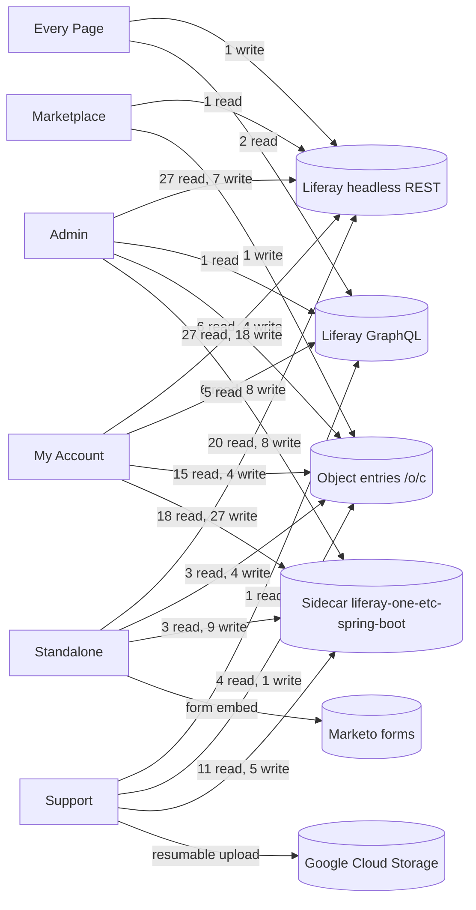

# Route to API Map

This file maps each Liferay page that hosts the Liferay One custom element to its route group, each route to the component that renders it, and each component to the HTTP calls that it can make. It also gives the reverse index from each sidecar endpoint to the routes that call it.

The code is the source of truth. A script read these sources on 2026-10-16 and generated the tables:

- `client-extensions/liferay-one-custom-element/src/**`: `main.tsx`, the routers and route files under `src/pages/**`, and every hook, context, and service that a route imports.
- `client-extensions/liferay-one-custom-element/client-extension.yaml`.
- `client-extensions/liferay-one-site-initializer/site-initializer/layouts/**` and the `liferay-one` master page, for the pages that place the element.
- `client-extensions/liferay-one-etc-spring-boot/src/main/java/com/liferay/one/*RestController.java`, for the sidecar endpoints.

[`README.md`](./README.md) says that a hand written route map goes stale. Do not edit the tables by hand. Run the script again and replace the file. When this file and the code disagree, the code is correct.

## How the Script Works

The script parses every TypeScript file with the TypeScript compiler API. It starts at the component of each route and follows the imports into hooks, contexts, services, and models. It follows static imports, `lazy(() => import(...))`, class methods, and calls through `this`. It does not follow a route definition file, because a layout that imports the route list for its navigation does not render those routes.

- A Liferay call is a string or a template that starts with `/o/`. The script also accepts `o/`, `${baseURL}/o/`, and `${window.location.origin}/o/`.
- A sidecar call is a path that a `OneSpringBootOAuth2` subclass passes to `this.get`, `this.post`, `this.put`, `this.patch`, or `this.delete`, or a path that a page passes to `oauth2Client.fetch`. The script adds the base path of the subclass, for example `/projects`.
- The HTTP method comes from the call: `fetcher.post`, `this.patch`, or a `method` option. A path in an SWR key, in `useObjectItems`, or in a `resource` property is a GET.
- The script matches a sidecar path to a `@GetMapping`, `@PostMapping`, `@PutMapping`, `@PatchMapping`, or `@DeleteMapping` segment by segment.

The tables show static reachability. A listed call can run from the route, for example from a button or a modal. It does not run on every page load.

The script does not see the calls inside `@liferay/oauth2-provider-web`, which reads `/o/oauth2/` to find the sidecar URL. It does not read fragments, `liferay-one-etc-cron`, or the scripts repository. The diagram adds the two external services by hand: Google Cloud Storage for ticket attachment uploads, and Marketo for two purchase forms.

The author checked five routes by hand against the source, and each one matched: `admin` `/pub-sub`, `my-account` `/:accountERC/account-details`, `ticket-attachments` `/new/:ticketId`, `business-events` `/:projectERC/business-events/add`, and `oauth2-authorize` `/congratulations`. The hand check found two calls that the tables leave out by design. The ticket attachment uploader also sends `PUT` requests to a Google Cloud Storage session URL (`useGCSUploadFile.ts:127`). `Congratulations` also resolves the DXP home page URL through the OAuth2 library before it redirects.

## Summary

| Count | Item |
| --- | --- |
| 12 | Route attributes in `src/main.tsx`, each with one router |
| 13 | Placements of the widget: 12 site pages and the `liferay-one` master page |
| 113 | Routes, after the script merges the purchase steps that several product flows share |
| 78 | Distinct Liferay headless and GraphQL calls (method and path) |
| 37 | Distinct object entry calls under `/o/c/` |
| 41 | Distinct writes that the browser sends to Liferay directly, not through the sidecar |
| 128 | Sidecar endpoints in 42 controllers |
| 79 | Sidecar endpoints that a route or a wrapper calls |
| 17 | Sidecar object action endpoints, which Liferay calls |
| 32 | Other sidecar endpoints with no caller in the custom element |

## How To Read the Map

A Liferay page places the `liferay-one-custom-element` widget with the property `route=<attribute>`. The element reads the attribute and loads one router. Every router uses a `HashRouter`, so the route path is the part of the URL after `#`. For example, `/my-account#/ACCNT-001/project/PRJCT-001/products` is the route `/:accountERC/project/:projectERC/products` of the `my-account` group.

Three gates apply, in this order:

1. The page permission in `page.json`. Liferay applies it before the element loads.

1. The gate in the element. The `admin` routes have a `canAccess` function each. Four routers call `useRequireSignIn`, which sends a guest to the login page. A gate in the element hides a page. It does not protect an endpoint.

1. The permission check in the sidecar controller, or the Liferay permission on a direct headless call.

The browser reaches the sidecar through the OAuth2 user agent application `liferay-one-etc-spring-boot-oaua`. The library reads the home page URL of that application, and the request path is the controller base path plus the method path.

## Diagram

The diagram groups the routes by the page group of the page that hosts them. Each label counts the distinct calls from that group to that backend. A sidecar POST can be a read, for example a download.

## Pages That Host the Element

Each row is one placement of the `liferay-one-custom-element` widget. The `route` property in the widget configuration selects the route group. "Page View" lists the roles that `page.json` grants VIEW. "In App Gate" is the check that the element itself makes.

| Friendly URL | Page Group | Page | Route Attribute | Hidden | Page View | In App Gate |
| --- | --- | --- | --- | --- | --- | --- |
| `(every page)` | Every Page | Liferay One master page | `account-selector` | no | every viewer of a page that uses the master | None. |
| `/account-invitation` | Standalone | Account Invitation | `account-invitation` | yes | not set (portal default) | None in the element. The page reads the invitation token. |
| `/admin` | Admin | Admin | `admin` | yes | Finance Administrator, Liferay Staff, Provisioning Administrator | `canAccess` per route (`adminRoutes.tsx`). The index shows "access required" when no route passes. |
| `/authorize` | Standalone | Authorize | `oauth2-authorize` | yes | User | `useRequireSignIn`. |
| `/license-agreement` | Standalone | License Agreement | `license-agreement` | yes | User | None. |
| `/marketplace/become-a-publisher` | Marketplace | Become a Publisher | `become-a-publisher` | yes | Guest | None. |
| `/my-account` | My Account | My Account | `my-account` | no | Site Member, User | `useRequireSignIn` redirects a guest to the login page. |
| `/my-account/publisher-dashboard` | My Account | Publisher Dashboard | `publisher-dashboard` | no | Marketplace Publisher | None in the router. The page permission admits only Marketplace Publisher. |
| `/next-steps` | Standalone | Next Steps | `next-steps` | yes | User | None. |
| `/product-purchase` | Standalone | Product Purchase | `product-purchase` | yes | User | `useRequireSignIn`. Contact sales products render `ContactSales` and no routes. |
| `/support/business-events` | Support | Business Events | `business-events` | no | not set (portal default) | None in the router. Each page checks project membership (`useHasAllEventsPermissions`). |
| `/support/large-file-uploader` | Support | Large File Uploader | `ticket-attachments` | yes | Site Member, User | `useRequireSignIn`. Each page checks access through the sidecar access checks. |
| `/support/ticket-attachments` | Support | Ticket Attachments | `ticket-attachments` | no | Site Member, User | `useRequireSignIn`. Each page checks access through the sidecar access checks. |

## Route Group Entry Points

`src/main.tsx` maps each route attribute to a lazily loaded router. Every router uses a `HashRouter`, so the route path is the part of the URL after `#`.

| Route Attribute | Router File | Routes |
| --- | --- | --- |
| `account-invitation` | `pages/AccountInvitation/index.tsx` | 1 |
| `account-selector` | `pages/AccountSelector/AccountSelectorRouter.tsx` | 1 |
| `admin` | `pages/Admin/AdminRouter.tsx` | 19 |
| `become-a-publisher` | `pages/BecomeAPublisher/BecomeAPublisherRouter.tsx` | 2 |
| `business-events` | `pages/BusinessEvents/BusinessEventsRouter.tsx` | 6 |
| `license-agreement` | `pages/LicenseAgreement/index.tsx` | 1 |
| `my-account` | `pages/MyAccount/MyAccountRouter.tsx` | 22 |
| `next-steps` | `pages/NextSteps/index.tsx` | 1 |
| `oauth2-authorize` | `pages/OAuth2Authorize/OAuth2AuthorizeRouter.tsx` | 4 |
| `product-purchase` | `pages/ProductPurchase/ProductPurchaseRouter.tsx` | 19 |
| `publisher-dashboard` | `pages/PublisherDashboard/PublisherDashboardRouter.tsx` | 31 |
| `ticket-attachments` | `pages/TicketAttachments/TicketAttachmentsRouter.tsx` | 6 |

## Layouts and Providers

A route renders inside its layouts and providers. The route tables do not repeat their calls. The calls of a wrapper can run on every route below it. `OneContextProvider` and `preloadAppData` run for every route attribute. `AppPurchaseProvider`, `CartProvider`, `useDeliveryProduct`, and `ContactSales` belong to `product-purchase`. `MarketplaceContextProvider` belongs to `publisher-dashboard`. `useGetResourceInfo` belongs to `oauth2-authorize`.

| Wrapper | File | Liferay Headless | Object Entries | Sidecar |
| --- | --- | --- | --- | --- |
| `AccountLayout` | `pages/MyAccount/components/AccountLayout/AccountLayout.tsx` | | | |
| `AccountProvider` | `context/AccountContext.tsx` | `POST /o/commerce-ui/set-current-account` (W) `POST /o/graphql` headlessAdminUser_v1_0.account `GET /o/headless-admin-user/v1.0/accounts/by-external-reference-code/{accountERC}` | | |
| `AccountTabsLayout` | `pages/MyAccount/components/AccountTabsLayout/AccountTabsLayout.tsx` | | | |
| `AdminLayout` | `pages/Admin/AdminLayout.tsx` | | | |
| `AppPurchaseProvider` | `pages/ProductPurchase/context/AppPurchaseContext.tsx` | | | |
| `BusinessEventsRedirect` | `pages/BusinessEvents/BusinessEventsRedirect.tsx` | `POST /o/graphql` c.projects | `GET /o/c/projectmemberships` | |
| `CartProvider` | `pages/ProductPurchase/context/CartContext.tsx` | `PATCH /o/headless-commerce-delivery-cart/v1.0/carts/{id}` (W) | | |
| `ContactSales` | `pages/ProductPurchase/ContactSales/ContactSales.tsx` | | | |
| `MarketplaceContextProvider` | `context/MarketplaceContextProvider.tsx` | `GET /o/headless-admin-user/v1.0/my-user-account` | | |
| `NewAppContextWrapper` | `pages/PublisherDashboard/publisherDashboardRoutes.tsx` | `POST /o/graphql` `GET /o/headless-commerce-admin-catalog/v1.0/catalogs` `GET /o/headless-commerce-admin-catalog/v1.0/products/{productId}` `GET /o/headless-commerce-admin-pricing/v2.0/price-entries/{priceEntryId}/tier-prices` `GET /o/headless-commerce-admin-pricing/v2.0/price-lists/{priceListId}/price-entries` `GET /o/headless-commerce-admin-pricing/v2.0/price-lists` `GET /o/headless-delivery/v1.0/documents/{documentId}` | `GET /o/c/publisherassets` | |
| `OAuth2AuthorizeLayout` | `pages/OAuth2Authorize/OAuth2AuthorizeRouter.tsx` | | | `GET /console/projects-usage` → `ConsoleRestController.getProjectsUsage` |
| `OneContextProvider` | `context/OneContextProvider.tsx` | `GET /o/headless-admin-user/v1.0/my-user-account` | | |
| `preloadAppData` | `preloadAppData.ts` | `POST /o/graphql` c.contracts `POST /o/graphql` c.projects `POST /o/graphql` headlessAdminUser_v1_0.account `POST /o/graphql` headlessAdminUser_v1_0.accounts `GET /o/headless-admin-user/v1.0/my-user-account` `GET /o/headless-commerce-delivery-catalog/v1.0/channels/{channelId}/products` `GET /o/headless-commerce-delivery-order/v1.0/channels/{channelId}/accounts/{accountId}/placed-orders` | `GET /o/c/entitlements` | |
| `ProductPurchaseLayout` | `pages/ProductPurchase/components/ProductPurchaseLayout/ProductPurchaseLayout.tsx` | `POST /o/commerce-ui/set-current-account` (W) `GET /o/headless-admin-user/v1.0/accounts/{accountId}` `GET /o/headless-admin-user/v1.0/accounts/{id}` `GET /o/headless-commerce-admin-account/v1.0/accounts/{accountId}/accountAddresses` `POST /o/headless-commerce-delivery-cart/v1.0/carts/{cartId}/checkout` (W) `GET /o/headless-commerce-delivery-cart/v1.0/carts/{cartId}/items` `GET /o/headless-commerce-delivery-cart/v1.0/carts/{cartId}/payment-url` `DELETE /o/headless-commerce-delivery-cart/v1.0/carts/{id}` (W) `GET /o/headless-commerce-delivery-cart/v1.0/carts/{id}` `PATCH /o/headless-commerce-delivery-cart/v1.0/carts/{id}` (W) `GET /o/headless-commerce-delivery-cart/v1.0/channels/{channelId}/account/{accountId}/carts` `POST /o/headless-commerce-delivery-cart/v1.0/channels/{channelId}/carts` (W) `GET /o/headless-commerce-delivery-catalog/v1.0/channels/{channelId}/currencies` `GET /o/headless-commerce-delivery-catalog/v1.0/channels/{channelId}/products/{productId}/skus` | `POST /o/c/getappinformations` (W) | `POST /liferay-data-platform/provisioning/{orderId}` → `LiferayDataPlatformRestController.postProvisioningOrder` (W) |
| `ProjectLayout` | `pages/MyAccount/components/ProjectLayout/ProjectLayout.tsx` | `POST /o/graphql` c.contracts `POST /o/graphql` c.projects | `GET /o/c/entitlements` `GET /o/c/projectmemberships` | |
| `ProjectProvider` | `context/ProjectContext.tsx` | `POST /o/graphql` c.contracts `POST /o/graphql` c.entitlements `POST /o/graphql` c.projects `GET /o/headless-commerce-delivery-catalog/v1.0/channels/{channelId}/products` `GET /o/headless-commerce-delivery-order/v1.0/channels/{channelId}/accounts/{accountId}/placed-orders` | `GET /o/c/projectmemberships` | |
| `PublishAppOutlet` | `pages/PublisherDashboard/pages/NewAppFlow/PublishAppOutlet.tsx` | `GET /o/headless-admin-user/v1.0/accounts/{accountId}` `DELETE /o/headless-commerce-admin-catalog/v1.0/attachment/by-externalReferenceCode/{externalReferenceCode}` (W) `GET /o/headless-commerce-admin-catalog/v1.0/options` `GET /o/headless-commerce-admin-catalog/v1.0/products/{productId}/productOptions` `POST /o/headless-commerce-admin-catalog/v1.0/products/{productId}/productOptions` (W) `POST /o/headless-commerce-admin-catalog/v1.0/products/{productId}/productSpecifications` (W) `POST /o/headless-commerce-admin-catalog/v1.0/products/{productId}/skus` (W) `PATCH /o/headless-commerce-admin-catalog/v1.0/products/{productId}` (W) `POST /o/headless-commerce-admin-catalog/v1.0/products/by-externalReferenceCode/{externalReferenceCode}/images` (W) `PATCH /o/headless-commerce-admin-catalog/v1.0/productSpecifications/{id}` (W) `POST /o/headless-commerce-admin-catalog/v1.0/products` (W) `GET /o/headless-commerce-admin-pricing/v2.0/price-entries/{priceEntryId}/tier-prices` `PATCH /o/headless-commerce-admin-pricing/v2.0/price-entries/{priceEntryId}` (W) `GET /o/headless-commerce-admin-pricing/v2.0/price-lists/{priceListId}/price-entries` `POST /o/headless-commerce-admin-pricing/v2.0/price-lists/{priceListId}/price-entries` (W) `GET /o/headless-commerce-admin-pricing/v2.0/price-lists` `POST /o/headless-commerce-admin-pricing/v2.0/price-lists` (W) `DELETE /o/headless-commerce-admin-pricing/v2.0/tier-prices/{tierPriceId}` (W) `POST /o/headless-delivery/v1.0/document-folders/{documentFolderId}/documents` (W) `GET /o/headless-delivery/v1.0/document-folders/{folderId}/document-folders` `POST /o/headless-delivery/v1.0/document-folders/{parentDocumentFolderId}/document-folders` (W) `DELETE /o/headless-delivery/v1.0/documents/{documentId}` (W) `POST /o/headless-delivery/v1.0/sites/{…}/document-folders` (W) `GET /o/headless-delivery/v1.0/sites/{siteId}/document-folders` | `POST /o/c/publisherassetattachments` (W) `DELETE /o/c/publisherassets/{id}` (W) `POST /o/c/publisherassets` (W) | |
| `PublisherDashboardLayout` | `pages/PublisherDashboard/components/PublisherDashboardLayout/PublisherDashboardLayout.tsx` | | | |
| `PublishSolutionOutlet` | `pages/PublisherDashboard/pages/NewSolutionFlow/PublishSolutionOutlet.tsx` | `GET /o/headless-admin-user/v1.0/accounts/{accountId}` `DELETE /o/headless-commerce-admin-catalog/v1.0/attachment/by-externalReferenceCode/{externalReferenceCode}` (W) `POST /o/headless-commerce-admin-catalog/v1.0/products/{productId}/productSpecifications` (W) `PATCH /o/headless-commerce-admin-catalog/v1.0/products/{productId}` (W) `POST /o/headless-commerce-admin-catalog/v1.0/products/by-externalReferenceCode/{externalReferenceCode}/images` (W) `PATCH /o/headless-commerce-admin-catalog/v1.0/productSpecifications/{id}` (W) `POST /o/headless-commerce-admin-catalog/v1.0/products` (W) `DELETE /o/headless-delivery/v1.0/documents/{documentId}` (W) | `DELETE /o/c/publisherassets/{id}` (W) | |
| `SolutionContextWrapper` | `pages/PublisherDashboard/publisherDashboardRoutes.tsx` | `POST /o/graphql` `GET /o/headless-commerce-admin-catalog/v1.0/catalogs` `GET /o/headless-commerce-admin-catalog/v1.0/products/{productId}` | | |
| `TicketAttachmentsLayout` | `pages/TicketAttachments/components/TicketAttachmentsLayout/TicketAttachmentsLayout.tsx` | | | |
| `useDeliveryProduct` | `hooks/useDeliveryProduct.ts` | `GET /o/headless-commerce-delivery-catalog/v1.0/channels/{channelId}/products/{productId}` | | |
| `useGetResourceInfo` | `hooks/useGetResourceInfo.ts` | | | `GET /console/projects-usage` → `ConsoleRestController.getProjectsUsage` |

## Routes

One table for each route group. "Hooks and Services" lists the hooks and service methods that the route component reaches, at most ten. The endpoint columns list every call that the component reaches through its imports. (W) marks a write. A GraphQL call shows as `POST /o/graphql` with the namespace and the field. It is a read. An empty row reads its data from a layout or a provider.

### `account-invitation`

| Route | Component | Hooks and Services | Liferay Headless | Object Entries | Sidecar |
| --- | --- | --- | --- | --- | --- |
| `(widget)` | `pages/AccountInvitation/AccountInvitation.tsx` | | | | `GET /invitations/accept` → `AccountInvitationsRestController.getAccept` |

### `account-selector`

| Route | Component | Hooks and Services | Liferay Headless | Object Entries | Sidecar |
| --- | --- | --- | --- | --- | --- |
| `(widget)` | `pages/AccountSelector/AccountSelectorRouter.tsx` | `useAccounts`, `useCurrentAccount`, `useDataQuery` | `POST /o/commerce-ui/set-current-account` (W) `POST /o/graphql` headlessAdminUser_v1_0.account `POST /o/graphql` headlessAdminUser_v1_0.accounts | | |

### `admin`

| Route | Component | Gate | Hooks and Services | Liferay Headless | Object Entries | Sidecar |
| --- | --- | --- | --- | --- | --- | --- |
| `/activation-key-uploads` | `pages/Admin/LicenseKeyUploads/LicenseKeyUploads.tsx` | Administrator or Provisioning Administrator | `useCommonLicenseKeys` | | | `GET /common-license-keys/{id}/download` → `CommonLicenseKeysRestController.getCommonLicenseKeysDownload` `DELETE /common-license-keys/{id}` → `CommonLicenseKeysRestController.deleteCommonLicenseKey` (W) `GET /common-license-keys` → `CommonLicenseKeysRestController.getCommonLicenseKeys` `POST /common-license-keys` → `CommonLicenseKeysRestController.postCommonLicenseKeys` (W) |
| `/details/:orderId` | `pages/Admin/SSADashboard/pages/TrialDetails/TrialDetails.tsx` | SSA Administrator, SSA User, or Administrator | `useDataQuery`, `useGetProductByOrderId`, `useModalContext`, `usePlacedOrders`, `useSSAActions`, `useSSADashboardOutlet`, `useSSATrialsExtend` | `GET /o/headless-admin-user/v1.0/accounts/by-external-reference-code/{externalReferenceCode}` `GET /o/headless-commerce-delivery-catalog/v1.0/channels/{channelId}/products/{productId}` `GET /o/headless-commerce-delivery-order/v1.0/channels/{channelId}/accounts/{accountId}/placed-orders` `GET /o/headless-commerce-delivery-order/v1.0/placed-orders/{orderId}/placed-order-billing-address` `GET /o/headless-commerce-delivery-order/v1.0/placed-orders/{orderId}` | `PATCH /o/c/trialextensionrequests/{id}` (W) `GET /o/c/trialextensionrequests` `POST /o/c/trialextensionrequests` (W) | `POST /trial/expire/{orderId}` → `TrialRestController.postExpire` (W) `POST /trial/extend/{extendTrialId}` → `TrialRestController.postExtend` (W) |
| `/manage-ssa-saas-users` | `pages/Admin/ManageSsaSaasUsers/ManageSsaSaasUsers.tsx` | SSA Administrator or Administrator | `useFetch`, `useManageUserActions`, `useModalContext`, `useStorage`, `useUpdateUrlParams` | `GET /o/headless-admin-list-type/v1.0/list-type-definitions/by-external-reference-code/{LIFERAY_VERSION_PICKLIST}` `GET /o/headless-admin-user/v1.0/accounts/by-external-reference-code/{accountExternalReferenceCode}/account-roles` `GET /o/headless-admin-user/v1.0/accounts/by-external-reference-code/{ssaAccountExternalReferenceCode}/user-accounts` `GET /o/headless-commerce-admin-order/v1.0/order-types` | | `PUT /accounts/{accountExternalReferenceCode}/user-accounts/{userId}/account-roles` → `AccountsRestController.putUserAccountsAccountRoles` (W) |
| `/mp-apps` | `pages/Admin/Apps/Apps.tsx` | Administrator | `useAppsMetrics`, `useFetch`, `useStorage`, `useUpdateUrlParams` | `POST /o/graphql` `GET /o/headless-admin-list-type/v1.0/list-type-definitions/by-external-reference-code/{LIFERAY_VERSION_PICKLIST}` `GET /o/headless-commerce-admin-catalog/v1.0/products` `GET /o/headless-commerce-admin-order/v1.0/order-types` | | |
| `/mp-apps/:productId` | `pages/Admin/Apps/AppDetail/AppDetail.tsx` | Administrator | `useAdminProduct` | `GET /o/headless-commerce-admin-catalog/v1.0/products/{productId}` | | |
| `/mp-finance-orders` | `pages/Admin/MPFinanceOrders/MPFinanceOrders.tsx` | Administrator or Finance Administrator | `useFetch`, `useStorage`, `useUpdateUrlParams` | `GET /o/headless-admin-list-type/v1.0/list-type-definitions/by-external-reference-code/{LIFERAY_VERSION_PICKLIST}` `GET /o/headless-commerce-admin-order/v1.0/order-types` `PATCH /o/headless-commerce-admin-order/v1.0/orders/{orderId}` (W) `GET /o/headless-commerce-admin-order/v1.0/orders` | | |
| `/mp-finance-orders/:orderId` | `pages/Admin/MPFinanceOrders/OrderDetails.tsx` | Administrator or Finance Administrator | `useAdminOrderProduct` | `GET /o/headless-commerce-admin-catalog/v1.0/products/{productId}` `GET /o/headless-commerce-admin-catalog/v1.0/skus/{skuId}` `GET /o/headless-commerce-admin-order/v1.0/orders/{orderId}` `PATCH /o/headless-commerce-admin-order/v1.0/orders/{orderId}` (W) `GET /o/headless-commerce-admin-payment/v1.0/payments` | | |
| `/mp-orders` | `pages/Admin/Orders/Orders.tsx` | Administrator | `useFetch`, `useOrderMetrics`, `useStorage`, `useUpdateUrlParams` | `POST /o/commerce-ui/set-current-account` (W) `POST /o/graphql` `GET /o/headless-admin-list-type/v1.0/list-type-definitions/by-external-reference-code/{LIFERAY_VERSION_PICKLIST}` `GET /o/headless-commerce-admin-catalog/v1.0/products/{productId}` `GET /o/headless-commerce-admin-order/v1.0/order-types` `GET /o/headless-commerce-admin-order/v1.0/orders` | `GET /o/c/projects` | `GET /orders/export` → `OrdersRestController.getOrdersExport` |
| `/mp-payments` | `pages/Admin/Payments/Payments.tsx` | Administrator or Finance Administrator | `useFetch`, `useStorage`, `useUpdateUrlParams` | `GET /o/headless-admin-list-type/v1.0/list-type-definitions/by-external-reference-code/{LIFERAY_VERSION_PICKLIST}` `GET /o/headless-commerce-admin-order/v1.0/order-types` | `GET /o/c/publishersalessummaries/{entryId}` `PATCH /o/c/publishersalessummaries/{entryId}` (W) `GET /o/c/publishersalessummaries` | |
| `/mp-payments/:entryId` | `pages/Admin/Payments/PaymentDetails.tsx` | Administrator or Finance Administrator | `usePublisherSalesSummaryObject` | `GET /o/headless-admin-user/v1.0/accounts/{accountId}/postal-addresses` `GET /o/headless-admin-user/v1.0/accounts/{accountId}` `GET /o/headless-commerce-admin-order/v1.0/orders/{orderId}` `GET /o/headless-commerce-delivery-order/v1.0/placed-orders/{orderId}` | `GET /o/c/publishersalessummaries/{entryId}` `PATCH /o/c/publishersalessummaries/{entryId}` (W) | |
| `/mp-solutions` | `pages/Admin/Solutions/Solutions.tsx` | Administrator | `useFetch`, `useStorage`, `useUpdateUrlParams` | `GET /o/headless-admin-list-type/v1.0/list-type-definitions/by-external-reference-code/{LIFERAY_VERSION_PICKLIST}` `GET /o/headless-commerce-admin-catalog/v1.0/products` `GET /o/headless-commerce-admin-order/v1.0/order-types` | | |
| `/mp-solutions/:productId` | `pages/Admin/Solutions/SolutionDetail/SolutionDetail.tsx` | Administrator | `useAdminProduct` | `GET /o/headless-commerce-admin-catalog/v1.0/products/{productId}` | | |
| `/mp-summary` | `pages/Admin/MPSummary/MPSummary.tsx` | Administrator | `useAccountsMetrics`, `useFetch`, `useKPI`, `useListTypeDefinition`, `useModalContext`, `useOrderMetrics`, `useStorage`, `useUpdateUrlParams` | `POST /o/commerce-ui/set-current-account` (W) `POST /o/graphql` `GET /o/headless-admin-list-type/v1.0/list-type-definitions/by-external-reference-code/{externalReferenceCode}` `GET /o/headless-admin-list-type/v1.0/list-type-definitions/by-external-reference-code/{LIFERAY_VERSION_PICKLIST}` `GET /o/headless-admin-user/v1.0/accounts` `GET /o/headless-commerce-admin-catalog/v1.0/catalogs` `GET /o/headless-commerce-admin-catalog/v1.0/products/{productId}` `GET /o/headless-commerce-admin-catalog/v1.0/products` `GET /o/headless-commerce-admin-order/v1.0/order-types` `GET /o/headless-commerce-admin-order/v1.0/orders` | `GET /o/c/projects` `GET /o/c/reports` | `GET /orders/export` → `OrdersRestController.getOrdersExport` |
| `/my-ssa-saas-demo` | `pages/Admin/MySsaSaasDemo/MySsaSaasDemo.tsx` | SSA Administrator, SSA User, or Administrator | `useDataQuery`, `useFetch`, `useModalContext`, `usePlacedOrders`, `useSSAActions`, `useSSADashboardOutlet`, `useSSAProduct`, `useSSATrialsExtend`, `useStorage`, `useUpdateUrlParams` | `POST /o/commerce-ui/set-current-account` (W) `GET /o/headless-admin-list-type/v1.0/list-type-definitions/by-external-reference-code/{LIFERAY_VERSION_PICKLIST}` `GET /o/headless-admin-user/v1.0/accounts/by-external-reference-code/{externalReferenceCode}` `GET /o/headless-commerce-admin-account/v1.0/accounts/{accountId}/accountAddresses` `GET /o/headless-commerce-admin-order/v1.0/order-types` `POST /o/headless-commerce-delivery-cart/v1.0/carts/{cartId}/checkout` (W) `GET /o/headless-commerce-delivery-cart/v1.0/carts/{cartId}/items` `GET /o/headless-commerce-delivery-cart/v1.0/carts/{cartId}/payment-url` `DELETE /o/headless-commerce-delivery-cart/v1.0/carts/{id}` (W) `GET /o/headless-commerce-delivery-cart/v1.0/carts/{id}` `PATCH /o/headless-commerce-delivery-cart/v1.0/carts/{id}` (W) `GET /o/headless-commerce-delivery-cart/v1.0/channels/{channelId}/account/{accountId}/carts` `POST /o/headless-commerce-delivery-cart/v1.0/channels/{channelId}/carts` (W) `GET /o/headless-commerce-delivery-catalog/v1.0/channels/{channelId}/products` `GET /o/headless-commerce-delivery-order/v1.0/channels/{channelId}/accounts/{accountId}/placed-orders` `GET /o/headless-commerce-delivery-order/v1.0/channels/{commerceChannelId}/accounts/{accountId}/placed-orders` | `PATCH /o/c/trialextensionrequests/{id}` (W) `GET /o/c/trialextensionrequests` `POST /o/c/trialextensionrequests` (W) | `GET /trial/domain-availability/{projectId}` → `TrialRestController.getDomainAvailability` `POST /trial/expire/{orderId}` → `TrialRestController.postExpire` (W) `POST /trial/extend/{extendTrialId}` → `TrialRestController.postExtend` (W) `POST /trial/provisioning/{orderId}` → `TrialRestController.postProvisioningOrder` (W) |
| `/pub-sub` | `pages/Admin/PubSub/PubSub.tsx` | Administrator or Provisioning Administrator | `useHasAdminPermissions` | | | `POST /admin/pubsub/dispatch` → `AdminRestController.postPubsubDispatch` (W) `GET /admin/pubsub/subscribers` → `AdminRestController.getPubsubSubscribers` |
| `/publisher-requests` | `pages/Admin/PublisherRequests/PublisherRequests.tsx` | Administrator | `useFetch`, `useStorage`, `useUpdateUrlParams` | `GET /o/headless-admin-list-type/v1.0/list-type-definitions/by-external-reference-code/{LIFERAY_VERSION_PICKLIST}` `GET /o/headless-commerce-admin-order/v1.0/order-types` | `PATCH /o/c/publisheraccountrequests/{id}` (W) `GET /o/c/publisheraccountrequests` | |
| `/publishers` | `pages/Admin/Publishers/Publishers.tsx` | Administrator | `useFetch`, `useStorage`, `useUpdateUrlParams` | `GET /o/headless-admin-list-type/v1.0/list-type-definitions/by-external-reference-code/{LIFERAY_VERSION_PICKLIST}` `GET /o/headless-admin-user/v1.0/accounts` `GET /o/headless-commerce-admin-order/v1.0/order-types` | | |
| `/ssa-saas-environments` | `pages/Admin/Environments/Environments.tsx` | SSA Administrator or Administrator | `useDataQuery`, `useFetch`, `useModalContext`, `usePlacedOrders`, `useSSAActions`, `useSSADashboardOutlet`, `useSSAProduct`, `useSSATrialsExtend`, `useStorage`, `useUpdateUrlParams` | `POST /o/commerce-ui/set-current-account` (W) `GET /o/headless-admin-list-type/v1.0/list-type-definitions/by-external-reference-code/{LIFERAY_VERSION_PICKLIST}` `GET /o/headless-admin-user/v1.0/accounts/by-external-reference-code/{externalReferenceCode}` `GET /o/headless-commerce-admin-account/v1.0/accounts/{accountId}/accountAddresses` `GET /o/headless-commerce-admin-order/v1.0/order-types` `POST /o/headless-commerce-delivery-cart/v1.0/carts/{cartId}/checkout` (W) `GET /o/headless-commerce-delivery-cart/v1.0/carts/{cartId}/items` `GET /o/headless-commerce-delivery-cart/v1.0/carts/{cartId}/payment-url` `DELETE /o/headless-commerce-delivery-cart/v1.0/carts/{id}` (W) `GET /o/headless-commerce-delivery-cart/v1.0/carts/{id}` `PATCH /o/headless-commerce-delivery-cart/v1.0/carts/{id}` (W) `GET /o/headless-commerce-delivery-cart/v1.0/channels/{channelId}/account/{accountId}/carts` `POST /o/headless-commerce-delivery-cart/v1.0/channels/{channelId}/carts` (W) `GET /o/headless-commerce-delivery-catalog/v1.0/channels/{channelId}/products` `GET /o/headless-commerce-delivery-order/v1.0/channels/{channelId}/accounts/{accountId}/placed-orders` `GET /o/headless-commerce-delivery-order/v1.0/channels/{commerceChannelId}/accounts/{accountId}/placed-orders` | `PATCH /o/c/trialextensionrequests/{id}` (W) `GET /o/c/trialextensionrequests` `POST /o/c/trialextensionrequests` (W) | `GET /trial/domain-availability/{projectId}` → `TrialRestController.getDomainAvailability` `POST /trial/expire/{orderId}` → `TrialRestController.postExpire` (W) `POST /trial/extend/{extendTrialId}` → `TrialRestController.postExtend` (W) `POST /trial/provisioning/{orderId}` → `TrialRestController.postProvisioningOrder` (W) |
| `/trials` | `pages/Admin/Trials/Trials.tsx` | Administrator | `useConfirmationModal`, `useDebounce`, `useModalContext`, `useTrialMetrics`, `useTrialProducts` | `POST /o/commerce-ui/set-current-account` (W) `GET /o/headless-commerce-admin-account/v1.0/accounts/{accountId}/accountAddresses` `DELETE /o/headless-commerce-admin-order/v1.0/orders/{orderId}` (W) `GET /o/headless-commerce-admin-order/v1.0/orders` `POST /o/headless-commerce-delivery-cart/v1.0/carts/{cartId}/checkout` (W) `GET /o/headless-commerce-delivery-cart/v1.0/carts/{cartId}/items` `GET /o/headless-commerce-delivery-cart/v1.0/carts/{cartId}/payment-url` `DELETE /o/headless-commerce-delivery-cart/v1.0/carts/{id}` (W) `GET /o/headless-commerce-delivery-cart/v1.0/carts/{id}` `PATCH /o/headless-commerce-delivery-cart/v1.0/carts/{id}` (W) `GET /o/headless-commerce-delivery-cart/v1.0/channels/{channelId}/account/{accountId}/carts` `POST /o/headless-commerce-delivery-cart/v1.0/channels/{channelId}/carts` (W) `GET /o/headless-commerce-delivery-catalog/v1.0/channels/{channelId}/products` | | `DELETE /trial/{orderId}` → `TrialRestController.deleteTrial` (W) `GET /trial/availability` → `TrialRestController.getAvailability` `POST /trial/provisioning/{orderId}` → `TrialRestController.postProvisioningOrder` (W) |

### `become-a-publisher`

| Route | Component | Hooks and Services | Liferay Headless | Object Entries | Sidecar |
| --- | --- | --- | --- | --- | --- |
| `/` | `pages/BecomeAPublisher/BecomeAPublisher.tsx` | | | | |
| `/request-account` | `pages/BecomeAPublisher/RequestAccount/RequestAccount.tsx` | `useListTypeDefinition` | `GET /o/headless-admin-list-type/v1.0/list-type-definitions/by-external-reference-code/{externalReferenceCode}` | `POST /o/c/publisheraccountrequests` (W) | |

### `business-events`

| Route | Component | Hooks and Services | Liferay Headless | Object Entries | Sidecar |
| --- | --- | --- | --- | --- | --- |
| `/` | `pages/BusinessEvents/BusinessEventsRedirect.tsx` | `useDataQuery`, `useFetch`, `useUserProjects` | `POST /o/graphql` c.projects | `GET /o/c/projectmemberships` | |
| `/:projectERC/business-events` | `pages/BusinessEvents/BusinessEvents.tsx` | `useDataQuery`, `useFetch`, `useFilters`, `useGetBusinessEvents`, `useGetUTCTimeZonesList`, `useHasAllEventsPermissions`, `useIsSaasOnly`, `useUserProjects` | `POST /o/graphql` c.projects | `GET /o/c/projectmemberships` | `GET /jira/business-events/fields/{fieldName}/options` → `BusinessEventsRestController.getBusinessEventsFieldsOptions` `PUT /jira/projects/{projectExternalReferenceCode}/business-events/{id}` → `BusinessEventsRestController.putProjectsBusinessEvents` (W) `GET /jira/projects/{projectExternalReferenceCode}/business-events` → `BusinessEventsRestController.getProjectsBusinessEvents` |
| `/:projectERC/business-events/:id` | `pages/BusinessEvents/BusinessEventsDetails/BusinessEventsDetails.tsx` | `useCanViewTickets`, `useFetch`, `useGetBusinessEvent`, `useGetUTCTimeZonesList`, `useHasAllEventsPermissions`, `useProjectTickets` | | `GET /o/c/projectmemberships` | `GET /jira/business-events/fields/{fieldName}/options` → `BusinessEventsRestController.getBusinessEventsFieldsOptions` `GET /jira/projects/{projectExternalReferenceCode}/business-events/{id}` → `BusinessEventsRestController.getProjectsBusinessEvents` `PUT /jira/projects/{projectExternalReferenceCode}/business-events/{id}` → `BusinessEventsRestController.putProjectsBusinessEvents` (W) `GET /jira/projects/{projectExternalReferenceCode}/tickets{params}` → `JiraRestController.getProjectsTickets` `GET /projects/{externalReferenceCode}/jira/object-key` → `ProjectRestController.getJiraObjectKey` |
| `/:projectERC/business-events/:id/activity-history` | `pages/BusinessEvents/BusinessEventsActivityHistory/BusinessEventsActivityHistory.tsx` | `useFetch`, `useGetBusinessEvent`, `useGetBusinessEventVersions`, `useGetUTCTimeZonesList`, `useHasAllEventsPermissions` | | `GET /o/c/projectmemberships` | `GET /jira/business-events/fields/{fieldName}/options` → `BusinessEventsRestController.getBusinessEventsFieldsOptions` `GET /jira/projects/{projectExternalReferenceCode}/business-events/{id}/versions` → `BusinessEventsRestController.getProjectsBusinessEventsVersions` `GET /jira/projects/{projectExternalReferenceCode}/business-events/{id}` → `BusinessEventsRestController.getProjectsBusinessEvents` `PUT /jira/projects/{projectExternalReferenceCode}/business-events/{id}` → `BusinessEventsRestController.putProjectsBusinessEvents` (W) |
| `/:projectERC/business-events/:id/edit` | `pages/BusinessEvents/BusinessEventsEdit/BusinessEventsEdit.tsx` | `useCanViewTickets`, `useFetch`, `useGetBusinessEvent`, `useGetBusinessEventTypesList`, `useGetLiferayVersions`, `useGetUTCTimeZonesList`, `useHasAllEventsPermissions`, `useIsSaasOnly`, `useProjectTickets` | | `GET /o/c/projectmemberships` | `GET /jira/business-events/fields/{fieldName}/options` → `BusinessEventsRestController.getBusinessEventsFieldsOptions` `GET /jira/product-versions` → `BusinessEventsRestController.getProductVersions` `GET /jira/projects/{projectExternalReferenceCode}/business-events/{id}` → `BusinessEventsRestController.getProjectsBusinessEvents` `PUT /jira/projects/{projectExternalReferenceCode}/business-events/{id}` → `BusinessEventsRestController.putProjectsBusinessEvents` (W) `GET /jira/projects/{projectExternalReferenceCode}/tickets{params}` → `JiraRestController.getProjectsTickets` `GET /projects/{externalReferenceCode}/jira/object-key` → `ProjectRestController.getJiraObjectKey` |
| `/:projectERC/business-events/add` | `pages/BusinessEvents/BusinessEventsAdd/BusinessEventsAdd.tsx` | `useCanViewTickets`, `useFetch`, `useGetBusinessEventTypesList`, `useGetLiferayVersions`, `useGetUTCTimeZonesList`, `useHasAllEventsPermissions`, `useIsSaasOnly`, `useProjectTickets` | | `GET /o/c/projectmemberships` | `GET /jira/business-events/fields/{fieldName}/options` → `BusinessEventsRestController.getBusinessEventsFieldsOptions` `GET /jira/product-versions` → `BusinessEventsRestController.getProductVersions` `POST /jira/projects/{projectExternalReferenceCode}/business-events` → `BusinessEventsRestController.postProjectsBusinessEvents` (W) `GET /jira/projects/{projectExternalReferenceCode}/tickets{params}` → `JiraRestController.getProjectsTickets` `GET /projects/{externalReferenceCode}/jira/object-key` → `ProjectRestController.getJiraObjectKey` |

### `license-agreement`

| Route | Component | Hooks and Services | Liferay Headless | Object Entries | Sidecar |
| --- | --- | --- | --- | --- | --- |
| `(widget)` | `pages/LicenseAgreement/LicenseAgreement.tsx` | | `GET /o/headless-delivery/v1.0/sites/{…}/structured-contents/by-key/{key}` `GET /o/headless-delivery/v1.0/sites/{…}/structured-contents` | | |

### `my-account`

| Route | Component | Hooks and Services | Liferay Headless | Object Entries | Sidecar |
| --- | --- | --- | --- | --- | --- |
| `/` | `pages/MyAccount/MyAccount.tsx` | `useCurrentAccount`, `useDataQuery` | `POST /o/graphql` headlessAdminUser_v1_0.account | | |
| `/:accountERC/account-details` | `pages/MyAccount/AccountDetails/AccountDetails.tsx` | `useAccountDetails`, `useHasAdminPermissions`, `usePrimaryContact` | `GET /o/headless-admin-user/v1.0/accounts/{accountId}/postal-addresses` `GET /o/headless-admin-user/v1.0/accounts/{accountId}/user-accounts` `GET /o/headless-admin-user/v1.0/accounts/{accountId}` | | `POST /accounts/{accountExternalReferenceCode}/sync-to-jsm` → `AccountsRestController.postSyncToJSM` (W) |
| `/:accountERC/account-members` | `pages/MyAccount/AccountMembers/AccountMembers.tsx` | `useAccountContractsWithEntitlements`, `useAccountMemberActions`, `useAccountMembers`, `useAccountProducts`, `useAccountType`, `useChannelProducts`, `useConfirmationModal`, `useDataQuery`, `useFetch`, `useHasProject`, and 2 more | `GET /o/headless-admin-user/v1.0/accounts/{accountId}/user-accounts` `GET /o/headless-admin-user/v1.0/accounts/{accountId}` `GET /o/headless-admin-user/v1.0/accounts/by-external-reference-code/{accountExternalReferenceCode}/account-roles` `GET /o/headless-commerce-delivery-catalog/v1.0/channels/{channelId}/products` | `GET /o/c/contracts` `GET /o/c/projectmemberships` `GET /o/c/projects` | `POST /accounts/{accountExternalReferenceCode}/invitations/{accountInvitationId}/resend` → `AccountsRestController.postInvitationsResend` (W) `DELETE /accounts/{accountExternalReferenceCode}/invitations/{accountInvitationId}` → `AccountsRestController.deleteInvitations` (W) `GET /accounts/{accountExternalReferenceCode}/invitations` → `AccountsRestController.getInvitations` `POST /accounts/{accountExternalReferenceCode}/invitations` → `AccountsRestController.postInvitations` (W) `PUT /accounts/{accountExternalReferenceCode}/user-accounts/{userId}/account-roles` → `AccountsRestController.putUserAccountsAccountRoles` (W) `DELETE /accounts/{accountExternalReferenceCode}/user-accounts/{userId}` → `AccountsRestController.deleteUserAccounts` (W) |
| `/:accountERC/orders` | `pages/MyAccount/Orders/Orders.tsx` | `useFetch` | `GET /o/headless-commerce-delivery-order/v1.0/channels/{channelId}/accounts/{accountId}/placed-orders` | | |
| `/:accountERC/orders/:orderId` | `pages/MyAccount/Orders/OrderDetails/OrderDetails.tsx` | `usePlacedOrder` | `GET /o/headless-commerce-delivery-order/v1.0/placed-orders/{orderId}` | | |
| `/:accountERC/orders/history` | `pages/MyAccount/Orders/OrderHistory/OrderHistory.tsx` | | | | |
| `/:accountERC/project-members` | `pages/MyAccount/ProjectMembers/ProjectMembers.tsx` | `useAccountContractsWithEntitlements`, `useAccountProjectContactRoles`, `useChannelProducts`, `useDataQuery`, `useFetch`, `useHasProject`, `useModalContext`, `useProjectMemberActions`, `useProjectMembers` | `GET /o/headless-admin-user/v1.0/accounts/{accountId}/account-roles` `GET /o/headless-admin-user/v1.0/accounts/{accountId}/user-accounts` `GET /o/headless-admin-user/v1.0/accounts/{accountId}` `GET /o/headless-commerce-delivery-catalog/v1.0/channels/{channelId}/products` | `GET /o/c/contracts` `GET /o/c/projectmemberships` `GET /o/c/projects` | `POST /accounts/{accountExternalReferenceCode}/invitations` → `AccountsRestController.postInvitations` (W) `DELETE /projects/{projectExternalReferenceCode}/user-accounts/{userId}/account-roles/{roleExternalReferenceCode}` → `ProjectRestController.deleteProjectMemberships` (W) `POST /projects/{projectExternalReferenceCode}/user-accounts/{userId}/account-roles/{roleExternalReferenceCode}` → `ProjectRestController.postProjectMemberships` (W) `PUT /projects/{projectExternalReferenceCode}/user-accounts/{userId}/account-roles/{roleExternalReferenceCode}` → `ProjectRestController.putProjectMemberships` (W) `DELETE /projects/{projectExternalReferenceCode}/user-accounts/{userId}/contact-roles/{contactRoleExternalReferenceCode}` → `ProjectRestController.deleteUserAccountsContactRoles` (W) `POST /projects/{projectExternalReferenceCode}/user-accounts/{userId}/contact-roles/{contactRoleExternalReferenceCode}` → `ProjectRestController.postUserAccountsContactRoles` (W) |
| `/:accountERC/project/:projectERC` | `pages/MyAccount/Projects/components/ProjectSectionRedirect/ProjectSectionRedirect.tsx` | `useChannelProducts`, `useDataQuery`, `usePlacedOrders`, `useProjectItems`, `useProjectOrders` | `GET /o/headless-commerce-delivery-catalog/v1.0/channels/{channelId}/products` `GET /o/headless-commerce-delivery-order/v1.0/channels/{channelId}/accounts/{accountId}/placed-orders` | | |
| `/:accountERC/project/:projectERC/activation` | `pages/MyAccount/Projects/LicenseKeys/LicenseKeys.tsx` | `useActivationKeyActions`, `useActivationKeyScope`, `useActivationKeySummary`, `useConfirmationModal`, `useDataQuery`, `useFetch`, `useHasAdminPermission`, `useHasLicenseKeyPermission`, `useModalContext`, `useObjectItems`, and 3 more | | `GET /o/c/activationkeys` `GET /o/c/environments` `GET /o/c/licensekeys` `GET /o/c/projectmemberships` | `PATCH /activation-keys/{activationKeyId}/active` → `ActivationKeysRestController.patchActivationKeysActive` (W) `GET /activation-keys/{activationKeyId}/download` → `ActivationKeysRestController.getActivationKeysDownload` `GET /activation-keys/summary` → `ActivationKeysRestController.getActivationKeysSummary` `PATCH /license-keys/{licenseKeyId}/active` → `LicenseKeysRestController.patchLicenseKeysActive` (W) `GET /license-keys/{licenseKeyId}/download` → `LicenseKeysRestController.getLicenseKeysDownload` |
| `/:accountERC/project/:projectERC/activation/:licenseKeyERC` | `pages/MyAccount/Projects/LicenseKeys/LicenseKeyDetails/LicenseKeyDetails.tsx` | `useActivationKeyActions`, `useActivationKeyLicenseKeys`, `useActivationKeyScope`, `useActivationKeySummary`, `useConfirmationModal`, `useDataQuery`, `useFetch`, `useHasAdminPermission`, `useHasLicenseKeyPermission`, `useKeySubscription`, and 5 more | | `GET /o/c/activationkeys` `GET /o/c/licensekeys/by-external-reference-code/{externalReferenceCode}` `GET /o/c/licensekeys` `GET /o/c/projectmemberships` | `PATCH /activation-keys/{activationKeyId}/active` → `ActivationKeysRestController.patchActivationKeysActive` (W) `GET /activation-keys/{activationKeyId}/download` → `ActivationKeysRestController.getActivationKeysDownload` `GET /activation-keys/generate-form` → `ActivationKeysRestController.getActivationKeysGenerateForm` `POST /activation-keys/generate` → `ActivationKeysRestController.postActivationKeysGenerate` (W) `DELETE /activation-keys/subscriptions` → `ActivationKeysRestController.deleteSubscriptions` (W) `GET /activation-keys/subscriptions` → `ActivationKeysRestController.getSubscriptions` `PUT /activation-keys/subscriptions` → `ActivationKeysRestController.putSubscriptions` (W) `GET /activation-keys/summary` → `ActivationKeysRestController.getActivationKeysSummary` `PATCH /license-keys/{licenseKeyId}/active` → `LicenseKeysRestController.patchLicenseKeysActive` (W) `GET /license-keys/{licenseKeyId}/download` → `LicenseKeysRestController.getLicenseKeysDownload` `GET /license-keys/developer-download` → `LicenseKeysRestController.getLicenseKeysDeveloperDownload` `DELETE /license-keys/subscriptions` → `LicenseKeysRestController.deleteSubscriptions` (W) `GET /license-keys/subscriptions` → `LicenseKeysRestController.getSubscriptions` `PUT /license-keys/subscriptions` → `LicenseKeysRestController.putSubscriptions` (W) `POST /license-keys/type-free-domains-check` → `LicenseKeysRestController.postLicenseKeysTypeFreeDomainsCheck` (W) `POST /license-keys/type-free` → `LicenseKeysRestController.postLicenseKeysTypeFree` (W) |
| `/:accountERC/project/:projectERC/activation/generate` | `pages/MyAccount/Projects/LicenseKeys/GenerateActivationKey/GenerateActivationKey.tsx` | `useActivationKeyLicenseKeys`, `useActivationKeyScope`, `useActivationKeySummary`, `useCloudNativeActivationCodes`, `useCloudNativeOfflineEnvironments`, `useDXPProductVersions`, `useDataQuery`, `useEnvironmentSubscriptions`, `useFetch`, `useGenerateActivationKeyForm`, and 8 more | `GET /o/headless-admin-list-type/v1.0/list-type-definitions/by-external-reference-code/{externalReferenceCode}` | `GET /o/c/activationkeys` `GET /o/c/environments` `GET /o/c/licensekeys` `GET /o/c/productversions` `GET /o/c/projectmemberships` | `GET /activation-keys/{activationKeyId}/download` → `ActivationKeysRestController.getActivationKeysDownload` `GET /activation-keys/generate-form` → `ActivationKeysRestController.getActivationKeysGenerateForm` `POST /activation-keys/generate` → `ActivationKeysRestController.postActivationKeysGenerate` (W) `PUT /activation-keys/subscriptions` → `ActivationKeysRestController.putSubscriptions` (W) `GET /activation-keys/summary` → `ActivationKeysRestController.getActivationKeysSummary` `GET /cloud/environments/{environmentId}/entitlements` → `CloudRestController.getEnvironmentsEntitlements` `POST /cloud/environments/{environmentId}/offline-activation-bundle` → `CloudRestController.postEnvironmentsOfflineActivationBundle` (W) `POST /cloud/environments/offline-activation/token-validation` → `CloudRestController.postEnvironmentsOfflineActivationTokenValidation` (W) `POST /cloud/environments/offline-activation` → `CloudRestController.postEnvironmentsOfflineActivation` (W) `GET /cloud/projects/{projectExternalReferenceCode}/environments/activation-codes` → `CloudRestController.getProjectsEnvironmentsActivationCodes` `POST /cloud/projects/{projectExternalReferenceCode}/environments/activation-codes` → `CloudRestController.postProjectsEnvironmentsActivationCodes` (W) `GET /cloud/projects/{projectExternalReferenceCode}/environments/offline` → `CloudRestController.getProjectsEnvironmentsOffline` `GET /license-keys/developer-download` → `LicenseKeysRestController.getLicenseKeysDeveloperDownload` |
| `/:accountERC/project/:projectERC/applications` | `pages/MyAccount/Projects/Applications/Applications.tsx` | `useChannelProducts`, `useDataQuery`, `usePlacedOrders`, `useProjectItems`, `useProjectOrders` | `GET /o/headless-commerce-delivery-catalog/v1.0/channels/{channelId}/products` `GET /o/headless-commerce-delivery-order/v1.0/channels/{channelId}/accounts/{accountId}/placed-orders` | | |
| `/:accountERC/project/:projectERC/applications/:applicationERC` | `pages/MyAccount/Projects/ProjectItemDetails/ProjectItemDetails.tsx` | `useAITokenBlockSizes`, `useAccountContractsWithEntitlements`, `useAccountLevelContracts`, `useChannelProducts`, `useDXPConnections`, `useDXPProductVersions`, `useDataQuery`, `useDeliveryProduct`, `useDeliveryProductByExternalReferenceCode`, `useFetch`, and 24 more | `POST /o/graphql` c.contracts `POST /o/graphql` c.projects `GET /o/headless-admin-list-type/v1.0/list-type-definitions/by-external-reference-code/{externalReferenceCode}` `GET /o/headless-admin-list-type/v1.0/list-type-definitions/by-external-reference-code/{LIFERAY_VERSION_PICKLIST}` `GET /o/headless-admin-user/v1.0/accounts/{accountId}` `GET /o/headless-commerce-admin-order/v1.0/order-types` `GET /o/headless-commerce-delivery-catalog/v1.0/channels/{channelId}/products/{productId}` `GET /o/headless-commerce-delivery-catalog/v1.0/channels/{channelId}/products` `GET /o/headless-commerce-delivery-order/v1.0/channels/{channelId}/accounts/{accountId}/placed-orders` `GET /o/headless-commerce-delivery-order/v1.0/channels/{commerceChannelId}/accounts/{accountId}/placed-orders` `GET /o/headless-commerce-delivery-order/v1.0/placed-orders/{orderId}/placed-order-billing-address` `GET /o/headless-commerce-delivery-order/v1.0/placed-orders/{orderId}` | `GET /o/c/contracts` `GET /o/c/entitlementdefinitions` `GET /o/c/entitlements` `GET /o/c/environments` `GET /o/c/oauth2dxpauthorizations` `GET /o/c/productversions` `GET /o/c/projectmemberships` `GET /o/c/usagedefinitions` `GET /o/c/usageevents` | `POST /cloud/environments/{environmentId}/offline-activation-bundle` → `CloudRestController.postEnvironmentsOfflineActivationBundle` (W) `POST /cloud/environments/activation-request` → `CloudRestController.postEnvironmentsActivationRequest` (W) `POST /cloud/environments/offline-activation` → `CloudRestController.postEnvironmentsOfflineActivation` (W) `GET /cloud/projects/{projectExternalReferenceCode}/entitlements/disaster-recovery` → `CloudRestController.getProjectsEntitlementsDisasterRecovery` `GET /common-license-keys/{id}/download` → `CommonLicenseKeysRestController.getCommonLicenseKeysDownload` `GET /common-license-keys` → `CommonLicenseKeysRestController.getCommonLicenseKeys` `GET /console/projects-usage` → `ConsoleRestController.getProjectsUsage` `POST /console/uninstall-app/{orderId}` → `ConsoleRestController.postUninstallApp` (W) `GET /projects/{projectExternalReferenceCode}/usage/event-history` → `ProjectRestController.getUsageEventHistory` `GET /projects/{projectExternalReferenceCode}/usage/event-summary` → `ProjectRestController.getUsageEventSummary` `GET /projects/{projectExternalReferenceCode}/usage` → `ProjectRestController.getUsage` |
| `/:accountERC/project/:projectERC/applications/:applicationERC/install/:orderId` | `pages/MyAccount/Projects/CloudAppInstall/CloudAppInstall.tsx` | `useGetProductByOrderId`, `useGetResourceInfo` | `GET /o/headless-commerce-delivery-catalog/v1.0/channels/{channelId}/products/{productId}` `GET /o/headless-commerce-delivery-order/v1.0/placed-orders/{orderId}/placed-order-billing-address` `GET /o/headless-commerce-delivery-order/v1.0/placed-orders/{orderId}` | | `GET /console/projects-usage` → `ConsoleRestController.getProjectsUsage` `POST /console/provisioning/{orderId}` → `ConsoleRestController.postProvisioningOrder` (W) |
| `/:accountERC/project/:projectERC/products` | `pages/MyAccount/Projects/Products/Products.tsx` | `useAccountLevelContracts`, `useChannelProducts`, `useDataQuery`, `useFetch`, `usePlacedOrders`, `useProjectCommerce`, `useProjectContractItems`, `useProjectContracts`, `useProjectEntitlements`, `useProjectItems`, and 2 more | `POST /o/graphql` c.contracts `POST /o/graphql` c.projects `GET /o/headless-commerce-delivery-catalog/v1.0/channels/{channelId}/products` `GET /o/headless-commerce-delivery-order/v1.0/channels/{channelId}/accounts/{accountId}/placed-orders` | `GET /o/c/entitlements` `GET /o/c/projectmemberships` | |
| `/:accountERC/project/:projectERC/products/:productERC` | `pages/MyAccount/Projects/ProjectItemDetails/ProjectItemDetails.tsx` | `useAITokenBlockSizes`, `useAccountContractsWithEntitlements`, `useAccountLevelContracts`, `useChannelProducts`, `useDXPConnections`, `useDXPProductVersions`, `useDataQuery`, `useDeliveryProduct`, `useDeliveryProductByExternalReferenceCode`, `useFetch`, and 24 more | `POST /o/graphql` c.contracts `POST /o/graphql` c.projects `GET /o/headless-admin-list-type/v1.0/list-type-definitions/by-external-reference-code/{externalReferenceCode}` `GET /o/headless-admin-list-type/v1.0/list-type-definitions/by-external-reference-code/{LIFERAY_VERSION_PICKLIST}` `GET /o/headless-admin-user/v1.0/accounts/{accountId}` `GET /o/headless-commerce-admin-order/v1.0/order-types` `GET /o/headless-commerce-delivery-catalog/v1.0/channels/{channelId}/products/{productId}` `GET /o/headless-commerce-delivery-catalog/v1.0/channels/{channelId}/products` `GET /o/headless-commerce-delivery-order/v1.0/channels/{channelId}/accounts/{accountId}/placed-orders` `GET /o/headless-commerce-delivery-order/v1.0/channels/{commerceChannelId}/accounts/{accountId}/placed-orders` `GET /o/headless-commerce-delivery-order/v1.0/placed-orders/{orderId}/placed-order-billing-address` `GET /o/headless-commerce-delivery-order/v1.0/placed-orders/{orderId}` | `GET /o/c/contracts` `GET /o/c/entitlementdefinitions` `GET /o/c/entitlements` `GET /o/c/environments` `GET /o/c/oauth2dxpauthorizations` `GET /o/c/productversions` `GET /o/c/projectmemberships` `GET /o/c/usagedefinitions` `GET /o/c/usageevents` | `POST /cloud/environments/{environmentId}/offline-activation-bundle` → `CloudRestController.postEnvironmentsOfflineActivationBundle` (W) `POST /cloud/environments/activation-request` → `CloudRestController.postEnvironmentsActivationRequest` (W) `POST /cloud/environments/offline-activation` → `CloudRestController.postEnvironmentsOfflineActivation` (W) `GET /cloud/projects/{projectExternalReferenceCode}/entitlements/disaster-recovery` → `CloudRestController.getProjectsEntitlementsDisasterRecovery` `GET /common-license-keys/{id}/download` → `CommonLicenseKeysRestController.getCommonLicenseKeysDownload` `GET /common-license-keys` → `CommonLicenseKeysRestController.getCommonLicenseKeys` `GET /console/projects-usage` → `ConsoleRestController.getProjectsUsage` `POST /console/uninstall-app/{orderId}` → `ConsoleRestController.postUninstallApp` (W) `GET /projects/{projectExternalReferenceCode}/usage/event-history` → `ProjectRestController.getUsageEventHistory` `GET /projects/{projectExternalReferenceCode}/usage/event-summary` → `ProjectRestController.getUsageEventSummary` `GET /projects/{projectExternalReferenceCode}/usage` → `ProjectRestController.getUsage` |
| `/account-details` | `pages/MyAccount/MyAccountRedirect.tsx` | `useCurrentAccount`, `useDataQuery` | `POST /o/graphql` headlessAdminUser_v1_0.account | | |
| `/account-members` | `pages/MyAccount/MyAccountRedirect.tsx` | `useCurrentAccount`, `useDataQuery` | `POST /o/graphql` headlessAdminUser_v1_0.account | | |
| `/activation/*` | `pages/MyAccount/components/ProjectRedirect/ProjectRedirect.tsx` | `useCurrentAccount`, `useDataQuery`, `useFetch`, `useUserProjects` | `POST /o/graphql` c.projects `POST /o/graphql` headlessAdminUser_v1_0.account | `GET /o/c/projectmemberships` | |
| `/orders/*` | `pages/MyAccount/MyAccountRedirect.tsx` | `useCurrentAccount`, `useDataQuery` | `POST /o/graphql` headlessAdminUser_v1_0.account | | |
| `/project-members` | `pages/MyAccount/MyAccountRedirect.tsx` | `useCurrentAccount`, `useDataQuery` | `POST /o/graphql` headlessAdminUser_v1_0.account | | |
| `/project/*` | `pages/MyAccount/components/ProjectRedirect/ProjectRedirect.tsx` | `useCurrentAccount`, `useDataQuery`, `useFetch`, `useUserProjects` | `POST /o/graphql` c.projects `POST /o/graphql` headlessAdminUser_v1_0.account | `GET /o/c/projectmemberships` | |

### `next-steps`

| Route | Component | Hooks and Services | Liferay Headless | Object Entries | Sidecar |
| --- | --- | --- | --- | --- | --- |
| `(widget)` | `pages/NextSteps/NextSteps.tsx` | `useGetProductByOrderId` | `GET /o/headless-admin-user/v1.0/accounts/{accountId}` `GET /o/headless-commerce-delivery-catalog/v1.0/channels/{channelId}/products/{productId}` `GET /o/headless-commerce-delivery-order/v1.0/placed-orders/{orderId}/placed-order-billing-address` `GET /o/headless-commerce-delivery-order/v1.0/placed-orders/{orderId}` | | `POST /commerce-orders/{orderId}/complete-settled` → `CommerceOrdersRestController.postCompleteSettled` (W) |

### `oauth2-authorize`

| Route | Component | Hooks and Services | Liferay Headless | Object Entries | Sidecar |
| --- | --- | --- | --- | --- | --- |
| `/` | `pages/OAuth2Authorize/AccountSelection/AccountSelection.tsx` | `useOAuth2AuthorizeContext` | `GET /o/headless-admin-user/v1.0/accounts` | | |
| `/congratulations` | `pages/OAuth2Authorize/Congratulations/Congratulations.tsx` | `useOAuth2AuthorizeContext` | | `POST /o/c/oauth2dxpauthorizations` (W) | |
| `/environment-selection` | `pages/OAuth2Authorize/EnvironmentSelection/EnvironmentSelection.tsx` | `useOAuth2AuthorizeContext` | | | |
| `/project-selection` | `pages/OAuth2Authorize/ProjectSelection/ProjectSelection.tsx` | `useOAuth2AuthorizeContext` | | | |

### `product-purchase`

| Route | Component | Flow | Hooks and Services | Liferay Headless | Object Entries | Sidecar |
| --- | --- | --- | --- | --- | --- | --- |
| `/` | `pages/ProductPurchase/AccountSelection/AccountSelection.tsx` | default; solution product; solution-type ai-hub; solution-type ai-hub-open-beta; solution-type dsr; solution-type seo-studio | `useAIHubOrders`, `useAIHubProduct`, `useCommerceRegions`, `useModalContext`, `useSEOStudioRequirementsModal` | `POST /o/commerce-ui/set-current-account` (W) `GET /o/headless-admin-address/v1.0/countries` `GET /o/headless-commerce-delivery-catalog/v1.0/channels/{channelId}/products` `GET /o/headless-commerce-delivery-order/v1.0/channels/{channelId}/accounts/{accountId}/placed-orders` | | `POST /accounts` → `AccountsRestController.postAccounts` (W) |
| `/` | `pages/ProductPurchase/LiferayProduct/AIHub/AIHubTokenSelection/AIHubTokenSelection.tsx` | solution-type lr-tokens | `useAITokenBlockSizes`, `useAppPurchaseContext`, `useCartContext`, `useFetch` | `GET /o/headless-commerce-delivery-cart/v1.0/channels/{channelId}/account/{accountId}/carts` | `GET /o/c/entitlementdefinitions` | |
| `/activation-key-form` | `pages/ProductPurchase/ActivationKeyForm/ActivationKeyForm.tsx` | default, isDXPFreeOnly | `useCommerceRegions`, `useMarketoForm` | `POST /o/commerce-ui/set-current-account` (W) `GET /o/headless-admin-address/v1.0/countries` `GET /o/headless-commerce-admin-account/v1.0/accounts/{accountId}/accountAddresses` `POST /o/headless-commerce-delivery-cart/v1.0/carts/{cartId}/checkout` (W) `GET /o/headless-commerce-delivery-cart/v1.0/carts/{cartId}/items` `GET /o/headless-commerce-delivery-cart/v1.0/carts/{cartId}/payment-url` `DELETE /o/headless-commerce-delivery-cart/v1.0/carts/{id}` (W) `GET /o/headless-commerce-delivery-cart/v1.0/carts/{id}` `PATCH /o/headless-commerce-delivery-cart/v1.0/carts/{id}` (W) `GET /o/headless-commerce-delivery-cart/v1.0/channels/{channelId}/account/{accountId}/carts` `POST /o/headless-commerce-delivery-cart/v1.0/channels/{channelId}/carts` (W) | `POST /o/c/dxpfreeactivationkeyrequests` (W) | `POST /license-keys/type-free-domains-check` → `LicenseKeysRestController.postLicenseKeysTypeFreeDomainsCheck` (W) `POST /license-keys/type-free` → `LicenseKeysRestController.postLicenseKeysTypeFree` (W) |
| `/ai-hub-form` | `pages/ProductPurchase/LiferayProduct/AIHub/AIHubForm/AIHubForm.tsx` | solution-type ai-hub | `useAppPurchaseContext`, `useCommerceRegions` | `POST /o/commerce-ui/set-current-account` (W) `GET /o/headless-admin-address/v1.0/countries` `GET /o/headless-commerce-admin-account/v1.0/accounts/{accountId}/accountAddresses` `POST /o/headless-commerce-delivery-cart/v1.0/carts/{cartId}/checkout` (W) `GET /o/headless-commerce-delivery-cart/v1.0/carts/{cartId}/items` `GET /o/headless-commerce-delivery-cart/v1.0/carts/{cartId}/payment-url` `DELETE /o/headless-commerce-delivery-cart/v1.0/carts/{id}` (W) `GET /o/headless-commerce-delivery-cart/v1.0/carts/{id}` `PATCH /o/headless-commerce-delivery-cart/v1.0/carts/{id}` (W) `GET /o/headless-commerce-delivery-cart/v1.0/channels/{channelId}/account/{accountId}/carts` `POST /o/headless-commerce-delivery-cart/v1.0/channels/{channelId}/carts` (W) | | |
| `/ai-hub-open-beta-form` | `pages/ProductPurchase/LiferayProduct/AIHub/AIHubOpenBetaForm/AIHubOpenBetaForm.tsx` | solution-type ai-hub-open-beta | `useAppPurchaseContext`, `useCommerceRegions` | `GET /o/headless-admin-address/v1.0/countries` | | |
| `/bank-transfer-completed` | `pages/ProductPurchase/BankTransferCompleted/BankTransferCompleted.tsx` | | | | | |
| `/contract` | `pages/ProductPurchase/LiferayProduct/Contract/index.tsx` | solution-type ai-hub-open-beta | `useAppPurchaseContext`, `useFetch` | | `GET /o/c/contracts` | |
| `/dsr-form` | `pages/ProductPurchase/LiferayProduct/DSR/DSRForm/DSRForm.tsx` | solution-type dsr | `useListTypeDefinition` | `POST /o/commerce-ui/set-current-account` (W) `GET /o/headless-admin-list-type/v1.0/list-type-definitions/by-external-reference-code/{externalReferenceCode}` `GET /o/headless-commerce-admin-account/v1.0/accounts/{accountId}/accountAddresses` `POST /o/headless-commerce-delivery-cart/v1.0/carts/{cartId}/checkout` (W) `GET /o/headless-commerce-delivery-cart/v1.0/carts/{cartId}/items` `GET /o/headless-commerce-delivery-cart/v1.0/carts/{cartId}/payment-url` `DELETE /o/headless-commerce-delivery-cart/v1.0/carts/{id}` (W) `GET /o/headless-commerce-delivery-cart/v1.0/carts/{id}` `PATCH /o/headless-commerce-delivery-cart/v1.0/carts/{id}` (W) `GET /o/headless-commerce-delivery-cart/v1.0/channels/{channelId}/account/{accountId}/carts` `POST /o/headless-commerce-delivery-cart/v1.0/channels/{channelId}/carts` (W) | `POST /o/c/dsrrequests` (W) | `POST /digital-sales-room/provisioning/{orderId}` → `DigitalSalesRoomRestController.postProvisioningOrder` (W) |
| `/license` | `pages/ProductPurchase/License/License.tsx` | default, isPaidOnly | | | | |
| `/payment-method` | `pages/ProductPurchase/LiferayProduct/AIHub/AIHubPaymentMethod/AIHubPaymentMethod.tsx` | solution-type lr-tokens | `useAccountAddresses`, `useAppPurchaseContext`, `useCartContext`, `useCommerceRegions` | `POST /o/commerce-ui/set-current-account` (W) `GET /o/headless-admin-address/v1.0/countries` `POST /o/headless-admin-user/v1.0/accounts/{accountId}/postal-addresses` (W) `PATCH /o/headless-admin-user/v1.0/accounts/{accountId}` (W) `DELETE /o/headless-commerce-admin-account/v1.0/accountAddresses/{id}` (W) `GET /o/headless-commerce-admin-account/v1.0/accounts/{accountId}/accountAddresses` `POST /o/headless-commerce-delivery-cart/v1.0/carts/{cartId}/checkout` (W) `GET /o/headless-commerce-delivery-cart/v1.0/carts/{cartId}/items` `GET /o/headless-commerce-delivery-cart/v1.0/carts/{cartId}/payment-url` `DELETE /o/headless-commerce-delivery-cart/v1.0/carts/{id}` (W) `GET /o/headless-commerce-delivery-cart/v1.0/carts/{id}` `PATCH /o/headless-commerce-delivery-cart/v1.0/carts/{id}` (W) `GET /o/headless-commerce-delivery-cart/v1.0/channels/{channelId}/account/{accountId}/carts` `POST /o/headless-commerce-delivery-cart/v1.0/channels/{channelId}/carts` (W) | `POST /o/c/getappinformations` (W) | |
| `/payment-method` | `pages/ProductPurchase/PaymentMethod/PaymentMethod.tsx` | default, isPaidOnly | `useAccountAddresses`, `useCommerceRegions` | `GET /o/headless-admin-address/v1.0/countries` `POST /o/headless-admin-user/v1.0/accounts/{accountId}/postal-addresses` (W) `PATCH /o/headless-admin-user/v1.0/accounts/{accountId}` (W) `DELETE /o/headless-commerce-admin-account/v1.0/accountAddresses/{id}` (W) `GET /o/headless-commerce-admin-account/v1.0/accounts/{accountId}/accountAddresses` `GET /o/headless-commerce-delivery-cart/v1.0/carts/{id}` | | `POST /commerce-orders/{orderId}/calculate-tax` → `CommerceOrdersRestController.postCalculateTax` (W) |
| `/project` | `pages/ProductPurchase/LiferayProduct/Project/index.tsx` | solution-type ai-hub-open-beta; solution-type seo-studio | `useAppPurchaseContext`, `useFetch` | | `GET /o/c/projects` | |
| `/provisioning` | `pages/ProductPurchase/LDPProvisioning/LDPProvisioning.tsx` | default, isLDPOnly | | | | |
| `/purchase-completed` | `pages/ProductPurchase/PurchaseCompleted/PurchaseCompleted.tsx` | | `usePlacedOrder` | `GET /o/headless-admin-user/v1.0/accounts/{accountId}` `GET /o/headless-commerce-delivery-order/v1.0/placed-orders/{orderId}` | | `POST /commerce-orders/{orderId}/complete-cloud-app` → `CommerceOrdersRestController.postCompleteCloudApp` (W) |
| `/seo-studio-form` | `pages/ProductPurchase/LiferayProduct/SEOStudio/SEOStudioForm.tsx` | solution-type seo-studio | `useAppPurchaseContext`, `useCommerceRegions` | `POST /o/commerce-ui/set-current-account` (W) `GET /o/headless-admin-address/v1.0/countries` `GET /o/headless-commerce-admin-account/v1.0/accounts/{accountId}/accountAddresses` `POST /o/headless-commerce-delivery-cart/v1.0/carts/{cartId}/checkout` (W) `GET /o/headless-commerce-delivery-cart/v1.0/carts/{cartId}/items` `GET /o/headless-commerce-delivery-cart/v1.0/carts/{cartId}/payment-url` `DELETE /o/headless-commerce-delivery-cart/v1.0/carts/{id}` (W) `GET /o/headless-commerce-delivery-cart/v1.0/carts/{id}` `PATCH /o/headless-commerce-delivery-cart/v1.0/carts/{id}` (W) `GET /o/headless-commerce-delivery-cart/v1.0/channels/{channelId}/account/{accountId}/carts` `POST /o/headless-commerce-delivery-cart/v1.0/channels/{channelId}/carts` (W) `GET /o/headless-commerce-delivery-order/v1.0/channels/{channelId}/accounts/{accountId}/placed-orders` | | |
| `/solution` | `pages/ProductPurchase/Solution/Solution.tsx` | solution product | `useMarketoForm`, `useTrialOrders` | `POST /o/commerce-ui/set-current-account` (W) `GET /o/headless-commerce-admin-account/v1.0/accounts/{accountId}/accountAddresses` `POST /o/headless-commerce-delivery-cart/v1.0/carts/{cartId}/checkout` (W) `GET /o/headless-commerce-delivery-cart/v1.0/carts/{cartId}/items` `GET /o/headless-commerce-delivery-cart/v1.0/carts/{cartId}/payment-url` `DELETE /o/headless-commerce-delivery-cart/v1.0/carts/{id}` (W) `GET /o/headless-commerce-delivery-cart/v1.0/carts/{id}` `PATCH /o/headless-commerce-delivery-cart/v1.0/carts/{id}` (W) `GET /o/headless-commerce-delivery-cart/v1.0/channels/{channelId}/account/{accountId}/carts` `POST /o/headless-commerce-delivery-cart/v1.0/channels/{channelId}/carts` (W) `GET /o/headless-commerce-delivery-order/v1.0/channels/{channelId}/accounts/{accountId}/placed-orders` | | `GET /trial/availability` → `TrialRestController.getAvailability` `POST /trial/provisioning/{orderId}` → `TrialRestController.postProvisioningOrder` (W) |
| `/summary` | `pages/ProductPurchase/LiferayProduct/AIHub/AIHubTokenOrderSummary/AIHubTokenOrderSummary.tsx` | solution-type lr-tokens | `useAITokenBlockSizes`, `useAccountAddresses`, `useAppPurchaseContext`, `useCartContext`, `useFetch` | `POST /o/commerce-ui/set-current-account` (W) `GET /o/headless-commerce-admin-account/v1.0/accounts/{accountId}/accountAddresses` `POST /o/headless-commerce-delivery-cart/v1.0/carts/{cartId}/checkout` (W) `GET /o/headless-commerce-delivery-cart/v1.0/carts/{cartId}/items` `GET /o/headless-commerce-delivery-cart/v1.0/carts/{cartId}/payment-url` `DELETE /o/headless-commerce-delivery-cart/v1.0/carts/{id}` (W) `GET /o/headless-commerce-delivery-cart/v1.0/carts/{id}` `PATCH /o/headless-commerce-delivery-cart/v1.0/carts/{id}` (W) `GET /o/headless-commerce-delivery-cart/v1.0/channels/{channelId}/account/{accountId}/carts` `POST /o/headless-commerce-delivery-cart/v1.0/channels/{channelId}/carts` (W) `GET /o/headless-commerce-delivery-order/v1.0/channels/{channelId}/accounts/{accountId}/placed-orders` | `GET /o/c/entitlementdefinitions` | |
| `/summary` | `pages/ProductPurchase/LiferayProduct/AIHub/AIHubOrderSummary/AIHubOrderSummary.tsx` | solution-type ai-hub-open-beta | `useAccountAddresses`, `useAppPurchaseContext`, `useCommerceRegions` | `POST /o/commerce-ui/set-current-account` (W) `GET /o/headless-admin-address/v1.0/countries` `POST /o/headless-admin-user/v1.0/accounts/{accountId}/postal-addresses` (W) `PATCH /o/headless-admin-user/v1.0/accounts/{accountId}` (W) `DELETE /o/headless-commerce-admin-account/v1.0/accountAddresses/{id}` (W) `GET /o/headless-commerce-admin-account/v1.0/accounts/{accountId}/accountAddresses` `POST /o/headless-commerce-delivery-cart/v1.0/carts/{cartId}/checkout` (W) `GET /o/headless-commerce-delivery-cart/v1.0/carts/{cartId}/items` `GET /o/headless-commerce-delivery-cart/v1.0/carts/{cartId}/payment-url` `DELETE /o/headless-commerce-delivery-cart/v1.0/carts/{id}` (W) `GET /o/headless-commerce-delivery-cart/v1.0/carts/{id}` `PATCH /o/headless-commerce-delivery-cart/v1.0/carts/{id}` (W) `GET /o/headless-commerce-delivery-cart/v1.0/channels/{channelId}/account/{accountId}/carts` `POST /o/headless-commerce-delivery-cart/v1.0/channels/{channelId}/carts` (W) | | |
| `/summary` | `pages/ProductPurchase/Summary/Summary.tsx` | default, excludeForDXPFree | | | | |

### `publisher-dashboard`

| Route | Component | Hooks and Services | Liferay Headless | Object Entries | Sidecar |
| --- | --- | --- | --- | --- | --- |
| `/newapp/:productId?/publisher` | `pages/PublisherDashboard/pages/NewAppFlow/pages/Create.tsx` | | | | |
| `/newapp/:productId?/publisher/build` | `pages/PublisherDashboard/pages/NewAppFlow/pages/Build.tsx` | `useListTypeDefinition`, `useNewAppContext` | `GET /o/headless-admin-list-type/v1.0/list-type-definitions/by-external-reference-code/{externalReferenceCode}` | | |
| `/newapp/:productId?/publisher/licensing` | `pages/PublisherDashboard/pages/NewAppFlow/pages/Licensing/index.tsx` | `useNewAppContext` | | | |
| `/newapp/:productId?/publisher/licensing-prices` | `pages/PublisherDashboard/pages/NewAppFlow/pages/Licensing/LicensePrices.tsx` | `useNewAppContext` | | | |
| `/newapp/:productId?/publisher/pricing` | `pages/PublisherDashboard/pages/NewAppFlow/pages/Pricing.tsx` | `useNewAppContext` | | | |
| `/newapp/:productId?/publisher/profile` | `pages/PublisherDashboard/pages/NewAppFlow/pages/Profile.tsx` | `useNewAppContext` | | | |
| `/newapp/:productId?/publisher/storefront` | `pages/PublisherDashboard/pages/NewAppFlow/pages/Storefront.tsx` | `useNewAppContext` | | | |
| `/newapp/:productId?/publisher/submit` | `pages/PublisherDashboard/pages/NewAppFlow/pages/Submit.tsx` | `useNewAppContext`, `usePublishMode` | | | |
| `/newapp/:productId?/publisher/support` | `pages/PublisherDashboard/pages/NewAppFlow/pages/Support.tsx` | `useNewAppContext` | | | |
| `/newapp/:productId?/publisher/version` | `pages/PublisherDashboard/pages/NewAppFlow/pages/Version.tsx` | `useNewAppContext` | | | |
| `/newsolution/:productId?/publisher` | `pages/PublisherDashboard/pages/NewSolutionFlow/pages/Create.tsx` | | | | |
| `/newsolution/:productId?/publisher/company` | `pages/PublisherDashboard/pages/NewSolutionFlow/pages/CompanyProfile.tsx` | `useSolutionContext` | | | |
| `/newsolution/:productId?/publisher/contact` | `pages/PublisherDashboard/pages/NewSolutionFlow/pages/ContactUs.tsx` | `useSolutionContext` | | | |
| `/newsolution/:productId?/publisher/details` | `pages/PublisherDashboard/pages/NewSolutionFlow/pages/Details.tsx` | `useSolutionContext` | | | |
| `/newsolution/:productId?/publisher/header` | `pages/PublisherDashboard/pages/NewSolutionFlow/pages/Header.tsx` | `useSolutionContext` | | | |
| `/newsolution/:productId?/publisher/profile` | `pages/PublisherDashboard/pages/NewSolutionFlow/pages/Profile.tsx` | `useSolutionContext` | | | |
| `/newsolution/:productId?/publisher/submit` | `pages/PublisherDashboard/pages/NewSolutionFlow/pages/Submit.tsx` | `useSolutionContext` | | | |
| `/newversion/:productId/publisher/build` | `pages/PublisherDashboard/pages/NewAppFlow/pages/Build.tsx` | `useListTypeDefinition`, `useNewAppContext` | `GET /o/headless-admin-list-type/v1.0/list-type-definitions/by-external-reference-code/{externalReferenceCode}` | | |
| `/newversion/:productId/publisher/licensing` | `pages/PublisherDashboard/pages/NewAppFlow/pages/Licensing/index.tsx` | `useNewAppContext` | | | |
| `/newversion/:productId/publisher/licensing-prices` | `pages/PublisherDashboard/pages/NewAppFlow/pages/Licensing/LicensePrices.tsx` | `useNewAppContext` | | | |
| `/newversion/:productId/publisher/pricing` | `pages/PublisherDashboard/pages/NewAppFlow/pages/Pricing.tsx` | `useNewAppContext` | | | |
| `/newversion/:productId/publisher/profile` | `pages/PublisherDashboard/pages/NewAppFlow/pages/Profile.tsx` | `useNewAppContext` | | | |
| `/newversion/:productId/publisher/storefront` | `pages/PublisherDashboard/pages/NewAppFlow/pages/Storefront.tsx` | `useNewAppContext` | | | |
| `/newversion/:productId/publisher/submit` | `pages/PublisherDashboard/pages/NewAppFlow/pages/Submit.tsx` | `useNewAppContext`, `usePublishMode` | | | |
| `/newversion/:productId/publisher/support` | `pages/PublisherDashboard/pages/NewAppFlow/pages/Support.tsx` | `useNewAppContext` | | | |
| `/newversion/:productId/publisher/version` | `pages/PublisherDashboard/pages/NewAppFlow/pages/Version.tsx` | `useNewAppContext` | | | |
| `/published-apps` | `pages/PublisherDashboard/PublishedApps/PublishedApps.tsx` | `useFetch`, `usePublisherCatalog`, `useStorage`, `useUpdateUrlParams` | `GET /o/headless-admin-list-type/v1.0/list-type-definitions/by-external-reference-code/{LIFERAY_VERSION_PICKLIST}` `GET /o/headless-commerce-admin-catalog/v1.0/catalogs` `GET /o/headless-commerce-admin-catalog/v1.0/products` `GET /o/headless-commerce-admin-order/v1.0/order-types` | | |
| `/published-apps/:productId` | `pages/PublisherDashboard/AppSummary/AppSummary.tsx` | `useNewAppContext` | | | |
| `/published-solutions` | `pages/PublisherDashboard/PublishedSolutions/PublishedSolutions.tsx` | `useConfirmationModal`, `useFetch`, `useModalContext`, `usePublisherCatalog`, `useStorage`, `useUpdateUrlParams` | `GET /o/headless-admin-list-type/v1.0/list-type-definitions/by-external-reference-code/{LIFERAY_VERSION_PICKLIST}` `GET /o/headless-commerce-admin-catalog/v1.0/catalogs` `DELETE /o/headless-commerce-admin-catalog/v1.0/products/{productId}` (W) `GET /o/headless-commerce-admin-catalog/v1.0/products` `GET /o/headless-commerce-admin-order/v1.0/order-types` | | |
| `/publisher-profile` | `pages/PublisherDashboard/PublisherProfile/PublisherProfile.tsx` | `useFetch`, `usePublisherCatalog`, `usePublisherDetails` | `GET /o/headless-commerce-admin-catalog/v1.0/catalogs` `GET /o/headless-commerce-admin-catalog/v1.0/products` | `GET /o/c/publisherdetails` | |
| `/publisher-profile/edit` | `pages/PublisherDashboard/PublisherProfileEdit/PublisherProfileEdit.tsx` | `usePublisherCatalog`, `usePublisherDetails` | `GET /o/headless-commerce-admin-catalog/v1.0/catalogs` | `PATCH /o/c/publisherdetails/{entryId}` (W) `GET /o/c/publisherdetails` | |

### `ticket-attachments`

| Route | Component | Hooks and Services | Liferay Headless | Object Entries | Sidecar |
| --- | --- | --- | --- | --- | --- |
| `/` | `pages/TicketAttachments/TicketAttachmentsList/TicketAttachmentsList.tsx` | `useConfirmationModal`, `useDataQuery`, `useDeleteTicketAttachment`, `useFetch`, `useModalContext`, `useSelectedProject`, `useUserProjects` | `POST /o/graphql` c.projects | `GET /o/c/projectmemberships` `GET /o/c/ticketattachments` | `DELETE /ticket-attachments/{ticketAttachmentId}` → `TicketAttachmentsRestController.delete` (W) |
| `/:ticketId` | `pages/TicketAttachments/TicketAttachmentsUploader/TicketAttachmentsUploaderOutlet.tsx` | `useCheckAttachmentAccess`, `useDataQuery`, `useFetch`, `useGCSGetUploadOffset`, `useGCSUploadFile`, `useGenerateFileMd5`, `useJiraTicketURL`, `useTicketAttachmentsCompleteUpload`, `useTicketAttachmentsDelete`, `useTicketAttachmentsInitiateUpload`, and 1 more | `POST /o/graphql` c.projects | `GET /o/c/projectmemberships` `GET /o/c/ticketattachments/{currentTicketAttachmentId}` `DELETE /o/c/ticketattachments/{ticketAttachmentId}` (W) `GET /o/c/ticketattachments/by-external-reference-code/{currentTicketAttachmentERC}` | `POST /ticket-attachments/{ticketAttachmentId}/complete-upload` → `TicketAttachmentsRestController.postCompleteUpload` (W) `POST /ticket-attachments/initiate-upload` → `TicketAttachmentsRestController.postInitiateUpload` (W) `GET /tickets/{jiraIssueKey}/ticket-attachments/download-access-check` → `TicketsTicketAttachmentsRestController.getDownloadAccessCheck` `GET /tickets/{jiraIssueKey}/ticket-attachments/upload-access-check` → `TicketsTicketAttachmentsRestController.getUploadAccessCheck` |
| `/erc/:ticketAttachmentERC` | `pages/TicketAttachments/TicketAttachmentsDownloader/TicketAttachmentsDownloaderOutlet.tsx` | `useCheckAttachmentAccess` | | `GET /o/c/ticketattachments/{currentTicketAttachmentId}` `GET /o/c/ticketattachments/by-external-reference-code/{currentTicketAttachmentERC}` | `GET /ticket-attachments/by-external-reference-code/{ticketAttachmentERC}/download` → `TicketAttachmentsRestController.getByExternalReferenceCodeDownload` `GET /ticket-attachments/by-id/{ticketAttachmentId}/download` → `TicketAttachmentsRestController.getByIdDownload` `GET /tickets/{jiraIssueKey}/ticket-attachments/download-access-check` → `TicketsTicketAttachmentsRestController.getDownloadAccessCheck` `GET /tickets/{jiraIssueKey}/ticket-attachments/upload-access-check` → `TicketsTicketAttachmentsRestController.getUploadAccessCheck` |
| `/id/:ticketAttachmentId` | `pages/TicketAttachments/TicketAttachmentsDownloader/TicketAttachmentsDownloaderOutlet.tsx` | `useCheckAttachmentAccess` | | `GET /o/c/ticketattachments/{currentTicketAttachmentId}` `GET /o/c/ticketattachments/by-external-reference-code/{currentTicketAttachmentERC}` | `GET /ticket-attachments/by-external-reference-code/{ticketAttachmentERC}/download` → `TicketAttachmentsRestController.getByExternalReferenceCodeDownload` `GET /ticket-attachments/by-id/{ticketAttachmentId}/download` → `TicketAttachmentsRestController.getByIdDownload` `GET /tickets/{jiraIssueKey}/ticket-attachments/download-access-check` → `TicketsTicketAttachmentsRestController.getDownloadAccessCheck` `GET /tickets/{jiraIssueKey}/ticket-attachments/upload-access-check` → `TicketsTicketAttachmentsRestController.getUploadAccessCheck` |
| `/new` | `pages/TicketAttachments/TicketAttachmentsAdd/TicketAttachmentsAdd.tsx` | `useDataQuery`, `useFetch`, `useSelectedProject`, `useUserProjects` | `POST /o/graphql` c.projects | `GET /o/c/projectmemberships` | `GET /jira/projects/{projectExternalReferenceCode}/tickets{params}` → `JiraRestController.getProjectsTickets` |
| `/new/:ticketId` | `pages/TicketAttachments/TicketAttachmentsUploader/TicketAttachmentsUploaderOutlet.tsx` | `useCheckAttachmentAccess`, `useDataQuery`, `useFetch`, `useGCSGetUploadOffset`, `useGCSUploadFile`, `useGenerateFileMd5`, `useJiraTicketURL`, `useTicketAttachmentsCompleteUpload`, `useTicketAttachmentsDelete`, `useTicketAttachmentsInitiateUpload`, and 1 more | `POST /o/graphql` c.projects | `GET /o/c/projectmemberships` `GET /o/c/ticketattachments/{currentTicketAttachmentId}` `DELETE /o/c/ticketattachments/{ticketAttachmentId}` (W) `GET /o/c/ticketattachments/by-external-reference-code/{currentTicketAttachmentERC}` | `POST /ticket-attachments/{ticketAttachmentId}/complete-upload` → `TicketAttachmentsRestController.postCompleteUpload` (W) `POST /ticket-attachments/initiate-upload` → `TicketAttachmentsRestController.postInitiateUpload` (W) `GET /tickets/{jiraIssueKey}/ticket-attachments/download-access-check` → `TicketsTicketAttachmentsRestController.getDownloadAccessCheck` `GET /tickets/{jiraIssueKey}/ticket-attachments/upload-access-check` → `TicketsTicketAttachmentsRestController.getUploadAccessCheck` |

## Sidecar Reverse Index

Each row is one endpoint of a `*RestController` in `liferay-one-etc-spring-boot`. "Permission Check" lists the permission calls in the method body. A check in a private helper does not show. "Called By" lists the route groups and wrappers whose components reach the endpoint. Liferay calls the 17 `/object/action/*` endpoints when an object action fires, so no route calls them.

| Endpoint | Controller Method | Permission Check | Called By |
| --- | --- | --- | --- |
| `GET /accounts/{accountKey}/products/{productExternalReferenceCode}/usage` | `AccountsRestController.getProductUsage` | `licenseKeyPermission.check` | **No caller in the custom element** |
| `POST /accounts/{externalReferenceCode}/invitations/{accountInvitationId}/resend` | `AccountsRestController.postInvitationsResend` | none in the method | `my-account` `/:accountERC/account-members` |
| `DELETE /accounts/{externalReferenceCode}/invitations/{accountInvitationId}` | `AccountsRestController.deleteInvitations` | none in the method | `my-account` `/:accountERC/account-members` |
| `GET /accounts/{externalReferenceCode}/invitations` | `AccountsRestController.getInvitations` | `accountPermission.check` | `my-account` `/:accountERC/account-members` |
| `POST /accounts/{externalReferenceCode}/invitations` | `AccountsRestController.postInvitations` | `projectPermission.check`, `accountPermission.check` | `my-account` `/:accountERC/account-members`, `/:accountERC/project-members` |
| `GET /accounts/{externalReferenceCode}/jira/object-key` | `AccountsRestController.getJiraObjectKey` | `accountPermission.check` | **No caller in the custom element** |
| `GET /accounts/{externalReferenceCode}/license-keys/export` | `AccountsRestController.getLicenseKeysExport` | `licenseKeyPermission.check` | **No caller in the custom element** |
| `GET /accounts/{externalReferenceCode}/license-keys` | `AccountsRestController.getLicenseKeys` | `licenseKeyPermission.check` | **No caller in the custom element** |
| `POST /accounts/{externalReferenceCode}/sync-to-jsm` | `AccountsRestController.postSyncToJSM` | `adminPermission.check` | `my-account` `/:accountERC/account-details` |
| `PUT /accounts/{externalReferenceCode}/user-accounts/{userId}/account-roles` | `AccountsRestController.putUserAccountsAccountRoles` | `accountPermission.check` | `admin` `/manage-ssa-saas-users` `my-account` `/:accountERC/account-members` |
| `DELETE /accounts/{externalReferenceCode}/user-accounts/{userId}` | `AccountsRestController.deleteUserAccounts` | `accountPermission.check` | `my-account` `/:accountERC/account-members` |
| `POST /accounts/{externalReferenceCode}/user-accounts/by-email-address/{emailAddress}/account-roles` | `AccountsRestController.postUserAccountsByEmailAddressAccountRoles` | `adminPermission.check` | **No caller in the custom element** |
| `POST /accounts` | `AccountsRestController.postAccounts` | none in the method | `product-purchase` `/` |
| `PATCH /activation-keys/{activationKeyId}/active` | `ActivationKeysRestController.patchActivationKeysActive` | `environmentActivationPermission.checkAccountLicenseKeyActivation`, `environmentActivationPermission.checkLicenseKeyActivation`, `environmentActivationPermission.checkSelfProvisioning`, `adminPermission.check` | `my-account` `/:accountERC/project/:projectERC/activation`, `/:accountERC/project/:projectERC/activation/:licenseKeyERC` |
| `GET /activation-keys/{activationKeyId}/download` | `ActivationKeysRestController.getActivationKeysDownload` | none in the method | `my-account` `/:accountERC/project/:projectERC/activation`, `/:accountERC/project/:projectERC/activation/:licenseKeyERC`, `/:accountERC/project/:projectERC/activation/generate` |
| `GET /activation-keys/{activationKeyId}` | `ActivationKeysRestController.getActivationKey` | none in the method | **No caller in the custom element** |
| `GET /activation-keys/generate-form` | `ActivationKeysRestController.getActivationKeysGenerateForm` | `adminPermission.contains`, `environmentActivationPermission.containsProvisioning` | `my-account` `/:accountERC/project/:projectERC/activation/:licenseKeyERC`, `/:accountERC/project/:projectERC/activation/generate` |
| `POST /activation-keys/generate` | `ActivationKeysRestController.postActivationKeysGenerate` | `environmentActivationPermission.checkSelfProvisioning`, `environmentActivationPermission.checkLicenseKeyActivation` | `my-account` `/:accountERC/project/:projectERC/activation/:licenseKeyERC`, `/:accountERC/project/:projectERC/activation/generate` |
| `DELETE /activation-keys/subscriptions` | `ActivationKeysRestController.deleteSubscriptions` | none in the method | `my-account` `/:accountERC/project/:projectERC/activation/:licenseKeyERC` |
| `GET /activation-keys/subscriptions` | `ActivationKeysRestController.getSubscriptions` | none in the method | `my-account` `/:accountERC/project/:projectERC/activation/:licenseKeyERC` |
| `PUT /activation-keys/subscriptions` | `ActivationKeysRestController.putSubscriptions` | none in the method | `my-account` `/:accountERC/project/:projectERC/activation/:licenseKeyERC`, `/:accountERC/project/:projectERC/activation/generate` |
| `GET /activation-keys/summary` | `ActivationKeysRestController.getActivationKeysSummary` | `environmentActivationPermission.containsSelfProvisioning`, `adminPermission.contains`, `environmentActivationPermission.containsProvisioning` | `my-account` `/:accountERC/project/:projectERC/activation`, `/:accountERC/project/:projectERC/activation/:licenseKeyERC`, `/:accountERC/project/:projectERC/activation/generate` |
| `POST /admin/jira/team-roles/sync` | `AdminRestController.postJiraTeamRolesSync` | `adminPermission.check` | **No caller in the custom element** |
| `POST /admin/pubsub/dispatch` | `AdminRestController.postPubsubDispatch` | `adminPermission.check` | `admin` `/pub-sub` |
| `GET /admin/pubsub/subscribers` | `AdminRestController.getPubsubSubscribers` | `adminPermission.check` | `admin` `/pub-sub` |
| `POST /admin/usage-reports/generate` | `AdminRestController.postUsageReportsGenerate` | `adminPermission.check` | **No caller in the custom element** |
| `GET /app-license-keys/{appLicenseKeyId}/download` | `AppLicenseKeysRestController.getAppLicenseKeysDownload` | `adminPermission.check` | **No caller in the custom element** |
| `GET /app-license-keys/{appLicenseKeyId}` | `AppLicenseKeysRestController.getAppLicenseKey` | `adminPermission.check` | **No caller in the custom element** |
| `PUT /app-license-keys/activate` | `AppLicenseKeysRestController.putAppLicenseKeysActivate` | `adminPermission.check` | **No caller in the custom element** |
| `PUT /app-license-keys/deactivate` | `AppLicenseKeysRestController.putAppLicenseKeysDeactivate` | `adminPermission.check` | **No caller in the custom element** |
| `POST /app-license-keys` | `AppLicenseKeysRestController.postAppLicenseKey` | `adminPermission.check` | **No caller in the custom element** |
| `POST /cloud/environments/{environmentId}/activation` | `CloudRestController.postEnvironmentsActivation` | none in the method | **No caller in the custom element** |
| `GET /cloud/environments/{environmentId}/entitlements` | `CloudRestController.getEnvironmentsEntitlements` | none in the method | `my-account` `/:accountERC/project/:projectERC/activation/generate` |
| `POST /cloud/environments/{environmentId}/manifest` | `CloudRestController.postEnvironmentsManifest` | none in the method | **No caller in the custom element** |
| `POST /cloud/environments/{environmentId}/offline-activation-bundle` | `CloudRestController.postEnvironmentsOfflineActivationBundle` | none in the method | `my-account` `/:accountERC/project/:projectERC/activation/generate`, `/:accountERC/project/:projectERC/applications/:applicationERC`, `/:accountERC/project/:projectERC/products/:productERC` |
| `POST /cloud/environments/activation-request` | `CloudRestController.postEnvironmentsActivationRequest` | `environmentActivationPermission.check` | `my-account` `/:accountERC/project/:projectERC/applications/:applicationERC`, `/:accountERC/project/:projectERC/products/:productERC` |
| `POST /cloud/environments/offline-activation/token-validation` | `CloudRestController.postEnvironmentsOfflineActivationTokenValidation` | none in the method | `my-account` `/:accountERC/project/:projectERC/activation/generate` |
| `POST /cloud/environments/offline-activation` | `CloudRestController.postEnvironmentsOfflineActivation` | none in the method | `my-account` `/:accountERC/project/:projectERC/activation/generate`, `/:accountERC/project/:projectERC/applications/:applicationERC`, `/:accountERC/project/:projectERC/products/:productERC` |
| `POST /cloud/products/{externalReferenceCode}/virtual-entry/{virtualEntryId}/download` | `CloudRestController.postProductsVirtualEntryDownload` | none in the method | **No caller in the custom element** |
| `GET /cloud/projects/{projectExternalReferenceCode}/entitlements/disaster-recovery` | `CloudRestController.getProjectsEntitlementsDisasterRecovery` | `environmentActivationPermission.check` | `my-account` `/:accountERC/project/:projectERC/applications/:applicationERC`, `/:accountERC/project/:projectERC/products/:productERC` |
| `GET /cloud/projects/{projectExternalReferenceCode}/environments/activation-codes` | `CloudRestController.getProjectsEnvironmentsActivationCodes` | `environmentActivationPermission.check` | `my-account` `/:accountERC/project/:projectERC/activation/generate` |
| `POST /cloud/projects/{projectExternalReferenceCode}/environments/activation-codes` | `CloudRestController.postProjectsEnvironmentsActivationCodes` | `environmentActivationPermission.check` | `my-account` `/:accountERC/project/:projectERC/activation/generate` |
| `GET /cloud/projects/{projectExternalReferenceCode}/environments/offline` | `CloudRestController.getProjectsEnvironmentsOffline` | `environmentActivationPermission.check` | `my-account` `/:accountERC/project/:projectERC/activation/generate` |
| `POST /commerce-orders/{commerceOrderId}/calculate-tax` | `CommerceOrdersRestController.postCalculateTax` | `commerceOrderPermission.check` | `product-purchase` `/payment-method` |
| `POST /commerce-orders/{commerceOrderId}/complete-cloud-app` | `CommerceOrdersRestController.postCompleteCloudApp` | `commerceOrderPermission.check` | `product-purchase` `/purchase-completed` |
| `POST /commerce-orders/{commerceOrderId}/complete-settled` | `CommerceOrdersRestController.postCompleteSettled` | `commerceOrderPermission.check` | `next-steps` `(widget)` |
| `GET /common-license-keys/{commonLicenseKeyId}/download` | `CommonLicenseKeysRestController.getCommonLicenseKeysDownload` | `commonLicenseKeyPermission.check` | `admin` `/activation-key-uploads` `my-account` `/:accountERC/project/:projectERC/applications/:applicationERC`, `/:accountERC/project/:projectERC/products/:productERC` |
| `DELETE /common-license-keys/{commonLicenseKeyId}` | `CommonLicenseKeysRestController.deleteCommonLicenseKey` | `adminPermission.check` | `admin` `/activation-key-uploads` |
| `GET /common-license-keys` | `CommonLicenseKeysRestController.getCommonLicenseKeys` | `commonLicenseKeyPermission.check` | `admin` `/activation-key-uploads` `my-account` `/:accountERC/project/:projectERC/applications/:applicationERC`, `/:accountERC/project/:projectERC/products/:productERC` |
| `POST /common-license-keys` | `CommonLicenseKeysRestController.postCommonLicenseKeys` | `adminPermission.check` | `admin` `/activation-key-uploads` |
| `GET /console/projects-usage` | `ConsoleRestController.getProjectsUsage` | none in the method | `OAuth2AuthorizeLayout`, `useGetResourceInfo` `my-account` `/:accountERC/project/:projectERC/applications/:applicationERC`, `/:accountERC/project/:projectERC/applications/:applicationERC/install/:orderId`, `/:accountERC/project/:projectERC/products/:productERC` |
| `POST /console/provisioning/{orderId}` | `ConsoleRestController.postProvisioningOrder` | `commerceOrderPermission.check` | `my-account` `/:accountERC/project/:projectERC/applications/:applicationERC/install/:orderId` |
| `POST /console/uninstall-app/{orderId}` | `ConsoleRestController.postUninstallApp` | `commerceOrderPermission.check` | `my-account` `/:accountERC/project/:projectERC/applications/:applicationERC`, `/:accountERC/project/:projectERC/products/:productERC` |
| `GET /contacts/{contactEmailAddress}/validate` | `ContactsRestController.getContactsValidate` | none in the method | **No caller in the custom element** |
| `POST /digital-sales-room/provisioning/{orderId}` | `DigitalSalesRoomRestController.postProvisioningOrder` | none in the method | `product-purchase` `/dsr-form` |
| `GET /dxp/project-usage` | `DXPRestController.getProjectUsage` | none in the method | **No caller in the custom element** |
| `POST /dxp/provisioning/{orderId}` | `DXPRestController.postProvisioning` | `commerceOrderPermission.check` | **No caller in the custom element** |
| `POST /entitlements/generate` | `EntitlementsRestController.postEntitlementsGenerate` | none in the method | **No caller in the custom element** |
| `GET /invitations/accept` | `AccountInvitationsRestController.getAccept` | none in the method | `account-invitation` `(widget)` |
| `GET /jira/business-events/fields/{fieldName}/options` | `BusinessEventsRestController.getBusinessEventsFieldsOptions` | none in the method | `business-events` `/:projectERC/business-events`, `/:projectERC/business-events/:id`, `/:projectERC/business-events/:id/activity-history`, `/:projectERC/business-events/:id/edit`, `/:projectERC/business-events/add` |
| `GET /jira/product-versions` | `BusinessEventsRestController.getProductVersions` | none in the method | `business-events` `/:projectERC/business-events/:id/edit`, `/:projectERC/business-events/add` |
| `GET /jira/projects/{externalReferenceCode}/business-events/{id}/versions` | `BusinessEventsRestController.getProjectsBusinessEventsVersions` | `projectPermission.check` | `business-events` `/:projectERC/business-events/:id/activity-history` |
| `DELETE /jira/projects/{externalReferenceCode}/business-events/{id}` | `BusinessEventsRestController.deleteProjectsBusinessEvents` | `projectPermission.check` | **No caller in the custom element** |
| `GET /jira/projects/{externalReferenceCode}/business-events/{id}` | `BusinessEventsRestController.getProjectsBusinessEvents` | `projectPermission.check` | `business-events` `/:projectERC/business-events/:id`, `/:projectERC/business-events/:id/activity-history`, `/:projectERC/business-events/:id/edit` |
| `PUT /jira/projects/{externalReferenceCode}/business-events/{id}` | `BusinessEventsRestController.putProjectsBusinessEvents` | `projectPermission.check` | `business-events` `/:projectERC/business-events`, `/:projectERC/business-events/:id`, `/:projectERC/business-events/:id/activity-history`, `/:projectERC/business-events/:id/edit` |
| `GET /jira/projects/{externalReferenceCode}/business-events` | `BusinessEventsRestController.getProjectsBusinessEvents` | `projectPermission.check` | `business-events` `/:projectERC/business-events` |
| `POST /jira/projects/{externalReferenceCode}/business-events` | `BusinessEventsRestController.postProjectsBusinessEvents` | `projectPermission.check` | `business-events` `/:projectERC/business-events/add` |
| `GET /jira/projects/{externalReferenceCode}/tickets` | `JiraRestController.getProjectsTickets` | `projectPermission.check` | `business-events` `/:projectERC/business-events/:id`, `/:projectERC/business-events/:id/edit`, `/:projectERC/business-events/add` `ticket-attachments` `/new` |
| `PATCH /license-keys/{licenseKeyId}/active` | `LicenseKeysRestController.patchLicenseKeysActive` | `licenseKeyPermission.check`, `environmentActivationPermission.checkLicenseKeyActivation`, `environmentActivationPermission.checkSelfProvisioning` | `my-account` `/:accountERC/project/:projectERC/activation`, `/:accountERC/project/:projectERC/activation/:licenseKeyERC` |
| `GET /license-keys/{licenseKeyId}/download` | `LicenseKeysRestController.getLicenseKeysDownload` | `licenseKeyPermission.check` | `my-account` `/:accountERC/project/:projectERC/activation`, `/:accountERC/project/:projectERC/activation/:licenseKeyERC` |
| `GET /license-keys/developer-download` | `LicenseKeysRestController.getLicenseKeysDeveloperDownload` | `projectPermission.check` | `my-account` `/:accountERC/project/:projectERC/activation/:licenseKeyERC`, `/:accountERC/project/:projectERC/activation/generate` |
| `GET /license-keys/download` | `LicenseKeysRestController.getLicenseKeysDownload` | none in the method | **No caller in the custom element** |
| `DELETE /license-keys/subscriptions` | `LicenseKeysRestController.deleteSubscriptions` | none in the method | `my-account` `/:accountERC/project/:projectERC/activation/:licenseKeyERC` |
| `GET /license-keys/subscriptions` | `LicenseKeysRestController.getSubscriptions` | `licenseKeyPermission.check` | `my-account` `/:accountERC/project/:projectERC/activation/:licenseKeyERC` |
| `PUT /license-keys/subscriptions` | `LicenseKeysRestController.putSubscriptions` | `licenseKeyPermission.check` | `my-account` `/:accountERC/project/:projectERC/activation/:licenseKeyERC` |
| `POST /license-keys/type-free-domains-check` | `LicenseKeysRestController.postLicenseKeysTypeFreeDomainsCheck` | none in the method | `my-account` `/:accountERC/project/:projectERC/activation/:licenseKeyERC` `product-purchase` `/activation-key-form` |
| `POST /license-keys/type-free` | `LicenseKeysRestController.postLicenseKeysTypeFree` | none in the method | `my-account` `/:accountERC/project/:projectERC/activation/:licenseKeyERC` `product-purchase` `/activation-key-form` |
| `POST /liferay-data-platform/provisioning/{orderId}` | `LiferayDataPlatformRestController.postProvisioningOrder` | none in the method | `ProductPurchaseLayout` |
| `POST /object/action/account/create` | `ObjectActionAccountCreateRestController.post` | none in the method | Liferay object action |
| `POST /object/action/account/delete` | `ObjectActionAccountDeleteRestController.post` | none in the method | Liferay object action |
| `POST /object/action/account/invitation/accepted` | `ObjectActionAccountInvitationAcceptedRestController.post` | none in the method | Liferay object action |
| `POST /object/action/account/update` | `ObjectActionAccountUpdateRestController.post` | none in the method | Liferay object action |
| `POST /object/action/commerce/order/item/entitlement/generation` | `ObjectActionCommerceOrderItemEntitlementGenerationRestController.post` | none in the method | Liferay object action |
| `POST /object/action/commerce/order/item/entitlement/update` | `ObjectActionCommerceOrderItemEntitlementUpdateRestController.post` | none in the method | Liferay object action |
| `POST /object/action/commerce/order/item/update` | `ObjectActionCommerceOrderItemUpdateRestController.post` | none in the method | Liferay object action |
| `POST /object/action/commerce/order/update` | `ObjectActionCommerceOrderUpdateRestController.post` | none in the method | Liferay object action |
| `POST /object/action/commerce/product/definition/update` | `ObjectActionCommerceProductDefinitionUpdateRestController.post` | none in the method | Liferay object action |
| `POST /object/action/organization/create` | `ObjectActionOrganizationCreateRestController.post` | none in the method | Liferay object action |
| `POST /object/action/organization/delete` | `ObjectActionOrganizationDeleteRestController.post` | none in the method | Liferay object action |
| `POST /object/action/organization/update` | `ObjectActionOrganizationUpdateRestController.post` | none in the method | Liferay object action |
| `POST /object/action/postal/address/create` | `ObjectActionPostalAddressCreateRestController.post` | none in the method | Liferay object action |
| `POST /object/action/usage/report/approved` | `ObjectActionUsageReportApprovedRestController.post` | none in the method | Liferay object action |
| `POST /object/action/user/create` | `ObjectActionUserCreateRestController.post` | none in the method | Liferay object action |
| `POST /object/action/user/delete` | `ObjectActionUserRestController.post` | none in the method | Liferay object action |
| `POST /object/action/user/update` | `ObjectActionUserUpdateRestController.post` | none in the method | Liferay object action |
| `GET /orders/export` | `OrdersRestController.getOrdersExport` | `adminPermission.check` | `admin` `/mp-orders`, `/mp-summary` |
| `DELETE /organizations/{organizationId}/accounts/{accountId}` | `OrganizationsRestController.deleteAccount` | `adminPermission.check` | **No caller in the custom element** |
| `POST /organizations/{organizationId}/accounts/{accountId}` | `OrganizationsRestController.postAccount` | `adminPermission.check` | **No caller in the custom element** |
| `POST /organizations/{organizationId}/sync-from-okta` | `OrganizationsRestController.postSyncFromOkta` | `adminPermission.check` | **No caller in the custom element** |
| `POST /organizations/{organizationId}/sync-to-jsm` | `OrganizationsRestController.postSyncToJSM` | `adminPermission.check` | **No caller in the custom element** |
| `DELETE /organizations/{organizationId}/user-accounts/{userId}/organization-roles/{organizationRoleId}` | `OrganizationsRestController.deleteUserAccountsOrganizationRole` | `adminPermission.check` | **No caller in the custom element** |
| `POST /organizations/{organizationId}/user-accounts/{userId}/organization-roles/{organizationRoleId}` | `OrganizationsRestController.postUserAccountsOrganizationRole` | `adminPermission.check` | **No caller in the custom element** |
| `GET /projects/{externalReferenceCode}/jira/object-key` | `ProjectRestController.getJiraObjectKey` | `projectPermission.check` | `business-events` `/:projectERC/business-events/:id`, `/:projectERC/business-events/:id/edit`, `/:projectERC/business-events/add` |
| `POST /projects/{externalReferenceCode}/sync-to-jsm` | `ProjectRestController.postSyncToJSM` | `projectPermission.check` | **No caller in the custom element** |
| `GET /projects/{externalReferenceCode}/usage/event-history` | `ProjectRestController.getUsageEventHistory` | `projectPermission.check` | `my-account` `/:accountERC/project/:projectERC/applications/:applicationERC`, `/:accountERC/project/:projectERC/products/:productERC` |
| `GET /projects/{externalReferenceCode}/usage/event-summary` | `ProjectRestController.getUsageEventSummary` | `projectPermission.check` | `my-account` `/:accountERC/project/:projectERC/applications/:applicationERC`, `/:accountERC/project/:projectERC/products/:productERC` |
| `GET /projects/{externalReferenceCode}/usage` | `ProjectRestController.getUsage` | `projectPermission.check` | `my-account` `/:accountERC/project/:projectERC/applications/:applicationERC`, `/:accountERC/project/:projectERC/products/:productERC` |
| `DELETE /projects/{projectId}/user-accounts/{userId}/account-roles/{accountRoleExternalReferenceCode}` | `ProjectRestController.deleteProjectMemberships` | `projectPermission.check` | `my-account` `/:accountERC/project-members` |
| `POST /projects/{projectId}/user-accounts/{userId}/account-roles/{accountRoleExternalReferenceCode}` | `ProjectRestController.postProjectMemberships` | `projectPermission.check` | `my-account` `/:accountERC/project-members` |
| `PUT /projects/{projectId}/user-accounts/{userId}/account-roles/{accountRoleExternalReferenceCode}` | `ProjectRestController.putProjectMemberships` | `projectPermission.check` | `my-account` `/:accountERC/project-members` |
| `DELETE /projects/{projectId}/user-accounts/{userId}/contact-roles/{contactRoleExternalReferenceCode}` | `ProjectRestController.deleteUserAccountsContactRoles` | `projectPermission.check` | `my-account` `/:accountERC/project-members` |
| `POST /projects/{projectId}/user-accounts/{userId}/contact-roles/{contactRoleExternalReferenceCode}` | `ProjectRestController.postUserAccountsContactRoles` | `projectPermission.check` | `my-account` `/:accountERC/project-members` |
| `GET /ready` | `ReadyRestController.get` | none in the method | **No caller in the custom element** |
| `POST /ticket-attachments/{ticketAttachmentId}/complete-upload` | `TicketAttachmentsRestController.postCompleteUpload` | none in the method | `ticket-attachments` `/:ticketId`, `/new/:ticketId` |
| `DELETE /ticket-attachments/{ticketAttachmentId}` | `TicketAttachmentsRestController.delete` | none in the method | `ticket-attachments` `/` |
| `GET /ticket-attachments/by-external-reference-code/{externalReferenceCode}/download` | `TicketAttachmentsRestController.getByExternalReferenceCodeDownload` | none in the method | `ticket-attachments` `/erc/:ticketAttachmentERC`, `/id/:ticketAttachmentId` |
| `GET /ticket-attachments/by-id/{id}/download` | `TicketAttachmentsRestController.getByIdDownload` | none in the method | `ticket-attachments` `/erc/:ticketAttachmentERC`, `/id/:ticketAttachmentId` |
| `POST /ticket-attachments/initiate-upload` | `TicketAttachmentsRestController.postInitiateUpload` | none in the method | `ticket-attachments` `/:ticketId`, `/new/:ticketId` |
| `GET /tickets/{ticketId}/ticket-attachments/download-access-check` | `TicketsTicketAttachmentsRestController.getDownloadAccessCheck` | none in the method | `ticket-attachments` `/:ticketId`, `/erc/:ticketAttachmentERC`, `/id/:ticketAttachmentId`, `/new/:ticketId` |
| `GET /tickets/{ticketId}/ticket-attachments/upload-access-check` | `TicketsTicketAttachmentsRestController.getUploadAccessCheck` | none in the method | `ticket-attachments` `/:ticketId`, `/erc/:ticketAttachmentERC`, `/id/:ticketAttachmentId`, `/new/:ticketId` |
| `DELETE /trial/{orderId}` | `TrialRestController.deleteTrial` | none in the method | `admin` `/trials` |
| `GET /trial/availability` | `TrialRestController.getAvailability` | none in the method | `admin` `/trials` `product-purchase` `/solution` |
| `GET /trial/domain-availability/{projectPrefix}` | `TrialRestController.getDomainAvailability` | none in the method | `admin` `/my-ssa-saas-demo`, `/ssa-saas-environments` |
| `POST /trial/expire/{orderId}` | `TrialRestController.postExpire` | none in the method | `admin` `/details/:orderId`, `/my-ssa-saas-demo`, `/ssa-saas-environments` |
| `POST /trial/extend/{id}` | `TrialRestController.postExtend` | none in the method | `admin` `/details/:orderId`, `/my-ssa-saas-demo`, `/ssa-saas-environments` |
| `POST /trial/provisioning/{orderId}` | `TrialRestController.postProvisioningOrder` | none in the method | `admin` `/my-ssa-saas-demo`, `/ssa-saas-environments`, `/trials` `product-purchase` `/solution` |
| `POST /user-accounts/{userId}/sync-to-jsm` | `UserAccountsRestController.postSyncToJSM` | `adminPermission.check` | **No caller in the custom element** |
| `POST /user-accounts/{userId}/sync-with-okta` | `UserAccountsRestController.postSyncWithOkta` | `adminPermission.check` | **No caller in the custom element** |

## Data Source Caveats

The author read the code for each caveat on 2026-10-16. Older notes in memory files disagree with two of them, and the code is correct.

| Caveat | Evidence |
| --- | --- |
| `useChannelProducts` reads the delivery catalog in pages of 100, up to 20 pages. A channel with more than 2,000 products loses the rest with no error. The cap is 2,000, not 100. | `hooks/useProjectCommerce.ts:35`, `:37`, `:274` to `:290` |
| The project Products list and the project Applications list read different data. Products (`useProjectContractItems`) takes the items of the placed orders and keeps only the SKUs that an entitlement grants under the selected contract. Applications (`useProjectItems`) takes the items of the placed orders and applies no contract filter. | `pages/MyAccount/Projects/Products/Products.tsx:10`, `pages/MyAccount/Projects/Applications/Applications.tsx:11`, `hooks/useProjectItems.ts:122` to `:200` |
| The product detail page reads `useProjectItems`, so it does not apply the contract filter of the Products list. A product can open in the detail page and still be absent from the Products list of the selected contract. The detail tabs then read entitlements, license keys, and usage. | `pages/MyAccount/Projects/ProjectItemDetails/ProjectItemDetails.tsx:68`, `:73` |
| Project orders are the placed orders of the account, in pages of 200, up to 20 pages, filtered in the browser by the `projectName` or project ERC custom field. An account with more than 4,000 placed orders loses the oldest. | `hooks/useProjectOrders.ts:18`, `:178` to `:213`, `hooks/usePlacedOrder.ts:16`, `:68` |
| The account Orders page reads one page of 100 placed orders and paginates in the browser. It never reads a second page. | `pages/MyAccount/Orders/Orders.tsx:179`, `:267` to `:269` |
| The project list reads at most 200 projects of the account through GraphQL. | `pages/MyAccount/Projects/hooks/useUserProjects.ts:35` |
| The account selector reads 20 accounts for each search through GraphQL. | `hooks/useAccounts.ts:15`, `:35` |
| GraphQL reads that start in the same tick go out as one `POST /o/graphql`. When the combined query fails, each part runs again alone. | `services/graphql/GraphQL.ts` |

## Findings

### High: The Trial Endpoints Have No Principal and No Permission Check

The six `TrialRestController` methods take no `Jwt` and check no permission: `DELETE /trial/{orderId}` (`TrialRestController.java:69`), `GET /trial/availability` (`:113`), `GET /trial/domain-availability/{projectPrefix}` (`:134`), `POST /trial/expire/{orderId}` (`:165`), `POST /trial/extend/{id}` (`:177`), and `POST /trial/provisioning/{orderId}` (`:241`). The controller acts through the sidecar service account. Delete, expire, and extend appear only on `admin` routes, behind `canAccessAdmin` and `canAccessSSA` in `adminRoutes.tsx`, but that gate only hides the page. Any user who can get a token for `liferay-one-etc-spring-boot-oaua` can delete or expire any trial by order ID. The callers are `services/spring-boot/Trial.ts:17` to `:47`.

### High: Free License Keys Accept Any Order ID

`POST /license-keys/type-free` (`LicenseKeysRestController.java:247`) reads `orderId` and `owner` from the body, takes no `Jwt`, and does not check that the caller owns the order. It then adds a license key to the account of that order. `POST /license-keys/type-free-domains-check` (`:290`) has the same gap. The callers are `services/spring-boot/LicenseKeys.ts:32` and `:110`, from `product-purchase` `/activation-key-form` and the license key detail page.

### Medium: Provisioning Endpoints Do Not Identify the Caller

`POST /digital-sales-room/provisioning/{orderId}` (`DigitalSalesRoomRestController.java:45`) and `POST /liferay-data-platform/provisioning/{orderId}` (`LiferayDataPlatformRestController.java:45`) take no `Jwt`. They check the order type and the payment status, but not the caller. `POST /trial/provisioning/{orderId}` has the same shape and is also called from the customer flow `product-purchase` `/solution`. The callers are `services/commerce/ProductPurchaseDSR.ts:71`, `services/commerce/ProductPurchaseLDP.ts:43`, and `services/spring-boot/Trial.ts:47`.

### Medium: Unbounded Pagination

These calls send `pageSize` `-1` on a collection that grows with customer data:

- `pages/Admin/MPSummary/hooks/useOrderMetrics.ts:113` reads the `totalAmount` of every order to compute one sum.
- `pages/Admin/MPSummary/hooks/useKPI.tsx:112`, `:116`, `:123`, and `:136` read every matching product, every catalog, and every report.
- `pages/Admin/SSADashboard/hooks/useSSATrialsExtend.ts:21` reads every trial extension request.
- `pages/MyAccount/AccountMembers/hooks/useAccountMembers.ts:69` and `:91`, and `pages/MyAccount/ProjectMembers/hooks/useProjectMembers.ts:56`, `:71`, `:84`, and `:98` read every user, project, project membership, and account role of the account.
- `pages/MyAccount/AccountDetails/hooks/usePrimaryContact.ts:19`, `pages/OAuth2Authorize/AccountSelection/AccountSelection.tsx:53`, `pages/ProductPurchase/LiferayProduct/SEOStudio/SEOStudioForm.tsx:112`, `hooks/useDXPProductVersions.ts:59`, `services/headless/HeadlessAdminAddress.ts:27`, `services/actions/AppPublish.ts:604`, and `types/filters.ts:247`.

12 product reads also send `productSpecifications.pageSize` `-1`. The number of specifications on one product bounds those reads, so the risk is low.

### Medium: Fetches for Each Row

These loops send one request for each item of a list that grows with data:

- `hooks/usePublisherSalesSummaryObject.ts:53` and `:61` send two order reads for each order of a sales summary, on `admin` `/mp-payments/:entryId`.
- `pages/ProductPurchase/hooks/useAccounts.ts:30` reads each account of the user again to get its members.
- `services/models/MarketplaceProduct.ts:77` reads the tier prices of each price entry.
- `context/NewAppContextProvider.tsx:782` reads the files of each attachment of each publisher asset.

### Medium: The Browser Writes to Liferay Directly

[`custom-element-structure.md`](../../.agents/rules/custom-element-structure.md) says that a write goes through `services/spring-boot/`. 41 distinct writes go to Liferay headless or object APIs from the browser. Examples: `pages/OAuth2Authorize/Congratulations/Congratulations.tsx:47` (`POST /o/c/oauth2dxpauthorizations`), `pages/BecomeAPublisher/RequestAccount/RequestAccount.tsx:84` (`POST /o/c/publisheraccountrequests`), `pages/Admin/PublisherRequests/components/PublisherRequestModal.tsx:48` (`PATCH /o/c/publisheraccountrequests/{id}`), the cart writes in `services/headless/HeadlessCommerceDeliveryCart.ts`, and the catalog and price list writes of the publish flow in `services/headless/HeadlessCommerceAdminCatalog.ts` and `services/headless/HeadlessCommerceAdminPricing.ts`.

### Medium: Ticket Attachments Have Two Delete Paths

The list page deletes through the sidecar (`pages/TicketAttachments/hooks/useDeleteTicketAttachment.ts:24` to `TicketAttachmentsRestController.delete`), which checks UPDATE permission and deletes the Google Cloud Storage object. The uploader deletes the object entry from the browser (`pages/TicketAttachments/hooks/useTicketAttachmentsDelete.ts:28`) and then cancels the upload session. Its `catch` block at `:57` is empty, so a failure gives no message.

### Low: Server Calls Outside `services/`

22 files outside `services/` and `main.tsx` call `fetch`, `fetcher`, or an OAuth2 client directly. Examples: the ticket attachment hooks under `pages/TicketAttachments/hooks/`, `pages/BusinessEvents/hooks/useCanViewTickets.ts:29`, `pages/ProductPurchase/hooks/useAccounts.ts:33`, `utils/apiUtils.ts`, and `utils/setCurrentAccount.ts:14`. The structure rule says that only `services/` calls a server.

### Low: Unreachable Calls

No route reaches 40 of the 42 server calls in `utils/apiUtils.ts`. Two of them call object paths that no object definition in `liferay-one-batch` or the site initializer declares: `createContactSales` (`utils/apiUtils.ts:108`, `POST /o/c/contactsaleses`) and `getLicenseDescription` (`utils/apiUtils.ts:79`, `GET /o/c/licensetypesdescriptions`). No route reaches 7 methods of `services/headless/HeadlessAdminUser.ts` and 8 methods of `services/headless/HeadlessCommerceAdminCatalog.ts` either.

### Low: Sidecar Endpoints With No Caller in the Custom Element

32 sidecar endpoints that are not object actions have no caller in the custom element. The reverse index lists them. Some have callers elsewhere: `GET /ready` is the probe in `liferay-one-etc-spring-boot/LCP.json`, and the test plan in `tests/plan/rest.md` calls several of them. Others look unused by any client: the five `/app-license-keys` endpoints, the six `/organizations` endpoints, `DELETE /jira/projects/{externalReferenceCode}/business-events/{id}` (the UI has no delete action for a business event), `GET /accounts/{externalReferenceCode}/license-keys/export`, and `POST /dxp/provisioning/{orderId}`.

## Open Questions

1. Where does the generation script belong? It is not in the repository now. A copy under `tests/scripts/` with a `yarn` script would let CI regenerate this file and fail when it is stale, like `yarn plan:check`.

1. The `/admin` page grants VIEW to Finance Administrator, Liferay Staff, and Provisioning Administrator. The SSA routes admit the SSA User and SSA Administrator account roles. Can an SSA user who holds none of the three regular roles open `/admin`?

1. `/support/business-events` has no permissions in `page.json`, and its router does not call `useRequireSignIn`. Is the page meant to load for a guest?

1. Who calls the 32 sidecar endpoints with no caller here? The scripts checkout (`liferay-one/scripts`) was not present, so this file could not check it.

1. Kong routes `/cloud/v1/environments/{id}/activation` and `/manifest` to `provisioning-rest` on another host (`liferay-one-kong/kong/kong.yml`). Does anything still call the sidecar copies, `CloudRestController.postEnvironmentsActivation` and `postEnvironmentsManifest`?

1. [`object-model.md`](./object-model.md) gives the REST path of Get App Information as `/o/c/getappinformation`. The batch file declares `/o/c/getappinformations`, and the custom element calls that path. Is the object model table stale?

1. Is the rule that writes go through the sidecar a target with a ledger, or does each of the 41 direct writes need a ticket?