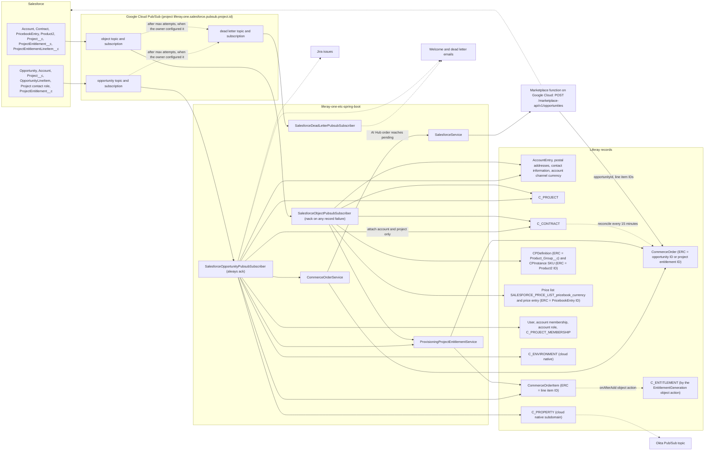
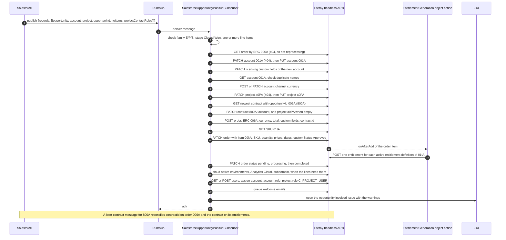

# Salesforce Data Flow and Field Mapping

This file traces every Salesforce record from its Pub/Sub message to the Liferay records that it writes, and every request that Liferay One sends back to Salesforce. It also records an audit of that flow on 2026-10-16.

[`integrations/salesforce.md`](./integrations/salesforce.md) is the contract: the topics, the message schema, and the rules that both sides keep. This file is the detail behind that contract: the handler for each message, the field mapping, the matching rules, and the behavior on redelivery and failure. When the two files disagree, the contract states the intent and the code states the behavior. The "Findings" section lists each place where they differ.

The source of truth is the code of `liferay-one-etc-spring-boot`. A script read the Salesforce field names from the model classes and checked every Liferay target field against `client-extensions/liferay-one-batch/batch/03-object-definition.batch-engine-data.json`, `04-object-relationship.batch-engine-data.json`, and `client-extensions/liferay-one-site-initializer/site-initializer/expando-columns.json` on 2026-10-16. All 46 target fields and relationships exist. A person then read each handler and wrote the transforms and the null rules by hand.

Paths in this file are relative to `client-extensions/liferay-one-etc-spring-boot/src/main/java/com/liferay/one/` unless they start with `client-extensions/` or `specs/`. A reference such as `service/AccountService.java:697` names a file and a line.

## Summary

| Count | Item |
| --- | --- |
| 3 | Pub/Sub subscribers: opportunity, object, and dead letter |
| 1 | Opportunity message type, with 6 record parts (opportunity, account, project, line items, contact roles, project entitlements) |
| 7 | Object message types that the object subscriber handles |
| 9 | Model classes that read Salesforce fields, with 102 field reads in total (the account model reads some fields in each of its 2 constructors) |
| 15 | Liferay record types that the inbound flow writes: account, account channel currency, project, contract, order, order item, product, SKU, price list, price entry, user, project membership, environment, property, and entitlement (contract and project links only) |
| 1 | Outbound request to Salesforce: the opportunity `POST` for an AI Hub order |
| 0 | Prefixes that the code adds to a Salesforce ID. The `ACCNT-`, `PRJCT-`, and `PRDCT-` prefixes exist only in seed data. |
| 17 | Findings |

## Diagram

The diagram shows the inbound flow from the left and the outbound flow at the bottom. Solid lines are writes. Dotted lines are lookups or side effects that do not change a Salesforce record.

## Subscribers and Delivery

| Subscriber | Class | Enable Property | Ack Rule | Source |
| --- | --- | --- | --- | --- |
| Dead letter | `SalesforceDeadLetterPubsubSubscriber` | `liferay.one.salesforce.dead.letter.pubsub.subscriber.enabled` | Always acks. Logs the message and queues an email to `liferay.one.dead.letter.notification.recipient`. | `pubsub/subscriber/BaseDeadLetterPubsubSubscriber.java:48`, `:90` |
| Object | `SalesforceObjectPubsubSubscriber` | `liferay.one.salesforce.object.pubsub.subscriber.enabled` | Processes every record, then throws when one or more records failed. The base class nacks on a throw. | `salesforce/pubsub/SalesforceObjectPubsubSubscriber.java:120` |
| Opportunity | `SalesforceOpportunityPubsubSubscriber` | `liferay.one.salesforce.opportunity.pubsub.subscriber.enabled` | Catches every exception, opens a Jira error issue, and returns. The message is always acked. | `salesforce/pubsub/SalesforceOpportunityPubsubSubscriber.java:75` |

The base class acks when `receive` returns and nacks when it throws (`pubsub/subscriber/BasePubsubSubscriber.java:97`). It does not create the Salesforce subscriptions, because `isAutoCreateSubscription` returns false (`:168`). So the code values for message ordering (`:213`), the 30 second acknowledgement deadline (`:152`), and the 5 delivery attempts before the dead letter topic (`:156`) are not in effect. The owner of the Pub/Sub project sets them.

The Pub/Sub client pulls with its default flow control. The handlers hold no lock per opportunity or per record, so two messages for the same Salesforce record can run at the same time.

## Identifiers

The code uses the Salesforce ID as the external reference code (ERC) with no prefix. The Salesforce key prefixes in the "Example" column are the Salesforce standard prefixes. The code does not check them.

| Liferay Record | ERC | Salesforce Source | Example | Source |
| --- | --- | --- | --- | --- |
| Account email address | `<Account Id>-owner-email` | Account owner email | `001…-owner-email` | `service/AccountService.java:483` |
| Account fax | `<Account Id>-fax` | `Fax` | `001…-fax` | `service/AccountService.java:502` |
| Account phone | `<Account Id>-phone` | `Phone` | `001…-phone` | `service/AccountService.java:492` |
| Account postal address | `<Account Id>-billing`, `<Account Id>-shipping` | Billing and shipping fields | `001…-billing` | `service/AccountService.java:596`, `:610` |
| Account web URL | `<Account Id>-website` | `Website` | `001…-website` | `service/AccountService.java:515` |
| AccountEntry | Account `Id` | Account | `001…` | `service/AccountService.java:732` |
| C_CONTRACT | Contract `Id` | Contract | `800…` | `service/ContractService.java:277` |
| C_PROJECT | Project__c `Id` | Project__c | custom object ID | `service/ProjectService.java:112` |
| CommerceOrder | Opportunity `Id` | Opportunity | `006…` | `service/CommerceOrderService.java:693` |
| CommerceOrder (project entitlement) | ProjectEntitlement__c `Id` | ProjectEntitlement__c | custom object ID | `service/ProvisioningProjectEntitlementService.java:386`, `service/CommerceOrderService.java:768` |
| CommerceOrderItem | OpportunityLineItem `Id` or ProjectEntitlementLineItem__c `Id` | Line item | `00k…` | `service/CommerceOrderItemService.java:99` |
| CPDefinition (product) | `Product_Group__c` | Product2 | product group name | `service/CommerceProductService.java:194` |
| CPInstance (SKU) | Product2 `Id`, also the SKU code | Product2 | `01t…` | `service/CommerceProductService.java:526`, `:530` |
| Price entry | PricebookEntry `Id` | PricebookEntry | `01u…` | `salesforce/pubsub/SalesforceObjectPubsubSubscriber.java:239` |
| Price list | `SALESFORCE_PRICE_LIST_<Pricebook2Id>_<CurrencyIsoCode>` | PricebookEntry | `SALESFORCE_PRICE_LIST_01s…_USD` | `salesforce/pubsub/SalesforceObjectPubsubSubscriber.java:225` |
| Product option value | lowercase Product2 `Id` | Product2 | `01t…` | `service/CommerceProductService.java:273` |
| User | none. The code matches a user by email address. | `Contact__r.Email` | `jane@example.com` | `service/ProvisioningContactService.java:78` |

The seed data uses `ACCNT-`, `PRJCT-`, and `PRDCT-` for accounts, projects, and products, and `C_` prefixes for contracts, orders, and entitlements. No Java code under `liferay-one-etc-spring-boot/src/main` contains these prefixes. A record that Salesforce creates never has them.

## Opportunity Message

### Steps

The handler runs these steps for each record in `records`, in this order. A step that throws ends the record. The catch at `salesforce/pubsub/SalesforceOpportunityPubsubSubscriber.java:87` opens a Jira error issue, and the handler goes to the next record.

1. Skip the record when `Product_Family__c` contains none of `E`, `P`, or `S` (`:281`).

1. Skip the record unless it is `Closed Won`, or it is a `Renewal` that is `Closed Lost` (`:291`, `:259`).

1. Skip the record when it has no `opportunityLineItems` and no `projectEntitlementLineItems` that match a `projectEntitlements` entry (`:308`).

1. Fetch the order whose ERC is the opportunity ID. The run is a reprocessing when that order has order items, or when it exists and the record has project entitlement line items (`:326`).

1. Split the line items. A line item with a quantity of zero or less is a realignment. Every other line item is provisionable (`:347`, `salesforce/model/SalesforceOpportunityLineItem.java:127`).

1. Stop with a warning when the account block has no `Id` (`:360`).

1. Upsert the account and, for a new account only, its licensing custom fields (`:402`). Stop with a warning when the account still does not exist (`:408`).

1. Set the account channel currency (`:425`).

1. Upsert the project when the record has a `project` block (`:440`).

1. Find the contract: by `SBQQ__AmendedContract__c`, or else the newest contract whose `opportunityId` is the opportunity ID. Attach the account and the project to it when they are empty (`:450`, `:129`).

1. Trim the realigned order items of the parent opportunity family (`:477`).

1. Trim the renewed order items of the same project when `Has_Renewal__c` is above 0 or the type is `Renewal` (`:504`).

1. Upsert the order (`:539`).

1. Upsert one order item for each provisionable line item whose SKU exists (`:566`).

1. Move the order to completed with the payment status "not required", when one or more items were written and the order was not completed before (`:601`).

1. Add the cloud native environments, the Analytics Cloud workspace, and the cloud native subdomain, when the line items need them (`:615`, `:621`, `:628`).

1. Process the project entitlements of the record (`:631`).

1. Add the project contacts, unless the type is `Renewal` (`:637`).

1. Send the welcome emails. A reprocessing sends the "assigned" welcome email in place of the first one (`:646`).

1. Open the "opportunity invoiced" Jira issue, with every warning of the run, unless the run is a reprocessing or the product family is exactly `P` (`:655`).

### Opportunity to CommerceOrder

The order is written by `service/CommerceOrderService.java:673`. Its custom fields come from `_getCustomFields` at `:1178`. The "Missing Value" column states what a missing or blank Salesforce field does to an order that already exists.

| Salesforce Field | Transform | Liferay Target | Required | Missing Value | Source |
| --- | --- | --- | --- | --- | --- |
| `AccountId` | Fallback account for the project upsert | `C_PROJECT.r_accountEntryToProject_accountEntryERC` | No | Project skipped when `Account__c` is also blank | `salesforce/pubsub/SalesforceOpportunityPubsubSubscriber.java:447` |
| `First_Line_Support__c` | `optBoolean`, written as the text `true` or `false` | `CommerceOrder.partnerFirstLineSupport` (expando) | No | **Clears**: written as `false` | `service/CommerceOrderService.java:1248` |
| `Has_Renewal__c` | Number above 0 is true | `CommerceOrder.renewal` (expando) | No | **Clears**: written as `false` | `service/CommerceOrderService.java:1258` |
| `Id` | As is | `CommerceOrder.externalReferenceCode`, `CommerceOrder.salesforceOpportunityId` (expando) | Yes | Fetch by a blank ERC fails | `service/CommerceOrderService.java:693`, `:1259` |
| `Name` | Not read by any handler | none | No | none | `salesforce/model/SalesforceOpportunity.java:22` |
| `Owner.Email` | Used only when a portal user has this email address | `CommerceOrder.creatorEmailAddress`, `CommerceOrder.accountOwnerEmailAddress` (expando) | No | Keeps | `service/CommerceOrderService.java:713`, `:1185` |
| `Owner.FirstName` | As is | `CommerceOrder.accountOwnerFirstName` (expando) | No | Keeps | `service/CommerceOrderService.java:1191` |
| `Owner.LastName` | As is | `CommerceOrder.accountOwnerLastName` (expando) | No | Keeps | `service/CommerceOrderService.java:1197` |
| `Pricebook2Id` | As is | `CommerceOrder.salesforcePricebookId` (expando) | No | Keeps | `service/CommerceOrderService.java:1262` |
| `Product_Family__c` | Gate: must contain `E`, `P`, or `S` | `CommerceOrder.opportunityProductFamily` (expando) | Yes | Record skipped | `service/CommerceOrderService.java:1214` |
| `Project__c` | As is | `CommerceOrder.salesforceProjectId` (expando). Also the project for the renewal trim. | No | Keeps | `service/CommerceOrderService.java:1268` |
| `Reseller__r.Name` | As is | `CommerceOrder.partnerAccount` (expando) | No | Keeps | `service/CommerceOrderService.java:1243` |
| `SBQQ__AmendedContract__c` | Contract lookup by ERC | `CommerceOrder.contractId` (expando), through the contract | No | Falls back to the newest contract of the opportunity | `salesforce/pubsub/SalesforceOpportunityPubsubSubscriber.java:132` |
| `SBQQ__AmendedContract__r.SBQQ__Opportunity__c` | As is. Also the parent family for the realignment trim. | `CommerceOrder.parentOpportunityId` (expando) | Only with realignment lines | Keeps | `service/CommerceOrderService.java:1235` |
| `Sold_By__c` | As is. Also an input to the licensing defaults of a new account. | `CommerceOrder.opportunitySoldBy` (expando) | No | Keeps | `service/CommerceOrderService.java:1220` |
| `StageName` | Gate. Also mapped to the item status. | `CommerceOrder.opportunityStageName` (expando) | Yes | Record skipped | `service/CommerceOrderService.java:1225` |
| `Type` | Gate for renewals, project warnings, and contacts | `CommerceOrder.opportunityType` (expando) | No | Keeps | `service/CommerceOrderService.java:1230` |
| line item `CurrencyIsoCode` | One code for all provisionable lines, else `USD` | `CommerceOrder.currencyCode` | No | **Overwrites** with `USD` | `salesforce/pubsub/SalesforceOpportunityPubsubSubscriber.java:141`, `service/CommerceOrderService.java:703` |
| line item `Product2Id` | SKU, then product, then the `solution-type` specification | `CommerceOrder.orderTypeExternalReferenceCode` (`CMP`, `DSR`, or `LDP`) | No | Keeps. Not set when the lines give more than one type. | `service/CommerceOrderService.java:1326` |
| line item `TotalPrice` | Sum of the provisionable lines. A negative sum is dropped. | `CommerceOrder.total` | No | Keeps | `service/CommerceOrderService.java:1525` |
| project `LDP_Workspace_Name__c` | As is | `CommerceOrder.ldpWorkspaceName` (expando) | No | Keeps | `service/CommerceOrderService.java:1207` |
| project `Name` | As is | `CommerceOrder.projectName` (expando) | No | Keeps | `service/CommerceOrderService.java:1252` |
| (account) | Default billing and shipping address of the account | `CommerceOrder.billingAddressId`, `shippingAddressId` | No | Keeps | `service/CommerceOrderService.java:695` |
| (configuration) | `liferay.one.commerce.channel.external.reference.code` | `CommerceOrder.channelId` | Yes | none | `service/CommerceOrderService.java:688` |
| (contract) | ID of the contract found in step 10 | `CommerceOrder.contractId` (expando) | No | Keeps | `service/CommerceOrderService.java:1203` |

### OpportunityLineItem to CommerceOrderItem

The order item is written by `service/CommerceOrderItemService.java:91`. A new item is added through a `PATCH` of the order with the full item list (`:266`). An existing item, found by its ERC on the order, gets a `PATCH` of its own (`:168`).

| Salesforce Field | Transform | Liferay Target | Required | Missing Value | Source |
| --- | --- | --- | --- | --- | --- |
| `Cloud_Region__c` | As is | `CommerceOrderItem.cloudRegion` (expando) | No | Keeps | `service/CommerceOrderItemService.java:206` |
| `CurrencyIsoCode` | Input to the order currency | none on the item | No | See the order table | `salesforce/model/SalesforceOpportunityLineItem.java:21` |
| `End_Date__c` | `yyyy-MM-dd` to midnight UTC | `CommerceOrderItem.endDate` (expando) | No | Keeps | `service/CommerceOrderItemService.java:215` |
| `End_Date__c` | Plus 30 days of grace. On an existing item, only when the end date changed, or when a trimmed date moves earlier. | `CommerceOrderItem.effectiveEndDate` (expando) | No | Keeps | `service/CommerceOrderItemService.java:219`, `:156`, `util/CommerceOrderItemUtil.java:139` |
| `Id` | As is | `CommerceOrderItem.externalReferenceCode` | Yes | Item cannot be matched on a later run | `service/CommerceOrderItemService.java:99` |
| `Machine_Type__c` | Lowercase, as the option `machinetype` | `CommerceOrderItem.options` | No | Keeps | `service/CommerceOrderItemService.java:134` |
| `Number_of_Pods__c` | Number | `CommerceOrderItem.sizing` (expando, integer) | No | Keeps | `service/CommerceOrderItemService.java:235` |
| `Product2.Name` | As is, locale `en_US` | `CommerceOrderItem.name`. Also selects cloud native, Analytics Cloud, and subdomain work. | No | Keeps | `service/CommerceOrderItemService.java:104` |
| `Product2Id` | As is. The item is skipped with a warning when no SKU has this ERC. | `CommerceOrderItem.skuExternalReferenceCode` | Yes | Item skipped | `service/CommerceOrderItemService.java:101`, `salesforce/pubsub/SalesforceOpportunityPubsubSubscriber.java:575` |
| `Product_Type__c` | As is | `CommerceOrderItem.orderType` (expando) | No | Keeps | `service/CommerceOrderItemService.java:228` |
| `Quantity` | Number. Zero or less makes the line a realignment, not an item. | `CommerceOrderItem.quantity` | No | Keeps | `service/CommerceOrderItemService.java:113` |
| `ServiceDate` | `yyyy-MM-dd` to midnight UTC | `CommerceOrderItem.startDate` (expando) | No | Keeps | `service/CommerceOrderItemService.java:240` |
| `TotalPrice` | Number | `CommerceOrderItem.finalPrice` | No | Keeps | `service/CommerceOrderItemService.java:127` |
| `UnitPrice` | Number | `CommerceOrderItem.unitPrice` | No | Keeps | `service/CommerceOrderItemService.java:120` |
| opportunity `StageName` | `Closed Won` to `Approved`. `Closed`, `Closed Lost`, `Disqualified`, and `Rejected` to `Canceled`. Any other value to `On Hold`. A canceled item keeps `Canceled`. | `CommerceOrderItem.customStatus` (expando) | Yes | **Overwrites** with `On Hold` | `service/CommerceOrderItemService.java:250`, `:321`, `:152` |

### Account Block to AccountEntry

The opportunity path builds the account from the `account` block and takes the addresses from the opportunity (`salesforce/model/SalesforceAccount.java:38`). The upsert is a `PATCH` by ERC. On a 404 it is a `PUT` (`service/AccountService.java:697`). Only the `PUT` returns the account, so only a new account gets the licensing custom fields (`:385`).

| Salesforce Field | Transform | Liferay Target | Required | Missing Value | Source |
| --- | --- | --- | --- | --- | --- |
| `Account_Tier__c` | As is | `AccountEntry.accountTier` (expando) | No | Keeps | `service/AccountService.java:552` |
| `CurrencyIsoCode` | Must be one of 8 supported codes and an active currency | Account channel currency for the configured channel | No | Keeps | `service/CommerceAccountCurrencyService.java:136` |
| `Description` | As is | `AccountEntry.description` | No | Keeps | `service/AccountService.java:740` |
| `Fax` | Telephone of type `fax`, not primary | `AccountEntry.accountContactInformation.telephones` | No | See finding 9 | `service/AccountService.java:499` |
| `Id` | As is | `AccountEntry.externalReferenceCode` | Yes | Record stops with a warning | `service/AccountService.java:732` |
| `Name` | As is | `AccountEntry.name` | No | Keeps | `service/AccountService.java:736` |
| `Owner.Email` | Primary email address | `AccountEntry.accountContactInformation.emailAddresses` | No | See finding 9 | `service/AccountService.java:479` |
| `Phone` | Primary telephone | `AccountEntry.accountContactInformation.telephones` | No | See finding 9 | `service/AccountService.java:489` |
| `Website` | Adds `https://` when no scheme. Dropped when it has a space or no period. Retried without it when Liferay rejects it. | `AccountEntry.accountContactInformation.webUrls` | No | See finding 9 | `service/AccountService.java:510`, `:671`, `:757` |
| opportunity `AccountAddress_Billing_Address__r.*` (`Street__c`, `City__c`, `Postal_Code__c`, `State__c`, `Country__c`) | Sent only when street, city, and postal code are all present. City cut to 75 characters, street to 255. | Postal address `<Id>-billing`, and the default billing address | No | Keeps | `service/AccountService.java:594`, `:643` |
| opportunity `AccountAddress_Shipping_Address__r.*` | Same as billing | Postal address `<Id>-shipping`, and the default shipping address | No | Keeps | `service/AccountService.java:608` |
| opportunity `Sold_By__c` and billing country | New account only. `Ireland` or `United Kingdom` turns off complimentary licenses. `Liferay Brazil`, `Liferay China`, or `Liferay India` turns off permanent licenses. | `AccountEntry.allowComplimentary`, `allowPermanentLicenses`, `allowSelfProvisioning` (expando) | No | Written once, at create | `service/AccountService.java:444`, `:565` |
| (constant) | `APPROVED`, `business` | `AccountEntry.status`, `AccountEntry.type` | Yes | **Overwrites** on every upsert | `service/AccountService.java:733` |

### Project Block to C_PROJECT

`service/ProjectService.java:69` writes the project with a `PATCH` by ERC, and a `PUT` on a 404. The opportunity path and the object path share this code.

| Salesforce Field | Transform | Liferay Target | Required | Missing Value | Source |
| --- | --- | --- | --- | --- | --- |
| `AI_Hub_Account_Name__c` | As is | `C_PROJECT.aiHubAccountName` | No | Keeps | `service/ProjectService.java:95` |
| `Account__c` | ERC of the parent account. The opportunity `AccountId` is the fallback. | `C_PROJECT.r_accountEntryToProject_accountEntryERC` | Yes | Project skipped with a warning | `service/ProjectService.java:74`, `:128` |
| `Allowed_Email_Domains__c` | As is | `C_PROJECT.allowedEmailDomains` | No | Keeps | `service/ProjectService.java:100` |
| `Data_Center_Location__c` | As is | `C_PROJECT.dataCenterLocation` | No | Keeps | `service/ProjectService.java:106` |
| `Friendly_Workspace_URL__c` | As is | `C_PROJECT.friendlyWorkspaceURL` | No | Keeps | `service/ProjectService.java:114` |
| `Id` | As is | `C_PROJECT.externalReferenceCode` | Yes | Project skipped with a warning | `service/ProjectService.java:112` |
| `LDP_Workspace_Name__c` | Not written to the project. Goes to the order and to Analytics Cloud. | `CommerceOrder.ldpWorkspaceName` (expando) | No | Keeps | `service/CommerceOrderService.java:1207` |
| `Liferay_Version__c` | As is | `C_PROJECT.liferayVersion` | No | Keeps | `service/ProjectService.java:120` |
| `Name` | As is | `C_PROJECT.name` | Yes | Project skipped with a warning | `service/ProjectService.java:125` |
| `Security_Contact_Email_Address__c` | As is | `C_PROJECT.securityContactEmailAddress` | No | Keeps | `service/ProjectService.java:131` |

### Project Contact Roles to Users and Memberships

`service/ProvisioningContactService.java:32` handles each entry in `projectContactRoles`. It skips a blank email address and an email address on a Liferay domain (`:72`).

| Salesforce Field | Transform | Liferay Target | Required | Missing Value | Source |
| --- | --- | --- | --- | --- | --- |
| `Contact__r.Email` | Matches a user by email address. Adds a user when none matches. | `User` | Yes | Entry skipped | `service/ProvisioningContactService.java:78` |
| `Contact__r.FirstName`, `Contact__r.LastName` | New user only | `User.givenName`, `User.familyName` | No | Used only at create | `service/ProvisioningContactService.java:82` |
| `Contact_Role__c` | Account role with the same name, assigned on the account | Account role assignment | No | Warning, and no account role | `service/ProvisioningContactService.java:96`, `:111` |
| `Contact_Role__c` = `Account Administrator` on any entry | Turns off the automatic administrator | none | No | The first new user of an account with no users becomes `Account Administrator` | `service/ProvisioningContactService.java:116`, `:158` |
| `Project__c` | Not read. Every entry goes to the project block of the record. | none | No | none | `salesforce/model/SalesforceProjectContactRole.java:20` |
| (project block) | Project role `C_PROJECT_USER` on the project of the record | `C_PROJECT_MEMBERSHIP` | No | No membership | `service/ProvisioningContactService.java:134` |

The handler returns at `:87` when the user is already a member of the account. That user gets no account role, no project membership on the new project, and no welcome email. See finding 3.

### Project Entitlements Inside an Opportunity

A record can carry a `projectEntitlements` array and a `projectEntitlementLineItems` array. The contract in [`integrations/salesforce.md`](./integrations/salesforce.md) lists them in TECH-SALESFORCE-010. `service/ProvisioningProjectEntitlementService.java:123` handles each project entitlement that has line items:

1. Find the project by `Project__c`. Add a warning and skip the entitlement when the project does not exist (`:365`).

1. Trim the renewed items of that project when the opportunity is a renewal (`:380`).

1. Upsert an order whose ERC is the project entitlement ID, with the same fields as the opportunity order and `salesforceProjectId` set to the entitlement project (`:386`).

1. Set `projectName` on that order to the Liferay project name (`:391`).

1. Upsert one item for each line item. The line item becomes an opportunity line item, as the next table shows (`:432`). A missing SKU fails that item. A SKU with no active entitlement definition adds a warning only (`:473`).

1. Complete the order when one or more items were written and it was not completed (`:417`).

| Salesforce Field | Transform | Liferay Target | Source |
| --- | --- | --- | --- |
| `End_Date__c` | Same as an opportunity line item | `CommerceOrderItem.endDate`, `effectiveEndDate` | `service/ProvisioningProjectEntitlementService.java:437` |
| `Id` (line item) | As is | `CommerceOrderItem.externalReferenceCode` | `service/ProvisioningProjectEntitlementService.java:437` |
| `Id` (project entitlement) | As is | `CommerceOrder.externalReferenceCode` | `service/ProvisioningProjectEntitlementService.java:353` |
| `Product2__c` | Copied to `Product2Id` | `CommerceOrderItem.skuExternalReferenceCode` | `service/ProvisioningProjectEntitlementService.java:441` |
| `ProjectEntitlement__c` | Groups the line items under their entitlement | none | `service/ProvisioningProjectEntitlementService.java:291` |
| `Project__c` | Project lookup | `CommerceOrder.salesforceProjectId`, `projectName` (expando) | `service/ProvisioningProjectEntitlementService.java:365` |
| `Purchasing_Opportunity__c` | Not read on this path | none | `salesforce/model/SalesforceProjectEntitlement.java:18` |
| `Quantity__c` | Copied to `Quantity` | `CommerceOrderItem.quantity` | `service/ProvisioningProjectEntitlementService.java:445` |
| `Start_Date__c` | Copied to `ServiceDate` | `CommerceOrderItem.startDate` | `service/ProvisioningProjectEntitlementService.java:447` |

## Object Messages

`salesforce/pubsub/SalesforceObjectPubsubSubscriber.java:59` reads `action`, `salesforceObjectName`, and `records`. It sends each record to the handler for the object name. It logs an unknown name and changes nothing (`:103`).

| Object Name | `delete` Action | Any Other Action | Source |
| --- | --- | --- | --- |
| `Account` | Upsert. The action is not read. | Upsert, when `Active_Subscription__c` is true | `:139` |
| `Contract` | Create path. The action is only compared to `update`. | `update`: update path. Any other: create path. | `:170`, `service/ContractService.java:358` |
| `PricebookEntry` | Delete the price entry | Upsert the price list and the price entry | `:177` |
| `Product2` | Unpublish the SKU, and deactivate the product when no published SKU is left | Publish the SKU, or add it, and activate the product | `:244` |
| `ProjectEntitlementLineItem__c` | Trim the order item: `effectiveEndDate` becomes now | Upsert the order item and complete the order | `:281` |
| `ProjectEntitlement__c` | Trim every item of the order | Update `projectName` on the order, or add the order | `:267` |
| `Project__c` | Upsert. The action is not read. | Upsert | `:263` |

### Account

`Active_Subscription__c` must be true, or the record is skipped with no change (`:143`). The object path reads the account fields from the account record itself (`salesforce/model/SalesforceAccount.java:15`). It then writes them as the account block table shows, with three differences:

| Salesforce Field | Difference From the Opportunity Path | Source |
| --- | --- | --- |
| `BillingStreet`, `BillingCity`, `BillingPostalCode`, `BillingState`, `BillingCountry` | The billing address comes from the account, not from the opportunity | `salesforce/model/SalesforceAccount.java:18` |
| `Owner_Email__c` | The owner email field is `Owner_Email__c`, not `Owner.Email` | `salesforce/model/SalesforceAccount.java:28` |
| `ShippingStreet`, `ShippingCity`, `ShippingPostalCode`, `ShippingState`, `ShippingCountry` | The shipping address comes from the account | `salesforce/model/SalesforceAccount.java:30` |

The object path calls `upsertAccount` with no "sold by" value, so it never writes the licensing custom fields, also when it creates the account (`service/AccountService.java:379`). See finding 4.

### Contract

`service/ContractService.java:259` skips a contract with no `Id` or no `AccountId`, with a warning. The create path is a `PATCH` by ERC, and a `PUT` on a 404 (`:443`). The update path fetches the contract and uses the create path when it does not exist (`:671`).

| Salesforce Field | Transform | Liferay Target | Required | Missing Value | Source |
| --- | --- | --- | --- | --- | --- |
| `AccountId` | Set only when the account exists | `C_CONTRACT.r_accountEntryToContract_accountEntryERC` | Yes | Record skipped. A missing account is attached later. | `service/ContractService.java:280` |
| `ContractTerm` | Integer | `C_CONTRACT.contractTerm` | No | Keeps | `service/ContractService.java:296` |
| `EndDate` | `yyyy-MM-dd` gets `T00:00:00Z`. Any other form is sent as is. | `C_CONTRACT.endDate` | No | Keeps | `service/ContractService.java:301`, `:657` |
| `Id` | As is | `C_CONTRACT.externalReferenceCode` | Yes | Record skipped | `service/ContractService.java:277` |
| `SBQQ__Opportunity__c` | As is. Also finds the order, its `salesforceProjectId`, and the predecessor contract. | `C_CONTRACT.opportunityId`, `r_projectToContract_c_projectERC` | No | Keeps | `service/ContractService.java:307`, `:326`, `:523` |
| `SBQQ__RenewalOpportunity__c` | As is. Also finds the successor contract. | `C_CONTRACT.renewalOpportunityId` | No | Keeps | `service/ContractService.java:312`, `:541` |
| `StartDate` | Same as `EndDate` | `C_CONTRACT.startDate` | No | Keeps | `service/ContractService.java:318` |
| (chain) | `renewal` when a predecessor exists, else `initial`. The update path writes `renewal` only. | `C_CONTRACT.contractType` | No | Create path **overwrites** | `service/ContractService.java:448`, `:692` |
| (chain) | ERC of the contract whose `renewalOpportunityId` is this `SBQQ__Opportunity__c` | `C_CONTRACT.r_originalContractToContract_c_contractERC` | No | Keeps | `service/ContractService.java:339` |

After the write, the handler reconciles the opportunity (`:375`). That attaches the account and the project when they are empty, sets `contractId` on the opportunity order and on every order whose `salesforceOpportunityId` is that opportunity, and sets the contract and the project on their entitlements when those are empty (`:167`, `:602`). It then links a successor contract that arrived first (`:411`). A scheduled job runs the same reconcile every 15 minutes for the contracts changed in the last day (`:211`, `liferay.one.contract.reconcile.cron`).

### PricebookEntry

| Salesforce Field | Transform | Liferay Target | Required | Missing Value | Source |
| --- | --- | --- | --- | --- | --- |
| `CurrencyIsoCode` | Must be AUD, BRL, EUR, GBP, INR, JPY, SGD, or USD | Price list currency, and part of the price list ERC | Yes | Record ignored | `salesforce/pubsub/SalesforceObjectPubsubSubscriber.java:191` |
| `Id` | As is | Price entry ERC | Yes | none | `:239` |
| `IsActive` | Boolean | Price entry `active` | No | **Overwrites** with `false` | `salesforce/model/SalesforcePricebookEntry.java:16` |
| `Pricebook2Id` | Part of the price list ERC and name | Price list `SALESFORCE_PRICE_LIST_<Pricebook2Id>_<currency>`, name `Salesforce <Pricebook2Id> <currency>` | Yes | Record ignored with a warning | `:199`, `:225` |
| `Product2Id` | SKU lookup | Price entry `skuId` | Yes | Record ignored with a warning | `:212` |
| `UnitPrice` | `optDouble` with no default | Price entry `price` | No | Reads as NaN. See finding 11. | `salesforce/model/SalesforcePricebookEntry.java:21` |

The price list is added in the catalog `LIFERAY_INC_CATALOG` when it does not exist. When the catalog does not exist, the record is ignored with no log line (`service/CommercePriceListService.java:24`). When an existing price entry belongs to another price list, the handler deletes it and adds it again (`service/CommercePriceEntryService.java:32`).

### Product2

| Salesforce Field | Transform | Liferay Target | Required | Missing Value | Source |
| --- | --- | --- | --- | --- | --- |
| `Description` | Locale `en_US`. Written at create, and on update only when the product has one SKU. | `CPDefinition.description` | No | **Clears** on a product with one SKU | `service/CommerceProductService.java:115`, `:192` |
| `Id` | As is | SKU ERC, SKU code, and the `salesforce-product` option value key (lowercase) | Yes | none | `service/CommerceProductService.java:526`, `:273` |
| `Name` | Locale `en_US`. Product name at create, and on update when the product has one SKU. Also the option value name, at create only. | `CPDefinition.name`, product option value name | No | **Clears** on a product with one SKU | `service/CommerceProductService.java:118`, `:282` |
| `Product_Group__c` | Product ERC. Needed only when the SKU does not exist yet. | `CPDefinition.externalReferenceCode` | Only for a new SKU | New SKU not added, with a warning | `service/CommerceProductService.java:496`, `:194` |
| (constant) | `true` on upsert, `false` on delete | SKU `published`, `purchasable`, product `active` | Yes | none | `service/CommerceProductService.java:466`, `:112`, `:545` |

### ProjectEntitlement__c and ProjectEntitlementLineItem__c

`upsertProjectEntitlement` finds the project by `Project__c` and ignores the record with a warning when it does not exist (`service/ProvisioningProjectEntitlementService.java:173`). When an order with the project entitlement ID exists, it updates only `projectName` and `salesforceProjectId` (`:189`). Otherwise it copies the order of `Purchasing_Opportunity__c` into a new order, and throws when that order does not exist (`:206`, `service/CommerceOrderService.java:741`). The copy keeps every custom field of the source order and replaces `projectName`, `salesforceOpportunityId`, and `salesforceProjectId`.

`upsertProjectEntitlementLineItem` throws when the order of `ProjectEntitlement__c` does not exist (`:228`). It trims the renewed items of the project when the order has `renewal` set, upserts the item with the stage `Closed Won`, and completes the order when it is not completed (`:243`).

A `delete` of either object sets `effectiveEndDate` to the current time on the matched items, unless the item already ends earlier (`:452`).

## Matching, Ordering, and Redelivery

### How a Message Finds an Existing Record

| Record | Match | Create | Update | Delete |
| --- | --- | --- | --- | --- |
| AccountEntry | `PATCH` by ERC | `PUT` by ERC after a 404 | `PATCH` | Never |
| Account channel currency | Entry for the configured channel | `POST` | `PATCH` when the currency differs | Never |
| C_CONTRACT | `PATCH` or `GET` by ERC | `PUT` by ERC after a 404 | `PATCH` | Never. A `delete` action takes the create path. |
| C_PROJECT | `PATCH` by ERC | `PUT` by ERC after a 404 | `PATCH` | Never. A `delete` action upserts. |
| CommerceOrder | `GET` by ERC, then `PATCH` by ID | `POST` | `PATCH` | Never |
| CommerceOrderItem | ERC among the items of the order | `PATCH` of the order with the item list | `PATCH` by ID | Never. A delete or a realignment sets `effectiveEndDate`. |
| CPDefinition | `GET` by ERC (`Product_Group__c`) | `POST` | `PATCH` | Set inactive when no SKU is published |
| CPInstance (SKU) | `GET` by ERC, cached | `POST` under the product | `PATCH` by ERC | Unpublished |
| Price entry | `GET` by ERC | `POST` | `PATCH` by ERC, or delete and `POST` when the price list changed | `DELETE` by ERC |
| Price list | `GET` by ERC | `PUT` by ERC | Never | Never |
| User | Email address | `POST` | Never | Never |

### Ordering Assumptions

The handlers do not compare record ages (TECH-SALESFORCE-043). Each message type assumes that some records arrive first:

| Child | Parent It Needs | Behavior When the Parent Is Missing | Recovery |
| --- | --- | --- | --- |
| `Contract` object | Account | Writes the contract with no account | The opportunity path (`salesforce/pubsub/SalesforceOpportunityPubsubSubscriber.java:457`) or the reconcile job attaches it |
| `Contract` object | Predecessor contract | Writes the contract as `initial` | The predecessor message links the successor and sets `renewal` (`service/ContractService.java:411`) |
| `PricebookEntry` object | SKU | Ignores the record with a warning, and acks | None. Salesforce must send the entry again. |
| `ProjectEntitlementLineItem__c` object | Project entitlement order | Throws, so the message is nacked | Pub/Sub redelivers until the order exists or the message goes to the dead letter topic |
| `ProjectEntitlement__c` object | Project | Ignores the record with a warning, and acks | None |
| `ProjectEntitlement__c` object | Order of the purchasing opportunity | Throws, so the message is nacked | Pub/Sub redelivers |
| `Project__c` object | Account | Liferay rejects the relationship ERC, so the message is nacked (see Open Questions) | Pub/Sub redelivers |
| Opportunity line item | SKU (`Product2`) | Skips the item with a warning | A later reprocessing of the opportunity adds it |
| Opportunity | Contract | Writes the order with no `contractId`, with a warning | The contract message reconciles the order |

### Redelivery

The opportunity subscriber acks every message, so Pub/Sub delivers an opportunity again only by its at least once rule. Salesforce can also publish the opportunity again. A second run is a reprocessing when the order has items. It then updates the order and the items by ERC, sends the "assigned" welcome email, and opens no "opportunity invoiced" issue. It does not change an order that is already completed, because it completes only an order that was not completed (`:601`).

The object subscriber nacks a message when one record fails. Pub/Sub then delivers the whole message again, and every record runs again (TECH-SALESFORCE-041). The account, project, price, and product writes are upserts, so a second run gives the same result. The contract create path is not quite the same: it writes `contractType` and the project again on every run (finding 7).

### Partial Failure

On the opportunity path, the steps after the order upsert have no retry. An exception in one of them ends the record. The handler opens a Jira error issue and acks the message (TECH-SALESFORCE-040). The order can then exist with some items, and with no contacts, no emails, and no invoiced issue. Some steps catch their own exceptions and add a warning, and the record goes on: the currency, each order item, the completion, each project entitlement, and each contact. The warnings reach Jira only through the "opportunity invoiced" issue, which a reprocessing and the `P` family do not open (finding 12).

On the object path, a failed record makes Pub/Sub deliver the whole message again. A record that fails every time keeps its message in the subscription until the dead letter policy of the owner moves it. The dead letter subscriber then logs it and emails the recipient.

## Null Semantics

The workspace rule in [`.agents/rules/code-style.md`](../../.agents/rules/code-style.md) ("Null Means Unknown in Partial Updates") says that a value that is not known is not written. Every model reads a missing string as an empty string (`optString`), so the handlers cannot tell "missing" from "blank". Most handlers write a field only when it is not blank, so a missing field keeps the Liferay value. These mappings break the rule:

| Mapping | What a Missing Field Does | Source |
| --- | --- | --- |
| `First_Line_Support__c` to `partnerFirstLineSupport` | Writes `false` | `service/CommerceOrderService.java:1248` |
| `Has_Renewal__c` to `renewal` | Writes `false` | `service/CommerceOrderService.java:1258` |
| `IsActive` to price entry `active` | Writes `false` | `salesforce/model/SalesforcePricebookEntry.java:16` |
| `Name` and `Description` of `Product2` to the product | Writes an empty name and description on a product with one SKU | `service/CommerceProductService.java:114` |
| `StageName` to `customStatus` | Writes `On Hold` for any unknown stage | `service/CommerceOrderItemService.java:263` |
| `UnitPrice` of `PricebookEntry` to price | Reads as NaN | `salesforce/model/SalesforcePricebookEntry.java:21` |
| line item `CurrencyIsoCode` to `currencyCode` | Writes `USD` | `salesforce/pubsub/SalesforceOpportunityPubsubSubscriber.java:172` |
| Account contact information | Sends only the entries that are present. Liferay can read the shorter list as a full replacement (see Open Questions). | `service/AccountService.java:470` |

The opposite case also exists. A Salesforce user who clears a field cannot clear it in Liferay, because a blank field keeps the old value. This applies to every "Keeps" row above.

## Outbound Opportunities

Liferay One sends one kind of request to Salesforce: a new opportunity for an AI Hub order. The marketplace function is not in this repository. The `liferay-one-gcf-mock` client extension mocks only the DataOps usage APIs.

1. The `CommerceOrderUpdate` object action calls `dispatchOrderUpdate`. For an `AI_HUB` order in the pending status, it calls `createAIHubOpportunity` (`service/CommerceOrderService.java:340`).

1. The method skips an order that is not pending or processing, removes `aiHubAccountEntryId` from the order metadata, and sets `projectName` (`:254`).

1. When the metadata already holds `salesforceOpportunityId`, it sets the order ERC to that ID and stops (`:917`). When the metadata has no `salesforceProjectId`, it stops (`:923`).

1. It sends the `POST` through `SalesforceService` with a Google identity token for `liferay.one.salesforce.gcf.audience` (`service/SalesforceService.java:51`, `:146`). An HTTP error returns null, and the caller throws (`service/CommerceOrderService.java:939`).

1. It sets the order ERC to `data.opportunityId` (`:950`), and each order item ERC to the `data.lineItems[].id` of the same SKU (`:1633`).

1. It writes `salesforceOpportunityId` into the order metadata and moves the order to processing (`:331`).

| Request Field | Liferay Source | Source |
| --- | --- | --- |
| `accountId` | Account ERC (the Salesforce account ID) | `service/SalesforceService.java:140` |
| `billingAddress` | Order billing address. Country and state as default locale names. Street is `street1 + " " + street2`. | `service/SalesforceService.java:161` |
| `closeDate` | Order create date, `yyyy-MM-dd` UTC | `service/SalesforceService.java:360` |
| `lineItems[]` | SKU ERC as `productId`, `quantity`, `unitPrice`, `orderType` `New`. Start and end dates except for `AI_HUB_TOKEN`. | `service/SalesforceService.java:89` |
| `marketplaceDealId` | Order ID | `service/SalesforceService.java:364` |
| `opportunityCurrency` | Order currency | `service/SalesforceService.java:366` |
| `opportunityOwner`, `termType`, `typeOfBusiness` | `Marketplace Integration`, `Single Year`, `Existing Business` | `service/SalesforceService.java:368` |
| `paymentMethodType` | `Offline` for `money-order`, else `Online` | `service/SalesforceService.java:223` |
| `primaryContact` | Administrator or owner email of the metadata form, user names, role `Opportunity Owner` | `service/SalesforceService.java:254` |
| `project` | `salesforceProjectId`, `salesforceContractId`, and the AI Hub or provisioning form | `service/SalesforceService.java:269` |

When Salesforce later publishes the new opportunity as closed won, the inbound path finds the order by the opportunity ID, and the items by the line item IDs, and updates them.

## Example: A Closed Won Opportunity Becomes an Order

The example is a `New Business` opportunity `006A` for account `001A`, project `a0PA`, and one line item `00kA` for the Product2 `01tA`. The contract `800A` arrived before it. Each arrow is one REST call to Liferay unless it is labeled otherwise.

## LPD-108526: Cloud Contact Designations

LPD-108526 (commits `b09149352b094` and `d1fd7259138e4`) moved a contact designation, such as Critical Incident Contact, from an account role to a project membership of one project. The commits add the contact role endpoints in `ProjectRestController`, a list of the allowed contact roles in `service/ProjectContactRoleService.java`, a contact role step in the account invitation acceptance, and seed data that puts `C_CRITICAL_INCIDENT_CONTACT` on `PRJCT-013`. Commit `51db54e4526f5` (LPD-109991) later made `ProjectContactRoleService` read the SKU of the entitlement in place of the SKU of the entitlement definition.

The audit checked the Salesforce path against this change. The commits do not change `service/ProvisioningContactService.java`. That service still assigns `Contact_Role__c` as an account role with the same name (`:96`, `:111`). So a Salesforce contact with the role "Critical Incident Contact" still gets the account role `Critical Incident Contact`, on every project of the account, which is the behavior that LPD-108526 removed from the user interface. The new model also gives no path from Salesforce to a contact role membership: the service assigns only `C_PROJECT_USER` (`:139`). See finding 1.

## Findings

1. **Salesforce contact roles still become account roles after LPD-108526.** `client-extensions/liferay-one-etc-spring-boot/src/main/java/com/liferay/one/service/ProvisioningContactService.java:96` and `:111` assign `Contact_Role__c` as an account role. A designation such as Critical Incident Contact that comes from Salesforce applies to every project of the account, and the Project Members page, which now reads designations from project memberships, does not show it as a designation of the project.

1. **Delete actions for Account, Project__c, and Contract upsert the record.** `salesforce/pubsub/SalesforceObjectPubsubSubscriber.java:74`, `:77`, and `:88` do not pass the action to the account and project handlers, and `service/ContractService.java:358` sends every action that is not `update` to the create path. A deleted contract is written again as `initial` or `renewal`.

1. **An existing account member gets no access to a new project.** `service/ProvisioningContactService.java:87` returns when the user is already in the account. The user gets no `C_PROJECT_USER` membership on the project of the opportunity, no account role, and no welcome email.

1. **An account that the object path creates never gets its licensing settings.** `service/AccountService.java:379` writes no licensing custom fields, and `:697` returns null on the `PATCH`, so a later opportunity does not write them either (`:391`). `allowComplimentary` has no default in `expando-columns.json`, and the "sold by" and country rules never apply to that account.

1. **Every account upsert sets the status to approved and the type to business.** `service/AccountService.java:733` and `:734`. An account that an administrator deactivated in Liferay becomes active again on the next Salesforce message.

1. **The cloud native environments get a stale project.** `salesforce/pubsub/SalesforceOpportunityPubsubSubscriber.java:465` attaches the project to the contract, but `:615` passes the contract object read before that change. `service/ProvisioningEnvironmentService.java:73` then adds the environments with no project. The same method returns when any cloud native environment exists (`:64`), so an environment type that failed once is never added.

1. **The contract create path is not idempotent.** `service/ContractService.java:454` and `:461` write `contractType` and `r_projectToContract_c_projectERC` on every create message, while the update path writes the project only when it is empty (`:701`). A redelivered create message replaces a project that the reconcile or a person set with the project of the order or of the predecessor contract.

1. **A failed SKU stamp after the outbound opportunity can duplicate order items.** `service/CommerceOrderService.java:1633` only logs when it cannot set the item ERCs to the Salesforce line item IDs. When Salesforce then publishes that opportunity, `service/CommerceOrderItemService.java:148` finds no item with the line item ERC and adds a second item, which generates a second set of entitlements.

1. **The account contact information can lose entries.** `service/AccountService.java:470` sends only the email address, phones, and web URL that are present. When Liferay treats the list as complete, a message without `Fax` removes the fax. This needs a check against the headless account `PATCH`.

1. **The order currency falls back to USD.** `salesforce/pubsub/SalesforceOpportunityPubsubSubscriber.java:172` returns `USD` when no line has a currency or the lines mix currencies, and `service/CommerceOrderService.java:703` always writes it. A redelivery with no line currency changes the currency of an existing order.

1. **A price book entry with no `UnitPrice` reads as NaN.** `salesforce/model/SalesforcePricebookEntry.java:21` calls `optDouble` with no default. The price entry request then carries NaN, which is not a valid JSON number, so the record likely fails and the whole message is nacked again.

1. **Warnings are lost when the run stops early or is a reprocessing.** `salesforce/pubsub/SalesforceOpportunityPubsubSubscriber.java:367` and `:413` return before the invoiced issue, and `:655` skips the issue for a reprocessing and for the `P` family. The warnings of those runs reach only the log.

1. **An order with no items is not a reprocessing.** `salesforce/pubsub/SalesforceOpportunityPubsubSubscriber.java:251` counts an order as provisioned only when it has items. When the first run added the order but no item (for example, every SKU was missing), a second run sends the first welcome emails again and opens a second "opportunity invoiced" issue.

1. **A renewal with no project trims every order of the account that has no project.** The opportunity gives an empty `Project__c` (`salesforce/model/SalesforceOpportunity.java:28`), and `service/ProvisioningOrderService.java:268` compares it to `GetterUtil.getString` of a missing `salesforceProjectId`, which is also empty. Every order of the account with no project matches, and its items of the same SKU get a new `effectiveEndDate`.

1. **A duplicate Salesforce opportunity is possible.** `service/CommerceOrderService.java:950` sets the order ERC to the new opportunity ID, but the metadata gets `salesforceOpportunityId` only at `:331`. When `updateOrder` fails between the two, the next attempt reads metadata with no ID (`:917`) and sends a second `POST`. The check could also use the order ERC.

1. **The billing street can end in "null".** `service/SalesforceService.java:180` joins `getStreet1()` and `getStreet2()` with no null check, so an address with one street line sends `Main Street null`.

## Open Questions

1. Does the Pub/Sub owner enable message ordering on the two Salesforce subscriptions, and with which ordering key? The handlers hold no lock, so two messages for one opportunity can run at the same time, and `service/CommerceOrderService.java:1950` can then send two `POST` requests for one ERC.

1. Which dead letter policy and maximum delivery count does the owner set on the object subscription? Without one, a record that always fails keeps its message in redelivery.

1. Does a headless account `PATCH` with `accountContactInformation` or `postalAddresses` replace the lists or merge them? The answer decides finding 9 and the address rows.

1. What does Liferay return when a project `PATCH` or `PUT` names an account ERC that does not exist? The table above assumes an error and a nack.

1. Is the `On Hold` default for an unknown stage name intended? A renewal that is closed lost writes `Canceled` items and then completes the order, and the entitlement generation action runs on those items.

1. `Number_of_Pods__c` is a decimal in Salesforce and `sizing` is an integer custom field. Does Liferay round, cut, or reject a fraction?

1. Which Salesforce product families does the marketplace function give to the opportunities it creates? When the family has none of `E`, `P`, or `S`, the inbound path skips that opportunity, and the order keeps the values that Liferay One sent.

1. Should a Salesforce account with `Active_Subscription__c` set to false change the Liferay account? Today the handler skips it, so Liferay never learns that the subscription ended.

1. The opportunity `Name`, the contact role `Project__c`, and the project entitlement `Purchasing_Opportunity__c` on the opportunity path are read but not used. Should the contact roles be filtered by their `Project__c`?