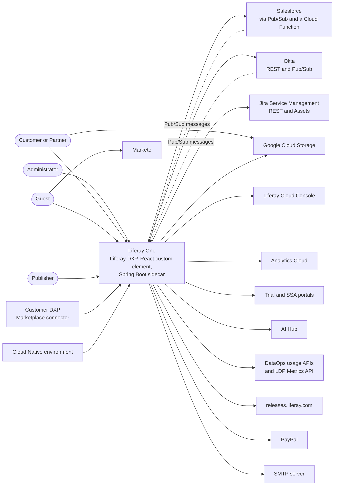

# System Context

This file shows Liferay One at two levels of the C4 model. Level 1 shows the people and the external systems around Liferay One. Level 2 shows the containers inside Liferay One and every connection between them. A connection table records the direction, the protocol, the authentication, and the configuration key of each connection. A last section describes where the containers run.

The source of truth is the code. To write this file on 2026-10-16, I read these files:

- The `client-extension.yaml`, `LCP.json`, and `Dockerfile` of each directory in `client-extensions/`.
- `client-extensions/liferay-one-etc-spring-boot/src/main/resources/application-default.properties` and `application.properties`, and the services, controllers, and Pub/Sub classes under `client-extensions/liferay-one-etc-spring-boot/src/main/java/com/liferay/one/`.
- The service layer of `client-extensions/liferay-one-custom-element/src/` (`services/fetcher/`, `services/spring-boot/`, `utils/apiUtils.ts`, `hooks/useMarketoForm.ts`, and `pages/TicketAttachments/hooks/`).
- `client-extensions/liferay-one-kong/kong/kong.yml` and `client-extensions/liferay-one-gcf-mock/mock/Caddyfile`.
- `docker-compose.yaml`, `.env.example` (keys only), `configs/`, `scripts/_common.sh`, `scripts/instance.sh`, and `scripts/bootstrap/*.sh`.
- The shared Spring Boot library that the sidecar imports, at `modules/util/client-extension-util-spring-boot3` in the portal repository.

When this file and the code disagree, the code is correct. The integration contracts in [`integrations/`](./integrations/) hold the payload details for each external system. This file holds only the shape of each connection.

## Summary

| Count | Item |
| --- | --- |
| 1 | Liferay DXP server that holds the objects, Commerce, the headless APIs, and the OAuth2 authorization server |
| 1 | React application, `liferay-one-custom-element`, that renders the Marketplace, Support, My Account, Publisher, and Admin pages |
| 1 | Spring Boot sidecar, `liferay-one-etc-spring-boot`, on port 58081 |
| 16 | Object actions that Liferay sends to the sidecar |
| 5 | OAuth2 applications declared in `client-extension.yaml` files (3 headless server, 1 user agent, plus 1 that no code uses) |
| 4 | OAuth2 applications that the sidecar knows by external reference code but that are made outside the client extensions (`external-ai-hub`, `external-dxp`, `external-ssa`, `external-trial`) |
| 8 | Client extension directories with tracked source (`batch`, `custom-element`, `etc-spring-boot`, `gcf-mock`, `global-css`, `instance-settings`, `kong`, `site-initializer`) |
| 2 | Client extension directories that hold only ignored build output (`etc-cron`, `mock-mail`) |
| 21 | External systems and endpoints that the code calls or that call the code (see the connection table) |
| 2 | Google Cloud Pub/Sub projects, one for Salesforce messages and one for Okta messages |
| 15 | Scheduled jobs in the sidecar (`@Scheduled`) |

## People

| Person | Description | Main Entry |
| --- | --- | --- |
| Administrator | A Liferay employee with a staff role such as Provisioning Administrator, SSA Administrator, or Finance Administrator. Liferay Staff can only view accounts, projects, and keys, and has no admin page. Manages trials, provisioning, publishers, and support data. | `layouts/05_admin` and the `pages/Admin` tree |
| Customer | A user of a customer account with account roles such as Account Administrator, Account Buyer, or Project Admin. Buys products, manages projects, keys, environments, and support tickets. | `layouts/02_my-account`, `03_support`, `06_product-purchase` |
| Guest | A visitor with no session. Browses the Marketplace catalog and public pages, and accepts an invitation by its token. | `layouts/01_home`, `04_marketplace`, `08_account-invitation` |
| Partner | A user of a partner account with roles such as Partner Account Admin, Partner Sales User, or Partner Technical User. The partner classification comes from the `partner-product` commerce specification on entitled products. | Same pages as the customer, with partner roles |
| Publisher | A user with the Marketplace Publisher or Account Solution Publisher role. Publishes apps and solutions to the Marketplace. | `pages/BecomeAPublisher`, `pages/PublisherDashboard` |

The role names come from `client-extensions/liferay-one-batch/batch/13-role.batch-engine-data.json`. The page folders are under `client-extensions/liferay-one-site-initializer/site-initializer/layouts/` and `client-extensions/liferay-one-custom-element/src/pages/`.

Two kinds of machines also call Liferay One without a person:

- A **customer DXP** connects to Liferay One through the Marketplace connector of DXP 2025.Q1 and later.
- A **Cloud Native environment** activates itself and reads its manifest from the sidecar.

## Context Diagram

GitHub renders this diagram. It shows Liferay One as one box. Arrows point from the caller to the system that it calls.

## Container Diagram

GitHub renders this diagram. Solid arrows are requests. Dotted arrows are messages that the sidecar pulls from Pub/Sub. The label on each arrow names the authentication.

```mermaid
flowchart TB
    browser(["Browser<br/>Administrator, Customer, Partner,<br/>Publisher, Guest"])
    customerDXP["Customer DXP"]
    cloudNative["Cloud Native environment"]

    subgraph one["Liferay One"]
        direction TB

        ce["liferay-one-custom-element<br/>React app in the page"]

        subgraph dxp["Liferay DXP"]
            direction TB
            headless["Headless REST and GraphQL APIs<br/>/o/..."]
            objects["Objects and Commerce<br/>orders, entitlements, keys"]
            actions["Object actions<br/>16 triggers"]
            oauth["OAuth2 server<br/>/o/oauth2/token, /o/oauth2/jwks"]
            notification["Notification queue"]
        end

        batch["liferay-one-batch<br/>definitions and reference data"]
        siteinit["liferay-one-site-initializer<br/>the One site"]
        css["liferay-one-global-css"]
        settings["liferay-one-instance-settings"]

        sidecar["liferay-one-etc-spring-boot<br/>Spring Boot, port 58081"]

        kong["liferay-one-kong<br/>API gateway"]
    end

    subgraph gcp["Google Cloud"]
        sfPubsub["Salesforce Pub/Sub project"]
        oktaPubsub["Okta Pub/Sub project"]
        gcf["Cloud Functions<br/>opportunities, usage APIs"]
        ldp["LDP Metrics API"]
        gcs["Cloud Storage bucket"]
    end

    okta["Okta REST API"]
    jira["Jira REST API and JSM Assets"]
    console["Liferay Cloud Console API"]
    ac["Analytics Cloud"]
    trial["Trial, SSA, and AI Hub DXPs"]
    releases["releases.liferay.com"]
    paypal["PayPal"]
    smtp["SMTP server"]
    marketo["Marketo forms"]
    provisioningUAT["Legacy provisioning webserver, UAT"]

    browser -- "session cookie and CSRF token" --> headless
    browser -- "oaua bearer JWT" --> sidecar
    browser -- "upload session URL or signed URL" --> gcs
    browser -- "none" --> marketo
    ce -. "runs inside" .- browser

    actions -- "oaua bearer JWT" --> sidecar
    batch -- "batch oahs client credentials" --> headless
    siteinit -- "site initializer oahs" --> headless
    headless --- objects
    objects --- actions
    notification --> smtp
    objects -- "Commerce PayPal integration" --> paypal

    sidecar -- "oahs client credentials or forwarded user JWT" --> headless
    sidecar -- "fetch JWK set at boot" --> oauth
    sfPubsub -. "service account" .-> sidecar
    oktaPubsub -. "service account" .-> sidecar
    sidecar -- "service account, publish" --> oktaPubsub
    sidecar -- "Google ID token" --> gcf
    sidecar -- "Google ID token" --> ldp
    sidecar -- "Google access token" --> gcs
    sidecar -- "SSWS API token" --> okta
    sidecar -- "Basic email and API token" --> jira
    sidecar -- "login, then bearer token" --> console
    sidecar -- "Basic email and password" --> ac
    sidecar -- "external-* client credentials" --> trial
    sidecar -- "none" --> releases

    customerDXP -- "marketplace-client-id bearer JWT" --> headless
    customerDXP -- "marketplace-client-id bearer JWT" --> sidecar
    cloudNative -- "JWT signed by the environment key" --> sidecar
    kong -- "pass through" --> provisioningUAT
```

## Connection Table

Each row is one connection. "From" is the caller. Rows are sorted by "From", then by "To". All file paths are relative to `workspaces/liferay-one-workspace/`, except the paths that start with `modules/`, which are relative to the portal repository root.

| From | To | Protocol | Auth | Config Key | Source File |
| --- | --- | --- | --- | --- | --- |
| Batch client extension | Liferay headless APIs and batch engine | HTTP, batch engine import at deploy | OAuth2 client credentials of `liferay-one-batch-oahs` (17 scopes) | `client-extension.yaml` `.serviceAddress: localhost:8080` | `client-extensions/liferay-one-batch/client-extension.yaml` |
| Browser | GCS bucket | HTTPS `PUT` and `DELETE` on a resumable upload session URL, `GET` on a signed URL | The session URL that the sidecar created, or a V4 signed URL that expires in 15 minutes | Bucket from `liferay.one.gcs.bucket.name` (`LIFERAY_ONE_GCS_BUCKET_NAME`) | `client-extensions/liferay-one-custom-element/src/pages/TicketAttachments/hooks/useGCSUploadFile.ts`, `client-extensions/liferay-one-etc-spring-boot/src/main/java/com/liferay/one/service/GoogleCloudStorageService.java` |
| Browser | Liferay pages, headless REST, and GraphQL | HTTPS, same origin | Liferay session cookie plus the `x-csrf-token` header from `Liferay.authToken`. A guest sends no session. | `window.location.origin` | `client-extensions/liferay-one-custom-element/src/services/fetcher/fetcher.ts`, `src/utils/apiUtils.ts`, `src/services/graphql/GraphQL.ts` |
| Browser | Marketo (`pages.liferay.com`) | HTTPS, script and form load | None. The munchkin ID is public. | `marketoFormIdDefault`, `marketoFormIdLiferayProduct` in the custom element properties | `client-extensions/liferay-one-custom-element/src/hooks/useMarketoForm.ts`, `client-extensions/liferay-one-custom-element/client-extension.yaml` |
| Browser | Sidecar | HTTPS REST, cross origin | Bearer JWT of the `liferay-one-etc-spring-boot-oaua` user agent application. `@liferay/oauth2-provider-web` gets the token with the user's Liferay session. The sidecar checks the CORS origin against `com.liferay.lxc.dxp.domains`. | Home page URL of `liferay-one-etc-spring-boot-oaua`, read at runtime from `/o/oauth2/application` | `client-extensions/liferay-one-custom-element/src/services/spring-boot/OAuth2Client.ts`, `modules/util/client-extension-util-spring-boot3/src/main/java/com/liferay/client/extension/util/spring/boot3/LiferayWebMvcConfigurer.java` |
| Browser | Sidecar `/invitations/accept` | HTTPS `GET` | None. The path is in `liferay.oauth.urls.excludes`. The invitation token is the proof. | Same home page URL as above | `client-extensions/liferay-one-custom-element/src/services/spring-boot/Invitations.ts`, `application-default.properties` |
| Cloud Native environment | Sidecar `/cloud/environments/{id}/activation`, `/manifest`, `/cloud/products/{erc}/virtual-entry/{id}/download` | HTTPS `POST` | No OAuth2 (excluded paths). The body is a JWT signed with the environment's RSA key. Activation verifies it with the public key in the JWT. Manifest verifies it with the public key stored on the environment. | `liferay.oauth.urls.excludes` | `client-extensions/liferay-one-etc-spring-boot/src/main/java/com/liferay/one/CloudRestController.java`, `util/CloudNativeSignatureValidator.java` |
| Customer DXP | Liferay delivery catalog, cart, order, and `commerce-media` APIs | HTTPS REST, cross origin | OAuth2 authorization code with PKCE and refresh token, client ID `marketplace-client-id` | `DXP_OAUTH_CLIENT_ID`, `DXP_OAUTH_REDIRECT_URIS`, CORS filter `dxp-connector` | `scripts/bootstrap/create_dxp_oauth_application.sh`, `configs/common/osgi/configs/com.liferay.portal.remote.cors.configuration.PortalCORSConfiguration~dxp-connector.config` |
| Customer DXP | Sidecar `/dxp/project-usage`, `/dxp/provisioning/{orderId}` | HTTPS REST | Bearer JWT issued to `marketplace-client-id`. The sidecar accepts it through the `external-dxp` entry. | `external-dxp.oauth2.user.agent.client.id`, `liferay.oauth.application.external.reference.codes` | `client-extensions/liferay-one-etc-spring-boot/src/main/java/com/liferay/one/DXPRestController.java`, `application-default.properties` |
| Kong gateway | Legacy provisioning webserver, UAT | HTTPS, path rewrite of `/cloud/v1/environments/{id}/activation` and `/manifest` to `/o/provisioning-rest/v1.0/...` | Pass through. Kong adds no credentials. | Upstream URL in `kong.yml`. Custom domains `api.one.liferay.com` (`extprd`) and `api.one-uat.liferay.com` (`extuat`). | `client-extensions/liferay-one-kong/kong/kong.yml`, `client-extensions/liferay-one-kong/LCP.json` |
| Liferay Commerce | PayPal | HTTPS, Commerce payment integration `paypal-integration` | PayPal credentials in the channel payment method settings. They are not in the repository. | Channel payment methods | `scripts/bootstrap/set_payment_methods.sh` |
| Liferay notification queue | SMTP server | SMTP | Mail settings of the portal. Local stacks use `mail:1025` with no credentials. | `LIFERAY_CONFIGURATION_..._OUTGOING_SMTP_*` in `docker-compose.yaml` | `docker-compose.yaml` |
| Liferay object actions | Sidecar `/object/action/...` (16 paths) | HTTP `POST` | Bearer JWT of `liferay-one-etc-spring-boot-oaua`. The sidecar verifies the signature against `/o/oauth2/jwks`, the type `at+jwt`, and the client ID. | `.serviceAddress: localhost:58081` and `resourcePath` | `client-extensions/liferay-one-etc-spring-boot/client-extension.yaml`, `modules/util/client-extension-util-spring-boot3/src/main/java/com/liferay/client/extension/util/spring/boot3/LiferayOAuth2ResourceServerEnableWebSecurity.java` |
| Okta Pub/Sub project | Sidecar | gRPC streaming pull from the app created, users, and dead letter subscriptions | Google service account: PKCS8 key from `liferay.one.pubsub.service.account.credentials.*`, or application default credentials | `liferay.one.okta.pubsub.project.id`, `liferay.one.okta.*.pubsub.subscriber.{enabled,subscription,topic}` | `client-extensions/liferay-one-etc-spring-boot/src/main/java/com/liferay/one/okta/pubsub/`, `pubsub/credentials/ServiceAccountCredentialsProvider.java` |
| Salesforce Pub/Sub project | Sidecar | gRPC streaming pull from the opportunity, object, and dead letter subscriptions | Same Google service account as above | `liferay.one.salesforce.pubsub.project.id`, `liferay.one.salesforce.*.pubsub.subscriber.{enabled,subscription,topic}` | `client-extensions/liferay-one-etc-spring-boot/src/main/java/com/liferay/one/salesforce/pubsub/` |
| Scripts (seed, teardown, reset) | Liferay headless and object APIs | HTTP REST | OAuth2 client credentials, `local-dev` by default, with only the scopes the scripts use. Basic admin auth is the fallback (`LIFERAY_AUTH_MODE=basic`). | `LIFERAY_URL`, `LIFERAY_OAUTH_CLIENT_ID`, `LIFERAY_OAUTH_CLIENT_SECRET`, `LIFERAY_OAUTH_SCOPE` | `scripts/_common.sh` |
| Sidecar | Analytics Cloud | HTTPS form `POST /o/faro/main/project/provisioned` | Basic email and password. 2 credential sets: customer and internal. | `liferay.one.analytics.cloud.auth.{url,email.address,password}`, `liferay.one.analytics.cloud.internal.auth.*` | `client-extensions/liferay-one-etc-spring-boot/src/main/java/com/liferay/one/service/AnalyticsCloudService.java` |
| Sidecar | AI Hub DXP | HTTPS REST `/o/ai-hub/v1.0/provisioning`, `/o/ai-hub-pricing/v1.0/...` | OAuth2 client credentials of `external-ai-hub` | `external.ai.hub.oauth2.headless.server.home.page.url`, `external-ai-hub.oauth2.token.uri` | `client-extensions/liferay-one-etc-spring-boot/src/main/java/com/liferay/one/service/AIHubService.java` |
| Sidecar | DataOps usage Cloud Functions (`/composable_usage_api`, `/customer_usage_api`) | HTTPS `GET` | Google ID token for the function audience, through impersonation of an optional service account | `liferay.one.gcf.base.url` (`LIFERAY_ONE_GCF_BASE_URL`), `liferay.one.gcf.composable.service.account`, `liferay.one.gcf.customer.service.account` | `client-extensions/liferay-one-etc-spring-boot/src/main/java/com/liferay/one/service/DataOpsUsageService.java` |
| Sidecar | GCS (`storage.googleapis.com`) | HTTPS, resumable upload session and V4 URL signing | Google access token from application default credentials, through impersonation of an optional service account | `liferay.one.gcs.bucket.name`, `liferay.one.gcs.project.id`, `liferay.one.gcs.service.account` | `client-extensions/liferay-one-etc-spring-boot/src/main/java/com/liferay/one/service/GoogleCloudStorageService.java` |
| Sidecar | Jira REST API | HTTPS `/rest/api/3` (issues, comments, JQL search) | Basic email and API token | `liferay.one.jira.url`, `liferay.one.jira.api.email.address`, `liferay.one.jira.api.token` | `client-extensions/liferay-one-etc-spring-boot/src/main/java/com/liferay/one/jira/service/JiraIssueService.java`, `jira/service/BaseJiraService.java` |
| Sidecar | JSM Assets (`api.atlassian.com/jsm/assets/workspace/{id}`) | HTTPS REST | Basic email and API token | `liferay.one.jira.workspace.id`, `liferay.one.jira.asset.schema.name`. The host is in the code. | `client-extensions/liferay-one-etc-spring-boot/src/main/java/com/liferay/one/jira/service/JiraAssetPersistence.java` |
| Sidecar | LDP Metrics API | HTTPS `GET /api/v1/projects/{id}/ldp/usage...` | Google ID token, through impersonation of an optional service account | `liferay.one.ldp.base.url` (`LIFERAY_ONE_LDP_BASE_URL`), `liferay.one.ldp.service.account` | `client-extensions/liferay-one-etc-spring-boot/src/main/java/com/liferay/one/service/DataOpsUsageService.java` |
| Sidecar | Liferay `/o/oauth2/jwks` | HTTP `GET` at bean creation | None | `com.liferay.lxc.dxp.server.protocol`, `com.liferay.lxc.dxp.mainDomain` (route files) | `modules/util/client-extension-util-spring-boot3/src/main/java/com/liferay/client/extension/util/spring/boot3/LiferayOAuth2ResourceServerEnableWebSecurity.java` |
| Sidecar | Liferay headless, object, Commerce, and notification APIs | HTTP REST | OAuth2 client credentials of `liferay-one-etc-spring-boot-oahs` (28 scopes), or the caller's JWT forwarded when the sidecar acts for the user | `com.liferay.lxc.dxp.mainDomain`, `com.liferay.lxc.dxp.server.protocol`, `liferay-one-etc-spring-boot-oahs.oauth2.headless.server.client.secret` | `client-extensions/liferay-one-etc-spring-boot/src/main/java/com/liferay/one/service/OneBaseService.java` |
| Sidecar | Liferay Cloud Console API | HTTPS REST (`/login`, `/projects`, `/apps`, `/admin/user-projects-plan-usage`) | `POST /login` with email and password, then a bearer token that the sidecar keeps for 15 minutes | `liferay.one.console.auth.{url,email.address,password}`, `liferay.one.console.{cluster,project.prefix,project.uid}`, `liferay.one.console.ssa.*` | `client-extensions/liferay-one-etc-spring-boot/src/main/java/com/liferay/one/service/ConsoleService.java` |
| Sidecar | Okta Pub/Sub project | gRPC publish to the topics `okta-user-create`, `okta-user-update`, `okta-app-create`, `okta-app-user-update`, and others | Same Google service account as the subscribers | `liferay.one.okta.pubsub.project.id` | `client-extensions/liferay-one-etc-spring-boot/src/main/java/com/liferay/one/okta/service/OktaService.java`, `okta/pubsub/OktaPubsubPublisher.java` |
| Sidecar | Okta REST API | HTTPS `GET /api/v1/users/...`, `/api/v1/groups/...` | `Authorization: SSWS <token>` | `liferay.one.okta.host`, `liferay.one.okta.api.token` | `client-extensions/liferay-one-etc-spring-boot/src/main/java/com/liferay/one/okta/service/OktaService.java` |
| Sidecar | Releases feed | HTTPS `GET https://releases.liferay.com/releases.json`, each Sunday | None | `liferay.one.product.version.sync.releases.url` | `client-extensions/liferay-one-etc-spring-boot/src/main/java/com/liferay/one/service/ProductVersionService.java` |
| Sidecar | Salesforce opportunity Cloud Function | HTTPS `POST /marketplace-api/v1/opportunities` | Google ID token for `liferay.one.salesforce.gcf.audience`, through impersonation of an optional service account | `liferay.one.salesforce.gcf.base.url`, `liferay.one.salesforce.gcf.audience`, `liferay.one.salesforce.gcf.service.account` | `client-extensions/liferay-one-etc-spring-boot/src/main/java/com/liferay/one/service/SalesforceService.java` |
| Sidecar | Trial DXP and SSA DXP | HTTPS, `headless-portal-instances` client | OAuth2 client credentials of `external-trial` or `external-ssa` | `external.trial.oauth2.headless.server.home.page.url`, `external.ssa.oauth2.headless.server.home.page.url`, `liferay.one.trial.*` | `client-extensions/liferay-one-etc-spring-boot/src/main/java/com/liferay/one/TrialRestController.java` |
| Site initializer client extension | Liferay site APIs | In process at deploy | OAuth2 client credentials of `liferay-one-site-initializer-oahs` (1 scope) | `siteExternalReferenceCode: LIFERAY_ONE` | `client-extensions/liferay-one-site-initializer/client-extension.yaml` |

The global CSS and instance settings client extensions make no connection. Liferay serves `global.css` on every page and applies the 4 instance settings configurations when it reads them.

### How the Sidecar Finds Its Credentials

The sidecar reads its OAuth2 client IDs, secrets, token URIs, and home page URLs from route files, not from `application-default.properties`. `application.properties` imports two Spring config trees:

- `LIFERAY_ROUTES_CLIENT_EXTENSION` holds the routes for the sidecar's own OAuth2 applications.
- `LIFERAY_ROUTES_DXP` holds `com.liferay.lxc.dxp.mainDomain`, `com.liferay.lxc.dxp.domains`, and `com.liferay.lxc.dxp.server.protocol`.

The shared library builds one client registration for each external reference code in `liferay.oauth.application.external.reference.codes`. It reads `<erc>.oauth2.headless.server.client.id`, `<erc>.oauth2.headless.server.client.secret`, and `<erc>.oauth2.token.uri` (default `/o/oauth2/token`). This is how the `external-*` applications can point at a different DXP. Source: `modules/util/client-extension-util-spring-boot3/src/main/java/com/liferay/client/extension/util/spring/boot3/client/LiferayOAuth2ClientConfiguration.java`.

The Google clients use application default credentials. A local stack has none, so every Google call fails unless `.env.local` provides credentials or points `GCE_METADATA_HOST` at `liferay-one-gcf-mock` (see `scripts/gcf-mock/README.md`).

## Deployment Topology

### Local Docker

`scripts/bootstrap.sh` builds the `liferay:local` image and starts the stack in `docker-compose.yaml`. The stack has 4 services:

| Service | Image | Ports | Notes |
| --- | --- | --- | --- |
| `database` | `postgres:16` | 5432 | Database partitioning is on (`configs/local/portal-ext.properties`). |
| `liferay` | `liferay:local` | 80 and 8080 (HTTP), 8000 (debug), 11311 (Gogo), 58081, 58082 to 58099 | Publishes the sidecar ports, because the sidecars share its network. |
| `liferay-one-etc-spring-boot` | `liferay-one-etc-spring-boot:latest` (`liferay/jar-runner`) | 58081, through `network_mode: service:liferay` | Reads `build/local.env`, then `.env.local`. Mounts the `liferay_routes` volume read only. |
| `mail` | `maildev/maildev` | 1025 (SMTP), 1080 (web) | Receives all portal mail. |

The bootstrap deploys the client extensions in this order: global CSS, instance settings, custom element, batch, Spring Boot, site initializer (`scripts/bootstrap/deploy_client_extensions.sh`). It then sets the virtual host `one.localhost`, the redirect entries, and the payment methods, creates the `marketplace-client-id` application, and runs `reprovision_etc_spring_boot_oauth.sh`.

Three behaviors of the local sidecar come from this layout:

- **The sidecar stops for good when `/o/oauth2/jwks` fails at boot.** The `JwtDecoder` bean calls `JWSAlgorithmFamilyJWSKeySelector.fromJWKSetURL`, which fetches the JWK set when the bean is created (`LiferayOAuth2ResourceServerEnableWebSecurity.java:77-85`). An error there stops the Spring context. `wait-for-routes.sh` waits only for the `mainDomain` route file, and the compose service has no `restart` policy, so nothing starts the sidecar again. Verified in the code.
- **The CORS allow list loses the unported origins when the route file is written again.** The library adds `http://` and `https://` to each entry of `com.liferay.lxc.dxp.domains` (`LiferayWebMvcConfigurer.java:42-43`). The portal writes each entry with its port (`one.localhost:8080`), so the origin `http://one.localhost` does not match. `reprovision_etc_spring_boot_oauth.sh` adds the unported entries to the route file on the shared volume. The edit is in the volume, not in the container, so a redeploy of the client extension that writes the route file again removes it. See Open Questions for the "force recreate" case.
- **A token with every scope can exceed the 8 KB header limit of Tomcat.** `scripts/_common.sh` requests only the scopes the scripts use for this reason. The sidecar's `oahs` application has 28 scopes. Verified only as a comment in the script.

### Partitioned Virtual Instances per Worktree

`scripts/instance.sh` runs one database partitioned virtual instance per worktree on the shared `liferay` server. The One site answers at `http://<subdomain>.<domain>` and the instance at `http://admin.<subdomain>.<domain>`. The domain defaults to `localhost`. The script:

- Creates the instance through `/o/headless-portal-instances/v1.0/portal-instances` with Basic admin auth.
- Builds each client extension with `-Pliferay.virtual.instance.id=<web ID>`, so the workspace plugin adds `_<web ID>` to the zip, the bundle symbolic name, and the web context path.
- Starts one sidecar container per instance with `docker run --network container:liferay`, on the first free port from 58082 to 58099 (`SERVER_PORT`). Each sidecar reads the routes under `/opt/liferay/routes/<web ID>/`.

### Liferay Cloud

The repository shows the Liferay Cloud (LXC) shape only through the `LCP.json` files. Each one has `"id": "__PROJECT_ID__"`, so the project IDs are not in the repository.

| Service | Kind | Resources | Probes | Environments |
| --- | --- | --- | --- | --- |
| `liferay-one-etc-spring-boot` | Deployment, scale 1 | 1 CPU, 512 MB | Liveness and readiness on `/ready`, port 58081 | Not deployed to `infra`. Routes from `/etc/liferay/lxc/ext-init-metadata` and `/etc/liferay/lxc/dxp-metadata`. |
| `liferay-one-gcf-mock` | Deployment, scale 1 | 0.1 CPU, 64 MB | `/` on port 80 | `"deploy": false`. For the local k3s harness only. |
| `liferay-one-kong` | Deployment, scale 1 | 0.5 CPU, 256 MB | `/status` and `/status/ready` on port 8100 | Custom domains `api.one.liferay.com` (`extprd`) and `api.one-uat.liferay.com` (`extuat`). Not deployed to `infra`. |

The frontend, batch, configuration, and site initializer client extensions run inside the Liferay service of the Cloud project. The environment variables in `.env.example` are the keys that the Cloud project must set on the sidecar service.

## Findings

1. **`.env.example` declares a key that no code reads.** `.env.example:21` sets `LIFERAY_ONE_GCS_SERVICE_ACCOUNT_KEY`, which binds to `liferay.one.gcs.service.account.key`. The code reads `liferay.one.gcs.service.account` (an email to impersonate) and `liferay.one.gcs.project.id` (`GoogleCloudStorageService.java:240`). A developer who pastes a JSON key there gets no GCS access.

1. **The instance settings client extension holds the OAuth2 application of Cloud Infra.** `client-extensions/liferay-one-instance-settings/client-extension.yaml` declares `liferay-one-instance-settings-cloud-infra-oahs`. Cloud Infra calls Liferay directly, so the sidecar does not request a token for it. The application authenticates as `default-service-account`, so the scopes are the only limit on what Cloud Infra can do.

1. **The sidecar has no restart policy and no wait on the JWK set.** `docker-compose.yaml:60-83` gives the sidecar no `restart` key (only `mail` has one, at line 90). `client-extensions/liferay-one-etc-spring-boot/scripts/wait-for-routes.sh` waits only for the `mainDomain` file. Together with the eager JWK fetch, a 503 from `/o/oauth2/jwks` during boot leaves the sidecar stopped.

1. **Kong sends activation calls to a legacy UAT host.** `client-extensions/liferay-one-kong/kong/kong.yml:15-37` routes `/cloud/v1/environments/{id}/activation` and `/manifest` to `https://webserver-lrprovisioning-uat.lfr.cloud`, while the sidecar now serves the same operations at `/cloud/environments/{id}/activation` and `/manifest`. The same `kong.yml` is deployed to `extprd`, so production traffic on `api.one.liferay.com` also goes to the UAT provisioning host.

1. **2 client extension directories hold only ignored build output.** `client-extensions/liferay-one-etc-cron` and `client-extensions/liferay-one-mock-mail` contain only `build/` and `dist/`, which `.gitignore:15` ignores. Nothing in Git defines them.

## Open Questions

1. Does force recreating the sidecar container remove the CORS patch? The patch is in the shared `liferay_routes` volume, which recreation does not change. I could verify only that a redeploy of the client extension writes the route file again. A portal restart that runs the configuration factories again can also do it.

1. Does the `oahs` token exceed 8 KB? The size depends on the token format of the portal. The repository records the risk only for an all scopes token, in `scripts/_common.sh:32-33`.

1. Where are the PayPal credentials, the production SMTP server, and the Salesforce Pub/Sub publisher configured? They are outside this repository.

1. Is the Kong route to the UAT provisioning host correct for `extprd`? See finding 4.

1. Which hosts do `external-ai-hub`, `external-ssa`, and `external-trial` point at in UAT and production? The home page URLs and token URIs come from the route files of each Cloud environment.

1. Which Google service accounts and audiences does each Cloud environment set for the Pub/Sub, GCS, DataOps, LDP, and Salesforce function clients? Every one of these keys has an empty default in the code.